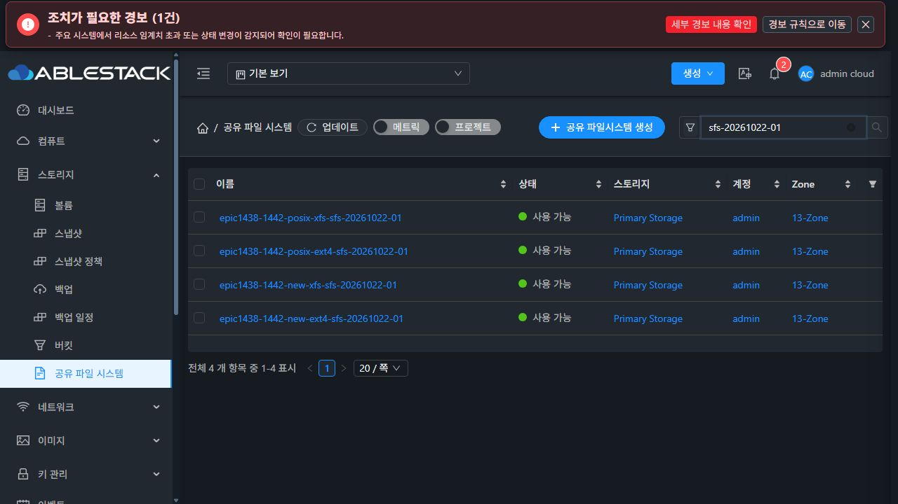
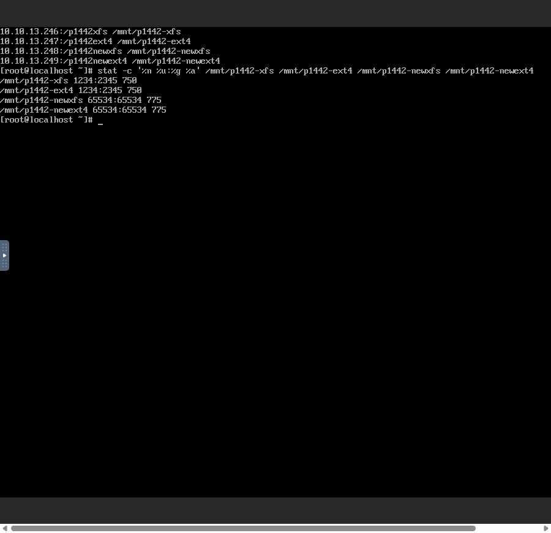
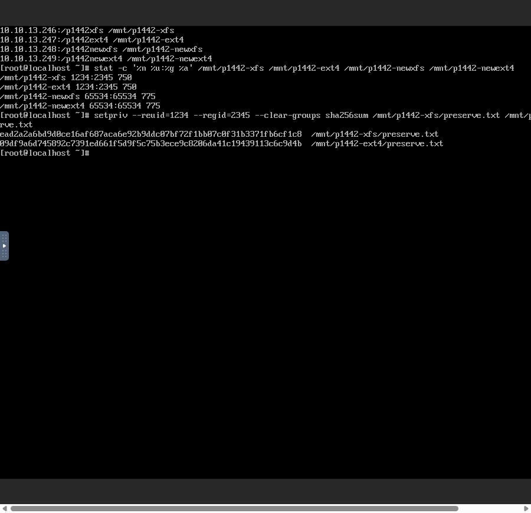
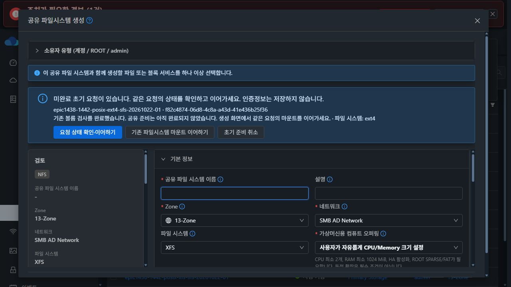
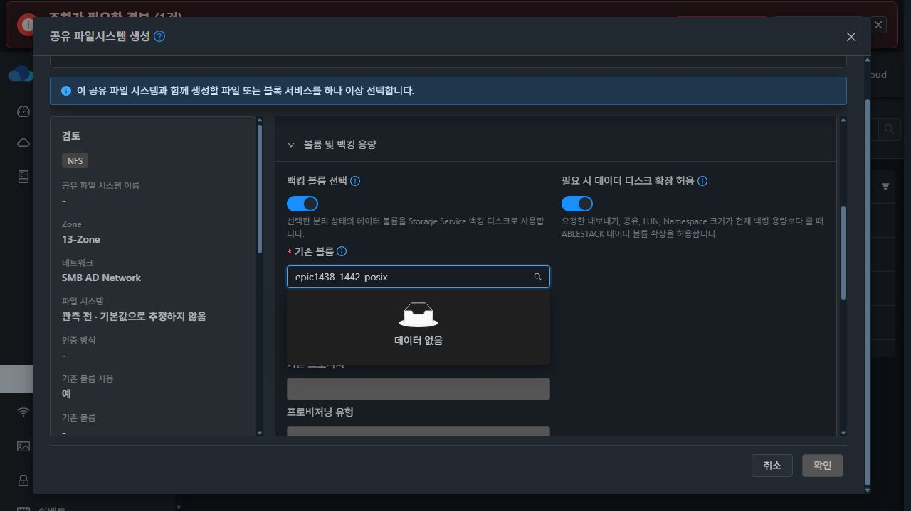

# #1442 기존 볼륨 초기 생성 및 POSIX 보존 최종 검증

**결과: PASS. 구현·모듈 빌드·13번 배포·실제 UI/클라이언트 인수를 완료했다.** #1442 종료 근거이며 Epic #1438 전체 완료·병합 승인이나 NFS ACL, 백업/복원 인수를 뜻하지 않는다.

## 변경 범위

제품 구현 commit **15ea52315437ea24dcd09148bfe31401e35d1fd7**. 작업 브랜치 epic/1438-sharedfs, local Europa/upstream 기준 0e6b5093d51079f0cfd9bfc88b6e37a795be55a3 (착수 fetch 후 0 0). 이전 생성 분리·journal 보완 위에 다음 최소 수정을 적용했다.

- 기존 볼륨을 사용한 초기 NFS 요청에만 optional initialcreationrequestid를 전달한다. 서버가 원래 SharedFS의 Ready journal, 같은 요청·DATA, MOUNT_EXISTING 요청, 최초 NFS인지를 검사한다.
- 이 경로만 PRESERVE_EXISTING_INITIAL을 저장한다. UID/GID/mode와 재귀 권한 변경을 초기 요청에 섞으면 거부한다. Root Squash·익명 매핑은 유지하며 생략된 소유자·모드를 합성하지 않는다.
- guest가 supportsInitialPosixPreservation을 실제 inspect 결과에 반환해야 NFS apply를 진행한다. 구 guest에는 위험한 기본값으로 fallback하지 않는다.
- 신규 볼륨과 이후 일반 수동 공유는 기존 ANONYMOUS_WRITE 기본값 65534:65534/0775를 유지한다. 명시적 권한 변경과 기존 확인·보호 절차를 해제하지 않았다.
- API command / server manager / guest storagectl / SharedFS 생성·NFS 폼 및 해당 회귀 시험만 변경했다. 공통 Volume, ACL, 백업/복원, 최종 UI 정리로 확장하지 않았다.

## 빌드와 배포

- Backend 관련 11 suites / **119 tests**, 실패·오류·skip 0. 여기에는 **실제 별도 MariaDB에서 SharedFSDao 저장·갱신·재조회 4개**가 포함된다. TEXT 255자 절단 회귀, UTF-8 상한, 손상 행 목록 격리·취소 보호를 포함한다.
- UI **41 tests / 4 suites**, lint와 production build 통과. guest 실제 Python 함수의 tempdir chown/chmod 시험 **4개 통과**, bash 구문 검사 통과. 같은 신규 시험을 수정 전 guest 소스로 실행하면 권한 보존 1개가 실패해 원래 결함을 검출한다.
- Maven 관련 모듈 package 성공. 13번 관리 서버 mold.service 및 UI 배포. 변경 API/manager 클래스 외 fat JAR 93,752 entries byte 동일, 실제 JVM 클래스 검증 통과.
- 설치 JAR SHA-256: **6e22a0e03e63a68f356d4993745dcbf038b8b43ad97cbd6681a8cb3623c7f078**.
- UI 899 files 검증, index SHA-256 **1e87fd0541134f0ef2dec2c5ded05a4d47efdef2eb504a742908011358a6ec79**. config·systemvm 경로 보존, rollback 보관. 이번 POSIX 후속 수정에 추가 DB migration 없음.
- guest 모듈 빌드: 검증된 Europa 기본 이미지의 **usr/local/bin/ablestack-storagectl 한 파일만** 변경했다. 다른 guest 33,922 paths의 내용·모드·소유자와 WSL 호스트 계정 파일의 무결성을 검증했다. OS/package 전체 재빌드라고 표기하지 않는다.
- 압축 이미지 SHA-256 **aa9e627b137bd7b5313cbfb073b4f48490f15fa5df59f7665d07ee2d6143cff7**, storagectl **7bc6d441378cfc57e95cf05faead9c5cee2115eb88a676753ad0d4b15407f489**.
- Mold의 실제 템플릿 등록 UI로 SYSTEM/x86_64/KVM/Debian12/교차 Zone·SHA-256 검증 등록, 사용 가능 확인. 템플릿 **c16a3592-dbab-49ae-8006-5230b4a73898**. 처음 특정 Zone을 입력해 표준 SYSTEM 교차 Zone 검증이 거절한 준비 입력은 교정했다. 제품 코드 결함이나 성공으로 숨기지 않는다. 네 새 VM 모두 이 템플릿과 실제 guest script hash가 일치한다.
- 기존 host agent와 실행 중인 기존 SharedFS guest는 교체·재시작하지 않았다.

## 실제 UI 및 클라이언트 시험

자원 생성·볼륨 보존 분리·SharedFS 생성·검사·마운트 재개·상태 재조회는 **실제 Mold UI**로 했다. 디스크 준비 및 NFS mount/쓰기/읽기/stat/hash는 **새 클라이언트의 Mold noVNC 콘솔**에서 실행했다. 숨은 API/QGA로 준비 상태를 만들거나 기능 단계를 대신하지 않았다. API는 UI 요청의 응답을 관찰했고, DB/QGA/물리 디스크는 사후 읽기 전용 대조에 사용했다.

새 클라이언트 fe723777-4be1-461b-8c8d-7f399d34bc29, i-2-110-VM, 10.10.254.119. 새 SPARSE ROOT 100 GiB와 새 SPARSE DATA 20 GiB 두 개를 UI로 생성했다. DATA 시리얼·크기·미포맷 상태를 확인하고 각 한 번만 XFS/EXT4 포맷했다. 시험 경로·파일의 소유자 1234:2345, 디렉터리 0750, 파일 0640을 만든 뒤 정상 unmount·보존 분리했다. 기존 시험의 변경된 볼륨을 재사용하지 않았고 MAC은 변경하지 않았다.

| 실제 UI 생성 사례 | SharedFS | VM | DATA | 결과 |
|---|---|---|---|---|
| 기존 XFS | 3d2dc764-5b17-49cf-9ae0-cc55bda79891 | 634178d0-3d06-31ec-84d3-9ec113093025 | adfcb5e8-1e32-49ce-9f39-20d7ecf6fafd | Ready, mount·데이터·권한 보존 |
| 기존 EXT4 | 1556abd4-ee34-4378-8ebb-448f7431938d | 38e1cc60-9de7-3241-a62c-ec9aff998d21 | c8aef987-45a4-47aa-a1b9-37ab54c5d629 | 검사→재개·Ready, 데이터·권한 보존 |
| 신규 XFS | 5946ec3f-fe20-4672-98d5-bb4fa6606bd0 | 76c59df9-91c4-3a51-8511-f483a61a3cd8 | ec9641ac-62b3-474e-8f25-38b9f45d48f9 | Ready, 65534:65534/0775 유지·쓰기 성공 |
| 신규 EXT4 | dacd4977-e4b8-47b8-919e-522ba3a5d636 | a14c8a94-8c5c-3675-b036-652cbb92d15a | 3cf2ca0a-b7bb-486f-be93-e62c57ff1039 | Ready, EXT4 의도·기존 기본 권한·쓰기 성공 |

네 서비스의 ROOT/DATA **8개 모두 SPARSE/QCOW2**. 기존 볼륨 분기는 ROOT만 새로 만들고 선택한 DATA를 연결했다. 각 VM은 ROOT 1 + DATA 1이며 추가 bootstrap DATA가 없다. 실제 libvirt XML과 QCOW2 header/virtual size도 읽기 전용 대조했다. 새 클라이언트까지 포함해 THIN을 생성하지 않았다.

### 데이터와 권한 보존

| 기존 볼륨 | 원본 SHA-256 (준비 전/후 동일) | FS UUID (동일) | 디렉터리 / 원본 파일 |
|---|---|---|---|
| XFS | ead2a2a6bd9d0ce16af687aca6e92b9ddc07bf72f1bb07c0f31b3371fb6cf1c8 | f99cf101-0d76-4009-9768-0d0a9a431032 | 1234:2345 / 0750·0640 |
| EXT4 | 09df9a6d745892c7391ed661f5d9f5c75b3ece9c8206da41c19439113c6c9d4b | 7dabd6e5-1c68-44ff-8b23-2894ed1195bf | 1234:2345 / 0750·0640 |

Root Squash를 유지한 채 실제 UID 1234/GID 2345로 원본 읽기와 새 owner-write.txt 쓰기/읽기를 확인했다. 기존 볼륨 ID·pool·path·size·disk offering도 journal의 원래 값과 일치한다. 신규 볼륨 두 경우는 클라이언트 root가 익명 UID/GID로 매핑돼 기존 기본 디렉터리에 쓰기가 성공했다.

### UI 새로고침과 중복 방지

EXT4 최초 create 요청 f82c4874-06d8-4c8a-a43d-41e436b25f36은 INSPECT_ONLY로 실행했다. UI가 관측 ext4·검사 완료/미완료 공유 상태를 표시했다. 같은 키로 MOUNT_EXISTING을 눌러 비동기 job 28e5718d-ba97-4001-8fa6-4327f19d0c53을 받은 직후 **UI 새로고침으로 완료 응답 관찰을 끊었다**.

생성 화면을 다시 열고 ‘요청 상태 확인·이어하기’를 눌렀다. 서버의 같은 VM/DATA/키·READY를 관찰한 뒤 초기 NFS 구성으로 이어졌다. EXT4 initial NFS 요청은 filesystem=ext4, MOUNT_EXISTING, 원래 initialcreationrequestid이며 소유자·mode가 없다. UI 요청은 createSharedFileSystem 1회 + resume 1회 + initial NFS 1회이고 VM·ROOT·DATA·export의 중복이 없다. 이후 생성 후보 UI에서도 두 사용 중 DATA를 검색하면 ‘데이터 없음’, 확인 비활성화다.

이 시험은 **UI 완료 응답 관찰 유실**을 실환경에서 검증한 것이다. 내부 attach/VM 할당/DB commit의 모든 실패 지점을 실환경에 장애 주입했다고 확대하지 않는다. 그 보상·잘못된 identity·기대 FS 불일치·손상 journal 보호는 별도 자동화 회귀 시험의 근거로 구분한다.

### 기존 동작과 범위 보호

비대상 기존 SharedFS 6개의 VM/DATA ID 및 Ready 상태는 UI API 전후 대조에서 동일하다. 이후 일반 수동 NFS 생성 폼은 원래 권한 기본값을 유지하며 제출하지 않고 취소했다. 제한 ACL·SMB/AD·백업/복원이나 #1468 최종 UI는 이번에 개발·검증하지 않았다.

상단 공통 헤더의 클라우드 NIC IP와 실제 서비스 IP의 표시 차이, offering 표시 문구 차이는 기능·데이터 보존을 차단하지 않아 기록만 남겼다. 기존 최종 UI 과제 #1468의 정리 시 참고하며 별도 이슈를 만들거나 이번 범위를 확장하지 않는다. 이전 실패 시험 자원의 수정된 디렉터리 권한을 임의로 되돌리거나 이전 결과를 새 검증 성공으로 재표기하지 않았다.

## 검증 화면

## 근거 파일

[요약](summary.json), [UI 실제 요청·응답](evidence/api-ui-summary.json), [DB 관계·journal·SPARSE](evidence/final-db.json), [guest/물리 읽기 전용 대조](evidence/guest-readonly-after.json), [시험 집계](evidence/test-summary.json), [관리 서버 배포](evidence/management-deployment-receipt.json), [UI 배포](evidence/ui-install-stdout.json), [guest 모듈 빌드](evidence/guest-module-build.json), [이미지 게시](evidence/published-systemvm-template.json), [체크섬](evidence/SHA256SUMS).

추가 자동화 실패 상황은 단위/통합 시험 결과로, 이번 네 사례는 실제 UI 및 콘솔 결과로 구분했다. 저장소 전체 CI·모든 프로토콜·Epic 전체가 통과했다고 주장하지 않는다. 후속 후보 #1443은 착수하지 않는다.
