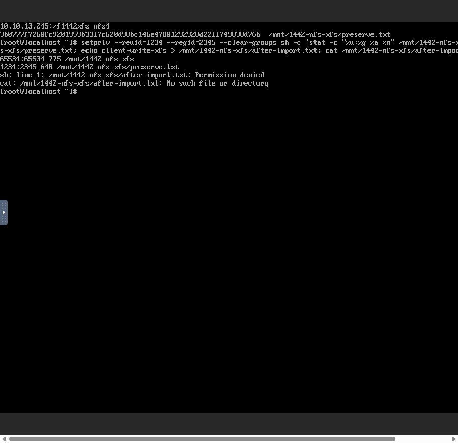

# #1442 생성 기록 수정·13번 배포와 실환경 권한 보존 인수 결과

**생성 기록 JSON 절단·손상 행 목록 차단은 수정·배포·실제 UI 확인을 완료했다. 다만 XFS의 공유 디렉터리 권한 보존 인수에서 실제 변경이 확인돼 기능 작업을 중단했다. #1442는 OPEN이다. EXT4·신규 분기·UI 응답 유실 후 중복 방지의 전체 인수를 완료했다고 주장하지 않는다.**

## 반영된 수정

- 백엔드: `265723427b665eb6a63d6075e82203e2bbb05fc8`.
- 재접속 후 손상 예약 취소 UI: `019bc922012ae7b035b18325533f0581653fc131`.
- local/upstream Europa `0e6b5093d51079f0cfd9bfc88b6e37a795be55a3`, 시작 시 0 0. origin의 `epic/1438-sharedfs`와 Epic Draft PR #1470 사용. 별도 이슈/PR 없음.
- SharedFS VO에 Lob/TEXT/65,535 길이 명시. 직렬화·VO setter에서 UTF-8 바이트 상한 검사. 공통 GenericDao는 변경하지 않았다.
- 잘못된 journal의 목록 응답을 CORRUPT/CREATION_JOURNAL_INVALID로 격리. 자원 작업은 차단하고, VM 미할당·계획 VM 없음·동일 소유자/zone의 Ready 미연결 DATA·다른 consumer 없음이 확인된 예약만 UI에서 취소한다.
- 실제 별도 로컬 MariaDB에서 실제 SharedFSDao persist/findById/update/findById를 거치는 **4개 통합 회귀 시험 모두 통과, skip 0**. 긴 XFS/EXT4 JSON, UTF-8 65,535바이트 경계, 손상 행+정상 행 응답 격리. [재현·범위](dao-test.ko.md).
- 관련 백엔드 **10개 모음 109개**, UI **4개 모음 38개**, 대상 lint, Maven 의존 모듈 포함 package·UI production build 통과. 이 결과를 실환경 데이터 보존 인수의 대체 근거로 삼지 않는다.

## 배포 및 실제 UI에서 확인한 저장 결함 해결

- 관리 서버 JAR SHA-256: `a8c66c52cf52f990206c56eab2fde8ac4a858dc0574ca3eacaf7fd8a725b7782`, mold PID 3024642 active. 비대상 JAR 93,750개 항목 바이트 보존 확인.
- UI commit 019bc922012 / 899개 파일 대조 배포. index `40ff9382dc86b9ee4308ce52919e000ab2ac2c00a2c7a850b95c904a965f8891`.
- 관리 config 원문·실경로와 systemvm 디렉터리 inode 유지. guest/template/host agent는 이번 수정에서 변경하지 않았다. journal schema는 기존 nullable 2컬럼과 owner/request 고유 인덱스를 그대로 사용하며 추가 DDL 없음.
- **손상된 255자 JSON을 그대로 둔 상태에서 실제 UI 목록 HTTP 200·7개 행**(기존 6개+CORRUPT 1개)을 확인했다.
- 실제 UI에서 손상 행 `64305194-2694-4e90-9bb2-afe487891342`의 “초기 준비 취소” 실행. job `cb5bbc96-1e69-4c32-8385-a345e8dc3368` 성공. VM/DATA 삭제 없이 volume 참조 NULL, CANCELLED/valid JSON 208바이트로 남았다.
- 새 XFS 생성 요청의 생성 기록은 **718바이트·JSON_VALID=1·phase READY**다. 원래 255자 절단은 재발하지 않았다.

## 실제 XFS 생성·연결·마운트

원본 DATA는 직전 동일 #1442 시험에서 UI와 VM 콘솔로 새로 준비한 20 GiB SPARSE 볼륨이다. 다른 Epic/오래된 클라이언트나 MAC 변경은 사용하지 않았다.

| 자원 | 값 |
|---|---|
| SharedFS | 5fd41a4d-5778-4c09-911a-557d12b618ab / epic1438-1442-xfs-20261022-01 |
| 생성 요청 | 96b54dbf-eda7-4339-bbb5-77edb26a2bb2 |
| VM / 실제 host | 0685be9d-b958-3d2a-a9ef-9e53a7c9ba07 / i-2-109-VM / 10.10.13.3 |
| 새 ROOT | ae63d90a-7996-4f8d-80e0-b9b92b852f99 / 5 GiB / SPARSE |
| 기존 DATA | 124a8aa7-18d6-47cb-bc7a-188ff3dc79f6 / 20 GiB / SPARSE |
| 실제 XFS UUID | f6b2849b-3c7c-4bf2-9789-0df8a519028b |
| 실제 mount | /dev/sdb → /srv/ablestack-storage/volumes/124a8aa7-18d6-47cb-bc7a-188ff3dc79f6 |
| NFS/클라이언트 | 10.10.13.245:/f1442xfs / b7cafa18-d952-4579-98f8-9d913d67a7fc (10.10.254.200) |

UI의 실제 createSharedFileSystem 요청에 기존 volumeid/importmode=MOUNT_EXISTING/filesystem=AUTO/requestid가 있고 신규 diskofferingid/storageid/size/IOPS가 없었다. VM/SharedFS Ready, 원래 pool/path/offering/20 GiB/FS UUID 보존, ROOT 1개+선택한 DATA 1개를 확인했다. 초기 bootstrap DATA는 추가하지 않았다. libvirt XML도 같은 두 디스크/serial이다. 이는 정상 한 번의 할당 관측이며, 전체 응답 유실 재개 인수를 통과했다는 뜻은 아니다.

## 시험 설정 교정과 실제 실패의 구분

처음 제가 초기 NFS에 클라이언트 전용 `10.10.254.200/32` ACL을 추가했다. 이는 #1440 조사에서 이미 볼륨 이슈 범위 밖으로 분리한 로컬 NFS visibility probe 제약을 다시 시험한 범위/사전 점검 실수였다. 서버 로컬 주소가 이 ACL에 없어서 host-selection 530이 발생했다. 관련 ACL 코드는 고치지 않았다.

새 시험 서비스에 제가 넣은 해당 ACL과 Error 상태의 시험 내보내기 설정만 실제 UI로 취소하고 **기본 NFS 설정**으로 재구성했다. deleteStorageNfsExport는 설정/규칙 제거와 desired state 적용만 하며 DATA 삭제/format API를 호출하지 않는다. 기존 DATA와 경로는 그대로 사용했다. Root Squash를 끄거나 POSIX 값을 수동 변경하지 않았다. UI의 CURRENT 볼륨 생성 폼은 UID/GID/mode가 비어 있었고 실제 요청/설정에도 ownerUid/ownerGid/mode가 없었다. NFS 생성 job `78c6e6e3-338a-4489-b1af-c46aa1825a16`은 성공/Ready다.

이전 오류 알림이 버튼을 가린 점, 콘솔 명령의 timeout 및 Caps Lock/터미널 전환 문제도 자체 교정했다. 이를 제품 결함으로 분류하지 않는다. 서버 IP와 DB 주 IP가 다른 경고·마운트 경로/권장 POSIX 표시 차이는 기록만 남기고 최종 UI #1468에서 정리할 항목으로 둔다.

그 뒤 실제 UI 콘솔에서 NFS 마운트가 성공했으며 아래의 **별도 실제 권한 보존 결함**을 확인한 시점에 추가 기능 작업을 중단했다.

## 새로 확인한 실제 결함과 정확한 영향

| 항목 | 연결 전 콘솔의 기준 | 연결 후 실제 NFS 클라이언트 및 guest stat |
|---|---|---|
| 공유 디렉터리 UID:GID | 1234:2345 | **65534:65534** |
| 공유 디렉터리 mode | 0750 | **0775** |
| preserve.txt UID:GID / mode | 1234:2345 / 0640 | 1234:2345 / 0640 |
| preserve.txt SHA-256 | 3b0777f7260fc9201959b3317c620d98bc146e47801292928d2211749838d76b | 동일 |
| 원래 소유자(UID 1234)의 새 파일 쓰기 | 디렉터리 소유자 권한으로 가능해야 함 | **Permission denied** |

클라이언트 작업은 실제 Mold VM 콘솔에서 했다. 실패 후 QGA는 **읽기 전용 진단**으로 stat/sha256sum/findmnt와 실행 파일 해시를 읽는 데만 사용했다. guest에서도 같은 UID/GID/mode 변경, 원본 파일·FS UUID 보존이 확인됐다. 파일시스템을 다시 포맷하지 않았고 수동 chown/chmod로 시험을 통과시키지 않았다. 새 파일 after-import.txt는 생성되지 않았다.

현재 XFS DATA의 시험 공유 디렉터리 권한은 변경된 상태로 보존했다. 원본 파일의 내용·소유권·권한은 위 검증 범위에서 유지되지만, **디렉터리 권한 보존은 실패했다**. 데이터 전체가 완전히 무변경이라고 표현하지 않는다.

### 원인 — 초기 inspect 이후 NFS 적용까지 보존 의도가 전달되지 않음

- 이번 구현의 StorageServiceManagerImpl.createStorageNfsExport는 imported primary에서 `buildNfsConfigJson(..., applyWritableRootSquashDefaults=false)`로 추천 POSIX 값 삽입을 생략했다. 실제 저장된 raw NFS config에도 ownerUid/ownerGid/mode가 없다.
- 그러나 현재 guest `ablestack-storagectl`의 `effective_nfs_export_config`(3421–3443)는 read-write+Root Squash이면 생략된 ownerUid/ownerGid/mode를 다시 **65534/65534/0775**로 채운다.
- NFS 적용 루프(4397–4413)가 이 유효 설정을 `apply_posix_permissions`에 전달하고, 4371/4373에서 실제 os.chown/os.chmod를 실행한다. recursivePermission=false이므로 이번에 확인한 변경은 해당 공유 디렉터리다.
- 실행 guest 파일 SHA-256 `c48dea1de2a4637292a26185af18a0bcd8aa6a1105a41269e92df371c107ca27`는 현재 소스/직전 설계 조사와 같다. 기존 신규 볼륨의 자동 권한 초기화 동작을 변경하지 않은 채 기존 볼륨 가져오기에 그대로 적용한 **이번 기능의 계층 간 계약 누락**이다.
- “guest 변경 없이 안전 payload만으로 가능”이라는 착수 설계는 **초기 volume inspect/mount에는 맞지만 최종 NFS apply까지는 충분하지 않았다**. 해당 가정을 수정해야 한다. 실제 DAO 회귀 시험은 journal 저장 경계를 검증하며 guest의 NFS 권한 적용을 대체하지 않는다.

## 필요한 다음 수정안 — 아직 적용하지 않음

1. imported primary의 NFS config/desired state에 기존 `posixPolicy` 필드를 사용한 명시적 **PRESERVE_EXISTING 의도**를 저장·전달한다. 신규 볼륨의 ANONYMOUS_WRITE 초기화는 유지한다.
2. backend와 guest 기본값 계산이 이 정책을 존중하도록 한다. Root Squash와 익명 UID/GID 매핑은 유지하면서 **ownerUid/ownerGid/mode를 자동 합성하지 않는다**. 생략된 POSIX 필드는 실제 chown/chmod를 유발하지 않아야 한다. 명시적 권한 변경에는 기존 보호를 유지한다.
3. UI의 effectiveNfsExportConfig와 편집 폼도 같은 정책을 존중해 권장값을 실제 소유권으로 만들거나 무변경 제출에 포함하지 않도록 한다. 최종 UI 레이아웃 작업으로 범위를 넓히지 않는다.
4. 실제 guest NFS 함수의 “유효 설정 계산→POSIX 적용”을 임시 디렉터리에서 실행하는 시험을 추가한다. 기존 볼륨의 1234:2345/0750 보존, 신규 볼륨의 종전 초기화, 명시적 변경 보호를 함께 확인한다.
5. guest 변경이 필요하므로 관리 JAR/UI만 바꿔 완료로 삼지 않는다. 관련 SystemVM/guest 산출물을 정식 빌드·배포하고 실행 파일 해시를 확인한다. 새 SPARSE 시험 DATA에 권한 기준선을 만들고 새 ROOT-only 서비스에서 XFS·EXT4 전체 UI/클라이언트 인수를 다시 수행한다.

## 완료·미완료 경계

- 완료: JSON 절단 수정·실제 DAO 저장/재조회 회귀·빌드/13번 배포·손상 행을 남긴 정상 목록·UI 취소·XFS 생성/연결/mount·파일 내용 보존.
- 실패: 기존 XFS 공유 디렉터리의 소유권·권한 보존 및 해당 소유자의 쓰기.
- 미진행: EXT4 연결/mount/클라이언트 보존, INSPECT_ONLY→마운트 UI 이어하기, 신규 XFS/EXT4 실환경 회귀, UI 응답 유실 후 중복 생성 방지의 전체 인수.
- 기존 6개 SharedFS Ready 및 VM/DATA 관계 유지. EXT4 DATA 213c0fe3-30f4-4412-b433-52c23e416393는 Ready·SPARSE·미연결 상태다. 기존 6개 서비스 전체의 클라이언트 I/O를 새로 검증한 것으로 표현하지 않는다.
- 별도 이슈를 만들거나 #1443으로 넘어가지 않는다. **#1442 OPEN, Epic PR #1470 Draft 유지.** 권한 보존 결함 확인 후에는 읽기 전용 진단·기록만 수행했다.

