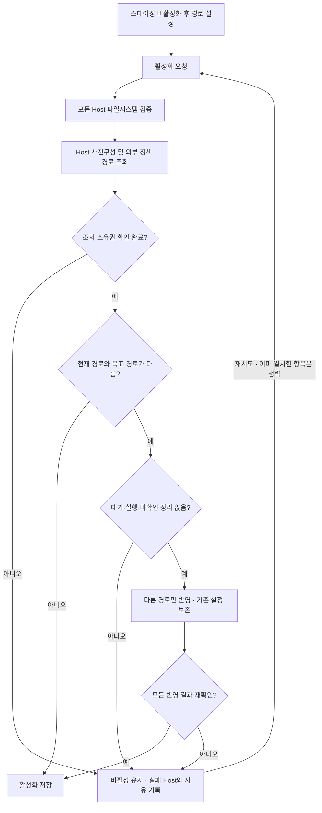
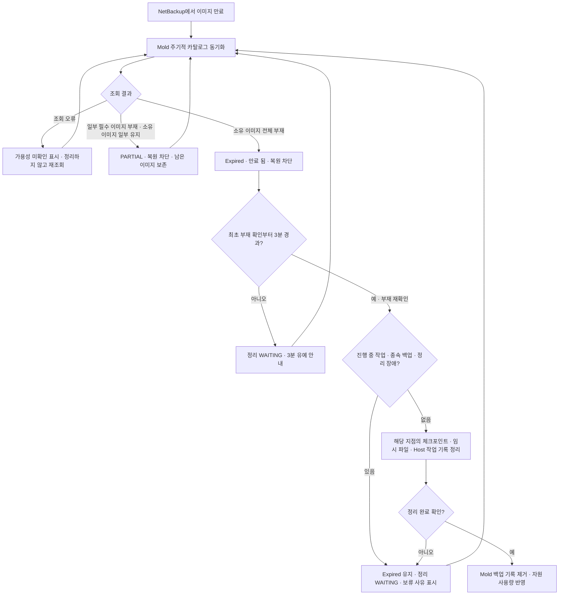
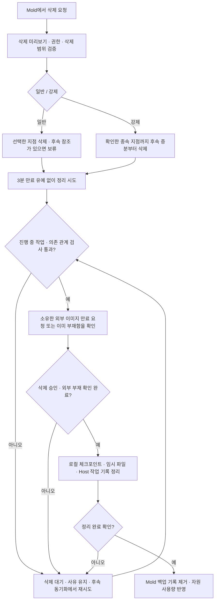
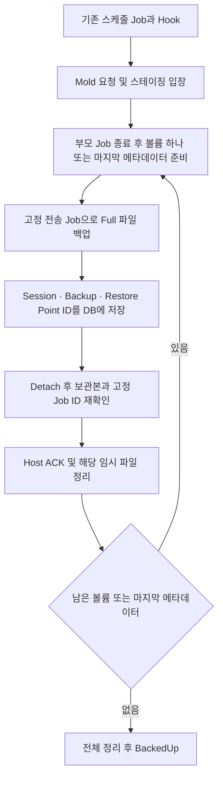

<!--
Licensed to the Apache Software Foundation (ASF) under one
or more contributor license agreements. See the NOTICE file
distributed with this work for additional information
regarding copyright ownership. The ASF licenses this file
to you under the Apache License, Version 2.0 (the
"License"); you may not use this file except in compliance
with the License. You may obtain a copy of the License at

  http://www.apache.org/licenses/LICENSE-2.0

Unless required by applicable law or agreed to in writing,
software distributed under the License is distributed on an
"AS IS" BASIS, WITHOUT WARRANTIES OR CONDITIONS OF ANY
KIND, either express or implied. See the License for the
specific language governing permissions and limitations
under the License.
-->

# ABLESTACK 백업 및 복원 운영 안내

이 문서는 인프라 담당자가 ABLESTACK 백업 환경을 구성하고 백업·복원을 운영하기 위한 안내다.
설정 범위와 권장 기준, 솔루션별 구성 순서, 백업·복원 흐름과 장애 대응 절차를 설명한다.

## 목차

- [운영자용 백업 구성 요약](#운영자용-백업-구성-요약)
- [설정 범위와 상속](#설정-범위와-상속)
- [공유 볼륨 백업 제한](#공유-볼륨-백업-제한)
- [GFS2 RAW 정지 상태 FULL 백업](#gfs2-raw-정지-상태-full-백업)
- [배포 정책을 보존하는 백업·복원](#배포-정책을-보존하는-백업복원)
- [스테이징 파일시스템별 외부 솔루션 설정](#스테이징-파일시스템별-외부-솔루션-설정)
- [LOCAL 마운트 및 디렉터리 모드](#local-마운트-및-디렉터리-모드)
- [공통 스테이징 경로 변경](#공통-스테이징-경로-변경)
- [볼륨별 스테이징과 VM 일시정지 옵션](#볼륨별-스테이징과-vm-일시정지-옵션)
- [백업 솔루션별 준비와 실행 순서](#백업-솔루션별-준비와-실행-순서)
- [NetBackup VM별 스케줄 구성 예시](#netbackup-vm별-스케줄-구성-예시)
- [NetBackup 백업 파일 만료 시 참고사항](#netbackup-백업-파일-만료-시-참고사항)
- [NetBackup 논리 백업과 카탈로그 매칭 확인](#netbackup-논리-백업과-카탈로그-매칭-확인)
- [Veeam 보존기간과 백업 삭제](#veeam-보존기간과-백업-삭제)
- [Veeam 고정 Host 전송 Job의 동작](#veeam-고정-host-전송-job의-동작)
- [Veeam 고정 Job 잠금과 소유 기록](#veeam-고정-job-잠금과-소유-기록)
- [Veeam 13.0 VM별 스케줄 구성 예시](#veeam-130-vm별-스케줄-구성-예시)
- [Veeam Job 이름과 길이 제한](#veeam-job-이름과-길이-제한)
- [NetBackup·Veeam 사전 구성 파라미터 비교](#netbackupveeam-사전-구성-파라미터-비교)
- [Full 및 증분 백업 운영](#full-및-증분-백업-운영)
- [작업 상태와 제어](#작업-상태와-제어)
- [공통 잠금과 예약의 구현](#공통-잠금과-예약의-구현)
- [백업 장애 대응](#백업-장애-대응)
- [복원 절차](#복원-절차)
- [임시 파일 정리와 실패한 백업 삭제](#임시-파일-정리와-실패한-백업-삭제)
- [NetBackup 및 Veeam 서비스 운영](#netbackup-및-veeam-서비스-운영)
- [NetBackup 및 Veeam 인증정보 관리](#netbackup-및-veeam-인증정보-관리)
- [Veeam Host 구성과 배포](#veeam-host-구성과-배포)

## 공유 볼륨 백업 제한

컴퓨트 오퍼링 또는 연결된 볼륨의 디스크 오퍼링에 `shareable=true`가 설정되어 있으면 VM 백업을 지원하지 않는다.
컴퓨트 오퍼링의 공유 옵션은 연결된 OS 디스크용 디스크 오퍼링에서 확인하고, 실제 OS·데이터 볼륨의 오퍼링도 각각 검사한다.
한 개의 공유 볼륨만 포함되어도 전체 VM의 백업과 스케줄 등록·실행을
`BACKUP_SHARED_VOLUME_UNSUPPORTED`로 차단한다. 백업 오퍼링 할당에도 같은 검사를 적용한다.
VM 정지 여부, 실제 연결 VM 수, RAW/QCOW2 형식, GFS2/RBD/NFS 저장소에 관계없이 적용한다.
삭제된 오퍼링도 정의를 조회해 검사하며, 참조한 오퍼링을 확인할 수 없으면 `BACKUP_SOURCE_UNKNOWN`으로 중단한다.
공유 저장소를 사용하는 일반 볼륨은 이 제한에 해당하지 않는다.

## GFS2 RAW 정지 상태 FULL 백업

대상은 GFS2 파일시스템 내부의 RAW 이미지 파일을 VM에 연결하는 구성이다.
파일명은 볼륨 UUID일 수 있으므로 확장자로 RAW 여부를 판단하지 않는다.
LV·SAN LUN을 VM에 직접 연결하는 구성은 이 지원 범위에 포함하지 않는다.
Mold NAS(`ablestack-nas`), Commvault, NetBackup, Veeam에 공통으로 적용한다.
아래 경로는 공유 옵션이 비활성화된 볼륨에 적용하며, 공유 옵션이 활성화된 VM은 위의 공통 검사에서 먼저 차단한다.

**GFS2 RAW가 하나라도 포함된 VM은 모든 연결 VM이 정지한 경우에만 독립 FULL 백업을 생성한다.**
`kvm.incremental.backup=true`, 체인 길이 8이어도 RAW 포함 VM은 매번 부모 없는 FULL로 처리한다.
RAW 증분 요청은 `GFS2_RAW_INCREMENTAL_UNSUPPORTED`로 거절한다.
QCOW2 파일로 변환하더라도 원본 RAW에 대한 변경 추적이 생기는 것은 아니므로 checkpoint·bitmap 증분을 사용하지 않는다.

처리 순서:

1. 디스크 오퍼링의 공유 설정과 `(poolId, path)`가 같은 볼륨 연결을 모두 확인한다.
   공유 설정이 false여도 실제 연결은 확인한다. VM·볼륨·Host 상태를 확인할 수 없으면 시작하지 않는다.
2. 동일한 GFS2 클러스터의 모든 Host Agent에서 실행·일시정지된 VM의 실제 디스크 사용 여부와 형식·크기를 확인한다.
   현재 오프라인 경로에서는 해당 VM의 모든 디스크가 같은 클러스터의 GFS2 파일이어야 한다. RBD/NFS와 혼합된 VM은 차단한다.
3. 관리 서버에 디스크 소유 정보를 기록하고 공유 파일시스템에 보호 마커를 생성한다.
   GFS2의 클러스터 POSIX 잠금을 사용하므로 `localflocks` 마운트는 허용하지 않는다.
   보호 기간에는 관련 VM 시작, 디스크 연결·해제와 디스크 경로 변경을 차단한다.
4. 원본을 변경하지 않고 `qemu-img convert`로 독립 파일을 만든 뒤 종료 코드·형식·가상 크기·독립 이미지 여부와 쓰기 반영을 확인한다.
   백업마다 원본·대상 전체 내용을 다시 읽는 `qemu-img compare`는 실행하지 않는다.
   **원본 RAW는 RAW로, 원본 QCOW2는 독립 QCOW2로 보관한다.** RAW를 QCOW2로 강제 변환하지 않는다.
   RAW 예시는 다음과 같다. `-S 4k`는 0인 영역을 sparse로 저장하는 옵션이며 증분을 의미하지 않는다.

   ```bash
   qemu-img convert -p -f raw -O raw -S 4k <원본 RAW> <스테이징 RAW>
   ```

5. 외부 솔루션은 기존처럼 볼륨별 파일을 전송하고, 마지막으로 매니페스트·VM 구성·완료 마커를 저장한다.
   NAS는 저장소에 독립 파일과 완료 마커를 저장한다.
   정지 후 libvirt 정의가 제거된 VM은 Mold에 저장된 구성과 UUID를 사용한 식별용 `domain-config.xml`을 남긴다.
   이 파일에는 `bootable=false`인 오프라인 구성임을 표시한다. 실제 VM 구성 재생성과 복원은 Mold가 저장된 백업 상세로 처리한다.
   NAS의 단계는 `PREPARING` → `RAW_COPY`(QCOW2 디스크는 `QCOW2_COPY`) → `FINALIZING` → `COMPLETED`로 표시한다.
   복사 진행률은 `qemu-img convert -p` 결과를 각 볼륨의 가상 크기로 가중하여 전체 5~95%에 반영하고 볼륨 번호도 표시한다.
   완료 후처리는 99%, 작업 성공 확인 후 100%로 표시한다. 실행 Host의 Agent와 `ablestack_shared_raw.py`를 함께 갱신해야 한다.
   RAW 복사 중에는 취소할 수 있고 시작 시 지정된 대역폭 제한을 적용한다. 실행 중 대역폭 변경 메뉴는 제공하지 않는다.
   `FINALIZING` 또는 Host 작업 완료 후에는 취소·대역폭 변경 메뉴를 숨기고 서버에서도 거절한다.
6. 백업 성공 또는 실패 정리가 확인된 뒤 보호를 해제한다.
   실행 프로세스·고아 reader가 남았거나 정리가 확인되지 않으면 보호를 유지하고 재시도한다.
   관리 서버를 재시작해도 소유 정보는 유지한다. 보호 파일을 임의로 지우지 않는다.

공유 파일 보호의 전체 계획은 `backup_details`에 보관하고, 255자로 제한된 `storage_pool_details`에는 작업 식별자와 계획 해시만 저장한다.
기존 전체 JSON이 정확히 255자로 잘린 기록은 백업·작업·Host·작업 종류와 원문의 접두부가 일치하고 Host 해제도 확인된 경우에만 정리한다.
전체 JSON 원문이 남아 있는 구형 기록도 지원하며, 다른 작업의 소유정보는 해제하지 않는다.

RAW 파일은 sparse여도 논리적 크기가 원본 가상 용량과 같을 수 있다.
외부 솔루션의 sparse 처리에 따라 실제 전송량이 달라지므로 대용량 VM은 전송량·백업 시간·복원 시간을 함께 측정한다.
복원 시에는 RAW 입력을 처리하고, 기존 공유 RAW 디스크에 덮어쓸 때도 모든 연결 VM이 정지했는지 다시 확인한다.
임시 대상 생성·할당 정책 적용·데이터 검증·원본 교체 작업은 RAW 보관 여부와 관계없이 필요하다.

### RAW FULL 스케줄 유지 개수

스케줄의 **유지 항목 수(`maxbackups`)** 는 RAW의 독립 FULL 개수에 적용한다.
전역 증분 설정이 true여도 RAW 백업은 서로 부모·자식 의존성이 없으므로 FULL 하나가 유지 항목 하나다.

- 유지 개수 2: 세 번째 FULL이 **성공한 뒤** 가장 오래된 FULL을 삭제하고 최근 두 개를 유지한다.
- 세 번째 백업이 대기·진행 중이거나 실패했다면 기존 정상 FULL 두 개를 유지한다.
- NetBackup·Commvault·Veeam에서는 해당 FULL에 속한 볼륨 보관본과 마지막 metadata 보관본을 모두 삭제 대상으로 처리한다.
  NAS는 해당 백업 디렉터리를 삭제한다.
- 외부 만료가 지연되거나 삭제 확인에 실패하면 정리를 보류하고 백그라운드에서 재시도한다. 관리 서버 재시작 후에도 재시도한다.
- 유지 개수 0은 스케줄 개수에 따른 자동 삭제를 사용하지 않는다는 뜻이다.
  외부 솔루션 자체의 보존 기간·만료 설정은 별도로 적용된다.

GFS2 클러스터에 필요한 디스크 검사를 지원하지 않거나 검사할 수 없는 Host가 있으면 백업을 시작하지 않는다.
기존 GFS2 QCOW2·RBD RAW의 온라인 FULL·증분 백업은 해당 경로를 유지한다.

## 배포 정책을 보존하는 백업·복원

GFS2 RAW는 위의 정지 상태 FULL 조건을 적용하고, 할당 정책은 다음 조합을 지원한다.

- GFS2 RAW: `off`, `falloc`, `full`
- GFS2 QCOW2: `metadata`, `falloc`, `full`
- RBD RAW: `off`, `full`

백업에는 원본 볼륨의 실제 형식과 볼륨에 고정된 할당 정책을 함께 기록한다.
스테이징 파일은 전송용 데이터이므로 원본의 선할당 상태를 그대로 복제할 필요는 없다.
`Full / INCREMENTAL` 백업 유형은 `full` 할당 정책과 별개다.

복원 시 기존 볼륨은 해당 볼륨에 고정된 정책을 사용한다.
새 볼륨을 복원하는 경로는 선택한 디스크 오퍼링의 정책을 요청 시점에 고정한다.
관리 서버가 정책을 Host에 전달하기 전에 새 프로토콜과 정확한 복사 방식의 지원 여부를 확인한다.
호환되지 않는 Agent에는 신규 정책 복원을 요청하지 않는다.

복원은 다음 순서로 처리한다.

1. Full·증분 체인을 임시 볼륨에 모두 적용한다. 기존 볼륨은 유지한다.
2. 복원된 데이터를 지정한 정책으로 생성한 별도 볼륨에 복사한다.
   GFS2는 형식에 따라 RAW `off / falloc / full`, QCOW2 `metadata / falloc / full`을 구분하고,
   RBD `full`은 thick 할당 후 할당 상태를 유지하는 복사를 수행한다.
3. 디스크 형식·가상 크기·데이터 일치 여부와 실제 할당 결과를 검증한다.
4. 모든 대상 볼륨이 검증된 뒤 원본과 교체한다. 실패하면 원본을 복구하고 해당 작업 소유의 임시 볼륨을 정리한다.
5. 교체 완료가 기록된 작업의 검증 결과만 Mold 볼륨 상세에 저장한다.
   과거 생성 시점의 검증 결과를 새 복원 결과로 재사용하지 않는다.

신규 정책을 적용할 볼륨은 체인 복원용 임시 볼륨과 정책 적용용 볼륨의 공간을 함께 예약한다.
두 볼륨의 크기가 같으면 **대상 크기의 두 배와 여유 공간**이 필요하다. 기존 정책의 볼륨은 기존 공간 계산을 유지한다.
외부 백업의 스테이징은 기존처럼 볼륨 파일 하나씩 처리한다.
기본스토리지와 스테이징이 같은 파일시스템이면 두 예약을 합산한다.

기존 `thin / sparse / fat` 볼륨과 정책 정보가 없는 구형 백업은 기존 경로를 유지한다.
신규 `falloc`과 `full`은 호환용 `fat` 컬럼만으로 판단하지 않으며 별도 계약 값을 전달한다.
실제 GFS2·Ceph 환경에서는 대상 볼륨의 형식·할당 정책과 복원에 필요한 여유 공간을 확인한다.

## 운영자용 백업 구성 요약

이 절은 백업 기능을 사용하는 인프라 관리자를 위한 안내다.
Provider는 Mold가 사용할 백업 연동 종류이며, 아래의 `ablestack-*` 이름을 설정한다.
백업 오퍼링은 VM에 연결하는 백업 정책이다. 스테이징은 외부 백업 솔루션으로 보내기 전에
백업 파일을 잠시 두는 저장 공간이며, 장기 보관용 백업 저장소와 역할이 다르다.

### 설정 범위와 상속

공통값은 Global에서 설정한다. Zone·Cluster에 별도 값이 없으면 Global을 상속하며,
별도 값이 있으면 그 범위의 값이 우선한다. 같은 값을 두 범위에 중복 입력할 필요는 없다.
다만 백업 프레임워크는 Global 활성화도 필수이므로 Zone만 `true`로 바꿔서는 전체 기능을 활성화할 수 없다.

| 설정 | 범위 | 적용 기준 |
| --- | --- | --- |
| `backup.framework.enabled` | Global 기본 · Zone 재정의 | 기본 `false`. Global을 `true`로 설정하고 Zone의 유효값도 확인. 변경 후 관리 서버 재시작 |
| `backup.framework.provider.plugin` | Global 기본 · Zone 재정의 | 기본 `ablestack-nas`. 기존 목록에 사용할 `ablestack-*` 연동 추가. Zone에 별도 목록이 있으면 그 목록이 우선 |
| `backup.plugin.netbackup.url`, `backup.plugin.netbackup.apikey` | Global 기본 · Zone 재정의 | NetBackup Primary 주소·키. Zone마다 서버·키가 다를 때만 별도 설정 |
| `backup.plugin.netbackup.request.timeout`, `backup.plugin.netbackup.recovery.job.timeout` | Global 기본 · Zone 재정의 | 각각 REST 요청 대기와 구형 동기 복구 대기. 현재 볼륨 데이터 단계 제한과 구분 |
| `backup.plugin.netbackup.vm.schedule.enabled` | Global | 기본 `true`. 모든 Zone의 NetBackup 정책에 공통 적용. 모드 변경 전 유휴·정책 비활성 조건 확인 |
| `backup.plugin.netbackup.hook.timeout` | Global | 기본 `86400`초. 새 PRE·POST 호출 및 관리 대상 Client의 notify/read 설정 동기화에 사용 |
| `kvm.incremental.backup` | Global 기본 · Cluster 재정의 | 기본 `true`. VM의 ROOT 볼륨이 속한 Cluster의 유효값 사용. 변경 후 관리 서버 재시작 |
| `kvm.backup.chain.size` | Global | 기본 `8`: Full 1개와 후속 증분 최대 7개로 구성된 체인 |
| `backup.thirdparty.staging.*` | Global | Commvault·NetBackup·ABLESTACK Veeam 공통. 이름에 Host·Cluster가 포함된 동시 실행 설정도 Global에 저장 |
| `backup.data.operation.timeout`, `backup.qos.bandwidth.limit.mbps` | Global | 공통 데이터 처리 제한과 지원되는 복사의 대역폭 제한. 솔루션·단계별 적용은 아래 설명 참고 |
| `netbackup.prepared.restore.path.ready.timeout` | Global | 준비된 복원 경로·필수 파일의 가시성 확인 대기. 볼륨 복원 전체 제한이 아님 |
| `backup.enable.attach.detach.of.volumes` | Global | 기본 `false`. 백업 오퍼링이 할당된 VM의 일반 볼륨 연결·분리 허용 여부 |

Zone 화면에 Global과 같은 값이 보인다는 이유만으로 Zone에 별도 값이 저장됐다고 판단하지 않는다.
Host 백업 연동 UI의 **현재 값의 출처**와 그 출처의 적용값을 함께 확인한다.
NetBackup UI·비상용 `--host-only`는 공통 설정을 읽고 유지하며 Zone·Cluster 값을 자동으로 추가하지 않는다.
`--host-only` 없는 NetBackup 기존 CLI와 Veeam 구성 CLI는 설정을 변경할 수 있으므로 해당 절차와 구분한다.

### VM 스토리지와 스테이징 스토리지 구분

| 구분 | 종류 | 운영자가 확인할 내용 |
| --- | --- | --- |
| VM 기본스토리지 | RBD | VM 디스크가 Glue RBD 이미지로 저장된다. 백업할 시점의 데이터를 읽어 파일로 내보낸다. 원본 VM 디스크를 Host에 별도 마운트할 필요는 없다. |
| VM 기본스토리지 | QCOW2, GFS2 환경 등 | VM 디스크가 QCOW2 파일로 저장된다. 해당 시점의 디스크 데이터를 백업 파일로 복사한다. |
| 공통 스테이징 | GFS2 | Host에서 사용하는 GFS2 경로를 지정한다. 기본스토리지 경로인 `/mnt/glue-gfs`도 사용할 수 있다. |
| 공통 스테이징 | NFS | NFS 서버의 공유 경로와 Host의 마운트 경로를 지정한다. |
| 공통 스테이징 | LOCAL | 기본 `MOUNT`는 별도 디스크의 마운트 경로를 지정한다. 명시적 `DIRECTORY`는 기존 로컬 파일시스템의 일반 디렉터리를 사용한다. 각 Host에 경로와 용량을 준비한다. |

RBD VM도 NFS 또는 GFS2 스테이징을 사용할 수 있다.
스테이징 종류를 VM 기본스토리지의 종류와 동일하게 맞출 필요는 없다.
현재 공통 스테이징은 파일시스템 경로를 사용하며, 스테이징용 RBD 이미지를 생성·map하는 방식은 사용하지 않는다.

### 솔루션과 VM 스토리지별 백업 방식

| 백업 솔루션 | VM 스토리지 | Full 백업 | 증분 백업 | 최종 보관 위치 |
| --- | --- | --- | --- | --- |
| `ablestack-nas` | RBD | 백업 시점의 전체 디스크를 NAS에 직접 내보낸다. | 이전 백업 시점 이후 변경된 데이터를 NAS에 직접 내보낸다. | Mold에 등록한 NAS 백업 저장소 |
| `ablestack-nas` | QCOW2 | 전체 디스크 백업 파일을 NAS에 직접 생성한다. | 변경된 디스크 데이터로 증분 파일을 NAS에 생성한다. | Mold에 등록한 NAS 백업 저장소 |
| `ablestack-commvault` | RBD | 볼륨 하나의 전체 데이터를 스테이징에 내보낸 후 Commvault로 전송한다. | 볼륨 하나의 변경분을 스테이징에 내보낸 후 Commvault로 전송한다. | Commvault의 백업 저장소 |
| `ablestack-commvault` | QCOW2 | 볼륨 하나의 전체 데이터를 스테이징에 복사한 후 Commvault로 전송한다. | 볼륨 하나의 변경분을 스테이징에 복사한 후 Commvault로 전송한다. | Commvault의 백업 저장소 |
| `ablestack-netbackup` | RBD | 볼륨 하나의 전체 데이터를 스테이징에 내보낸 후 NetBackup 작업으로 저장한다. | 볼륨 하나의 변경분을 스테이징에 내보낸 후 NetBackup 작업으로 저장한다. | NetBackup 정책의 백업 저장소 |
| `ablestack-netbackup` | QCOW2 | 볼륨 하나의 전체 데이터를 스테이징에 복사한 후 NetBackup 작업으로 저장한다. | 볼륨 하나의 변경분을 스테이징에 복사한 후 NetBackup 작업으로 저장한다. | NetBackup 정책의 백업 저장소 |
| `ablestack-veeam` | RBD | 볼륨 하나의 전체 데이터를 스테이징에 내보낸 후 Veeam 작업으로 저장한다. | 볼륨 하나의 변경분을 스테이징에 내보낸 후 Veeam 작업으로 저장한다. | Veeam Job의 백업 저장소 |
| `ablestack-veeam` | QCOW2 | 볼륨 하나의 전체 데이터를 스테이징에 복사한 후 Veeam 작업으로 저장한다. | 볼륨 하나의 변경분을 스테이징에 복사한 후 Veeam 작업으로 저장한다. | Veeam Job의 백업 저장소 |

Commvault·NetBackup·Veeam은 `볼륨 1 생성 → 외부 저장 완료 → 해당 임시 파일 정리 → 볼륨 2 처리` 순서로 진행한다.
모든 볼륨을 처리한 뒤 VM 구성과 디스크 순서, 백업 연결 관계를 담은 메타데이터도 마지막으로 저장한다.
Mold에서는 이 전체 묶음이 VM 백업 하나로 표시되지만, 외부 솔루션에는 여러 작업이 보일 수 있다.
NAS는 NAS 자체가 최종 저장소이므로 공통 스테이징 설정을 사용하지 않는다.

### 정지 VM의 외부 백업 파일과 복원 메타데이터

NetBackup·Commvault·Veeam의 공통 볼륨 백업은 다음 기준을 사용한다.

1. QCOW2는 Full과 증분 모두 `.qcow2` 파일을 만든다. Full부터 선택한 증분까지의 체인은 매니페스트로 구분한다.
2. RBD는 Full에 `.raw`, 이후 변경분에 `.rbdiff`를 사용한다. 증분 복원은 Full 적용 후 부모·자식 체크포인트 순서대로 진행하며,
   RBD 증분 체인의 복원 대상 기본스토리지는 RBD여야 한다. Full `.raw`는 파일 저장소로 변환 복원할 수 있다.
3. GFS2 RAW가 포함된 오프라인 백업은 항상 독립 Full이다. 볼륨별 원본 형식에 따라 `.raw` 또는 `.qcow2`를 만들며,
   dummy·RBD 스냅샷·증분 비트맵을 사용하지 않는다. VM 시작은 기존 공유 파일 소유권과 클러스터 잠금으로 보호한다.
4. `backup-manifest.json`은 원본 VM 이름·UUID와 Mold 구성 정보, 디스크 UUID·장치 번호·크기·엔진 및 정확한 파일 체인을 기록한다.
5. `domain-config.xml`은 원본 VM의 구성 정보다. 정지 후 libvirt 정의가 없으면 원본 UUID와 Mold 설정을 담은
   `bootable=false` 식별·구성 기록으로 생성한다. 복원 VM의 실제 하드웨어·네트워크 정의는 Mold가 구성한다.
6. `checkpoints/*.xml`은 QCOW2 증분 기준의 메타데이터이고, RBD의 `rbd-backup.meta`와 `checkpoints/*.meta`는 스냅샷 기준 정보다.
   dummy와 실제 VM 사이의 장치 이름을 연결할 때도 원본 이미지에 남아 있는 비트맵 이름은 보존한다.
7. `.staging.complete`는 해당 백업 UUID의 볼륨 준비 완료 기록이다. 외부 솔루션의 최종 메타데이터 전송 확인까지 끝나야 Mold에서 백업 완료가 된다.
8. NetBackup의 `MOLD-RESTORE.json`은 매니페스트·원본 VM 구성·완료 기록을 묶은 복원 진입 파일이다.
   디스크 데이터는 별도 Full·증분 파일 체인으로 복원한다. Commvault·Veeam은 각 공급자의 메타데이터 복원 경로를 사용한다.

작업 폴더의 `dummy.xml`, `pull.xml`, 임시 소켓·scratch와 실행 계획은 작업 제어용이다.
원본 VM의 이름·UUID·CPU·메모리 정보에 dummy 값을 사용하지 않는다. 필수 원본 구성은 디스크 export 전에 준비·검증하며,
복원에서도 선택한 매니페스트와 원본 VM 식별 정보 및 파일 형식을 확인한 뒤 준비 볼륨을 적용한다.
실패한 백업의 `정리 상태=COMPLETED`는 자원 정리 완료를 뜻한다. 필수 메타데이터가 빠진 실패본을 성공한 복원 지점으로 전환하지 않는다.
관리 서버·공통 API·KVM Agent와 호스트 스크립트를 함께 갱신하고 새 백업으로 검증한다.

### Commvault·NetBackup·Veeam 공통 준비

1. 백업에 사용할 Host에 해당 솔루션의 백업 에이전트 또는 클라이언트를 설치하고 외부 서버와 통신을 확인한다.
   VM 이동이나 정지 VM 백업에 대비하여 백업을 수행할 수 있는 Host 모두에 준비한다.
2. Mold의 Global 설정에서 `backup.framework.enabled=true`로 활성화하고, `backup.framework.provider.plugin`의 기존 목록에 사용할 연동을 추가한다.
   Zone에 별도 값이 없으면 Global을 상속하므로 같은 값을 중복 설정하지 않는다.
   기존 Zone 재정의가 있으면 해당 값도 확인한다. 프레임워크는 Global과 해당 Zone의 유효값이 모두 `true`여야 한다.
   NetBackup 주소·API 키도 Global을 기본으로 사용하고, Zone마다 달라야 할 때만 해당 Zone에 별도 값을 설정한다.
   비동적 설정을 바꿨다면 Host 사전구성 전에 관리 서버를 재시작한다.
3. 글로벌 설정에서 공통 스테이징 종류와 경로를 입력한다.

   | 글로벌 설정 | 입력 내용 |
   | --- | --- |
   | `backup.thirdparty.staging.storage.type` | `GFS2`, `NFS`, `LOCAL` 중 실제 스테이징 구성 |
   | `backup.thirdparty.staging.local.mode` | LOCAL의 경로 검증 방식. 기본 `MOUNT`, 일반 디렉터리는 명시적으로 `DIRECTORY` 선택 |
   | `backup.thirdparty.staging.activation.capacity.check` | 기본 `LARGEST_VOLUME`는 전체 최대 볼륨 기준 활성화 검사. `PER_JOB`은 활성화 시 경로·쓰기를 검증하고 작업 실행 시 필요 용량 검사 |
   | `backup.thirdparty.staging.mount.path` | Host의 마운트 절대 경로. LOCAL `DIRECTORY`에서는 사용하지 않음 |
   | `backup.thirdparty.staging.root.path` | 임시 백업·복원 디렉터리를 만들 절대 경로. MOUNT는 지정 마운트 내부, DIRECTORY는 기존 로컬 파일시스템의 일반 디렉터리 |
   | `backup.thirdparty.staging.nfs.source` | NFS 사용 시 `서버주소:/공유경로` |
   | `backup.thirdparty.staging.capacity.buffer.percent` | 활성화의 최대 볼륨 검사 및 작업별 요구량에 추가할 여유 공간 비율. 기본 `20` |
4. `backup.thirdparty.staging.enable=true`로 활성화한다.
   Mold가 선택한 모드에 따라 대상 Host의 파일시스템, 쓰기 가능 여부와 용량 정책을 확인한다.
   실패하면 활성화되지 않으므로 표시된 Host·경로·용량 문제를 해결하고 다시 활성화한다.
5. 백업 오퍼링을 가져오거나 구성 스크립트로 등록하고 대상 VM에 연결한다.
   외부 서버 연결과 스테이징 검증을 완료한 뒤 첫 백업을 실행한다.

GFS2 기본스토리지를 사용한다면 `mount.path=/mnt/glue-gfs`, `root.path=/mnt/glue-gfs`로 모두 입력할 수 있다.
실제 임시 파일은 `ablestack-commvault`, `ablestack-netbackup`, `ablestack-veeam` 하위에 생성된다.
백업 후 정리는 개별 작업의 임시 파일을 대상으로 하며 기본스토리지 경로 자체를 삭제하지 않는다.

기본 `LARGEST_VOLUME`의 스테이징 준비 용량은 현재 VM들 중 **가장 큰 단일 볼륨의 할당 크기 + 설정한 여유 비율**을 기준으로 한다.
예를 들어 최대 볼륨이 1 TiB이고 여유 비율이 20%이면 활성화 검사 기준은 1.2 TiB이다.
동시 작업은 각각 용량을 사용하며, QCOW2 백업은 원래 기본스토리지에도 별도 임시 작업 공간이 필요하다.
QCOW2 기본스토리지의 임시 공간은 백업 대상 볼륨의 할당 크기 합에
그 합의 20% 또는 10 GiB 중 큰 여유 공간을 더하여 확인한다.
기본스토리지와 스테이징이 같은 파일시스템이면 두 용량 예약을 합산한다.
스테이징 활성화가 성공해도 실제 작업 시작 시 공간·동시 작업 수를 다시 검사한다. 부족하면 `WAITING`으로 대기한다.

실행 중인 VM의 백업은 해당 VM을 실행하는 Host에서 처리한다.
정지 VM도 백업할 수 있으며, 일반 RBD 백업은 원본 디스크와 스테이징에 접근할 수 있는 Host를 Mold가 선택한다.
NetBackup·Veeam 호스트 정책으로 요청한 정지 VM은 마지막 실행 Host를 우선 사용하며,
이력이 없으면 이전 정상 백업의 Host 또는 최초로 배정한 Worker를 사용한다. 정책/Job의 Client도 해당 Host와 일치해야 한다.
QCOW2 정지 VM은 게스트 OS를 실행하지 않는 임시 백업 환경을 사용한다.
MOUNT 구성은 작업 후에도 마운트를 유지한다. 모든 모드에서 외부 UI가 복원 파일을 쓰는 시점에도 스테이징에 접근 가능해야 한다.
마운트가 빠져 있으면 NFS는 글로벌 설정의 공유 주소로 연결한다.
GFS2·LOCAL `MOUNT`는 Host의 `/etc/fstab`에 마운트 정보가 있어야 자동으로 다시 연결할 수 있으므로
각 Host에서 파일시스템과 마운트 설정을 먼저 준비한다.

### LOCAL 마운트 및 디렉터리 모드

LOCAL 경로 모드와 활성화 용량 검사는 독립적인 설정이다.
기본값 `MOUNT`·`LARGEST_VOLUME`는 이전의 별도 마운트 요구와 최대 단일 볼륨 기준을 유지한다.
기존 Snapshot이나 Agent 명령에 LOCAL 모드가 없으면 `MOUNT`로 처리한다.

| 설정 | 선택값 | 검사 내용 |
| --- | --- | --- |
| `backup.thirdparty.staging.local.mode` | `MOUNT` — 기본값 | `mount.path`의 별도 마운트와 root 경로의 소속을 확인한다. 마운트가 없으면 `/etc/fstab`으로 연결을 시도하며, 연결되지 않으면 실패한다. 일반 디렉터리 사용으로 자동 전환하지 않는다. |
| 같은 설정 | `DIRECTORY` | `root.path`를 기존 XFS·EXT4·Btrfs 파일시스템의 일반 디렉터리로 준비한다. 루트 파일시스템 아래 경로도 사용할 수 있다. `mount.path`, `mount.options`, `nfs.source`는 사용하지 않는다. |
| `backup.thirdparty.staging.activation.capacity.check` | `LARGEST_VOLUME` — 기본값 | 활성화 시 모든 대상 Host에서 전체 최대 단일 VM 볼륨 크기와 여유율을 검사한다. |
| 같은 설정 | `PER_JOB` | 활성화 시 모든 대상 Host의 경로·파일시스템·쓰기·가용량 조회를 검증한다. 실제 요구량과 기존 예약분의 비교는 작업 입장 시 수행한다. 백업·복원 실행 제한이나 용량 예약을 해제하는 옵션이 아니다. |

`DIRECTORY`는 LOCAL에서만 적용한다. NFS·GFS2는 별도 마운트·공유 원본 검증을 계속 수행한다.
디렉터리 모드도 `/` 자체, 상대 경로, 심볼릭 링크, 경로 이탈, NFS·GFS2·임시 파일시스템과 UUID를 확인할 수 없는 파일시스템을 거절한다.
경로 생성 전후의 실제 마운트·파일시스템 UUID가 같아야 하며, 작업 하위 경로가 다른 파일시스템으로 연결되면 실패한다.
쓰기·동기화 가능 여부와 실제 여유 공간을 확인하고 Host별 활성 예약을 반영한다.
루트 파일시스템을 선택하면 OS와 같은 공간을 사용하므로 백업 대상과 동시 실행 수에 맞는 여유 공간을 유지한다.

최대 기존 볼륨이 1000 GiB이지만 Host마다 가용 공간이 250 GiB이고, 백업 대상은 100 GiB 볼륨인 경우의 설정 예시는 다음과 같다.

```text
backup.thirdparty.staging.storage.type              = LOCAL
backup.thirdparty.staging.local.mode                = DIRECTORY
backup.thirdparty.staging.activation.capacity.check = PER_JOB
backup.thirdparty.staging.root.path                 = /var/lib/ablestack/staging-local
backup.thirdparty.staging.capacity.buffer.percent   = 20
```

진행 중인 백업·복원·정리를 먼저 마무리하고, UI/API로 스테이징을 `false`로 변경한 뒤 위 설정을 저장하고 다시 `true`로 활성화한다.
`mount.path`는 DIRECTORY에서 사용하지 않으므로 빈 값으로 둘 수 있다. bind mount나 DB 직접 변경은 필요하지 않다.
`root.path`의 디렉터리는 미리 만들지 않아도 된다. 경로 값을 저장할 때가 아니라
`staging.enable=true`의 활성화 검증 중 각 대상 KVM Host에서 상위 디렉터리까지 자동 생성하고,
로컬 파일시스템·UUID·쓰기·가용 공간을 검사한다. 관리 서버에 같은 디렉터리를 만들 필요는 없다.
NetBackup·Veeam 사전구성 도구도 DIRECTORY 모드에서 provider 하위 디렉터리를 자동 생성한다.
예를 들어 위 root를 사용할 때 NetBackup 정책 `ablecube1`의 Backup Selections는
`/var/lib/ablestack/staging-local/ablestack-netbackup/bootstrap/ablecube1`이다.
Veeam Host `ablecube1`, Job `host1-backup`의 부모 SelectedFiles는
`/var/lib/ablestack/staging-local/ablestack-veeam/bootstrap/ablecube1/host1-backup`이다.
공백·특수문자가 포함된 이름은 변환되므로 각 구성 도구가 출력하는 최종 경로를 사용한다.
활성화 단계에서 1200 GiB를 요구하지 않지만, 실제 100 GiB 단일 볼륨 백업은 여유율 포함 약 120 GiB와 기존 예약분을 검사한다.
QCOW2 원본 작업 공간과 같은 파일시스템을 사용하면 추가 요구량도 반영한다. 복원은 선택한 볼륨·Full 및 증분 체인에 따라 별도로 계산한다.
큰 작업이 공간을 확보하지 못하면 대기 사유를 기록하며, 실제 작업 종료·정리 전에는 예약을 반환하지 않는다.

반영 대상은 모든 Management Server, KVM Agent와 Host의 검증 스크립트·`thirdparty_staging_directory.py`,
NetBackup·Veeam 사전구성 도구 및 Hook이다. Agent는 DIRECTORY 명령을 Host 스크립트로 전달하며,
기존 MOUNT 호출은 이전의 8개 인수 형식을 유지한다. 새 모드 사용 전에 관련 구성요소를 함께 업데이트한다.
최초 사전구성 이후에는 스테이징 활성화 시 등록된 Host 설정과 외부 정책·Job의 bootstrap 선택 경로를 비교·동기화한다.
경로가 이미 같으면 설정 파일 수정·외부 쓰기·서비스 재시작을 수행하지 않는다.
백업·복원 시에는 경로 모드를 Snapshot에 기록하여 이후 전역 설정이 바뀌어도 원래 방식으로 정리한다.
기존 백업의 보관 경로나 메타데이터를 수정하거나 백업본을 재생성할 필요는 없다.

## 스테이징 파일시스템별 외부 솔루션 설정

사전구성 시 각 KVM Host의 실제 마운트 타입과 외부 솔루션의 파일 백업 설정을 함께 확인한다.
Mold의 스테이징 활성화 검사와 별도로, 외부 솔루션이 해당 경로의 파일을 백업하도록 설정해야 한다.

```bash
# 각 KVM Host에서 실제 스테이징 경로로 바꿔 실행
findmnt -T '<스테이징 root.path>' -o SOURCE,TARGET,FSTYPE
```

판단 기준은 **백업을 실행하는 KVM Host에서 보이는 파일시스템 타입**이다.
NFS 서버 내부의 저장소가 GFS2여도 KVM Host가 `nfs` 또는 `nfs4`로 마운트했다면 NFS 기준으로 설정한다.

**NetBackup: 정책의 Follow NFS 확인**

| KVM Host의 `FSTYPE` | 기준 정책의 `Follow NFS` |
| --- | --- |
| `gfs2` | 활성화할 필요 없음 |
| `nfs`, `nfs4` | 활성화 필요 |

NFS 스테이징을 사용하는 모든 Host의 기준 정책에서 `Follow NFS`를 활성화한다.
이 속성은 bootstrap을 저장하는 `Full Backup`과 실제 파일을 전송하는 `mold-transfer` / `User Backup`에 함께 적용된다.
`netbackup-host-config.py`는 이 정책 속성을 자동 변경하지 않으므로 정책 생성 및 GFS2 → NFS 전환 시 관리자가 확인한다.

Linux NetBackup **Primary 서버**에서 다음과 같이 설정·확인할 수 있다. 정책명은 실제 값으로 바꾼다.

```bash
/usr/openv/netbackup/bin/admincmd/bpplinfo '<정책명>' -modify -follownfs 1
/usr/openv/netbackup/bin/admincmd/nbpemreq -updatepolicies
/usr/openv/netbackup/bin/admincmd/bppllist '<정책명>' -L
```

출력의 `Follow NFS Mnts: yes`와 Backup Selections의 현재 bootstrap 경로를 확인한다.
공식 기준은 [Follow NFS 정책 속성](https://docs.cohesity.com/docs/netbackup/11.1/150157642-170198590-0/v42408770-170198590)과
[bpplinfo의 -follownfs 옵션](https://docs.cohesity.com/docs/netbackup/11.0/15263389-167321334-0/v14664839-167321334)을 참고한다.

**Commvault: Subclient Content에 NFS 작업 경로 명시**

Linux File System Agent는 기본적으로 NFS 파일시스템을 자동 포함하지 않으므로 Subclient Content에 백업할 경로를 명시해야 한다.
현재 연동은 볼륨·메타데이터 전송 전에 선택한 Host의 Subclient Content를 해당 작업의 정확한 경로로 갱신하고,
`followMountPointsMode=FOLLOW_MOUNT_POINTS_ON`을 설정한다.
따라서 현재 연동에는 NFS 경로를 명시하는 처리가 포함되어 있다.
실제 Commvault Client의 경로 읽기 권한과 적용 중인 글로벌 제외 필터도 확인하고,
Job의 백업 파일 목록에 해당 볼륨·메타데이터가 포함됐는지 검증한다.
공식 기준은 [Linux File System의 NFS 백업 구성](https://docs.commvault.com/2023e/commcell-console/advanced_configuration_linux_file_system.html)의
`Configuring Backups for NFS-Mounted File Systems`를 참고한다.

**Veeam: NFS·GFS2 모두 snapshot-less 파일 백업 사용**

KVM Host의 NFS·GFS2 경로는 Linux Agent의 **snapshot-less file-level backup**으로 백업한다.
사전구성 전에 VBR의 기준 Linux Agent Job을 이 모드로 준비하고,
SelectedFiles는 사전구성이 출력하는 해당 Host·Job의 bootstrap 디렉터리로 지정한다.
`veeam-host-config.py`는 기준 Job의 백업 모드를 자동 변경하지 않는다.
현재 연동은 실제 볼륨·메타데이터 전송용 Job을 구성할 때 `SelectedFiles`와
`UseSnapshotlessFileLevelBackup`을 명시하며, 해당 PowerShell 옵션이 없는 VBR에서는 준비 검사를 실패 처리한다.
공식 기준은 [NFS·GFS2를 지원하는 snapshot-less 파일 백업](https://helpcenter.veeam.com/docs/agentforlinux/userguide/file_backup_snapshotless.html)과
[Set-VBRComputerBackupJob](https://helpcenter.veeam.com/docs/vbr/powershell/set-vbrcomputerbackupjob.html)을 참고한다.

공통 스테이징 마운트 검사나 기준 정책·Job의 성공만으로 실제 VM 백업 완료를 판단하지 않는다.
각 볼륨·메타데이터의 파일 목록과 전송 결과, Mold의 최종 `BackedUp` 상태를 확인한다.

## 볼륨별 스테이징과 VM 일시정지 옵션

이 절은 `ablestack-nas`, `ablestack-commvault`, `ablestack-netbackup`, `ablestack-veeam`에 적용한다.
CloudStack 기본 `nas`, `kboss`와 VM 스냅샷의 동결 정책은 변경하지 않는다.
`quiescevm`은 VM의 CPU를 정지하거나 백업 전송이 끝날 때까지 VM을 멈추는 기능이 아니다.
QEMU Guest Agent로 게스트 파일시스템 쓰기를 잠시 동결하여 원본 볼륨의 복원 시점을 확보할 때 사용한다.
볼륨별 스테이징에서도 네 솔루션 모두 원본 복원 시점을 확보하는 구간에 같은 동결·해제 기준을 적용한다.

| 원본 저장 방식 | 동결을 시도하는 구간 | 해제 이후 작업 |
| --- | --- | --- |
| RBD | 전체 대상 볼륨의 RBD 스냅샷을 순서대로 생성하는 구간 | 고정된 스냅샷에서 볼륨 하나씩 export/export-diff 후 외부 전송 |
| 실행 중인 QCOW2 | 전체 대상 디스크를 포함한 libvirt `backup-begin` 구간 | pull 백업에서 볼륨 하나씩 추출 후 외부 전송 |
| 정지한 RBD·QCOW2·GFS2 RAW | 게스트 동결을 적용하지 않음 | 정지 상태의 원본 복원 시점을 확보한 뒤 백업 |

순서는 `스테이징 입장·외부 부모 Job 종료 대기 → 동결 시도 → 전체 볼륨 복원 시점 확보 → 해제 → 볼륨별 추출·전송 → 메타데이터 전송`이다.
볼륨마다 그 시점의 원본을 새로 캡처하는 방식이 아니며, 대기열이나 긴 외부 전송 동안 파일시스템을 계속 동결하지 않는다.
스냅샷/backup-begin 오류가 발생해도 `finally`에서 자신이 요청한 동결의 해제를 시도하고,
해제가 확인되지 않으면 소유 기록을 남겨 정리 시 다시 해제를 시도한다.

`quiescevm=false`이면 동결을 요청하지 않으며 Guest Agent 없이도 백업한다. 이 백업은 파일시스템 동결에 의한 정합성을 보장하지 않는다.
`quiescevm=true`인 실행 VM은 **동결 성공이 필수**다. Guest Agent 미연결·미지원, 명령 오류·시간 초과,
동결 파일시스템 수 0, 상태 확인 실패 시 백업을 실패 처리한다. 동결 없이 재시도하여 성공으로 바꾸지 않는다.
이미 다른 작업이 동결한 상태이면 소유권을 취득하거나 임의로 해제하지 않고 백업을 중단한다.
RBD도 옵션을 따르며, 전체 디스크의 접근·부모 스냅샷 검사를 먼저 마친 뒤 전체 스냅샷 생성 구간에만 동결한다.

동결 요청 전에 작업 디렉터리에 소유 기록을 영속화한다. 명령 응답이 유실돼 실제 동결 여부가 불명확해도,
자신이 요청한 동결의 상태를 확인하고 해제를 시도한다. 해제 명령의 종료 코드만으로 완료를 판정하지 않고
`guest-fsfreeze-status=thawed`를 확인한다. 한 번의 해제 처리에서 해제 명령은 최대 3회 시도하며,
각 시도 후 상태를 재확인한다. 정상 종료·취소·오류 처리와 Agent의 작업 정리에도 같은 기준을 적용한다.
해제가 확인되지 않으면 백업 전송·성공 처리·소유 기록 삭제를 허용하지 않는다. 이후 작업 정리에서 재시도하며,
VM이 실제 종료됐거나 존재하지 않음이 확인된 경우에도 해제 기록을 정리할 수 있다.
셸 작업은 Agent가 제공하는 `ABLESTACK_BACKUP_JOB_DIR`가 없거나 소유 기록을 영속화할 수 없으면 동결 전에 실패한다.
강제 종료나 Host 장애는 `trap`만으로 처리할 수 없으므로 `guest-freeze.pending` 또는 `volume-engine.json`의
`freezePending` 기록을 보존한다. 기록을 수동 삭제하지 않는다.

전체 복원 시점을 확보한 뒤에도 해제 전에 동결 상태를 다시 확인한다.
[QEMU Guest Agent 공식 안내](https://www.qemu.org/docs/master/interop/qemu-ga-ref.html#command-guest-fsfreeze-freeze)에 따르면
Windows VSS의 동결은 최대 10초로 제한되므로,
RBD의 순차 스냅샷 도중 자동 해제가 감지되면 실패 처리하고 해당 복원 시점을 전송하지 않는다. 실제 Windows Guest Agent/VSS 조합에서 별도 복원 검증이 필요하다.
공통 볼륨 엔진은 매니페스트의 `guestQuiesce`에 요청 여부와 `VERIFIED`, `NOT_REQUESTED`, `NOT_APPLICABLE`을 기록한다.
NAS 완료 마커와 디렉터리 방식 RBD 메타데이터에는 `quiesce_requested`, `quiesce_state`를 기록한다.
이 기록은 파일시스템 동결 검증 결과이며 DB 등 애플리케이션 정합성 보장을 의미하지 않는다.
실행 중인 VM은 QEMU Guest Agent 설치·실행과 fsfreeze 지원을 확인하고, 중요한 애플리케이션은 해당 애플리케이션의 flush·정합성 확보 절차와 복원 검증을 함께 수행한다.

NetBackup은 `backup.plugin.netbackup.vm.schedule.enabled=true`, Veeam은 `backup.plugin.ablestack-veeam.vm.schedule.enabled=true`일 때
검증한 Mold VM 스케줄의 `quiescevm`을 사용하며,
Hook 요청에 다른 값이 있더라도 저장된 스케줄 값이 우선한다. 증분 실패 후 Full 재시도에도 원래 요청 값을 보존한다.
`false` 방식은 VM별 스케줄을 사용하지 않으므로 스케줄에 저장한 일시정지 옵션도 적용하지 않는다.
Commvault의 Mold 스케줄은 저장된 값을 백업 명령에 전달한다.

UI는 NetBackup·Veeam의 VM별 스케줄 화면에도 옵션과 위 모드 안내를 표시한다.
스케줄 옵션은 모드가 `false`일 때에도 화면에서 자동으로 숨기지는 않는다.
설정 변경은 새로 시작하는 백업부터 적용되며 기존 작업의 `volume-plan.json`은 변경하지 않는다.
동결 정책 변경은 Host 엔진·공통 안전 스크립트와 네 공급자의 스크립트, Agent의 해제 재확인 코드에 적용한다.
진행 작업을 마친 뒤 백업 가능 Host의 Agent·스크립트를 함께 갱신하고, API 설명을 제공하는 관리 서버 모듈도 함께 갱신한다.

## 공통 스테이징 경로 변경

Commvault·NetBackup·Veeam의 `backup.thirdparty.staging.*`는 공통 글로벌 설정이다.
한 솔루션의 구성을 변경하더라도 변경 범위에 포함된 모든 솔루션과 백업 Host를 함께 확인한다.
NAS 백업 저장소의 경로 변경은 이 절의 대상이 아니다.

현재 글로벌 설정을 변경하면 이후 작업은 새 스테이징 설정을 읽는다.
최초 사전구성을 마친 NetBackup·Veeam Host는 스테이징을 다시 활성화할 때 경로 차이만 자동 동기화한다.
글로벌 경로 값을 저장한 즉시 외부 정책을 변경하지 않으며, 비활성 상태에서 활성화 검증·동기화를 완료한 뒤 활성화한다.
새 Host의 최초 사전구성, 사용자 지정 경로와 설치 버전 갱신은 아래 절차에 따라 준비한다.

| 항목 | 현재 동작과 필요한 작업 |
| --- | --- |
| Mold의 새 볼륨별 작업 | 현재 글로벌 설정으로 스테이징과 복원 목적지를 결정한다. |
| 진행 중이거나 정리 대기 중인 작업 | 기존 설정에서 종료·정리를 완료한다. 대기·실행·삭제·정리 중인 기록이 있으면 위치 설정 변경을 거부한다. 완료된 보관 백업은 유지할 수 있다. |
| NetBackup Host 구성 | 정책별 `NETBACKUP_PARENT_PAYLOAD_PATH`, 기존 `restore.conf`·`restore-watcher.conf`의 `NETBACKUP_STAGING_ROOT` 중 다른 경로만 활성화 시 갱신한다. |
| NetBackup 기준 정책 | Backup Selections는 `<root>/ablestack-netbackup/bootstrap/<policy>`로 비교·갱신한다. Client·스케줄·활성 여부·보존 설정은 변경하지 않는다. |
| Veeam Host 구성 | 기본 마커 경로 `<root>/ablestack-veeam/bootstrap/<host>/<job>`를 Job별 conf와 비교한다. `EXPLICIT`로 지정한 `--agent-payload-path`는 유지한다. |
| Veeam 부모 Job | 기본 마커 디렉터리와 SelectedFiles가 다를 때만 해당 선택 경로를 갱신하고 재조회한다. VM 대상·스케줄·보존 설정은 변경하지 않는다. |

두 솔루션은 부모 작업의 작은 마커 사본과 원본 볼륨 스테이징을 분리한다.
부모 작업에는 `<backup UUID>.json`만 저장하며 사본은 Post Hook에서 소유권을 확인하고 제거한다.
원본 `.volume-bootstrap`과 볼륨 데이터는 Mold의 작업별 정리가 관리한다.
공통 root 또는 provider 디렉터리 전체를 부모 정책/Job의 대상으로 선택하지 않는다.
구성 파일의 기본 마커 경로가 현재 root와 다르면 Pre Hook은 백업 요청 전에 재구성과 외부 선택 경로 수정을 요구한다.

### 경로 차이만 자동 동기화

최초 Host 구성을 완료한 뒤 `backup.thirdparty.staging.enable=false` 상태에서 종류·경로를 저장하고,
다시 `true`로 활성화하면 다음 절차를 수행한다. 설정 파일이 없는 새 Host에서는 정책명을 호스트명으로 추정하지 않는다.
최초 활성화·파일시스템 준비는 허용하고, 해당 Host의 사전구성 도구로 실제 정책·Job을 한 번 등록한다.

1. 모든 대상 Host의 파일시스템·쓰기·용량을 기존 규칙으로 검증한다.
2. 각 Host의 등록된 사전구성 파일을 읽어 공급자·정책/Job·Host와 현재 경로를 조회한다. 설정 파일을 shell로 실행하지 않는다.
3. 외부 정책/Job의 실제 선택 경로를 조회한다. 모든 대상의 조회·소유권 검사가 끝나기 전에는 경로를 변경하지 않는다.
4. 경로 차이가 있으면 대기·실행·미확인 정리 작업이 없는지 검사한 뒤 다른 항목만 외부 선택 경로와 Host 설정에 반영하고 재조회한다. 같은 값이면 파일 재작성·외부 API 쓰기·서비스 재시작을 생략한다.
5. 모두 확인된 뒤에만 스테이징 활성화를 저장한다. 일부 적용 후 실패해도 활성화하지 않으며, 재시도 시 이미 맞는 경로는 건너뛴다.

NetBackup의 최신 사전구성은 원본 정책명을 `NETBACKUP_POLICY_NAME`에 저장한다.
이 값이 없는 구형 파일은 실제 정책 목록의 이름과 파일명 정규화 값, 단일 Client의 Host를 대조하여 유일한 정책만 사용한다.
목록을 완전히 조회할 수 없거나 이름이 모호하면 자동 수정을 거절한다.
Veeam은 Job별 `.conf`의 원본 `VEEAM_JOB_NAME`을 사용하고, 생성된 Host/Job 마커 경로인지 확인한다.
같은 외부 정책/Job을 여러 Host에서 서로 다른 경로로 사용한 경우에도 자동 덮어쓰기를 거절한다.

완료된 기존 백업이 있다는 이유만으로 전환을 차단하거나 삭제를 요구하지 않는다. 진행 중인 백업·복원과 미확인 정리는 기존 구성에서 먼저 마무리한다.
자동 반영 대상은 생성된 경로 항목뿐이다. VM 포함·제외 조건, 인증정보, 외부 스케줄·보존 설정을 재생성하지 않는다.
원래의 백업 manifest·카탈로그 경로·이미지 ID와 보관본도 변경하거나 이동하지 않는다.
Veeam `VEEAM_AGENT_PAYLOAD_MODE=EXPLICIT`의 사용자 경로는 자동 전환하지 않으므로 해당 경로 접근은 운영자가 유지한다.
여러 디렉터리를 선택한 외부 정책이나 생성된 마커 범위가 아닌 사용자 선택은 보존하고 자동 수정을 중단한다.
실행 중인 외부 Job·복원 감시나 동시 설정 편집 때문에 적용을 확인하지 못하면 비활성 상태에서 재시도한다.
NetBackup의 재시도 대기 Job도 이전 선택 경로로 재개될 수 있으므로 경로 변경을 보류한다. 자동 취소나 재실행은 하지 않는다.
복원 감시의 경로는 원자적으로 갱신하고 다음 조회에서 사용하며, 서비스 재시작이나 스케줄 활성화를 수행하지 않는다.

기준 정책/Job의 자동 실행은 전환 동안 기존 절차대로 중지한다. 스테이징 비활성화 자체가 외부 스케줄을 중지하지는 않는다.
NetBackup 정책 조회·Backup Selections 수정 권한과 Veeam Job 조회·선택 파일 옵션 수정 권한이 필요하다.
외부 쓰기는 [NetBackup 선택 경로 API 예제](https://github.com/VeritasOS/netbackup-api-code-samples/blob/master/recipes/go/utils/api_helper.go)와
[Veeam Set-VBRComputerBackupJob](https://helpcenter.veeam.com/docs/vbr/powershell/set-vbrcomputerbackupjob.html)의 선택 파일 옵션만 사용한다.
권한 부족 또는 외부 적용 결과 미확인 시 스테이징은 활성화하지 않는다. 외부 UI에서 경로를 먼저 맞춘 후 재시도하면 쓰기는 생략한다.

Host별 결과는 관리자용 `host_details`의 `backup.staging.sync.status`와 `backup.staging.sync.error`에 기록한다.
상태는 `PENDING`, `APPLYING`, `SYNCHRONIZED`, `FAILED`이며 구성 revision과 마지막 확인 시간을 포함한다.
인증정보나 설정 파일 원문은 관리 서버로 전달하거나 상태에 기록하지 않는다.
관리 서버의 공통 API·core·server·두 공급자 플러그인과 모든 대상 KVM Agent·`thirdparty_staging_sync.py`를 함께 배포한다.
구형 Agent나 누락된 helper에는 활성화를 거절하고 갱신 필요 사유를 표시한다.



### 변경 유형과 기존 백업 보존 조건

Mold는 새 백업의 `backup_details`에 `thirdparty.staging.configuration`을 저장하고,
새 복원 계획에도 해당 작업의 스테이징 구성을 저장한다.
여기에는 종류·root·마운트·NFS 공유·마운트 옵션이 포함되며, 원본 카탈로그 경로와 외부 작업 ID는 변경하지 않는다.
기존 백업은 스테이징 비활성화·위치 설정 변경·활성화 시 현재 구성과 원래 provider 경로가 일치하면 구성을 자동 보완한다.
업그레이드 후 처음 경로를 바꾸기 전에 기존 구성이 올바른 상태에서 비활성화한다.
완료된 볼륨별 백업은 원본 경로와 일치하는 스테이징 구성을 보존하면 삭제 없이 유지한다.
볼륨별 계획이 없는 구형 VM 단위 백업은 경로 전환을 차단한다. 이 구형 방식의 전환 지원은 별도 개선 대상이다.
원래 구성 기록이 없고 현재 경로와도 다르거나, 기록된 구성과 manifest 경로가 다른 경우에도 전환을 거절한다.

| 변경 유형 | 진행 조건 |
| --- | --- |
| 절대 경로 유지, 스토리지 또는 마운트 구성 변경 | 모든 작업·정리를 완료하고 새 스토리지를 준비한다. 이전 구성이 필요한 정리는 해당 마운트에 접근할 수 있어야 한다. |
| `root.path` 변경, 기존 백업 없음 | 이전 작업의 대기·실행·정리와 외부 복원 세션도 종료한 뒤 아래 절차를 따른다. |
| `root.path` 변경, 기존 백업 보존 | 원본 백업 선택은 유지하고 새 복원 작업은 현재 스테이징을 사용한다. 기존 백업의 삭제 정리는 기록된 이전 구성을 사용하므로 필요한 기존 마운트 접근은 유지한다. |

기존 백업 삭제 시 글로벌 설정을 구경로로 되돌릴 필요는 없다.
저장한 구성을 사용해 이전 마운트를 검증한 뒤 해당 백업의 체크포인트·작업 파일을 정리한다.
이전 마운트가 없거나 NFS 공유가 기록과 달라 마운트 검증에 실패하면 삭제 정리는 대기한다.
기록이 없고 현재 구성과도 다른 구형 경로는 마운트 정보를 추정하지 않는다.
이 경우 원래 설정을 복구하고 활성화하여 구성을 기록한 뒤 변경 절차를 다시 수행한다.

외부 UI에서 이전 백업의 메타데이터를 복원할 때 원본 선택과 수신 위치를 구분한다.

| API 응답 필드 | 의미 |
| --- | --- |
| `metadatapath` | 외부 백업에 저장된 원래 메타데이터 선택 경로 |
| `metadatarestorepath` | 현재 root 기준 수신 경로: `<root>/<provider>/<VM 내부 이름>/<백업 timestamp>` |

`resolveBackupArtifact`는 정확한 메타데이터 카탈로그 ID 또는 Restore Point ID로 두 경로를 반환한다.
외부 UI에서는 원래 메타데이터 백업을 선택하되, 최종 파일 수신 디렉터리가 `metadatarestorepath`가 되도록 지정한다.
NetBackup 부분 성공과 Veeam Warning은 새 위치의 파일이 이번 복원에서 생성됐는지 확인하고,
manifest의 원본 경로·백업 UUID·VM·시점·완료 마커를 함께 대조한 뒤 Mold 복원에 연결한다.
이전 위치와 새 위치에 모두 이번 작업 시점의 메타데이터가 남아 있으면 모호한 결과로 보류한다.
manifest·카탈로그의 원본 경로나 외부 작업 ID를 DB에서 일괄 치환하지 않는다.

### 정책·Hook 전환 후 기존 경로로 복원

다음은 볼륨별 NetBackup·Veeam 백업에 적용한다. 부모 정책/Job과 Hook의 새 bootstrap 선택 경로는 신규 백업용이다.
기존 백업의 manifest·카탈로그 ID·원본 파일 경로는 그대로 유지하므로 복원 대상 선택을 새 경로로 치환하지 않는다.

| 처리 단계 | 사용하는 경로 |
| --- | --- |
| 신규 백업과 부모 마커 | 전환한 현재 글로벌 root와 동기화한 Host 설정 |
| 기존 백업의 외부 UI 메타데이터 복원 | 등록된 원래 `metadatapath` 또는 현재 `metadatarestorepath` |
| 메타데이터 확인 후 Mold의 실제 볼륨 회수·체인 적용 | 현재 root의 `<provider>/restore/<복원 작업 ID>` |
| 기존 백업의 삭제·만료 정리 | 해당 백업에 기록한 원래 스테이징 구성 |

NetBackup 감시는 현재 root 외에도 `ablestack-netbackup/<VM>/<시점>`의 기존 선택을 정확한 Mold 백업과 대조한다.
NetBackup 메타데이터와 Veeam Warning 검증은 원래 목적지와 현재 목적지를 모두 검사하며,
이번 외부 작업이 생성한 유효한 메타데이터가 정확히 한 곳에 있어야 한다. 양쪽에 새 파일이 있으면 모호한 결과로 보류한다.
Veeam Success는 완료 세션과 정확한 Restore Point를 대조하여 Mold에 연결한다.
기존 경로의 존재만으로 다른 백업이나 오래된 파일을 복원 결과로 채택하지 않는다.

따라서 기존 경로에 메타데이터를 복원해도 VM 복원에 쓰는 큰 볼륨 파일은 현재 스테이징으로 회수한다.
기존 경로 전체를 자동으로 복원 작업 공간으로 선택하는 기능은 아니다. 현재 스테이징에도 복원 용량이 필요하다.
기존 목적지는 실제 메타데이터 복원 Host에서 쓰기·접근이 가능해야 하며, 삭제·복원 후 정리에 필요한 원래 마운트도 유지한다.
백업별 스테이징 Snapshot이 없는 구형 기록은 기존 구성이 올바른 상태에서 비활성화하여 기록을 먼저 보완한다.
동기화만으로 기존 mount/fstab을 삭제하거나 해제하지 않는다.

구형 VM 단위 백업은 전환 대상에서 제외하며, 외부 제품의 실제 권한·Client 동작은 통합 검증 대상이다.
운영 전환 전에는 보존할 Full·증분 시점을 선택하여 기존 메타데이터 경로 복원 → Mold VM 복원 → 정리까지 실제로 확인한다.

### 수동 변경 순서

Commvault의 경로 전환은 아래의 [Commvault 경로 전환](#commvault-경로-전환)도 함께 확인한다.

**1. 기존 값을 기록하고 새 작업 유입을 중단한다.**

Mold의 storage type, mount path, root path, NFS source, mount options, 여유율을 기록한다.
각 Host의 구성·암호화 키와 외부 기준 정책/Job의 선택 경로·Hook·스케줄도 복구할 수 있게 보관한다.
NetBackup·Veeam 재구성에 사용할 정책/Job 이름, 각 솔루션의 글로벌 스케줄 모드, include/exclude와
현재 Cluster의 `kvm.incremental.backup` 유효값도 확인한다.

외부 솔루션의 기준 정책/Job 스케줄을 일시 중지하고 수동 요청도 받지 않는다.
Mold 백업 스케줄에는 별도 일시 중지 플래그가 없으므로 변경 중 실행될 스케줄은
주기·시각·시간대·보관 개수를 기록한 뒤 해당 스케줄만 삭제하고, 검증 완료 후 같은 값으로 다시 등록한다.
기존 설정에서 대기 중인 작업을 완료하거나 지원되는 취소 절차로 정리한다.
실행 중인 백업·복원, 외부 파일 복원 세션과 `WAITING`·`RUNNING` 정리 작업이 남지 않았는지 확인한다.
`backup.thirdparty.staging.enable=false`는 실행 중인 작업을 종료하거나 예약을 해제하는 명령이 아니다.
대기·실행·삭제·정리 중인 작업이 있으면 위치 설정 변경이 거부되므로 기존 설정에서 해당 작업부터 정리한다.
완료된 보관 백업은 삭제하지 않으며, 기존 경로의 접근성과 백업별 스테이징 구성 기록을 확인한다.

**2. 외부 UI 복원 감시를 잠시 중지한다.**

설치된 솔루션에 해당하는 명령만 각 Host에서 실행하고 기존 활성 상태를 기록한다.
timer를 중지해도 현재 조회는 계속되므로 service가 `inactive` 또는 `failed`가 된 뒤 다음 단계로 진행한다.

```bash
# NetBackup: 새 주기 실행을 막고 현재 조회가 끝났는지 확인
systemctl stop netbackup-host-restore-watcher.timer
systemctl is-active netbackup-host-restore-watcher.service

# Veeam: 새 주기 실행을 막고 현재 조회가 끝났는지 확인
systemctl stop mold-veeam-restore-agent.timer
systemctl is-active mold-veeam-restore-agent.service
```

timer가 없는 구형 NetBackup 상시 서비스 구성은 실행 중인 복원 요청이 없음을 확인한 뒤
`systemctl stop netbackup-host-restore-watcher.service`로 중지한다.

**3. 공통 스테이징을 비활성화하고 새 마운트·경로를 준비한다.**

Mold에서 `backup.thirdparty.staging.enable=false`로 변경한 뒤
storage type, mount path, root path와 필요한 NFS source·mount options를 수정한다.
활성화 상태에서는 경로·스토리지 설정의 변경을 허용하지 않는다.
MOUNT 구성의 새 root는 새 mount와 같거나 그 하위의 절대 경로여야 한다.
LOCAL DIRECTORY는 [LOCAL 마운트 및 디렉터리 모드](#local-마운트-및-디렉터리-모드)에 따라 새 root의 실제 로컬 파일시스템을 확인한다.

모든 대상 Host에 실제 파일시스템과 마운트 구성을 준비한다.
GFS2·LOCAL MOUNT는 `/etc/fstab`도 맞추고, NFS는 지정한 서버·공유 경로가 실제 마운트와 일치하도록 한다.
각 Host에서 아래 명령으로 확인한다. 디렉터리만 존재하는 상태를 마운트 완료로 판단하지 않는다.

```bash
findmnt -rn --mountpoint '<새 mount.path>' -o SOURCE,TARGET,FSTYPE
df -B1 '<새 mount.path>'
```

`/mnt/glue-gfs`처럼 VM 기본스토리지와 공유하는 마운트는 스테이징 변경을 이유로 해제하거나 삭제하지 않는다.
root의 하위 디렉터리만 바꾸는 경우에는 기존 마운트를 유지한다.

**4. Mold에서 새 설정을 활성화·검증한다.**

`backup.thirdparty.staging.enable=true`로 변경한다.
Mold가 대상 KVM Host의 마운트, 쓰기와 용량을 검증하고 등록된 Host 구성·외부 선택 경로의 차이를 동기화한 후 값을 저장한다.
실패하면 표시된 Host·스토리지 문제를 해결하고 다시 활성화한다.
같은 경로는 수정하지 않으며, 경로 차이를 반영하기 전에는 대기·실행·미확인 정리 작업이 없는지 다시 검사한다.

**5. 자동 동기화 결과를 확인하고 필요한 Host만 사전구성한다.**

등록된 기본 경로는 4번 활성화에서 자동 동기화하므로 구성 도구를 반복 실행하지 않는다.
첫 설치, 원본 정책명을 확인할 수 없는 구형 파일, 사용자 지정 경로 또는 누락된 Host 파일은
NetBackup의 [netbackup-host-config.py](netbackup-host-config.py), Veeam의 [veeam-host-config.py](veeam-host-config.py)로 준비한다.
명령 형식은 [사전 구성 파라미터 비교](#netbackupveeam-사전-구성-파라미터-비교)를 따른다.
최초 구성 도구는 스테이징이 활성화되어 있어야 실행할 수 있다. 기존 Host의 모호한 정책명 때문에 활성화가 보류되면
해당 정책의 정확한 `NETBACKUP_POLICY_NAME`과 구성 파일의 소유 Host를 확인해 수정한 뒤 활성화를 재시도한다.
아래 옵션 주의사항은 구성 도구를 실제로 재실행하는 경우에 적용한다.
NetBackup은 UI 또는 `--host-only`로 현재 공통 설정을 유지하여 구성한다.
다음 모드·증분·체인 변경 옵션 설명은 `--host-only` 없는 기존 CLI와 Veeam 구성 도구에 적용한다.

- `--vm-schedule-backup`을 기존 운영 값으로 명시한다. Veeam은 `false`일 때 include/exclude도 확인한다.
- `--incremental-backup`도 현재 적용할 값으로 명시한다. 생략하면 기본 `true`가 해당 Cluster에만 반영된다. 두 도구 모두 Global 증분값을 변경하지 않는다.
- 체인 길이를 변경하지 않으면 `--backup-chain-size`는 생략하여 기존 `kvm.backup.chain.size`를 유지한다.
- Veeam 기본 구성을 사용하면 `--agent-payload-path`를 생략하고 출력된 새 마커 디렉터리로 부모 Job의 SelectedFiles를 변경한다.
  명시적 경로를 유지할 경우에는 해당 옵션을 같은 값으로 지정한다.
- NetBackup 기준 정책의 Backup Selections는 출력된 새 bootstrap 디렉터리 하나로 변경한다.
  NFS로 전환한 경우 각 기준 정책의 `Follow NFS`도 활성화한다.
  기존 백업 이미지나 복원 시점에 저장된 원본 파일 경로는 변경하지 않는다.

구성 도구가 비동적 설정 변경으로 Mold 재기동을 요구하면 안내에 따라 재기동하고 같은 명령을 재실행한다.
`backup.framework.enabled`와 `kvm.incremental.backup`의 대상 범위 유효값이 모두 요청값과 같으면
관리 서버 재기동 안내 없이 오퍼링·Host 구성을 계속한다.
위의 기존 설정 변경 CLI는 상속한 유효값이 요청값과 같아도 Cluster 값을 명시적으로 저장하며 Global 증분값은 변경하지 않는다.
NetBackup UI·`--host-only`에는 이 설정 저장을 적용하지 않는다.
대상 Zone·Cluster의 유효값이 달라 실제 동작을 변경하면 재기동 안내가 나올 수 있다.
NetBackup은 `bp.conf`를 갱신하면서 Client를 재시작할 수 있고,
Veeam은 Agent 설정이 바뀌면 Agent 서비스를 재시작할 수 있다.
두 도구 모두 복원 감시를 다시 활성화하므로 모든 Host 구성이 끝나기 전에는 외부 UI 복원을 새로 시작하지 않는다.
기존에 별도 조정한 감시 옵션은 생성된 `.bak`와 비교하여 필요한 값을 유지한다.

**6. 감시와 백업·복원을 검증한 뒤 스케줄을 재개한다.**

외부 UI 복원을 사용할 Host에서 감시가 실행 중인지 확인한다.
서비스가 첫 조회를 완료한 것을 로그에서 확인한 뒤 새 외부 복원 세션을 생성한다.
시작 전부터 존재하던 외부 복원 작업은 중복 방지를 위해 제외될 수 있다.

```bash
# NetBackup
systemctl start netbackup-host-restore-watcher.timer
systemctl status netbackup-host-restore-watcher.timer --no-pager

# Veeam
systemctl start mold-veeam-restore-agent.timer
systemctl status mold-veeam-restore-agent.timer --no-pager
```

경로 변경 후에는 새 백업의 저장 위치, 외부 전송 결과와 완료 후 정리를 확인한다.
외부 UI 복원을 운영한다면 최종 메타데이터 작업을 선택한 복원도 확인한다.
기존 백업을 보존한 경우에는 이전 Full·증분 복원도 검증하고,
백업 삭제 후에는 대상 외부 보관본과 로컬 자원의 정리 상태를 확인한다.
새 임시 파일의 경로가 설정과 일치하고 Mold의 최종 상태와 정리 상태가 완료된 뒤 스케줄을 재개한다.
이전에 감시를 사용하지 않던 Host는 구성 도구의 자동 활성화 결과를 확인하여 기존 운영 정책에 맞춘다.

### 변경 실패 시 되돌리기

새 경로에서 작업을 시작하지 않았다면 스케줄·감시를 중지한 상태로 공통 스테이징을 비활성화하고,
기록해 둔 글로벌 설정과 마운트, 외부 기준 정책/Job의 선택 경로를 복구한다.
기존 스토리지 접근을 확인한 뒤 다시 활성화하고 Host 구성을 기존 운영 값으로 재실행하여 검증한다.
암호화 키와 작업 이력은 유지한다.

새 경로에서 이미 작업을 시작했다면 먼저 **새 설정을 유지한 채 해당 작업의 종료·정리를 완료**한다.
종료·정리가 확인되지 않은 상태에서는 위치 설정을 바꿀 수 없다.
새 경로에 백업까지 저장한 경우에는 그 백업도 위의 기존 백업 보존 조건에 포함한다.
공통 root나 `/var/lib/ablestack/backup` 전체 삭제로 변경을 마무리하지 않는다.
작업별 정리와 기록 처리는 [임시 파일 정리 안내](#임시-파일-정리와-실패한-백업-삭제)를 따른다.

## 백업 솔루션별 준비와 실행 순서

### NetBackup·Veeam 호스트 정책의 VM 대상 선택

NetBackup과 ABLESTACK Veeam은 각각 Mold 글로벌 설정으로 VM별 스케줄 사용 여부를 결정한다.
최초 기본값은 NetBackup `true`, ABLESTACK Veeam `false`이며, 두 설정 모두 동적 설정이므로 운영 중 값 변경에 관리 서버 재기동은 필요하지 않다.
각 솔루션의 모든 Host 정책/Job에 공통 적용하며, 두 솔루션의 값은 서로 독립적이다. NAS·Commvault에는 적용하지 않는다.

| 솔루션 | 글로벌 설정 |
| --- | --- |
| NetBackup | `backup.plugin.netbackup.vm.schedule.enabled` |
| ABLESTACK Veeam | `backup.plugin.ablestack-veeam.vm.schedule.enabled` |

기존 구성 CLI의 `--vm-schedule-backup true|false` 입력은 해당 솔루션의 글로벌 설정을 갱신한다.
NetBackup UI와 `--host-only`는 글로벌 설정을 갱신하지 않고 현재 값을 사용한다.
호스트의 NetBackup `/etc/ablestack/netbackup/netbackup-host-<policy>.conf`와
Veeam `/etc/ablestack/veeam/<job>.conf`에는 모드 값을 저장하지 않는다.
운영 중에는 Mold에서 글로벌 설정을 변경한다.

아래 include/exclude 입력 절차와 호스트 필터 예시는 Veeam 구성에 적용한다.
NetBackup은 두 스케줄 모드 모두 오퍼링이 할당된 VM을 기준으로 하며 include/exclude 옵션을 지원하지 않는다.

1. VM별 스케줄 사용 여부를 먼저 선택한다. 현재 Mold 글로벌 값을 기본값으로 표시하며,
   터미널이 없는 실행에서도 옵션을 생략하면 현재 값을 유지한다. 다른 Host를 추가하면서 제품 기본값으로 덮어쓰지 않는다.
2. `true`이면 include/exclude 입력을 생략하고 Mold에서 대상 VM에 오퍼링과 백업 스케줄을 연결한다.
   기존 호스트 필터는 보존하며 새 정책/Job은 `VM_INCLUDE="*"`, `VM_EXCLUDE=""`를 저장한다.
   이 필터는 이후 글로벌 값을 `false`로 전환했을 때 사용한다.
3. `false`이면 `VM_INCLUDE`와 `VM_EXCLUDE`를 차례로 입력받는다.
   재구성의 필터 기본값은 해당 정책/Job conf의 기존 값이며, 최초 기본값은 `*`와 빈 값이다.
   비대화형 재구성에서도 생략한 필터는 기존 값을 유지한다. 저장된 제외 필터를 비우려면 `--vm-exclude ''`를 명시한다.

Veeam의 `--vm-include`·`--vm-exclude`는 `--vm-schedule-backup false`일 때만 지정한다.
VM 스케줄 사용 여부와 `--incremental-backup`의 Full/증분 선택은 서로 독립적인 설정이다.

| 판단 항목 | 운영 중 기준 | 사전 구성의 역할 |
| --- | --- | --- |
| VM별 스케줄 사용 여부 | 해당 솔루션의 Mold 글로벌 `vm.schedule.enabled` | NetBackup UI·`--host-only`는 현재 값 사용. 기존 CLI는 명시한 값으로 갱신하고 생략 시 현재 값 유지 |
| Full/증분 선택 | Mold의 `kvm.incremental.backup` 유효값 | NetBackup UI·`--host-only`는 현재 값 사용. 기존 설정 변경 CLI의 `--incremental-backup`은 대상 Cluster 값만 저장하며 전역값 유지 |
| 증분 체인 길이 상한 | Mold의 `kvm.backup.chain.size` | NetBackup UI·`--host-only`는 현재 값 사용. 기존 설정 변경 CLI는 증분 사용 시 명시한 값으로 갱신 |

실행 중 호스트 구성 파일의 모드·증분·체인 값으로 Mold 글로벌 설정을 다시 덮어쓰지 않는다.
Hook은 글로벌 설정을 별도 조회하거나 `vmschedulebackup` 파라미터를 전송하지 않는다.
`listExternalBackupCandidates`가 반환한 `selectionmode`와 대상 목록을 그대로 사용한다.
Mold는 백업 실행 직전에도 현재 글로벌 값을 다시 확인하므로 조회 후 모드가 변경되면 실행을 중단한다.

Veeam의 호스트 필터 구성 예시:

```bash
VM_INCLUDE="i-2-218-VM,i-2-285-VM"
VM_EXCLUDE="i-2-285-VM"
```

Veeam의 글로벌 값이 `false`이면 위 예시에서 `i-2-218-VM`만 백업한다.
`true`이면 호스트 필터와 관계없이 실행 시각이 된 Mold 스케줄의 VM만 백업한다.
스케줄이 없거나 지금 실행할 VM이 없으면 **백업하지 않는다**. 호스트 필터 방식으로 전환하지 않는다.
Veeam 필터 모드에서는 exclude가 include보다 우선하며, `include="*"`, `exclude="*"`이면 대상은 0개다.
NetBackup에는 이 필터를 적용하지 않는다. 두 모드 모두 해당 정책과 일치하는 NetBackup 오퍼링이 할당된 VM만 선택한다.

VM별 스케줄 방식에서 외부 호스트 정책은 실행 계기이며, 실제 VM별 일정은 Mold가 판단한다.
예를 들어 VM 일정이 01:30이고 호스트 정책이 02:00에 실행되면 백업은 02:00에 시작하므로,
호스트 정책 주기는 필요한 VM 일정 정밀도에 맞춰 설정한다.

| 유효 모드 및 조회 결과 | 백업 대상 | 오퍼링 처리 |
| --- | --- | --- |
| NetBackup·Veeam `true`, 실행할 Mold 스케줄 있음 | 일치하는 오퍼링이 할당되고 예약 시각이 도래한 실행 중·정지 VM | 기존 연결 유지, 자동 할당하지 않음 |
| NetBackup·Veeam `true`, 스케줄 없음 또는 실행 대상 없음 | 백업하지 않음 | 다른 선택 방식으로 전환하지 않음 |
| NetBackup `false` | 일치하는 NetBackup 오퍼링이 할당된 해당 Host의 실행 중·정지 VM | 자동 할당하지 않음. Mold VM 스케줄의 시각은 사용하지 않음 |
| Veeam `false` | 구성 파일의 포함·제외 조건과 일치하는 해당 Host의 실행 중·정지 VM | 미할당이면 호환되는 기본 오퍼링 자동 할당 후 백업 |
| 조회 실패·잘못된 응답 | 작업 중단 | 다른 선택 방식으로 전환하지 않음 |

다른 백업 솔루션의 오퍼링이 연결된 VM은 제외하며, 같은 솔루션의 기존 오퍼링도 덮어쓰지 않는다.
사전 구성으로 생성한 `externalid=netbackup` 또는 `veeam` 오퍼링은 공용 기본 오퍼링이다.
별도 오퍼링을 특정 정책/작업에 연결하려면 오퍼링의 외부 ID 또는 이름을 해당 정책/작업 이름과 일치시킨다.

조회 자체는 스케줄을 소비하지 않으며, Mold는 백업 시작 직전에 호스트·상태·오퍼링·스케줄을 다시 확인한다.
대상이 이동했거나 오퍼링이 변경/제거되었거나 스케줄이 삭제/소비되었으면 실행하지 않는다.
`false` 모드는 Mold VM 스케줄의 시각을 사용하거나 소비하지 않는다.
백업 시작이 수락된 뒤에만 다음 스케줄 시각을 갱신하고 VM별 중복 요청은 백업 잠금으로 직렬화한다.
NetBackup은 오퍼링을 해제한 VM을 두 모드 모두 대상에서 제외한다.
Veeam 필터 방식에서 백업을 중단하려면 호스트 필터에서도 제외해야 한다. 오퍼링만 해제하면 다음 실행에 다시 자동 할당될 수 있다.

**기존 Host 전환:** 외부 정책/Job 실행을 중지한 상태에서 관리 서버와 Host 스크립트를 함께 갱신하고,
NetBackup은 Mold에서 모드를 선택한 뒤 UI 또는 `--host-only`로 구성한다.
Veeam 기존 CLI는 원하는 `--vm-schedule-backup true|false`를 명시해 재실행한다.
각 솔루션의 모든 Host가 같은 글로벌 모드를 사용하므로 예전에 호스트별로 다른 모드를 사용했다면 공통 모드를 먼저 정한다.
기존 conf의 `VM_SCHEDULE_BACKUP`은 런타임에서 무시하며, 재구성하면 파일에서 제거한다.
Veeam에서 기존 스케줄 모드가 자동 저장한 `VM_INCLUDE=*`, `VM_EXCLUDE=*` 조합은 재구성 시 제외 sentinel을 제거한다.
Veeam에서 의도적으로 모든 VM을 제외하려면 `--vm-schedule-backup false --vm-exclude '*'`를 명시한다.
Veeam 필터 모드로 전환하기 전에는 각 Host conf에 저장된 include/exclude를 확인한다.
새 API나 글로벌 설정을 제공하지 않는 서버에서는 조회/사전 구성 실패로 중단한다.

### 정지 VM을 포함한 호스트 정책 실행

두 모드 모두 Mold의 VM 목록을 기준으로 대상을 선정한다. 정지 후 libvirt 정의가 제거된 VM도 조회하며,
호스트의 `virsh list` 결과와 교차하여 제외하지 않는다.
실행 중인 VM은 현재 Host(`host_id`)의 정책에서 선택한다. 정지 VM의 실행 Host는 다음 순서로 정한다.

1. `last_host_id`가 있으면 해당 Host를 사용한다.
2. `last_host_id`가 없고 같은 백업 오퍼링의 정상 백업이 있으면 최근 정상 백업의 Host·매니페스트·정책을 확인한다.
   기록이 충돌하거나 확인되지 않으면 새 Worker로 우회하지 않는다.
3. 두 이력이 모두 없으면 저장된 최초 배정을 사용한다. 배정도 없으면 디스크가 모두 `Ready`이고
   모든 저장소와 스테이징에 접근 가능한 정상 KVM Host의 정책 Hook이 최초 Worker를 배정한다.
   NetBackup은 활성 Standard 정책·단일 Client·`mold-transfer` User Backup 창을 검증한다.

최초 배정은 VM별 DB 분산 잠금 `backup.volume.lifecycle.<VM ID>` 안에서 VM 상태·오퍼링·배정을 다시 조회한 뒤,
숨김 VM 상세 `backup.host.policy.<provider>`에 VM UUID·공급자·오퍼링 ID·Host ID·정책명을 저장한다.
`last_host_id`는 변경하지 않는다. 다른 Host가 동시에 요청하면 저장된 배정을 확인해 제외하며,
잠금을 얻지 못하면 그 VM을 이번 조회에서 보류한다. 실행 요청은 배정과 진행 중인 백업을 다시 검사한다.
NetBackup `false` 모드는 일치하는 오퍼링이 할당된 VM을 기준으로 최초 배정을 수행한다.
Veeam `false` 모드는 호스트의 포함·제외 필터를 Mold에 전달해 **필터 적용 후** 최초 배정을 수행하며,
필터를 전달하지 않는 이전 Veeam Hook은 새 CONFIG 배정을 만들지 않는다.
`true` 모드는 필터 대신 VM 스케줄을 적용하며, 최초 배정 자체는 예약을 소비하지 않는다.

두 조회에 같은 VM이 나오거나 스케줄이 여러 개 있어도 한 번만 선택한다.
시작·종료·이동·복원 중인 VM은 제외하며, 요청 직전에 Host·상태·오퍼링·스케줄을 다시 확인한다.

호스트 정책으로 요청한 정지 RBD VM을 다른 Worker로 재배치하지 않는다.
기존 Host가 사용 불가하거나 디스크·스테이징에 접근하지 못하면 요청을 거절하며, 다른 Host로 자동 재배정하지 않는다.
디스크가 아직 생성되지 않았거나 `Ready`가 아니면 최초 배정하지 않는다. 오퍼링·정책·배정 기록이 충돌해도 중단한다.

정지 VM의 증분 백업은 이전 정상 백업의 Host·정책 및 기준점과 일치하는지 새 백업 등록 전에 확인한다.
Host Agent의 읽기 전용 검사로 RBD 부모 스냅샷 또는 QCOW2 부모 체크포인트의 영구 비트맵을 확인한다.
비트맵이 없거나 사용 중·비활성·불일치 상태이면 Full로 우회하지 않고 실패로 반환해 원인 확인 후 재시도한다.
같은 오퍼링의 기존 정상 체인은 새 스케줄 등록 후에도 정지 VM의 증분 후보로 사용한다.
외부 카탈로그의 확정 만료, 체인 길이 상한, 봉인된 체인과 GFS2 RAW의 독립 FULL 규칙은 기존 동작을 유지한다.

정지 VM은 게스트 OS를 기동하지 않고 기존 저장소별 백업 경로를 사용한다.
RBD는 스냅샷·export 경로, QCOW2는 임시 백업 도메인을 사용한다.
정지 QCOW2 백업을 등록한 뒤에는 dummy 종료와 원본 디스크 해제가 확인될 때까지 Mold의 VM 시작을 차단한다.
정지 RBD는 모든 볼륨의 스냅샷 생성이 끝날 때까지만 시작을 차단하며, 이후 스냅샷 export·전송 중에는 시작할 수 있다.
VM 시작과 백업 등록은 같은 VM별 DB 잠금으로 조율하고, Agent도 Python 엔진과 공유하는 VM별 잠금·보호 기록으로
지연된 시작 명령을 차단한다. 실패·취소·Agent 조회 실패만으로 보호를 해제하지 않는다.
정리가 확인되거나 미시작 작업이 영구 차단되었다는 동일 작업의 증거가 있어야 시작을 다시 허용한다.
관리 서버와 KVM Agent·호스트 스크립트를 함께 갱신해야 한다. 호스트에서 직접 실행하는 `virsh`는 Mold의 시작 제어를 거치지 않는다.
새 보호 계획이 기록된 작업부터 적용하며, 갱신 전에 시작된 작업의 보호 상태를 소급 생성하지 않는다.
GFS2 RAW는 기존 보호 절차를 거쳐 항상 독립 FULL로 백업하며, 공유 볼륨 제한과 스토리지 검사는 그대로 적용한다.

다음은 네 VM 모두 해당 Host의 정책과 일치하는 NetBackup 오퍼링이 할당되어 있는 예시다.

| 예시 VM | 상태 / Mold 일정 | NetBackup `false` 정책 실행 | NetBackup `true` 정책이 02:05에 실행 |
| --- | --- | --- | --- |
| VM-A | 실행 중 / 매일 02:00 | 현재 Host에서 선택 | 02:00 예약이 아직 접수되지 않았다면 선택 |
| VM-B | 정지 / 매일 02:00 | 마지막 Host에서 선택 | 마지막 Host에서 02:00 예약이 아직 접수되지 않았다면 선택 |
| VM-C | 정지 / 매일 03:00 | 마지막 Host에서 선택 | 예약 시각 전이므로 제외 |
| VM-D | 정지 / 스케줄 없음 | 마지막 Host에서 선택 | 스케줄이 없으므로 제외 |

Veeam `true`도 오퍼링·도래한 예약을 기준으로 하며, Veeam `false`는 별도의 호스트 필터 조건을 적용한다.
관리 서버·공통 API·해당 백업 플러그인·KVM Agent와 호스트 스크립트(`thirdparty_volume_backup.py` 포함)를 함께 갱신한다.
이전 Agent가 새 증분 검사 명령을 지원하지 않으면 정지 VM 증분을 시작하지 않는다.
운영 검증에서는 정지 VM의 RBD·QCOW2·GFS2 RAW 백업·복원과 GFS2 RAW 백업 중 VM 시작 차단을 각각 확인한다.

NetBackup은 Mold Global에서 모드를 먼저 선택하고 UI 또는 아래 명령으로 Host를 구성한다.
두 모드 모두 VM에 NetBackup 오퍼링을 직접 할당해야 한다.

```bash
python3 netbackup-host-config.py \
  --host-only --policy-name '<실제 NetBackup 정책명>' \
  --credentials-file /root/netbackup-host-credentials.json
```

`--host-only`는 현재 Global 모드를 사용한다. `true`이면 VM별 Mold 백업 스케줄도 등록하고,
`false`이면 NetBackup 정책 실행 시 오퍼링이 할당된 대상 VM을 일괄 백업한다.
자격증명 파일은 [비상용 수동 실행](#비상용-수동-실행)을 참고한다.
`--vm-include`·`--vm-exclude`는 Veeam의 필터 모드에만 사용한다.

### NAS: `ablestack-nas`

**사전 준비**

1. NAS 공유와 백업 Host의 접근 권한을 준비하고 Mold에 백업 저장소를 등록한다.
2. Global의 백업 프레임워크를 활성화하고 연동 목록에 `ablestack-nas`를 포함한다.
   Zone은 기본적으로 Global을 상속한다. Zone에 별도 값이 있으면 해당 유효값도 확인한다.
3. NAS 백업 오퍼링을 등록하여 VM에 연결한다. 주기 백업을 사용할 때는 Mold에 백업 스케줄을 설정한다.

백업 저장소의 추가 여유율은 글로벌 설정 `backup.nas.repository.capacity.buffer.percent`로 지정한다.
기본값은 `20`이며 정수 `0`~`100`을 받는다. 예상 필요량에 설정한 비율과 최소 `10 GiB` 중 큰 값을 더해 가용 공간을 검사한다.
예를 들어 Full 백업 대상이 `300 GiB`라면 기본 20%에서는 `360 GiB`, 15%에서는 `345 GiB` 이상의 가용 공간이 필요하다.
`0`으로 설정해도 최소 `10 GiB`의 추가 여유 공간은 유지한다.
Full의 예상 필요량은 Ready 상태인 대상 볼륨의 논리 용량 합계이며, 증분은 현재 그 합계의 10%로 추정한다.
따라서 실제 게스트 사용량이나 실제 증분 파일 크기를 사전에 측정한 값은 아니다.
설정값 변경은 이후 백업 공간 검사부터 적용한다.
이 설정은 NAS 백업 저장소용이며, RBD를 포함한 복원 대상 기본스토리지의
`backup.restore.primary.storage.capacity.buffer.percent`와는 독립적이다.

구형 백업 설정과 현재 사용하는 설정의 대응은 다음과 같다.

| 정리하는 구형 설정 | 현재 기준 |
| --- | --- |
| `backup.command.timeout`, `backup.restore.timeout`, `nas.backup.restore.timeout`, `netbackup.restore.timeout` | `backup.data.operation.timeout`으로 통합 |
| `backup.plugin.commvault.stage.root.path`, `backup.plugin.netbackup.stage.root.path`, `backup.plugin.ablestack-veeam.stage.root.path` | 공통 `backup.thirdparty.staging.*` 설정 사용. 기존 스테이징 마이그레이션에서 정리 |
| `backup.plugin.ablestack-veeam.sync.delete.missing.catalog`, `backup.plugin.ablestack-veeam.sync.delete.rbd.diff` | 현재 카탈로그 검증·만료 동기화 흐름 사용 |

이미 `backup.data.operation.timeout`이 있으면 값을 유지한다.
이전 정리 단계가 이미 완료된 설치에서도 후속 마이그레이션으로 남은 `netbackup.restore.timeout`을 정리한다.
기존 정리 체크포인트가 완료된 환경에는 별도의 후속 단계가 적용되어 남아 있는 구형 timeout과 공급자별 staging root 설정을 다시 정리한다.
현재 사용하는 공통 스테이징 경로·용량 검사 모드·timeout 값은 유지하며, 구형 staging root의 Zone 설정도 함께 제거한다.
새 설정이 없는 설치에서는 구형 timeout 값 중 기존 기본값과 다른 유효한 양의 정수 설정을 이관하며, 여러 값이면 가장 큰 값을 사용한다.
이관할 값이 없으면 새 기본값 `43200`초를 사용한다. 구형 설정은 새 값 보존이 성공한 뒤 삭제하며, 실패한 마이그레이션은 다음 시작 시 재시도한다.
`backup.chain.size`는 KBOSS에서 사용하므로 유지한다. `kvm.backup.chain.size`와 자동으로 합치거나 삭제하지 않는다.

**백업 순서**

1. Mold에서 백업을 실행하거나 설정한 스케줄을 기다린다.
2. NAS 저장소의 여유 공간을 확인한 후 Host에서 작업에 사용할 공유를 연결한다.
3. RBD VM은 백업 시점의 전체 데이터 또는 변경분을 NAS에 내보낸다.
   QCOW2 VM은 전체 또는 증분 디스크 파일을 NAS에 직접 생성한다.
4. 복원에 필요한 VM 구성 정보와 디스크 정보를 함께 저장한다.
5. Mold의 백업 결과를 확인한다. 작업용 NAS 연결과 임시 작업 자료는 후처리에서 정리한다.

NAS에서는 스테이징에서 외부 솔루션으로 다시 전송하는 단계가 없다.
백업 파일과 필요한 이전 Full·증분 파일은 NAS 백업 저장소에 남아 있어야 한다.

`backup.data.operation.timeout`은 Commvault·NetBackup·Veeam과 같이 **개별 데이터 처리 단계마다** 적용한다.
기본값은 `43200`초(12시간)이며 NAS도 다음 단계로 넘어갈 때 새 제한을 적용한다.

| NAS 처리 | 데이터 제한의 적용 단위 |
| --- | --- |
| 실행 중·정지 QCOW2 백업 | 전체 대상 디스크를 포함한 libvirt 백업 작업 한 건. 디스크별로 분리하지 않음 |
| RBD 백업 | 디스크별 `rbd export` 또는 `export-diff` 한 번씩 |
| 공유 RAW 오프라인 백업 | 볼륨별 독립 Full 복사·변환 한 번씩 |
| QCOW2 복원 | NAS의 backing chain을 직접 읽는 볼륨별 변환 한 번씩. 별도 다운로드 단계 없음 |
| RBD 복원 | FULL import·각 증분 import-diff·추가 변환 한 번씩 |

NAS의 QCOW2 백업은 여러 디스크를 포함한 libvirt 작업 한 건에 제한을 적용한다.
Commvault·NetBackup·Veeam의 공통 볼륨 스테이징 경로는 볼륨별 생성과 외부 전송에 각각 제한을 적용한다.
QCOW2 복원도 NAS는 선택한 backing chain을 읽는 변환 한 번으로 처리하고, 나머지 세 솔루션은
파일별 다운로드와 FULL 변환·각 증분 적용을 나눠 처리한다. RBD export·RAW 복사의 볼륨별 제한은 같지만
NAS에는 외부 백업 제품으로 다시 전송하거나 해당 제품에서 다운로드하는 단계가 없다.

정지 RBD·공유 RAW 및 동기 백업 worker의 바깥쪽 감시에는 단일 데이터 단계 제한을 재사용하지 않는다.
비정상 worker의 전체 보호 한도는 `N × T + max(300, M) + (N + 1) × 300`초로 계산한다.
`N`은 데이터 작업 수(QCOW2 libvirt 백업은 1, RBD·공유 RAW는 볼륨 수), `T`는 개별 데이터 제한,
`M`은 NAS 마운트 제한이다. 마운트·제어·정리 여유는 데이터 단계의 제한을 늘리지 않는다.
예를 들어 디스크별 RBD export가 각각 7시간인 두 볼륨 백업은 합산 14시간이라는 이유로 12시간에 중단하지 않는다.
각 export가 자체 12시간 제한을 넘으면 해당 단계에서 실패하며 기존 무진행 감지와 종료 확인·정리 보호도 유지한다.

정지 VM의 시작 보호는 NAS에도 적용한다. Commvault·NetBackup·Veeam과 같은 VM별 DB 잠금과 Agent 보호 기록을 사용하지만,
NAS 저장소 형식과 직접 백업 경로는 유지한다. Agent가 동일 작업의 원본 보호 준비를 확인한 뒤에만 실행한다.
정지 QCOW2는 백업 전용 `DUMMY-NAS-<백업 UUID>`의 종료와 QEMU의 디스크 해제를 확인할 때까지 시작을 차단한다.
RBD는 전체 볼륨의 스냅샷을 먼저 생성·확인한 뒤 시작을 허용하고, 이후 스냅샷을 NAS로 export한다.
실패·취소 시 작업 종료와 원본 정리가 확인되거나, 미시작 작업이 영구 차단되어야 보호를 해제한다.
관리 서버·NAS 플러그인·KVM Agent와 `ablestack_nasbackup.sh`, `ablestack_nas_source_guard.py`, 공통 보호 스크립트를 함께 갱신한다.
갱신 후 새 보호 계획이 기록된 작업부터 적용하며 기존 진행 작업에 소급하지 않는다. GFS2 RAW는 기존 보호 절차를 유지한다.

### Commvault: `ablestack-commvault`

**사전 준비**

1. Commvault 서버의 백업 저장소와 Plan을 준비한다.
2. Mold에 Commvault 서버 접속 정보를 설정하고 백업 Host의 에이전트 설치·등록을 확인한다.
3. 공통 스테이징을 활성화한 후 Commvault 백업 오퍼링을 가져와 VM에 연결한다.
4. NFS 스테이징은 [파일시스템별 외부 솔루션 설정](#스테이징-파일시스템별-외부-솔루션-설정)에 따라
   작업 경로의 Subclient Content 반영, 읽기 권한과 제외 필터를 확인한다.

**백업 순서**

1. Mold의 VM 백업 기능 또는 Mold 백업 스케줄에서 백업을 시작한다.
2. 실행 Host와 여유 공간을 확인한 뒤 VM의 백업 시점을 준비한다.
3. RBD는 볼륨의 전체 데이터 또는 변경분을 내보내고, QCOW2는 해당 데이터를 스테이징 파일로 복사한다.
4. Commvault로 해당 볼륨 파일을 보내고 저장 완료를 확인한 뒤 임시 파일을 정리한다.
5. 다음 볼륨에 같은 절차를 반복하고 마지막에 메타데이터를 저장한다.
6. Mold에서 VM 백업이 `BackedUp`으로 표시되는지 확인한다.

`COMMVAULT_TRANSFER`는 Host에서 만든 파일을 Commvault로 보내는 단계다.
Host 측 디스크 복사가 끝났더라도 이 전송과 마지막 메타데이터 저장이 끝나야 전체 백업이 완료된다.

**마이그레이션과 스테이징 호스트**

실행 중인 VM은 현재 실행 호스트에서 스테이징하고, 해당 호스트의 Commvault Client 아래에서 VM 내부 이름의 BackupSet을 생성하거나 재사용한다.
마이그레이션 후에는 새 호스트의 BackupSet을 사용하며, 이전 호스트의 BackupSet은 기존 백업을 위해 유지한다.
NFS·LOCAL·GFS2 모두 이 선택 절차를 따른다. NFS·GFS2의 같은 경로가 여러 호스트에서 보여도 전송은 선택한 작업 호스트에서 수행한다.
각 볼륨·메타데이터 전송 전에 해당 BackupSet의 콘텐츠 경로를 현재 작업의 파일 경로로 지정한다.
중지된 QCOW2 VM은 마지막 실행 호스트를 사용하며, 중지된 Glue RBD VM은 기본스토리지 접근성과 스테이징 공간을 확인해 작업 호스트를 선택한다.
QCOW2는 이전 백업 체인의 스테이징 호스트와 달라지면 새 Full 체인을 시작한다. Glue RBD는 호스트가 바뀌어도 스냅샷과 체인이 정상이고 증분 조건을 충족하면 이어갈 수 있다.
복원은 현재 VM 위치가 아니라 각 백업에 저장된 원본 호스트·외부 작업 정보를 사용한다.

#### Commvault 경로 전환

Commvault에는 NetBackup 부모 정책의 Backup Selections나 Veeam 부모 Job의 bootstrap 선택 경로를 동기화하는 절차를 추가하지 않는다.
신규 볼륨·메타데이터의 스테이징 경로는 공통 글로벌 root에서 생성하며, 전송 직전에 Mold가 해당 Host/VM의 Subclient Content를 정확한 작업 경로로 갱신한다.
같은 VM의 다음 작업이 LOCAL·NFS·GFS2의 다른 root를 사용해도 이 경로를 요청한다. 활성화만으로 기존 Subclient Content를 일괄 변경하지 않는다.
Subclient Content는 다음 전송 때 갱신되므로 경로를 바꾼 직후에는 마지막 작업의 이전 경로가 보일 수 있다.

| 항목 | 경로 전환 후 동작 |
| --- | --- |
| 새 백업 | 현재 글로벌 root 아래 파일을 생성하고 그 파일·메타데이터 경로를 Content에 지정한다. |
| 기존 백업의 카탈로그 확인 | 저장된 원본 Host·Job·완료 시각·원본 파일 경로를 사용한다. |
| 기존 백업의 Mold 복원 | 원본 Job의 Client·BackupSet·Subclient·시각·경로를 선택하고, 현재 스테이징의 복원 작업 디렉터리로 받는다. |
| 복원 요청 | `inPlace=false`, 대상 Client와 `destPath`를 지정한다. 기존 Content를 옛 경로로 되돌리지 않는다. |
| 기존 백업의 삭제·만료 정리 | 원본 외부 파일 경로를 대상으로 처리하고, 로컬 정리는 백업별로 저장한 원래 스테이징 구성을 사용한다. |

따라서 완료된 볼륨별 백업은 보존하면서 스테이징 경로를 바꿀 수 있다. 기존 카탈로그 경로·외부 Job ID를 새 root로 바꾸지 않는다.
Commvault 복원은 Mold에서 시작하며, NetBackup·Veeam의 외부 UI 메타데이터 복원 감시와는 실행 흐름이 다르다.
외부 API의 새 목적지 지정은 [Restore Subclient](https://api.commvault.com/docs/latest/api/cv/FileServerOperations/post-createtask/)의 out-of-place restore 옵션을 사용한다.

전환 시에는 다음 조건을 유지한다.

- 원본 Client와 VM별 BackupSet/Subclient, 기존 보관본과 Full·증분 체인을 유지한다. 새 스테이징 준비를 이유로 원본 BackupSet을 삭제·재생성하지 않는다.
- 새 경로는 실제 작업 Host에서 접근 가능해야 하며, 복원 Worker에는 등록·준비 완료된 Linux File System Client와 충분한 스테이징 용량이 필요하다.
- 원래 스테이징 구성과 마운트는 기존 백업의 삭제·만료 정리에 필요하다. 관련 정리 전에는 이전 mount/fstab을 제거하지 않는다.
  같은 mount 경로를 다른 NFS 공유로 교체하면 원본 구성 검증에 실패할 수 있으므로, 새 공유는 별도 경로에 준비한다.
- NFS 전환 시 Content의 명시적 경로 지정과 `FOLLOW_MOUNT_POINTS_ON`은 기존 전송 코드가 반영한다. Client 읽기 권한과 글로벌 제외 필터는 실제 Job 파일 목록으로 확인한다.
- 공통 경로 전환 검증은 Commvault에도 적용한다. 실행·대기·미확인 정리가 있거나, 볼륨별 계획이 없는 구형 백업 또는 원래 구성이 누락·불일치하면 전환을 보류한다.

### NetBackup: `ablestack-netbackup`

Mold에서 VM별 백업 스케줄을 사용하는 경우에는 아래의
[NetBackup VM별 스케줄 구성 예시](#netbackup-vm별-스케줄-구성-예시)를 순서대로 따른다.
공통 설정과 두 VM 스케줄 모드의 구성은 다음 사전 구성 흐름을 참고한다.

**사전 구성 흐름**

1. NetBackup Primary Server와 백업 저장소를 준비하고 백업 Host에 NetBackup Client를 설치한다.
   서버에서 각 Host를 Client로 인식하며 이름 또는 IP로 연결할 수 있는지 확인한다.
2. NetBackup에 Host별 기준 정책 하나를 준비한다. 정책 종류는 **`Standard`**이며,
   VM 요청용 **`Full Backup`** 스케줄과 실제 전송용 **`mold-transfer` / `User Backup`** 스케줄을 함께 만든다.
   실제 백업 Host가 정책의 Client에 등록되어 있어야 한다.
   **정책 이름은 Mold Host 이름과 달라도 된다.** 사전구성의 `--policy-name`에는 NetBackup에 미리 생성한 실제 정책명을 대소문자까지 그대로 입력한다.
   정책에는 Client가 정확히 하나 있어야 한다. 사전구성 도구는 Client의 DNS/IP가 실행 중인 KVM Host의 실제 인터페이스와 일치하고,
   같은 IP를 가진 Mold KVM Host가 하나인지 확인한 뒤 Host·Zone·Cluster를 자동으로 결정한다.
   `listHosts` 응답의 `id`인 Mold Host UUID(`cloud.host.uuid`)를 호스트별 구성 파일의 `KVM_HOST_ID`에 저장한다.
   Hook은 실행할 때마다 Client의 DNS/IP와 실제 로컬 인터페이스를 확인하고 현재 Mold 등록 정보를 조회한다.
   정확히 하나의 KVM Host가 일치하면 실행 중 UUID와 이름을 최신값으로 갱신하고 `hostid`로 요청한다.
   따라서 Host 이름 변경, 삭제 후 재등록, UUID 없는 기존 구성 파일에서도 저장한 이름이나 UUID에 의존하지 않는다.
   구성 파일은 사전 구성 시 확인한 값을 보존하며 실행 시 갱신값으로 파일을 덮어쓰지 않는다.
   Client가 로컬 Host를 가리키지 않거나 등록 정보가 없거나 둘 이상 일치하면 백업 요청 전에 중단한다.
   Client가 없거나 여러 개이거나, 다른 서버를 가리키거나, Mold Host를 하나로 특정할 수 없으면 자격증명 생성·Mold 설정 변경 전에 중단한다.
   `--kvm-hostname`·`--kvm-ip`는 생략한다. 기존 호출에서 지정했다면 자동 검증 결과와 같은지 추가로 확인한다.
   정책명은 최대 128자이며 영문·숫자와 `. _ - +`를 사용할 수 있다. 공백과 다른 특수문자는 허용하지 않으며 `-`·`.`으로 시작하거나 `.`으로 끝낼 수 없다.
   `+`와 `_`는 서로 다른 이름으로 유지하며, Hook 파일과 bootstrap 디렉터리에도 실제 정책명을 사용한다.
   요청용 `Full Backup` 스케줄명은 `mold-vm-request` 등으로 자유롭게 정할 수 있다. 실제 전송용 `User Backup` 스케줄명은 `mold-transfer`를 유지한다.
   기존 VM의 정책명을 변경하면 첫 백업은 독립 Full로 시작하며, 이후 새 정책의 체인에서 증분을 이어간다. 기존 백업의 정책명과 복원 체인은 유지한다.
   정책·스케줄·Client 이름을 합친 내부 상태 키가 길어지면 해시 키를 사용하여 상태·잠금 파일의 이름 길이를 제한한다. 외부 정책명과 실제 백업 소유 정보는 변경하지 않는다.
   Host의 실제 스테이징이 NFS이면 기준 정책의 `Follow NFS`를 활성화한다. GFS2 마운트에는 이 옵션이 필요 없다.
   확인 명령과 설정 방법은 [파일시스템별 외부 솔루션 설정](#스테이징-파일시스템별-외부-솔루션-설정)을 따른다.
3. NetBackup REST API 주소와 API key, 대상 Mold 서버의 관리자 API key·secret key를 준비한다.
   NetBackup API 계정에는 정책·Job·카탈로그 조회 및 복원·이미지 만료에 필요한 권한을 부여한다.
   신규 백업은 Host의 `bpbackup`으로 실행하며 별도 정책을 생성하지 않는다.
4. Mold의 Global에서 공통 설정과 스테이징을 준비한다. Zone·Cluster에 별도 값이 있으면 그 범위의 유효값을 확인한다.
5. Host 상세의 NetBackup 백업 연동 UI에서 정책명을 입력하고 사전 점검 후 구성을 적용한다.
   UI를 사용할 수 없을 때는 아래 [비상용 수동 실행](#비상용-수동-실행)의 `--host-only` 옵션을 사용한다.
6. UI와 `--host-only`는 현재 Global·Zone·Cluster 설정을 읽고 유지한다. VM 스케줄 모드·증분 여부·체인 길이는 Mold에서 먼저 설정한다.
   `--host-only` 없이 실행하는 기존 CLI는 공통 설정을 변경하는 이전 방식이므로 비상용으로 사용하지 않는다.
7. 사전·사후 백업 스크립트, 암호화된 Mold 인증정보와 복원 감시 서비스를 Host에 구성한다.
   **NetBackup 기준 정책의 Backup Selections는 구성 결과에 출력된 bootstrap 디렉터리 하나로 설정한다.**
   볼륨 스테이징 전체 경로를 선택하지 않는다. 기존 Host도 업그레이드 후 재구성과 이 선택 경로 변경을 한 번 수행한다.
   신규 Host 키는 자동 준비하지만 Mold API key 자체를 발급하는 기능은 아니므로 3번의 키는 필요하다.
8. NetBackup 연결 설정과 서비스 상태를 확인한다. VM별 일정을 사용할 때는 등록된 오퍼링을 VM에 연결하고 Mold 백업 스케줄을 추가한다.
   `backup.plugin.netbackup.vm.schedule.enabled=false` 방식도 보호할 VM에 오퍼링을 직접 할당한다. VM별 Mold 스케줄은 필요하지 않다.
   이 구성은 각 백업 Host에서 수행한다. VM이 이동할 수 있다면 이동 대상 Host도 준비한다.

구성 스크립트는 `/usr/openv/netbackup/bp.conf`가 있으면 기존 파일을 백업하고
사전·사후 작업 및 Client 읽기 timeout을 Global `backup.plugin.netbackup.hook.timeout` 값
(기본 `86400`초)으로 설정한 후 NetBackup 서비스를 재시작한다.
진행 중인 NetBackup 작업이 없는 시간에 구성한다. NetBackup Client 자체를 설치하는 스크립트는 아니다.

### 비상용 수동 실행

대상 KVM Host에 root로 접속하여 실행한다. 해당 Host의 NetBackup 정책은 비활성화하고 백업·복원·정리 작업이 끝난 뒤 적용한다.
Mold와 NetBackup 접속 정보, 활성화된 공통 스테이징 등 공통 설정은 이미 준비되어 있어야 한다.
수동 실행에서도 정책 Client와 로컬 Host의 일치 여부, 정책 스케줄, 스테이징, 현재 설정과 구성 시 작업 유무를 UI와 같은 Host 작업으로 점검한다.
정책명은 Host 이름과 달라도 되며, 다른 Host의 정책을 입력하면 Client 검증에서 차단한다.

각 Host에 아래 파일을 준비한다. 실제 키는 편집기로 입력하고 파일 소유자는 root, 권한은 `600`으로 유지한다.
NetBackup 주소·키는 해당 Zone의 현재 유효값과 일치해야 한다.

```bash
install -m 600 /dev/null /root/netbackup-host-credentials.json
vi /root/netbackup-host-credentials.json
```

```json
{
  "moldurl": "http://<Mold IP>:8080/client/api",
  "adminapikey": "<Mold 관리자 API key>",
  "adminsecretkey": "<Mold 관리자 secret key>",
  "netbackupurl": "https://<NetBackup IP>:1556/netbackup",
  "netbackupapikey": "<NetBackup API key>"
}
```

처음에는 `--check-only`로 점검한다. 아래 정책명과 Host 주소는 구성 예시이며 실제 환경에 맞게 바꾼다.

```bash
python3 /usr/share/cloudstack-common/scripts/vm/hypervisor/kvm/netbackup-host-config.py \
  --host-only --check-only \
  --policy-name ablecube1 \
  --credentials-file /root/netbackup-host-credentials.json
```

명령은 접수 결과 `RUNNING`과 `operationid`를 출력하고 종료한다. 완료 여부는 다음 명령이나 해당 Host의 백업 연동 UI를 새로고침하여 확인한다.
`RUNNING`은 구성 완료를 의미하지 않는다. 작업은 터미널 연결이 종료되어도 Host에서 계속 실행된다.
접수 전 입력·Host 식별 검증에서 중단되면 새 작업은 등록되지 않으므로 터미널에 출력된 오류를 확인한다.

```bash
python3 /usr/share/cloudstack-common/scripts/vm/hypervisor/kvm/netbackup_host_configuration.py --status
```

점검 결과 `CHECKED`와 각 점검 항목을 확인한 뒤 `--check-only`를 빼고 적용한다.
아래 명령을 **각 줄에 지정된 Host에서 한 줄씩** 실행한다. 정책명은 환경에 맞게 변경한다.

| 실행 Host | 접속 주소 | 해당 Host의 NetBackup 정책 |
| --- | --- | --- |
| ablecube1 | `<Host 1 IP>` | ablecube1 |
| ablecube2 | `<Host 2 IP>` | ablecube2 |
| ablecube3 | `<Host 3 IP>` | ablecube3 |
| ablecube4 | `<Host 4 IP>` | ablecube4 |

```bash
# ablecube1에서 실행
python3 /usr/share/cloudstack-common/scripts/vm/hypervisor/kvm/netbackup-host-config.py --host-only --policy-name ablecube1 --credentials-file /root/netbackup-host-credentials.json

# ablecube2에서 실행
python3 /usr/share/cloudstack-common/scripts/vm/hypervisor/kvm/netbackup-host-config.py --host-only --policy-name ablecube2 --credentials-file /root/netbackup-host-credentials.json

# ablecube3에서 실행
python3 /usr/share/cloudstack-common/scripts/vm/hypervisor/kvm/netbackup-host-config.py --host-only --policy-name ablecube3 --credentials-file /root/netbackup-host-credentials.json

# ablecube4에서 실행
python3 /usr/share/cloudstack-common/scripts/vm/hypervisor/kvm/netbackup-host-config.py --host-only --policy-name ablecube4 --credentials-file /root/netbackup-host-credentials.json
```

적용 결과 `COMPLETED`와 `policypathmatched: true`를 확인한다.
`POLICY_PATH_MISMATCH`이면 출력된 `bootstrappath` 하나만 NetBackup 정책의 Backup Selections에 등록한 후 `--check-only`로 재확인한다.
`FAILED`는 `message`와 실패한 점검 항목을 확인한다. `UNCONFIRMED`는 이전 작업의 종료·결과를 확인한 뒤 점검부터 재실행한다.
수동 실행도 UI와 같은 결과 파일과 구성 잠금을 사용하므로 별도 UI 등록은 필요 없다.
이 옵션은 VM 오퍼링 할당·스케줄 등록·정책 활성화를 자동으로 수행하지 않는다. 구성 확인 후 운영자가 진행한다.

### 이전 백업 정리 중 PRE 요청 처리

`createNetBackup` 접수 시 같은 VM의 이전 작업 정리 상태 또는 생성·정리 잠금 충돌이 확인되면 백업을 생성하기 전에 보류한다.
같은 비동기 요청 안에서 최대 5분 동안 5초 간격으로 재확인하며, PRE Hook 또는 응답 대기 예산이 더 짧으면 그 기한을 따른다.
대기 중 VM 볼륨·스냅샷 잠금과 리소스 예약을 해제하고 매번 Host·오퍼링·모드·스케줄 조건을 다시 검사한다.
백업이 접수된 뒤에는 새 생성 요청으로 재시도하지 않으며, 응답·전송 결과가 불명확한 일반 오류도 자동 재접수하지 않는다.

기한 초과는 `BACKUP_PREPARATION_TIMEOUT`으로 종료하며 새 백업을 만들거나 VM 스케줄을 소비하지 않는다.
후속 정상 정책 실행에서 아직 도래 상태인 VM 스케줄을 다시 선택할 수 있다.
이 대기는 슬롯 대기(`backup.thirdparty.staging.queue.timeout`) 및 데이터 처리(`backup.data.operation.timeout`)와 별개다.
새 Global 설정은 추가하지 않는다. Management와 Host 스크립트를 함께 반영해야 호출자 기한 전달도 적용된다.

관리 서버를 재시작해도 NetBackup·ABLESTACK Veeam의 기존 VM 스케줄 시각을 유지한다.
아직 접수되지 않은 도래 스케줄을 다음 시간으로 넘기지 않으며, 백업이 접수된 뒤에 다음 예약 시각을 갱신한다.
VM 스케줄 모드를 끈 상태에서도 저장된 스케줄 시각은 유지한다.

**백업 순서**

1. NetBackup UI 또는 정책 스케줄에서 기준 정책을 실행한다.
2. Host의 사전 백업 스크립트가 대상 VM을 찾아 Mold에 백업을 요청한다.
3. 기준 정책의 작업이 종료된 뒤 Mold가 실제 볼륨별 백업과 외부 저장을 진행한다.
4. RBD는 전체 데이터 또는 변경분을 내보내고, QCOW2는 해당 데이터를 스테이징에 복사한다.
5. Mold가 Host Agent에 준비된 파일의 정확한 경로를 전달한다.
   Agent는 같은 Host 정책의 `mold-transfer` 스케줄에 `bpbackup -f <파일 목록>`으로 전송을 요청한다.
   저장 완료를 확인한 뒤 임시 파일을 정리하고 다음 볼륨을 처리한다.
6. 마지막으로 메타데이터를 저장하고 Mold의 VM 백업 결과를 확정한다.

기준 정책과 Backup Selections는 유지되며, 볼륨별 작업의 대상 파일은 실행 요청의 파일 목록으로 지정한다.
`mold-transfer`의 Hook은 VM 백업 요청이나 부모 Job의 정리를 다시 실행하지 않는다.
Mold의 Full·Incremental은 원본 볼륨에서 전체 데이터 또는 변경분을 생성하는 구분이다.
생성한 파일 자체는 두 경우 모두 NetBackup `User Backup`으로 전송하며 NetBackup 증분 스케줄을 사용하지 않는다.
기준 정책 하나의 성공만으로 VM 백업 완료를 판단하지 않고, Mold에서 `BackedUp`을 확인한다.
구성 스크립트가 등록하는 NetBackup 오퍼링은 사용자 수동 백업을 허용하지 않으므로,
기본 운영 시작점은 NetBackup 정책과 사전 백업 스크립트이다.

#### NetBackup VM별 스케줄 구성 예시

**Mold에서 가상머신마다 백업 스케줄을 설정하는 경우**의 예시다.
Global의 `backup.plugin.netbackup.vm.schedule.enabled`를 `true`로 설정한 뒤
UI 또는 `--host-only`로 Host를 사전구성하고, VM에 NetBackup 오퍼링과 백업 스케줄을 연결한다.
`false` 모드의 오퍼링 기준 일괄 백업은 [NetBackup·Veeam 호스트 정책의 VM 대상 선택](#netbackupveeam-호스트-정책의-vm-대상-선택)을 참고한다.

예시 환경은 다음과 같다. 서버 주소·정책명·백업 시각은 실제 환경에 맞춰 바꾼다.

| 항목 | 예시 |
| --- | --- |
| KVM Host / NetBackup 기준 정책 | `ablecube1`, `ablecube2`, `ablecube3`, `ablecube4` |
| 공통 스테이징 | GFS2, mount와 root 모두 `/mnt/glue-gfs` |
| 대상 VM | `ablecube4`에서 실행 중인 RBD VM 1개와 QCOW2 VM 1개 |
| Mold VM 백업 스케줄 | 두 VM 모두 매시 `50`분, 시간대 `Asia/Seoul` |
| Full/증분 | 증분 사용, 체인 길이 `8`; 최초 백업은 Full |
| 기준 정책 실행 계획 | 해당 Host의 VM 스케줄과 허용 지연에 맞춰 결정; 5분 주기는 필수가 아님 |

전체 구성 순서는 다음과 같다.

```text
서버·Client·GFS2 준비 → Mold 스테이징 활성화
  → Host별 기준 정책 준비(자동 실행 보류) → 각 Host 사전구성 및 오퍼링 등록
  → VM에 오퍼링·스케줄 연결 → 기준 정책의 실행 시간 설정·활성화
  → 기준 Job 확인 → 볼륨·메타데이터 Job 확인 → Mold BackedUp 확인
```

**1. NetBackup 연결과 Mold 공통 스테이징을 준비한다.**

NetBackup Primary Server와 저장소를 준비하고 네 Host 모두에 NetBackup Client를 설치한다.
관리 서버와 Host에서 NetBackup API 주소에 연결할 수 있어야 하며,
NetBackup에서 각 Host의 Client 이름을 확인하고 해당 Host와 통신할 수 있어야 한다.
Mold 관리자 API key·secret key와 NetBackup API key를 준비한다.
NetBackup API 계정에는 정책·Job·카탈로그 조회 및 운영할 복원·이미지 만료 작업의 권한이 필요하다.

Mold 공통 준비 절차에 따라 다음 값을 설정한다. provider 목록에는 기존 값과 함께 `ablestack-netbackup`을 포함한다.
아래 경로는 네 Host 모두에서 실제 GFS2 마운트여야 한다.

| 설정 | 값 |
| --- | --- |
| Global의 `backup.framework.enabled` | `true`. Zone은 상속하며 기존 별도 값이 있으면 함께 확인 |
| Global의 `backup.framework.provider.plugin` | 기존 목록에 `ablestack-netbackup` 포함. Zone은 상속하며 기존 별도 목록이 있으면 함께 확인 |
| Global의 `backup.plugin.netbackup.url` | 실제 NetBackup Primary API 주소. Zone마다 다를 때만 별도 재정의 |
| Global의 `backup.plugin.netbackup.apikey` | 필요한 권한을 가진 NetBackup API 키. Zone마다 다를 때만 별도 재정의 |
| Global의 `backup.plugin.netbackup.vm.schedule.enabled` | 이 구성 예시에서는 `true` |
| 글로벌 `backup.thirdparty.staging.storage.type` | `GFS2` |
| 글로벌 `backup.thirdparty.staging.mount.path` | `/mnt/glue-gfs` |
| 글로벌 `backup.thirdparty.staging.root.path` | `/mnt/glue-gfs` |
| 글로벌 `backup.thirdparty.staging.enable` | 경로 입력 후 `true`로 활성화 |

각 Host에서 마운트와 여유 공간을 확인하고 Mold의 활성화 검사를 통과한다.
스테이징 공간 산정은 [공통 준비](#commvaultnetbackupveeam-공통-준비)의 기준을 따른다.

```bash
findmnt -rn --mountpoint /mnt/glue-gfs -o SOURCE,TARGET,FSTYPE
df -h /mnt/glue-gfs
```

**2. NetBackup WebUI에서 Host별 기준 정책을 준비한다.**

정책 관리 화면에서 다음 네 정책을 생성한다. 초기 구성 중에는 자동 실행을 보류한다.
각 정책은 `Standard`, 실제 백업 저장소와 아래 두 스케줄을 사용한다.
Client는 해당 Host 하나로 지정하고 `Allow multiple data streams`는 해제한다.

| Schedule name | Backup type | 역할 / 실행 시간 |
| --- | --- | --- |
| `schedule` (이름 변경 가능) | `Full Backup` | bootstrap 백업과 Hook으로 VM 백업을 요청한다. 해당 Host의 VM 예약 시각에 맞춰 자동 실행한다. |
| `mold-transfer` (고정 이름) | `User Backup` | 준비된 볼륨·메타데이터 파일을 요청받아 저장한다. Start window는 매일 `00:00–24:00`으로 열어 둔다. 시간 창 자체로 자동 반복 실행되지 않는다. |

**Retention 설정과 실제 VM 백업의 보존 기준**

| 스케줄 | Retention의 적용 대상 | 설정 기준 / 예시 |
| --- | --- | --- |
| `schedule` / `Full Backup` | VM 백업 요청을 시작하는 bootstrap 디렉터리의 작은 파일 | 실행 이력을 확인할 기간. 예: `1 week` |
| `mold-transfer` / `User Backup` | 실제 VM의 Full·증분 볼륨 파일과 복원 메타데이터 | 고객이 요구하는 복구 지점 보존기간. 예: `2 weeks` 또는 `1 month` |

위 기간은 구성 예시이며 고객의 보관 요구에 맞춰 정한다. bootstrap은 Hook으로 Mold에 VM 백업을 요청하는
기준 작업이다. **Full 스케줄의 Retention은 VM 디스크의 Full 백업 보존기간을 뜻하지 않는다.**
VM 디스크의 Full 백업도 `mold-transfer`로 저장한다. `mold-transfer`의 저장소와 Retention은
볼륨 파일과 메타데이터 모두에 적용할 실제 VM 백업 기준으로 설정한다.
VM 스케줄 모드가 `true`인지 `false`인지는 이 보존 기준을 바꾸지 않는다.
SLP 저장소를 사용하면 스케줄 Retention 대신 SLP의 보존 설정이 적용되므로 실제 카탈로그의 만료일을 확인한다.
NetBackup의 일반적인 Retention 동작은 [10.5 공식 안내](https://www.veritas.com/support/en_US/doc/18716246-165970620-0/v41780533-165970620)를 따른다.

볼륨별 NetBackup 백업은 스케줄의 기본 보존기간과 별도로 **복원 체인에 필요한 이미지의 만료일을 보호**한다.
NetBackup은 Mold가 만든 Full·증분 파일 간 연결을 알지 못하므로 같은 Retention을 지정하는 것만으로는
먼저 생성된 Full이 후속 증분보다 먼저 만료되는 것을 막을 수 없다.

1. 증분의 원본 작업을 시작하기 전에 필요한 Full·중간 증분·메타데이터 이미지의 복사본별 만료일을 조회한다.
   현재 시각에서 30분 뒤까지의 짧은 임시 보호를 설정하고, 남은 시간이 10분 이하이면 다시 30분으로 갱신한다.
   현재 만료일이 그보다 길면 유지하고, 짧으면 이미지 만료일 변경 API로 연장한 뒤 재조회로 반영을 확인한다.
   볼륨 수나 `backup.data.operation.timeout`을 곱한 시간을 처음부터 보관기간에 더하지 않는다.
2. 새 볼륨·메타데이터 이미지가 저장되면 실제 이미지 만료일을 조회하여 부모 이미지들을 그 기한까지 연장한다.
   여러 파일·복사본의 만료일이 다르면 새 복구 지점에서 가장 늦은 만료일을 기준으로 필요한 이미지들을 보호한다.
3. 최종 카탈로그 재조회에서 보존을 확인한 뒤 스테이징 정리와 Mold의 `BackedUp` 완료 처리를 진행한다.
   기존 완료 백업 중 보존이 아직 확인되지 않았거나 대기 중인 백업은 정기 동기화에서 재확인한다.
   완료 백업의 필요 기한은 원래 보관기간과 유효한 후속 백업의 의존 관계로 계산한다.
   새 증분은 관련 체인 전체를 다시 검증하고, 작업 중 임시 보호는 실제 reader 종료 확인 후 해제한다.
   이미 만료·누락된 이미지의 데이터는 복구하지 못한다.

예를 들어 11월 1일 Full과 11월 10일 증분을 각각 14일 보존하면 기본 만료일은 서로 다르다.
11월 10일 증분의 실제 만료일이 11월 24일이면 필요한 Full·중간 증분·메타데이터도 최소 그 시각까지 보존한다.
따라서 부모 이미지가 기본 Retention보다 오래 남을 수 있으며 저장소 용량 산정에 이 기간을 포함한다.
보호를 위한 연장은 더 늦은 기존 만료일을 단축하지 않으며, 공유 정책이나 관련 없는 bootstrap 이미지는 변경하지 않는다.
Mold가 추가한 임시 연장의 해제·복귀 조건은 [복원 중 만료 시각의 임시 보호와 해제](#복원-중-만료-시각의-임시-보호와-해제)를 따른다.

이미지 조회와 연장에는 `|MANAGE|IMAGES|`의 `|OPERATIONS|VIEW|` 및
`|OPERATIONS|MANAGE|IMAGES|CHANGE-EXPIRATION|` 권한이 필요하다.
변경 API는 `POST /netbackup/catalog/images/update-expiration-date`의 `byBackupId`이며,
명시한 Backup ID·Client·복사본 하나의 만료일만 미래로 연장한다.
10.5의 JSON API 버전은 `12.0`, 11.1 문서의 버전은 `13.0`이다.
`12.0` 요청이 `406` 또는 `415`로 거절될 때만 `13.0`으로 재요청한다.
요청의 `delete`, `immediate`, `forceIncompleteSLP`, `followDependee`는 모두 `false`로 지정한다.

`204` 응답 후에도 카탈로그 재조회로 실제 만료일을 검증한다. `202`는 MPA 승인 대기이며 완료가 아니다.
권한 오류·승인 대기·응답 유실·반영 미확인 시에는 새 증분의 원본 시작이나 완료 처리를 대기시키고
스테이징 관리에 **보존 확인 대기**, 필요 보존 기한과 상세 사유를 표시한다.
MPA 승인은 NetBackup에서 처리하고 Mold의 **작업 상태 다시 확인**으로 재검증한다.
응답 유실로 접수 여부를 모르면 같은 요청을 자동으로 재전송하지 않는다.
관리자가 NetBackup의 요청·이미지 상태를 확인하여 표시된 필요 보존 기한 이상으로 연장한 뒤 재확인한다.
관계없는 이미지의 만료나 공유 정책의 일괄 보존기간 변경으로 대기 상태를 해소하지 않는다.

**정책·Client·저장소의 동시 실행 제한도 함께 확인한다.**
이 흐름에서 bootstrap 작업과 `mold-transfer`는 같은 정책의 서로 다른 백업 Job이다.
여기서 말하는 bootstrap은 Mold 요청을 시작하는 일반 Standard 백업이며,
NetBackup 멀티스트림 기능의 자원을 소비하지 않는 제어용 parent job과 구분한다.
PRE Hook은 조회 시점에 조건에 맞는 VM 목록을 순회하며 모든 VM의 백업 요청을 접수한다.
VM 준비가 실패하거나 접수 결과를 확인할 수 없으면 해당 순회를 중단한다. 캐시된 다음 VM을 계속 접수하지 않는다.
접수 응답에는 정확한 Mold 백업 UUID가 필요하다. UUID가 없으면 다른 백업의 마커를 찾거나 같은 요청을
다시 접수하지 않고, 관리 서버의 API·Server·NetBackup 플러그인과 Host 스크립트의 버전 일치를 먼저 확인한다.
각 VM은 스테이징 슬롯을 기다리기 전에 작은 `.volume-bootstrap` 마커를 생성하므로,
Hook은 실제 볼륨 백업 완료를 기다리지 않고 대상 목록의 접수를 끝낼 수 있다.
실제 데이터 처리는 bootstrap Job 종료 확인 이후 시작한다. 따라서 bootstrap용 동시 슬롯을 별도로 더하지 않는다.

| 위치 / 옵션 | 확인·조정 기준 |
| --- | --- |
| Policy Attributes / `Limit jobs per policy` | 활성화하고 **Host별 `1`**을 초기 기준으로 한다. 전체 순차 및 Host별 1개 병렬 운영 모두 동일하며, bootstrap 종료 후 같은 정책의 볼륨·메타데이터 전송 Job에 적용한다. bootstrap용 슬롯을 더하지 않는다. |
| Primary Host properties / Global attributes / `Maximum jobs per client` | **`1`**을 초기 기준으로 한다. Host 수에 맞춰 올리는 값이 아니다. 같은 Client의 여러 정책·스케줄이 공유하는 제한이며 Primary 전체에 적용하므로 다른 정책의 영향을 확인한다. Client·정책 상한 중 낮은 값이 적용된다. |
| Primary Host properties / Client attributes / `Maximum data streams` | Client별 override가 있으면 `Maximum jobs per client` 대신 이 값이 적용된다. 정책의 `Allow multiple data streams` 체크박스와는 다른 옵션이다. |
| Storage unit / `Maximum concurrent jobs` | 같은 저장소를 사용하는 모든 Host·정책이 공유한다. 목표 전체 동시 실행 수와 다른 작업의 공유 사용량을 기준으로 검토한다. Host 수만으로 `4`·`8` 등으로 올리지 않으며 bootstrap용 슬롯을 별도로 더하지 않는다. |
| Policy Attributes / `Allow multiple data streams` | 해제한다. 전송 한 건의 정확한 파일 목록과 Job·Backup ID를 연결하며 여러 스트림으로 나뉜 모호한 결과는 완료로 처리하지 않는다. |
| Mold / `backup.thirdparty.staging.concurrent.jobs.per.host` | 기본 `1`이다. NetBackup 제한을 올려도 이 값이 `1`이면 Host 내 VM 스테이징은 하나씩 진행한다. 여러 볼륨을 가진 VM 한 개의 볼륨은 계속 순차 처리된다. |
| Mold / `backup.thirdparty.staging.concurrent.jobs.per.cluster`, `.total` | 기본값은 각각 `1`, `1`이다. 백업·복원과 다른 third-party 공급자도 함께 사용하는 제한이며, Host별 병렬 운영 시 목표 동시 Host 수에 맞춰 명시적으로 조정한다. |
| Mold / `backup.thirdparty.staging.queue.timeout`, `backup.data.operation.timeout` | 각각 스테이징 입장 대기와 실제 처리 대기·전송 시간을 고려한다. NetBackup 자원 대기로 전송이 길어지면 활성 VM이 Host 슬롯을 계속 보유하고 다음 VM은 스테이징 큐 만료로 실패할 수 있다. |

전체 순차 운영 `1 / 1 / 1`을 초기 기준으로 하며 Host별 상한은 `1`로 유지한다.
한 Cluster에서 Host H대의 병렬 실행을 검토할 때도 `1 / H / H`는 용량·부하를 확인한 뒤 적용할 상한이다.
Host 4대라는 이유만으로 `1 / 4 / 4`를 권장하지 않고 `1 / 2 / 2`부터 공유 스토리지·네트워크·VM 서비스 지연을 확인해 확대한다.
대용량 VM은 실제 사용량과 개별 단계의 생성·전송량, 슬롯 점유시간 및 여유 공간을 기준으로 전체 동시 실행 수를 정한다.
다른 공통 백업 솔루션의 백업·복원도 같은 제한을 사용하므로 함께 고려한다.

| 단계 (1 Cluster·4 Host 예시) | Mold Host / Cluster / 전체 | Host별 Policy 상한 | Client 상한 기준 | 공유 Storage unit 상한 기준 |
| --- | --- | --- | --- | --- |
| ① 전체 순차 운영 | `1 / 1 / 1` | `1` | `1` | `1` |
| ② 동시 Host 2대 운영 | `1 / 2 / 2` | `1` | `1` | 목표 동시 쓰기 수와 공유 작업량 확인 |
| ③ 용량·부하 확인 후 Host별 병렬 운영 | `1 / 4 / 4` | `1` | `1` | 목표 동시 쓰기 수와 공유 작업량 확인 |

Host당 `2` 이상인 `2 / 6 / 6`·`2 / 8 / 8` 등은 일반 권장 구성에 포함하지 않는다.
같은 Host의 대용량 VM들이 원본 읽기·스테이징 생성·외부 전송을 겹쳐 수행할 수 있기 때문이다.
특수한 환경에서 별도 부하·용량 검증 후 선택한 경우에만 Host별 정책·Client 제한도 함께 조정한다.
이때 Host 정책 제한이 `1`이면 Mold의 Host 상한을 `2`로 올려도 해당 Host의 전송 두 건이 동시에 실행되지는 않는다.
VM 한 대의 처리·정리가 끝난 뒤 다음 VM을 시작하려면 Mold의 Host 상한을 `1`로 유지한다.

`Queued`이면 Job 상세의 대기 자원이 정책인지, Client인지, storage unit인지 먼저 확인한다.
공식 기준은 [정책 동시 Job 제한](https://www.veritas.com/support/en_US/doc/18716246-163344127-0/v41274481-163344127)과
[Client 동시 실행 제한·override](https://origin-www.veritas.com/content/support/en_US/doc/150157642-165999184-0/v44169007-165999184)를 참고한다.
사전구성 도구는 정책·Client·User Backup 스케줄을 조회하고 정책 Job 제한과 Mold Host 제한을 출력한다.
Primary의 전역·Client override와 storage unit 제한은 관리 UI에서 별도로 확인하며 자동 변경하지 않는다.

| Policy name | Clients에 등록할 Host | Backup Selections에 입력할 경로 |
| --- | --- | --- |
| `ablecube1` | `ablecube1` | `/mnt/glue-gfs/ablestack-netbackup/bootstrap/ablecube1` |
| `ablecube2` | `ablecube2` | `/mnt/glue-gfs/ablestack-netbackup/bootstrap/ablecube2` |
| `ablecube3` | `ablecube3` | `/mnt/glue-gfs/ablestack-netbackup/bootstrap/ablecube3` |
| `ablecube4` | `ablecube4` | `/mnt/glue-gfs/ablestack-netbackup/bootstrap/ablecube4` |

Backup Selections는 해당 정책의 **Client Host에 있는 경로**를 가리킨다.
GFS2 경로를 공유하더라도 각 정책에는 대응하는 Client와 bootstrap 디렉터리를 지정한다.
위 표는 정책명과 Host명이 같은 기존 구성의 예시이며 계속 사용할 수 있다.
정책명을 다르게 구성하려면 예를 들어 `ablecube1` Host의 정책을 `seocho-gfs+01`로 만들고
`--policy-name seocho-gfs+01`로 사전구성한다.
이때 Backup Selections는 `/mnt/glue-gfs/ablestack-netbackup/bootstrap/seocho-gfs+01`로 지정하며,
정책의 Client에는 실제 백업 Host인 `ablecube1` 하나만 등록한다.
복원·정리의 Mold 작업 Host는 백업에 저장한 Host ID로 결정하고, NetBackup 정책명과 Client 이름은 별도로 보존한다.
Mold는 `/mnt/glue-gfs` 아래에 `ablestack-netbackup`을 붙이므로 root 설정에 이 하위 이름을 다시 붙이지 않는다.

기준 정책의 `Full Backup` 스케줄은 작은 bootstrap 마커를 저장한다.
실제 이미지 파일은 같은 정책의 `mold-transfer` User Backup 요청에 포함된 파일 목록으로 백업한다.
따라서 기준 정책의 Backup Selections에는 위 bootstrap 경로 하나를 입력한다.
볼륨이나 VM 백업본이 늘어나도 정책을 추가하거나 Backup Selections를 변경하지 않는다.

**3. 각 Host에서 VM별 스케줄 모드로 사전구성한다.**

UI로 사전구성할 때는 관리 서버의 API·Core·Server·NetBackup 플러그인, KVM Agent 모듈,
Host 공용 스크립트와 UI를 같은 소스 기준으로 반영한다. `ablestack_backup_progress.py`와
`thirdparty_volume_backup.py`를 함께 포함한다. 비동적 공통 설정을 바꿨다면
Host 구성 전에 **Mold 관리 서버에서** `systemctl restart mold.service`로 재시작한다.

Host 상세의 백업 연동 화면에서 실제 NetBackup 정책명과 Mold API 접속 정보를 지정한다.
NetBackup 주소·API 키는 공통 설정의 Global 또는 해당 Zone 유효값을 사용한다.
사전 점검을 통과한 뒤 구성을 적용한다. VM 오퍼링 할당·스케줄 등록 여부는 화면에 조회된 실제 상태로 확인한다.

백업 후에는 `BackedUp`, 스테이징 정리 완료와 예약 `RELEASED`를 확인한다.
사전구성 완료나 서비스 `active`만으로 백업 성공을 판단하지 않는다.
정책 중지·구성 변경 전에는 Mold 백업뿐 아니라 기준 정책의 NetBackup Job과 Host PRE Hook도 모두 종료됐는지 확인한다.
기준 정책의 실행 창을 닫아도 이미 실행 중인 Hook의 VM 순회가 자동으로 끝나는 것은 아니다.
종료가 확인되지 않은 작업의 잠금·예약·원본 보호 기록을 삭제하여 후속 작업을 시작하지 않는다.

UI 대신 비상용 수동 실행이 필요하면 아래 명령을 사용한다. 예시는 `ablecube1`에서 실행하며,
나머지 Host에서는 `--policy-name`을 해당 Host를 Client로 등록한 실제 NetBackup 정책명으로 바꾼다.
Mold의 VM 스케줄 모드를 먼저 `true`로 설정한다. 자격증명 파일은 [비상용 수동 실행](#비상용-수동-실행)을 참고한다.

```bash
python3 /usr/share/cloudstack-common/scripts/vm/hypervisor/kvm/netbackup-host-config.py \
  --host-only --check-only \
  --policy-name 'ablecube1' \
  --credentials-file /root/netbackup-host-credentials.json

# 점검 결과를 확인한다. CHECKED는 점검 완료이며 구성이 적용된 상태는 아니다.
python3 /usr/share/cloudstack-common/scripts/vm/hypervisor/kvm/netbackup_host_configuration.py --status

# CHECKED와 점검 항목 통과를 확인한 뒤 구성을 적용한다.
python3 /usr/share/cloudstack-common/scripts/vm/hypervisor/kvm/netbackup-host-config.py \
  --host-only \
  --policy-name 'ablecube1' \
  --credentials-file /root/netbackup-host-credentials.json
```

`--host-only`는 현재 Mold 설정을 유지하고 해당 Zone의 NetBackup 오퍼링을 등록하거나 기존 오퍼링을 사용한다.
CLI의 `RUNNING` 응답은 작업 접수이며 완료를 뜻하지 않는다. 같은 `--status` 명령 또는 Host UI에서
진행 결과를 확인한다. 최종적으로 `COMPLETED`, `policypathmatched: true`와 bootstrap 경로 존재를 확인한다.
스크립트가 해당 Host의 bootstrap 디렉터리를 생성하므로 이 단계까지 완료한 뒤 정책을 실행한다.
예를 들어 root가 `/mnt/glue-gfs`이고 정책명이 `ablecube4`이면 다음 항목을 확인한다.
실제 환경에서는 상태 응답의 `bootstrappath`를 기준으로 경로를 바꾼다.

```bash
ls -ld /mnt/glue-gfs/ablestack-netbackup/bootstrap/ablecube4
test -x /usr/openv/netbackup/bin/bpstart_notify.ablecube4
test -x /usr/openv/netbackup/bin/bpend_notify.ablecube4
systemctl is-active netbackup-host-restore-watcher.timer
```

bootstrap 디렉터리에 JSON 파일이 없는 시점도 정상이다. 마커는 대상 VM의 백업 접수·준비 과정에서 생성되고 이후 정리된다.
디렉터리 자체는 유지하며, 경로가 없다면 마운트와 사전구성 완료 여부를 확인한다.

**4. Mold에서 각 VM에 오퍼링과 매시 50분 스케줄을 연결한다.**

사전구성에서 등록한 NetBackup 오퍼링을 두 VM에 각각 할당한다.
각 VM의 백업 스케줄 설정에서 다음 값을 저장한다.

| 항목 | 입력 값 |
| --- | --- |
| 간격 유형 | `HOURLY` / 매시간 |
| 시간(매시 몇 분) | `50` |
| 시간대 | `Asia/Seoul` |
| 보관 개수 | 운영 보관 정책에 맞는 값; 증분 의존성에 따라 추가 보존될 수 있음 |

이 예시는 두 VM이 `ablecube4`에서 실행 중인 경우다. 예약 시각이 되면 `ablecube4`의 기준 정책이 대상 VM을 조회한다.
VM이 이동할 수 있다면 이동 대상 Host도 사전구성하고 기준 정책을 운영한다.
정지한 VM도 마지막 실행 Host의 정책에서 선택한다.
정지 VM의 마지막 Host, 이전 백업 Host 또는 최초 배정 Host가 해당 정책의 Host인지 확인한다.
스케줄을 매시 50분이 지난 뒤 새로 등록했다면 최초 예약은 다음 시간의 50분이 될 수 있다.

**5. VM 스케줄에 맞춰 기준 정책의 Start window와 실행 주기를 설정한다.**

Mold VM 스케줄은 VM별 백업 대상 시각을 정하고, NetBackup Host 기준 정책은 그 대상을 조회·요청하는 실행 계기가 된다.
**Host 정책을 반드시 5분마다 실행할 필요는 없다.** 해당 Host에 있는 VM들의 백업 시각과 허용 지연을 보고 결정한다.

| 해당 Host의 VM 스케줄 | 기준 정책 실행 계획 |
| --- | --- |
| 모든 VM이 매시 50분 | 매시 50분 이후 한 번씩 실행되도록 계획한다. 예를 들어 매시 55분을 목표로 시간 창과 주기를 맞추고 실제 실행 시각을 확인한다. |
| VM마다 매시 10분·30분·50분 등으로 다름 | 필요한 각 시각 이후 실행 기회를 두거나, 허용 지연에 맞춰 짧은 주기로 실행한다. |
| VM별 시각이 다양하고 빠른 처리가 필요함 | 예를 들어 5분 주기로 대상을 확인한다. 대상이 없는 실행에서는 VM 백업을 요청하지 않는다. |

대상이 없어도 bootstrap 디렉터리 백업은 Catalog에 별도 Backup ID를 만들 수 있다.
호스트 4대가 5분마다 이미지 하나씩을 만들면 하루 `1,152개`, 30일에 `34,560개`이며 실제 VM 전송 이미지는 별도다.
VM들이 모두 매시 50분 대상이면 매시 55분 등으로 실행 기회를 줄이고 bootstrap 보존기간도 운영 기준에 맞춰 조정한다.
**정책 하나가 Catalog 이미지 하나를 의미하지 않는다.** 볼륨별 스테이징에서는 VM 백업 한 번에
볼륨 수만큼의 이미지와 마지막 메타데이터 이미지가 생긴다.

이미 쌓인 bootstrap 이미지는 `Catalog`에서 정책명·기간으로 조회하고,
연결된 Job의 스케줄과 파일 목록이 bootstrap 경로만 선택했는지 확인한 뒤 `Expire`로 만료 처리한다.
스테이징이 현재 비어 있다는 이유로 이미지를 선택하지 않는다. 정상 볼륨도 전송 완료 후 임시 파일이 삭제된다.
실제 VM 볼륨·메타데이터는 Mold에서 백업본을 삭제하여 의존성과 정확한 Backup ID를 함께 정리한다.
bootstrap 스케줄의 Retention을 바꾸는 것과 기존 이미지의 만료 처리는 별도 작업이다.
절차는 [Catalog 이미지 만료 안내](https://www.veritas.com/support/en_US/doc/150157642-163367294-0/v41088127-163367294)를 참고한다.

NetBackup WebUI에서 기준 정책의 스케줄을 편집하고 다음 항목을 구분하여 저장한다.

| 화면 / 항목 | 설정 기준 |
| --- | --- |
| Attributes / Backup type | `Full Backup` |
| Attributes / Frequency | VM 스케줄과 허용 지연에 맞춰 선택한다. 모두 매시 50분인 경우에는 1시간 단위를 검토할 수 있고, 짧은 확인 주기가 필요하면 예를 들어 `5 minutes`로 지정한다. |
| Start window | 정책의 자동 시작을 허용할 시간대다. VM 예약 시각 이후 실행 기회를 포함한다. 상시 확인 방식이라면 일~토 각 요일의 `00:00`~`24:00` 전체를 열 수 있다. |
| Start window / Resolution | 시간 창을 편집하는 눈금 간격이다. `5 minutes`를 선택해도 정책 실행 주기가 5분이 되지는 않는다. |
| Exclude dates | 실행해야 할 날짜가 제외되어 있지 않은지 확인한다. |

`Frequency = 1 hour`는 매시 55분 같은 고정 분 실행을 보장하는 설정이 아니다.
Start window도 그 안에서 시작할 수 있다는 뜻이므로, 목표 시각에 맞춘 창과 빈도를 구성한 뒤 여러 회차의 실제 시작 시각을 확인한다.
예를 들어 기준 정책이 매시 45분에만 실행되면 50분에 도래한 VM 백업은 다음 시간 45분까지 기다릴 수 있다.
자원 대기·작업 소요 시간도 영향을 주므로 VM 스케줄 이후 허용 지연 안에 기준 Hook이 실행되는지 검증한다.

기준 정책을 저장하고 활성화한다. 네 Host의 정책 주기는 각 Host의 VM 스케줄에 맞춰 정한다.
Start window와 Frequency의 의미는 공식 [Start Window 안내](https://www.veritas.com/content/support/en_US/doc/18716246-165970620-0/v42545421-165970620)와
[Frequency 안내](https://www.veritas.com/content/support/en_US/doc/18716246-165970620-0/v41780165-165970620)를 참고한다.

**6. 예약 시각 이후 기준 정책과 실제 VM 백업이 이어지는지 확인한다.**

다음은 09:50 예약을 아직 접수하지 않았고 `ablecube4` 기준 정책의 Hook이 09:55에 실행되는 예시다.
시간은 모두 `Asia/Seoul`이며, 09:55는 설명을 위한 실제 실행 시각이다.

| 시점 | 동작 |
| --- | --- |
| 09:50 | 두 VM의 Mold 스케줄이 실행 대상 시각에 도달한다. |
| 09:55 기준 정책 Hook 실행 | 예약 시각이 현재 이하인 두 VM을 조회하고 Mold에 백업을 요청한다. |
| 요청 접수 | VM별 백업 작업과 bootstrap 마커를 준비한다. 접수 이후 다음 예약을 10:50으로 갱신한다. |
| 기준 Job 종료 | bootstrap 파일 저장을 마친 뒤 실제 볼륨 파일 생성·전송 단계가 진행된다. |
| 볼륨 파일 준비 완료 | Mold가 Host Agent에 정확한 파일 목록을 전달하고, 같은 `ablecube4` 정책의 `mold-transfer` User Backup을 요청한다. |
| 각 볼륨 저장 후 | 해당 Job과 Backup ID를 확인한 뒤 임시 파일을 삭제하고 다음 볼륨을 처리한다. 마지막에는 메타데이터 디렉터리를 같은 스케줄로 전송한다. |
| 전체 완료 | Mold에서 `BackedUp`을 확인한다. |

Mold는 Host Agent를 통해 `bpbackup -p <Host 정책> -s mold-transfer -f <파일 목록>`을 실행한다.
REST API는 Job의 정책·스케줄·Client·정확한 파일 목록을 확인하고 해당 Job의 Backup ID를 카탈로그에서 검증하는 데 사용한다.
명령 종료 코드 `0`만으로 완료 처리하지 않으며, 요청 기록을 호스트에 저장하여 재시작 후 같은 전송을 중복 요청하지 않는다.
요청 직전의 Job ID 경계도 함께 저장하여 오래된 전체 Job 이력을 매번 다시 읽지 않고 해당 요청 이후의 후보만 조회한다.
VM 하나에 여러 볼륨이 있으면 여러 볼륨 Job과 마지막 메타데이터 Job이 생기므로 VM 수와 Job 수가 같을 필요는 없다.
09:50 요청이 이미 접수된 VM은 09:55 실행에서 같은 예약으로 다시 요청하지 않는다.
접수 후 실제 백업이 실패한 경우에도 다음 예약이 갱신되어 있으므로, 짧은 정책 주기가 같은 예약의 자동 재시도를 보장하지는 않는다.

**7. NetBackup과 Mold에서 결과를 함께 확인한다.**

NetBackup WebUI의 `Activity monitor → Jobs`에서 전체 Job을 볼 수 있는 목록과 시간 범위를 선택한다.
정책 이름을 `ablecube4`로 조회하고, `schedule`과 `mold-transfer` 스케줄의 Job을 구분한다.
두 VM이 Host 4에서 실행 중이라면 다른 Host의 기준 Job에서 VM 백업 요청이 없는 것은 정상이다.

| 확인 대상 | 확인할 내용 |
| --- | --- |
| 기준 정책 `ablecube4` | Hook 실행과 Job 종료 상태·코드를 확인한다. 기준 Job 성공은 VM 백업 전체의 완료를 의미하지 않는다. |
| `ablecube4` / `mold-transfer` 볼륨 Job | 파일 목록이 준비된 볼륨 파일 하나를 선택하며 정상 완료되는지 확인한다. |
| `ablecube4` / `mold-transfer` 메타데이터 Job | 파일 목록이 해당 VM·백업 시각의 디렉터리를 선택하며 마지막에 정상 완료되는지 확인한다. |
| Mold VM 백업 | 최종 상태 `BackedUp`, 카탈로그 확인과 정리 결과를 확인한다. 정리 `COMPLETED`만으로 백업 성공을 판단하지 않는다. |

Job 상세의 `Overview`에서 파일 목록·상태 코드를, `Details`에서 실행 로그를 확인한다.
정상 성공 코드 `0`을 확인하고, `1` 등 비정상·부분 성공은 상세 사유를 확인한다.
화면 확인 방법은 공식 [Job 조회 안내](https://www.veritas.com/support/en_US/doc/150157642-165935937-0/v152286338-165935937)를 참고한다.

| 증상 | 먼저 확인할 항목 |
| --- | --- |
| Job이 `Queued`, storage unit의 최대 Job 수 메시지 | 저장소·Client·정책의 동시 실행 제한과 자원 할당 상태를 확인한다. |
| 기준 Job만 있고 VM 백업 요청도 없음 | 실행 중 VM의 현재 Host 또는 정지 VM의 마지막 Host, 오퍼링 연결, 해당 솔루션의 글로벌 스케줄 모드, 예약 도래 여부와 Hook 로그를 확인한다. |
| Mold는 `Failed`, `mold-transfer` Job은 없음 | 해당 정책의 User Backup 스케줄·Start window, Host의 `bpbackup` 설치와 요청 기록, Mold 실패 상세와 관리 서버 로그를 확인한다. |
| `NetBackup artifact query failed with status 401` | API key·계정 권한과 관리 서버의 API 인증 코드 반영 여부를 확인한다. 기준 Job의 성공만으로 REST API 연결을 판단하지 않는다. |
| 볼륨 Job은 성공했지만 `NETBACKUP_TRANSFER`에서 HTTP `400`, `Limit must be less than 100.` | `/catalog/images`의 페이지 크기를 확인한다. 카탈로그는 `99`, Job 목록은 `1000`으로 조회한다. 아래 카탈로그 조회 오류 확인 절차를 따른다. |
| bootstrap 경로 없음 | 해당 Host의 스테이징 마운트와 사전구성 완료 여부, 정책에 입력한 경로를 확인한다. |

실제 백업을 실행한 Host에서 Hook 로그와 해당 백업 UUID의 작업 로그를 확인한다.
GFS2를 공유해도 아래 로그는 Host 로컬 파일이다.

```bash
tail -n 100 /var/log/netbackup-mold-hook.log
tail -n 100 '/var/lib/ablestack/backup/jobs/<백업 UUID>/job.log'
```

같은 Host의 두 VM 중 하나가 `PREPARING / ADMITTED`, 다른 하나가
`WAITING / HOST_CONCURRENCY_LIMIT`이면 Host 스테이징 슬롯을 순차 사용하는 상태다.
큐 대기 제한은 `backup.thirdparty.staging.queue.timeout`이며 기본 `14400`초(4시간)다.
VM 하나의 볼륨·메타데이터 처리가 끝나야 다음 VM이 슬롯을 얻는다. UI의 대기 만료 시각도 함께 확인한다.
대용량 VM과 여러 대기 작업이 있으면 아래 [대용량 작업의 대기 시간 조정](#대용량-작업의-대기-시간-조정)에 따라 제한을 늘린다.
작은 `.volume-bootstrap` 마커는 슬롯 대기 전에 생성하므로, 부모 Hook이 대기 VM의 마커를 기다리면서
먼저 허용된 VM의 진행을 막지 않는다. 실제 볼륨 파일 생성은 입장 허용과 부모 Job 종료 확인 이후에 시작한다.

`createNetBackup`의 접수 결과는 기존 `success`와 함께 이번 VM 백업의 `backupid` UUID를 반환한다.
Hook은 이 UUID로 `getBackupJobStatus`를 조회하고 같은 UUID의 `.volume-bootstrap`만 선택한다.
최근 취소된 다른 백업의 마커나 Host 간 시각 차이를 기준으로 이번 요청을 판별하지 않는다.
마커 준비 전에 작업이 실패·취소되면 원래 사유를 남기고 대기를 종료하며, 상태 조회의 일시 오류는
기존 준비 대기 제한 안에서 재확인한다. Hook이 VM 백업을 자동 취소하거나 새 요청을 반복 생성하지 않는다.
이 동작은 관리 서버와 Host Hook을 함께 갱신해야 적용된다. 이전 서버가 UUID를 반환하지 않으면
호환을 위해 기존 마커 조회를 유지하고 상태 검사 생략 사실을 Hook 로그에 남긴다.

`PREPARING`이 계속되면 Mold 상태 툴팁의 상세 사유에서 기다리는 부모 Job ID·상태를 확인한다.
조회가 실패하면 오류를 표시하고 파일 생성을 보류한다. Host에서는 다음을 확인한다.

```bash
cat '/var/lib/ablestack/backup/jobs/<백업 UUID>/volume-request.json'
systemctl status 'ablestack-backup-<백업 UUID>' --no-pager -l
tail -n 100 '/var/lib/ablestack/backup/jobs/<백업 UUID>/job.log'
```

`volume-request.json`의 `gate: true`는 부모 작업 종료를 기다리는 단계다.
NetBackup의 `Failed / Done` 작업은 종료됐으며 source 준비를 막지 않는다.
`Waiting for retry`(REST API의 `REQUEUED`, 호환 상태명 `WAITING_FOR_RETRY`)도
실행 중인 Hook이 없으므로 source 준비를 막지 않지만,
부모의 `Active`·`Queued` 또는 확인되지 않은 상태는 계속 기다린다. 외부 전송 자체의 성공 판정과는 별개다.
상태 코드 `74`와 `Client timed out waiting for bpstart_notify to complete`는 부모 Pre Hook 시간 초과다.
과거 재시도 부모 Job이 남아 있어도 이 상태만으로 현재 VM 백업의 준비를 막지 않는다.
과거 재시도를 중단하려면 해당 부모 Job만 확인하여 취소한다. 현재 Mold 백업이 실행 중이면
기존 작업을 유지하며, 이미 실패·만료됐다면 종료·정리를 확인한 뒤 새 기준 백업을 요청한다.
73·74가 반복되면 Hook 로그의 최초 실패 원인을 해결한다. 취소 후 무조건 새 정책을 반복 실행하지 않는다.
실제 볼륨 전송 Job이나 진행 중인 Mold 작업을 일괄 취소하거나 `volume-start` 파일을 수동 생성하지 않는다.

이전 Pre Hook이 비정상 종료해 context가 남았으면 context 잠금을 확보한 뒤
기록된 부팅 ID·PID·프로세스 시작 시각과 NetBackup Backup ID를 확인한다.
이전 프로세스가 종료된 다른 백업의 context만 보관 디렉터리로 옮기며, 실행 중이거나 확인할 수 없으면 중단한다.
소유 프로세스 정보가 없는 구형 `.inprogress`는 자동 정리하지 않는다.
이때는 NetBackup·Mold의 활성 작업과 잠금 소유자가 없는지 먼저 확인하고 해당 context의
`.inprogress`와 `.env`만 별도 보관한다. 볼륨 파일·DB 행·작업 디렉터리는 삭제하지 않는다.
Post Hook은 Pre 실패 `73`·시간 초과 `74` 또는 다른 Job의 context로 오래된 Mold 백업을 갱신하지 않는다.

첫 Full과 후속 증분의 백업 유형·카탈로그 상태를 확인한다.
제품 버전별 API 설정은 [API 호환성 확인](#netbackup-105111-api-호환성-확인)을 참고한다.

**실패 후 자동 재시도와 Frequency를 함께 구성한다.**

`Frequency`만 설정해도 실패한 기준 정책이 같은 간격으로 계속 실행되는 것은 아니다.
성공한 백업 이후의 실행 주기는 정책의 Frequency로 계산하지만, 실패 후에는 Primary 서버의
`Host properties → Global attributes`에 있는 공통 설정을 함께 적용한다.

| 설정 | 적용 내용 | 1시간 간격 재시도 예시 |
| --- | --- | --- |
| 기준 `Full Backup` / Frequency | 성공한 기준 백업 이후 다음 실행 주기 | `1 hour` |
| Primary / Job retry delay | 실패한 Job의 재시도 간격. 기본 `10 minutes` | `60 minutes` |
| Primary / Schedule backup attempts | 과거 지정 시간 동안 허용할 시도 횟수. 기본 `2 tries in 12 hours` | `4 tries in 1 hour` |

이 예시는 시간당 실행에서 기본 횟수 제한 때문에 장시간 대기하는 상황을 피하기 위한 값이다.
시도 제한을 해제하는 값은 아니며, 다른 수동 실행 등으로 한도를 소진하면 다시 대기할 수 있다.
진행 중인 작업, 실행 창, Job 동시 실행 제한과 저장소 자원 때문에 실제 시작은 늦어질 수 있다.
`mold-transfer`는 User Backup이므로 이 자동 스케줄 시도 제한의 적용 대상이 아니지만,
기준 Full Job이 실행되지 않으면 새 VM 백업 요청 자체가 시작되지 않는다.

Primary 서버에서 현재 값을 확인한 뒤 필요한 공통 값을 변경한다. KVM Host에서 실행하지 않는다.

```bash
# 현재 Primary 공통 설정 확인
/usr/openv/netbackup/bin/admincmd/bpconfig -U

# 실패 후 약 1시간 간격 재시도: 최근 1시간 동안 최대 4회 허용
/usr/openv/netbackup/bin/admincmd/bpconfig -wi 60 -tries 4 -period 1

# 변경된 정책을 스케줄러가 다시 읽도록 요청
/usr/openv/netbackup/bin/admincmd/nbpemreq -updatepolicies

# 저장된 정책과 실제 다음 실행 계산을 확인
/usr/openv/netbackup/bin/admincmd/bppllist ablecube4 -L
/usr/openv/netbackup/bin/admincmd/nbpemreq -policies screen ablecube4
```

재시도 간격과 시도 제한은 **Primary 서버 전체 정책에 적용**된다.
예를 들어 `ablecube1`의 Frequency가 5시간이고 `ablecube4`가 5분이면, 성공 후에는 각 주기를 따르지만
둘 다 실패한 경우 위 설정의 공통 재시도 간격은 60분이다.
정책별 Frequency와 실패 재시도 간격을 각각 동일하게 만드는 설정으로 해석하지 않는다.
원래 설정으로 되돌릴 때는 처음 확인한 `bpconfig -U` 값을 사용한다.
일반 제품 기본값은 `-wi 10 -tries 2 -period 12`이며 기존 운영 값과 같다고 가정하지 않는다.

정책 변경 확인 간격은 기본 10분이다. `nbpemreq -updatepolicies`는 정책 재읽기 요청이며,
실패 이력 삭제나 강제 백업 실행 명령이 아니다.
`nbpemreq -policies screen`에서 `Earliest time based on failure history`, `triesPerPeriod`,
`timePeriod`, `jobRetryDelay`, `Next schedule to run`의 `Start`를 확인한다.
예를 들어 `triesPerPeriod 2 timePeriod 43200`과 수 시간 뒤의 `Start`가 표시되면,
정책이 활성화되고 창이 열려 있어도 실패 시도 제한으로 자동 실행이 미뤄질 수 있다.
반대로 현재 `Last backup`과 `Due`가 5시간 차이면 스케줄러는 5시간 주기를 반영한 상태다.
과거 Job 목록의 간격만으로 현재 Frequency 적용 여부를 판단하지 않는다.

사전구성 도구는 이 공통 재시도 설정의 확인 필요성을 출력하며, 값을 조회하거나 자동 변경하지 않는다.
실패한 Hook이나 API 인증 문제는 별도로 해결해야 한다. 재시도 주기 변경 자체가 실패 원인을 고치지는 않는다.
공식 기준은 [10.5 Global attributes](https://origin-www.veritas.com/content/support/en_US/doc/18716246-165970620-0/v40147083-165970620),
[bpconfig](https://origin-www.veritas.com/support/en_US/doc/15263389-165221817-0/v14660491-165221817),
[nbpemreq](https://origin-www.veritas.com/support/en_US/doc/15263389-165221817-0/v14670858-165221817)를 따른다.

**8. 백업 삭제와 만료 후 정리 흐름을 확인한다.**

Mold에서 볼륨 스테이징 백업본을 삭제하면 **선택한 복원 지점이 소유한 볼륨·메타데이터 Backup ID를 모두 만료**하고,
외부 이미지 부재를 확인한 다음 기록된 RBD 스냅샷 또는 QCOW2 체크포인트·스테이징·작업 기록을 정리한다.
볼륨 두 개의 백업본이면 볼륨 이미지 두 개와 메타데이터 이미지 한 개가 대상이다.
다른 VM의 이미지, bootstrap 이미지, 다른 복원 지점과 공유하는 부모 이미지를 정책명으로 일괄 만료하지 않는다.
후속 증분이 참조하는 백업본은 삭제 대기하며, 강제 삭제는 미리 확인한 의존 백업 범위를 따른다.

NetBackup에서 먼저 이미지를 만료한 경우에는 다음 동기화에서 저장된 정확한 Backup ID를 조회한다.
일부 볼륨 또는 메타데이터만 없으면 `PARTIAL`로 표시하고 남은 이미지와 원본 스냅샷을 보존한다.
해당 복원 지점이 소유한 이미지가 모두 없으면 `EXPIRED`로 표시하고,
최초 부재 확인 후 최소 3분 뒤에도 부재가 확인되며 의존 백업·실행 중 작업이 없을 때 로컬 정리를 진행한다.
백업 생성 후 첫 10분의 동기화 유예와 실제 조회 주기도 있으므로 NetBackup에서 지운 즉시 Mold에서 사라지는 방식은 아니다.
API 조회 오류는 이미지 삭제로 판단하지 않는다. Host 연결·마운트·스냅샷 삭제가 확인되지 않으면 정리 `WAITING`으로 남겨 재시도한다.
RBD는 기록된 원본 디스크의 해당 백업 체크포인트 이름만 삭제하며 VM의 다른 스냅샷을 전부 삭제하지 않는다.

#### NetBackup에서 만료한 경우와 Mold에서 삭제한 경우

자동 만료와 명시적 삭제는 서로 다른 경로로 처리한다. NetBackup에서 보관본이 만료된 경우에는
백업 실행 결과를 `Failed`로 바꾸지 않고 **백업 상태 `Expired`**, 한국어 화면에서는 **만료 됨**으로 표시한다.
이는 외부 보관본을 더 이상 사용할 수 없어 복원할 수 없다는 의미다. 정리가 끝나기 전까지는 백업 행과 소유권 정보를 유지한다.
예전 버전에서 `Failed`·카탈로그 `EXPIRED`로 저장된 항목도 다음 정상 동기화에서 `Expired`로 전환하며,
이미 기록된 최초 만료 확인 시간은 유지한다. 실제 백업 실행 실패는 계속 `Failed`로 구분한다.

| 항목 | NetBackup에서 이미지 만료 | Mold에서 일반·강제 삭제 |
| --- | --- | --- |
| 시작 조건 | 주기적 카탈로그 조회에서 정확한 이미지 ID의 부재 확인 | 사용자가 백업 삭제 요청 |
| 3분 유예 | 최초 전체 소유 이미지 부재 확인부터 적용 | 적용하지 않음. 만료 확인 직후의 항목도 삭제 요청 가능 |
| 외부 이미지가 남아 있음 | 자동으로 남은 이미지를 만료시키지 않음 | 승인된 삭제 범위가 소유한 볼륨·메타데이터 이미지를 만료 |
| 종속 증분 | 후속 복원 지점부터 정리. 남아 있는 종속 지점은 보호 | 일반 삭제는 후속 참조가 있으면 보류, 강제 삭제는 미리 확인한 후속 종속 지점까지 포함 |
| 완료 조건 | 부재 재확인, 실행·의존 관계 검사, 로컬·Host 작업 기록 정리 완료 | 외부 삭제/부재 확인, 실행·의존 관계 검사, 로컬·Host 작업 기록 정리 완료 |
| Mold 기록 제거 | 모든 정리가 확인된 뒤 기록·자원 사용량 정리 | 모든 정리가 확인된 뒤 기록·자원 사용량 정리 |

**NetBackup에서 만료한 뒤의 자동 처리**



3분은 최초 만료 확인부터의 **최소 재확인 유예**이며 정확히 3분 후 실행하는 타이머가 아니다.
기본 `backup.framework.sync.interval=300`초이면 최초 부재 확인 뒤 다음 조회는 보통 약 5분 후이므로
그 조회에서 3분 경과와 부재를 재확인하고 정리를 시도한다. 백업 생성 직후 10분의 조회 유예는 별도다.
카탈로그 조회 오류는 전체 부재 확인을 대체하지 않으며, 다시 정상 조회된 뒤 연속 확인 유예를 적용한다.
순환 참조나 정리되지 않은 종속 지점은 삭제하지 않고 보류한다.

스테이징 상세의 **만료 확인 시간**은 최초 부재 확인 시간이고 **정리 재확인 가능 시간**은 그 시각에 3분을 더한 값이며, 정리 완료 예정 시각을 뜻하지 않는다.
상태 툴팁에는 두 시각을 표시하지 않고 카탈로그 확인 시간과 3분 유예·정리 설명을 표시한다. 실제 만료 판단과 정리 유예 계산은 유지한다.
만료된 항목에는 외부 복원 파일 안내를 숨기고,
외부 보관본 만료로 복원 불가하다는 설명과 현재 정리 대기 사유를 표시한다.
카탈로그 조회 오류가 발생하면 해당 오류도 계속 표시한다. 체크포인트·비트맵의 이전 기준 정리 완료는 이 만료 후 정리와 별개다.

**Mold에서 일반·강제 삭제한 뒤의 처리**



강제 삭제는 종속 복원 지점을 삭제 범위에 포함하는 옵션이다. 3분 유예는 일반 삭제에도 적용하지 않는다.
강제 옵션으로 외부 승인, 실행 종료 확인, 마운트 검증 또는 Host 정리 확인을 생략하지 않는다.
실패·대기 중인 정리는 DB 행이나 파일을 직접 지워 완료 처리하지 않는다.

**Veeam과 공통 처리**

볼륨별 NetBackup·Veeam은 같은 의존 관계 정렬을 사용하여 마지막 증분부터 부모 순서로 카탈로그 및 삭제 대기를 처리한다.
따라서 전체 체인이 만료되고 각 지점의 유예와 정리 조건을 충족하면 한 번의 동기화 안에서 정리 가능한 지점을 모두 진행한다.
각 외부 이미지·Host 작업은 소유권을 확인하며 순서대로 처리한다. 병렬 일괄 삭제나 확인 없는 DB 일괄 삭제를 뜻하지 않는다.
전체 3분 유예, `Expired` / **만료 됨**, 복원 차단과 정리 보류 사유 표시는 볼륨별 공통 코드에서 적용한다.
외부 승인, 살아 있는 종속 지점, 실행 중 작업, 연결할 수 없는 Host 때문에 보류된 지점은 다음 동기화에서도 재시도한다.

`createNetBackup`과 `createAblestackVeeamBackup`은 성공 응답에 이번 요청의 `backupid`를 추가해 반환한다.
Veeam Pre Hook은 이 UUID의 `getBackupJobStatus`를 확인한 뒤 동일 UUID의 `.volume-bootstrap`만 게시한다.
실패·취소·만료된 작업은 즉시 중단하고 원래 사유를 남긴다. 조회 오류·미확인 응답은 기존 60초 bootstrap 대기 안에서만 재조회한다.
구형 관리 서버가 UUID를 반환하지 않으면 새 백업만 조회하며, 이전 성공 백업으로 대체하지 않는다.
자동 취소나 시작 명령 재제출은 추가하지 않는다. NetBackup `REQUEUED` 처리 규칙은 NetBackup에만 적용한다.

모든 관리 서버의 공통 API·server 및 두 공급자 플러그인, UI를 함께 반영한다.
Veeam Host의 설치된 `mold-backup.lib.sh`와 NetBackup Host의 설치된 `netbackup-host-common.sh`도 갱신한다.
관리 서버 응답이 먼저 UUID를 제공하도록 반영한 뒤 Hook을 갱신하고 백업·복원·삭제를 확인한다.

Catalog를 비우기 위해 NetBackup 내부 DB나 이미지 파일을 파일 시스템에서 직접 삭제하지 않는다.

Mold는 새 백업 항목을 등록하기 전에 Host 정책의 활성 상태와 Client·전송 스케줄을 확인한다.
비활성·누락 정책은 새 항목을 만들지 않고 요청을 거절한다.
이미 소스 준비를 기다리던 요청도 정책 비활성·누락이 확인되면 실패 종료하고 Host 취소·정리를 진행한다.
정책 조회의 인증·통신 오류만으로는 이미 시작된 작업의 실패를 단정하지 않는다.
정책 비활성화는 이미 진행 중인 백업을 취소하는 명령이 아니므로 초기화 전에 Mold의 진행 중·대기 요청도 확인한다.

새 증분 백업은 이전 Full부터 필요한 증분·메타데이터 이미지가 모두 카탈로그에 있는지 확인한다.
명시적인 `404`로 기반 이미지 누락이 확인되면 이전 체인을 참조하지 않는 새 Full을 시작한다.
조회 오류는 이미지 삭제로 간주하지 않으며 새 백업 항목 등록 전에 요청을 중단한다.
동기화에서 `EXPIRED`와 `External artifact absence will be reconfirmed before expiration cleanup`이 표시되면
첫 누락 확인 후 최소 3분이 지난 동기화에서 부재를 재확인한 뒤 정리한다.
같은 VM의 활성 백업·복원이나 남아 있는 종속 복원 지점이 있으면 정리가 계속 보류될 수 있다.

#### NetBackup 체인 보존 기한과 자동 연장

보관기간은 **각 백업 시점으로 복원할 수 있어야 하는 기간**이다. 체인에 속한 마지막 증분을
생성하는 날까지 Full을 보관하는 것만으로는 그 증분의 보관기간을 보장할 수 없다.
복원에 필요한 부모 Full·중간 증분·메타데이터의 각 이미지 Copy도 마지막 의존 백업의 만료 시각까지 필요하다.
만료 기한은 날짜만 비교하지 않고 UTC 기준 시·분·초까지 비교하며, 카탈로그의 초 단위 정밀도에 맞춰 올림한다.

예를 들어 매일 같은 시각에 백업하고 체인 길이가 `8`(Full 1개 + 증분 7개), 보관기간이 14일이면 다음과 같다.
실제 전송·완료 시각에 따른 차이는 이 예에서 생략한다.

| 생성일 | 백업 | 해당 백업의 원래 만료일 | 첫 Full이 필요한 기한 |
| --- | --- | --- | --- |
| 11/1 | Full | 11/15 | 11/15 |
| 11/2 | 증분 1 | 11/16 | 11/16까지 보호 |
| 11/8 | 증분 7 | 11/22 | 11/22까지 보호 |
| 11/9 | 새로운 Full | 11/23 | 새 체인 시작. 이전 체인의 필요 기한은 계속 11/22 |

11/20에 11/8 백업을 복원할 때에도 11/1의 Full과 필요한 중간 증분이 있어야 한다.
따라서 첫 Full은 생성 시각부터 약 21일간 필요하다. 같은 조건에서 보관기간이 60일이면 약 67일이다.
이는 보관기간 전체에 걸쳐 증분의 복원을 보장하기 위한 연장이다.

Mold는 최초 확인한 원래 만료 시각(`original`)과 Mold가 적용한 시각(`managed`)을 따로 기록한다.
완료 백업의 필요 기한은 **자신의 원래 만료 시각과, 자신을 필요로 하는 유효한 후속 백업들의 원래 만료 시각 중 최댓값**이다.
연장된 날짜에 보관기간을 다시 더하지 않으므로, 같은 내용을 재조회하거나 새 독립 Full을 생성하는 것만으로
이전 체인의 기한이 계속 늘어나지 않는다. 원래 더 긴 보관기간이나 운영자가 직접 변경한 만료 시각은 별도로 보존한다.

보호 확인은 새 데이터 처리 시작 전·진행 중, 볼륨별 전송 완료 후, 메타데이터를 포함한 최종 완료 전에 수행한다.
최종 완료에서는 새 증분의 원래 만료 시각을 확인해 부모의 필요 기한을 다시 계산한다.
연장 API 수락만으로 완료하지 않고 모든 필요한 이미지 Copy의 실제 카탈로그 만료 시각을 재확인한다.
그 확인을 마치기 전에는 해당 단계의 후속 처리나 논리 백업의 최종 완료를 보류한다.

**보관기간이 14일이라고 저장소에 항상 14일치 이미지 분량만 남는 것은 아니다.**
보관 중인 증분이 참조하는 더 오래된 부모와 새 체인이 함께 존재하는 공간도 용량 산정에 포함한다.
외부 보관기간에 따른 자동 만료와 운영자가 요청한 명시적 삭제는 구분한다.

#### 복원 중 만료 시각의 임시 보호와 해제

백업·복원 소요 시간은 사전에 확정할 수 없으므로, 작업을 시작한 날짜까지만 만료 기한을 맞추지 않는다.
진행 중인 백업과 복원에는 같은 짧은 임시 보호·갱신 기준을 적용한다.
Mold에 복원 계획·진행 기록이 등록되면 실행 슬롯을 기다리는 동안부터 필요한 체인을 보호한다.
이 설명은 Mold가 관리하는 복원과 NetBackup UI에서 `MOLD-RESTORE.json`을 통해 Mold에 접수된 복원에 적용한다.
Mold에 접수되지 않은 별도 수동 파일 복원 전체를 감시한다는 뜻은 아니다.

| 구분 | 현재 구현 |
| --- | --- |
| 임시 보호 기한 | 현재 시각에서 **30분 뒤**까지. 원래 보관 기한·다른 증분의 필요 기한이 더 길면 그 긴 기한을 유지 |
| 갱신 조건 | 진행 기록을 재확인할 때 임시 보호가 **10분 이하**로 남았으면 다시 현재 시각 + 30분으로 갱신 |
| 확인 주기와 보호 범위 | 정상 재조정에서 갱신한다. 실행 중 중복 검사는 같은 매니페스트 기준 60초 이내 생략할 수 있으며, Full·필요한 중간 증분·메타데이터의 각 Copy를 확인 |
| 장시간 복원 | 복원이 3시간 또는 그 이상 걸려도 활성 복원 기록이 있으면 짧은 보호를 계속 갱신. 예상 완료 시간을 한 번 계산해 고정하지 않음 |
| 설정과의 관계 | 데이터 처리 제한이 12시간, Hook 제한이 24시간이어도 그 시간을 일괄 보관기간에 더하지 않음. 이 30분·10분·5분 값은 현재 코드 상수이며 별도 Global 설정이 아님 |
| 보호 종료 조건 | 파일 다운로드 완료만으로 해제하지 않음. 복원·롤백 등 실제 작업과 필요한 정리가 끝나 이미지 reader 종료를 확인한 뒤 해제 가능 |

**예시: 현재 이미지 만료가 18:00이고, 17:50에 시작한 복원이 약 3시간 걸리는 경우**

| 시각 | 정상 갱신이 이루어질 때의 처리 |
| --- | --- |
| 17:50 | 복원 접수·보호 확인. 기존 18:00보다 늦은 18:20까지 임시 보호 |
| 18:10 무렵 | 보호가 10분 남으면 18:40까지 갱신 |
| 18:30 무렵 | 계속 진행 중이면 19:00까지 갱신. 이후에도 같은 방식으로 갱신 |
| 20:50 무렵 | 복원이 끝났더라도 정리가 진행 중이면 보호 유지. 이때 갱신됐다면 임시 기한은 21:20 |
| 20:55 | 복원과 정리의 완료를 확인하면 임시 보호 해제 대상. 다른 의존 백업이 없다면 아래 복귀 절차 적용 |

표의 시각은 정상 조회·갱신을 가정한 예이며 정확히 그 시각에 실행하는 별도 타이머는 아니다.
통신·권한·승인 문제로 갱신을 확인하지 못한 경우에는 아래 실패 처리로 구분한다.

임시 보호 해제 후에는 **원래 기한과 아직 유효한 다른 의존 백업의 필요 기한**을 다시 계산한다.
그 기한이 미래이면 해당 기한을 유지한다. 이미 지난 경우, Mold가 추가한 임시 연장을 되돌릴 수 있는 Copy에는
최초 해제 시점에서 **5분 뒤의 고정 유예**를 기록하고 그 시각으로 복귀시킨다.
위 예에서는 조건을 모두 만족한 20:55에 21:00을 기록할 수 있다. 같은 해제를 재시도할 때마다 5분씩 밀지 않는다.
그 뒤 실제 이미지 정리와 Mold의 만료 반영은 NetBackup·Mold의 정상 처리 주기에 따라 이루어진다.
이 5분은 임시 연장을 되돌리는 유예이며, 이미지 전체 부재를 확인한 뒤 로컬 정리 전에 적용하는 3분 유예와 별개다.

자동 단축은 원래 기한을 알고 있고, 현재 카탈로그 값이 Mold가 마지막으로 적용한 값과 일치할 때만 허용한다.
다른 복원 reader가 남아 있거나 실패 작업의 종료가 불명확하면 단축을 보류한다.
운영자가 만료일을 직접 바꾼 Copy, 원래 기한을 알 수 없는 구형 기록도 자동으로 덮어쓰거나 단축하지 않는다.

#### 보존 기한 연장을 확인하지 못했을 때

| 발생 지점·사유 | 처리 흐름 |
| --- | --- |
| 새 백업의 부모 보호가 미확인 | 보호 사유를 기록하고 신규 소스 시작·다음 외부 전송 진행을 보류. Host 종료·취소 상태 확인은 계속 수행 |
| 볼륨 전송 후 보호가 미확인 | 이미 저장한 외부 Job·이미지 참조를 유지. Host의 다음 단계 ACK를 보류하며 같은 전송을 다시 제출하지 않음 |
| 모든 전송 뒤 최종 보호가 미확인 | 최종화·정리를 `WAITING`으로 유지. 보호 확인 전에 논리 백업을 `BackedUp`으로 확정하지 않음 |
| 새로운 파일 복원 요청 전 보호가 미확인 | 새 NetBackup 복원 POST를 보내지 않음. 미제출 실패·준비 상태를 기록하고 기존 복원 흐름에서 종료·재확인 |
| 이미 Job ID가 있는 복원 중 갱신 실패 | 기존 Job ID로 진행·종료를 계속 조회하고 재조정에서 보호를 재확인. 중복 복원 POST나 다른 복원 방식으로 전환하지 않음 |
| 인증·권한 등 명확한 연장 요청 거절 | `NETBACKUP_RETENTION_UNCONFIRMED` 사유를 보존. 불명확한 수락 건과 구분하며 원인 해소 후 보호 재확인 가능 |
| 응답 유실 또는 API 수락 뒤 카탈로그 미반영 | 요청 목표와 pending 기록을 보존. 카탈로그 반영을 확인하기 전 같은 요청을 무작정 재제출하거나 완료로 판정하지 않음 |
| MPA 승인 대기 | 승인 ticket과 pending 기록 유지. 기존 승인 건을 다시 만들지 않고 반영 여부를 재확인 |

`WAITING`은 보호를 확인하지 못했다는 표시이며 **그 표시만으로 NetBackup 만료일이 연장됐다는 뜻이 아니다.**
갱신에 계속 실패하면 실제 카탈로그에 남은 만료 시각에 도달해 아직 필요한 이미지가 만료될 수 있다.
상세 오류와 정확한 이미지 ID·Copy·실제 만료 시각을 함께 보고 인증·권한·연결·승인 문제를 해소해야 한다.
이미 만료·소실된 이미지의 데이터를 만료일 연장만으로 되살릴 수는 없다.

그 경우 기존 증분 복원 지점은 유효한 체인으로 취급하지 않는다. 기존 작업의 종료·정리를 확인하고,
후속 백업에서는 정확한 카탈로그 조회로 부모의 만료·누락을 확인한 뒤 독립 Full로 새 체인을 시작한다.
단순 조회 장애는 부모의 소실 증거가 아니므로, 이를 근거로 임의의 새 전송이나 Full 전환을 실행하지 않는다.

보호 확인 대기가 모든 단계에서 무제한이라는 뜻은 아니다. 입장 전에는 슬롯 큐 제한을 적용하고,
슬롯 확보 뒤 소스 준비·파일 전송 확인에는 해당 단계의 데이터 처리 제한을 적용한다.
제한에 도달한 Host 작업의 실제 종료와 정리를 확인한 뒤 실패 결과·예약 반환을 반영한다.
모든 외부 전송이 이미 완료된 경우에는 그 참조를 보존하며 최종화 재시도와 신규 전송을 구분한다.

#### NetBackup 백업 파일 만료 시 참고사항

**활성 Host 정책의 bootstrap 이미지까지 전체 만료하면, 12시간 Frequency를 설정했어도 기준 정책이 다시 실행될 수 있다.**
NetBackup의 정책 실행 관리자(`NBPEM`)는 정책 설정과 기존 백업 이미지를 기준으로 실행 시점을 판단하고,
이미지 만료 시 실행 대상을 다시 계산한다.
최근 성공한 기준 백업 이미지가 모두 없어지면 이전 백업이 없는 것으로 판단할 수 있으며,
정책이 활성화되고 실행 창이 열려 있으면 새 기준 백업을 시작할 수 있다.
이 동작의 기준은 [NetBackup nbpem 명령 설명](https://www.veritas.com/support/en_US/doc/15263389-162556708-0/v14670814-162556708)을 참고한다.

이때의 실행 흐름은 `전체 이미지 만료 → NetBackup 기준 정책 재실행 → Host PRE Hook → Mold createNetBackup API → VM 백업 생성`이다.
`backup.plugin.netbackup.vm.schedule.enabled=false`이면 기준 정책이 실행될 때마다
해당 정책과 일치하는 NetBackup 오퍼링이 할당된 적격 VM의 백업을 요청한다.
Mold의 카탈로그 만료 동기화 자체는 새 VM 백업을 요청하지 않는다.

만료 목적에 따라 다음 대상을 구분한다.

| 목적 | 만료 대상과 실행 조건 |
| --- | --- |
| 특정 VM 백업의 만료·정리 | 해당 복원 지점의 정확한 볼륨·메타데이터 Backup ID를 확인한다. 일반 구성에서는 `mold-transfer` / `User Backup` 이미지이며, 기준 `schedule` / `Full Backup`의 bootstrap 이미지와 구분한다. Mold 백업 삭제는 의존 관계를 확인하는 정상 삭제 절차를 사용한다. |
| bootstrap 이미지 정리 | 해당 정책·스케줄의 파일 목록이 bootstrap 경로만 포함하는지 확인한다. 모든 bootstrap 이미지를 만료하면 기준 정책이 재실행될 수 있으므로 정책 활성 상태·Start window를 함께 확인한다. |

bootstrap과 여러 VM의 이미지는 같은 Host 정책·Client 아래에 존재하므로 정책명이나 Client만으로 일괄 선택하지 않는다.
스케줄 이름, 파일 목록과 Backup ID로 대상을 확인하며, 남겨 둘 복원 지점이 참조하는 Full·증분 이미지는 보존한다.
bootstrap 파일 경로는 `<backup.thirdparty.staging.root.path>/ablestack-netbackup/bootstrap/<정책명>`이다.

만료 후 예상보다 빨리 백업이 생성되면 Primary 서버에서 다음을 조회한다. `ablecube3`은 대상 Host 정책명으로 바꾼다.

```bash
/usr/openv/netbackup/bin/admincmd/bppllist ablecube3 -L
/usr/openv/netbackup/bin/admincmd/nbpemreq -policies screen ablecube3
/usr/openv/netbackup/bin/admincmd/bpconfig -U
```

`Frequency`, `Last backup`, 다음 실행의 `Due`·`Start`, 실패 이력과 실제 Job의 실행 사유·결과를 함께 확인한다.
조회에 과거 계산 결과인 `(stale)` 항목이 함께 있으면 현재 계산 결과와 시점을 구분한다.
실패 후 재시도는 별도 공통 설정인 `Job retry delay`와 `Schedule backup attempts`를 따르므로,
만료 후 재실행과 구분해 위의 실패 재시도 설정 설명을 확인한다.

#### NetBackup 10.5·11.1 API 호환성 확인

두 버전의 연동을 확인할 때에는 제품 버전과 요청하는 API 버전을 구분한다.
현재 클라이언트와 복원 감시기는 `application/vnd.netbackup+json;version=12.0`을 요청한다.
설치된 Primary Server의 API 문서에서 아래 요청 경로와 지원 버전을 확인한다.

NetBackup API key는 `Authorization: <API key>`로 전달한다. API key에 `Bearer `를 붙이지 않는다.
관리 서버의 Java 클라이언트와 Host의 복원 감시기에 같은 형식을 적용한다.
인증 형식은 [NetBackup API key 사용 안내](https://www.veritas.com/support/en_US/doc/150157642-170198590-0/v136631063-170198590)를 따른다.
기준 정책 실행은 NetBackup Client를 통해 이루어지므로, 기준 정책이 성공하더라도 Mold의 REST API 인증이 통과했다는 의미는 아니다.

| 점검 항목 | 요청 또는 실행 | 정상 동작 기준 |
| --- | --- | --- |
| API 인증·Job 조회 | `GET /admin/jobs/` | API v12 요청이 HTTP `200`을 반환한다. `401`은 인증 실패이며 백업 시작으로 처리하지 않는다. |
| 기준 정책 조회 | `GET /config/policies/<Host 정책명>` | 활성 `Standard`, 해당 Host Client 하나와 `mold-transfer` / `User Backup` 스케줄을 확인한다. |
| 준비된 파일 전송 | Host의 `netbackup-volume-backup.py` → `bpbackup -p <정책> -s mold-transfer -f <목록>` | 정책·Backup Selections 변경 없이 정확한 파일만 전송된다. 요청 기록을 남기며 재시작·응답 유실 후 중복 실행하지 않는다. |
| 저장 완료·카탈로그 | `GET /admin/jobs/`, `GET /admin/jobs/<Job ID>/file-lists`, `GET /admin/jobs/<Job ID>`, `GET /catalog/images/<Backup ID>` | 정확한 정책·스케줄·Client·파일 목록, 명시적인 성공 코드 `0`과 그 Job의 이미지 ID를 확인한다. 공유 정책의 다른 이미지를 선택하지 않는다. |
| 볼륨별 복원 | 관리 서버의 Primary REST `POST /recovery/workloads/physical/scenarios/granular-files-folders/recover`, `GET /admin/jobs/<Job ID>` | 정확한 원본 Client·백업 시점·파일을 지정하고 `destinationClient`와 `renameFile`로 기록된 Worker의 작업 전용 경로에 받는다. Full·증분을 각각 복원한다. |
| 외부 UI 복원 | 메타데이터 복원 후 Host 감시기 실행 | 성공 코드 `0` 또는 검증된 부분 성공만 Mold 복원으로 연결한다. |
| 이미지 삭제 | `POST /catalog/expire-images` | HTTP `202` 승인 대기는 삭제 완료로 처리하지 않는다. 외부 이미지 부재 확인 후 정리한다. |

API 정의의 기준은 각 Primary Server의 `https://<Primary Server>/api-docs/index.html`이다.
User Backup 전송의 `bpbackup -p`, `-s`, `-S`, `-t 0`, `-f`, `-k`, `-L` 옵션은
[10.5 명령 참조](https://www.veritas.com/support/en_US/doc/15263389-165221817-0/v14659534-165221817)와
[11.1 명령 참조](https://www.veritas.com/content/support/en_US/doc/15263389-170177412-0/v14659534-170177412)에 정의되어 있다.
`-i`는 파일 목록을 받는 User Backup과 함께 사용하지 않는다.
설치된 서버에서 요청 파일 목록의 응답 형식, Client 식별, User Backup 창과 보존기간을 확인한다.
복원 요청은 기존에 두 제품 버전에서 사용하던 API 미디어 버전 `12.0`을 유지한다.
제품 버전 `10.5`·`11.1`과 API 미디어 버전은 별개이며, WebUI가 사용하는 버전만 보고 연동 API 버전을 변경하지 않는다.
[10.5 Recovery API 정의](https://sort.veritas.com/public/documents/nbu/10.5/windowsandunix/productguides/html/recovery/recovery.yaml)의
최신 미디어 버전은 `12.0`, [11.1 Recovery API 정의](https://sort.veritas.com/public/documents/nbu/11.1/windowsandunix/productguides/html/recovery/recovery.yaml)는 `14.0`이다.
현재 요청은 `12.0`으로 유지한다. 미디어 버전 관련 오류가 발생하면
`Accept`, 외부 multipart `Content-Type`, 각 part의 `Content-Type`을 함께 확인하고 `14.0` 적용 여부를 검토한다.
단순히 제품이 11.1이라는 이유로 자동 변경하거나, 응답이 불명확한 복원 요청을 다른 버전으로 재제출하지 않는다.
두 정의 모두 `physicalFilesFoldersRecoveryRequest`, 파일별 `path`·`backupTime`, `renameFile`의 `from`·`to` 구조를 제공한다.
설치 버전에서 지원하는 요청 구조와 권한은 해당 Primary Server의 API 문서를 기준으로 확인한다.

**볼륨별 복원의 Primary REST 전환**

기존 VM 단위 복원은 관리 서버가 Primary REST로 요청했으나, 볼륨별 스테이징 초기 구현은 KVM에서
`bprestore`를 실행했다. 서로 다른 Client 사이의 복원에서는 요청 주체와 권한 확인 방식이 달라
Client 상태 코드 `135`가 발생할 수 있었다. 새 요청은 기존 VM 단위 복원과 같은 Primary REST 경로를 사용한다.
관리 서버에 설정된 API key의 원본 Client `RESTORE`와 대상 Client `RESTORE_DESTINATION` 권한을 확인한다.
WebUI에서 관리자 계정으로 성공한 것만으로 Mold API key의 복원 권한이 확인된 것은 아니다.

- 원본 Client·시점은 각 매니페스트 artifact의 `sourceHost`·`backupTime`으로 지정한다.
- 대상 Client는 저장된 복원 계획의 Worker Host이며, 파일 수신과 VM 볼륨 적용·정리를 같은 Host에서 수행한다.
- `renameFile`은 선택한 파일/디렉터리의 부모 경로를 작업 전용 `restore/<작업 ID>/metadata/` 또는 `payload/`로 바꾼다.
- GFS2·NFS는 해당 Worker에서 설정된 공유 파일 시스템의 마운트를 확인한다. 같은 경로 문자열만으로 같은 저장소라고 간주하지 않는다.
- LOCAL은 원본 백업 Host의 로컬 디렉터리를 읽지 않는다. NetBackup 저장소의 파일을 선택한 Worker의 로컬 스테이징으로 받는다.
  대상 Worker는 모든 복원 대상 기본 스토리지와 스테이징에 접근할 수 있어야 하며, 기본 스토리지도 로컬이면 그 접근성에 따라 후보가 제한된다.
- REST 응답의 정확한 Job ID를 저장한 뒤 비동기로 조회하고, 명시적인 성공 코드 `0`을 확인한 후 Host에 다음 단계 진행을 알린다.
- 요청 전에 전송 방식과 제출 의도를 저장한다. 응답 유실로 Job ID를 확인할 수 없으면 재제출하거나 KVM 명령으로 전환하지 않는다.
  이 경우 Mold는 확인 대기와 스테이징 보존을 유지하므로 Primary의 실제 복원 작업을 확인해야 한다.
- 업데이트 전에 접수된 KVM 복원은 기존 Job ID를 조회하거나 Host의 기존 제출 기록만 조회한다. 새 복원은 REST로 요청한다.

기존 백업은 다시 생성하지 않고 사용할 수 있지만, 상태 코드 `135`로 이미 실패한 복원은 rollback·정리가 끝난 뒤 새로 요청한다.
Client 상호 복원 허용 파일을 추가하는 작업은 새 REST 흐름의 필수 설정이 아니다.

외부 UI 메타데이터 복원으로 감시기를 중지했다면, 원래 경로에 남은 메타데이터와 처리 기록을 먼저 확인한 뒤 감시를 재개한다.

사전 구성 후 `NetBackup artifact query failed with status 401`이 발생하면,
키의 유효성과 함께 **관리 서버에 반영된 Java 클라이언트의 Authorization 헤더**를 확인한다.
`Volume pipeline was cancelled`만 남은 Host 로그보다 DB의 `thirdparty.volume.failure`와 관리 서버 로그를 먼저 확인한다.

**카탈로그 조회 페이지 크기 오류와 기존 작업 확인**

NetBackup 10.5에서 `GET /catalog/images?page[limit]=1000`은 HTTP `400`, 오류 코드 `8961`,
`Limit must be less than 100.`을 반환한다. 이 목록은 `page[limit]=99`로 조회하며,
기존 이미지별 정책의 백업 완료 확인과 삭제 전 확인에 같은 제한을 적용한다.
새 User Backup은 Job에 기록된 정확한 이미지 ID를 개별 조회한다.
Job 목록의 `page[limit]=1000`은 유지하며 공유 Host 정책은 cursor로 후속 페이지까지 조회한다.
응답에 다음 페이지가 있거나 한 페이지를 가득 채우면 조회가 불완전한 것으로 처리하고,
해당 응답만으로 백업 완료나 이미지 부재를 확정하지 않는다.
설치 버전별 목록 조회 제한은 해당 서버의 API 문서와 오류 응답을 기준으로 확인한다.

볼륨 Job이 성공해도 카탈로그 참조를 저장하지 못하면 Mold는 `NETBACKUP_TRANSFER`와 정리 `WAITING`을 유지할 수 있다.
같은 Host의 후속 작업은 실행 슬롯을 기다리다가 `Staging queue timeout expired`로 실패할 수 있다.
기존 스테이징 파일과 외부 볼륨 Job을 보존하고 `RUNNING` 작업의 저장된 외부 Job 참조를 확인한다.
조회가 정상화되면 다음 볼륨과 metadata까지 완료되는지 확인한다.
이미 대기 시간 만료로 `Failed`가 된 작업은 자동 재개 대상이 아니므로 별도 백업을 다시 요청한다.

#### NetBackup 논리 백업과 카탈로그 매칭 확인

관리자는 백업 목록 또는 VM의 백업 탭에서 대상 NetBackup 백업의 **백업 이미지 정보**를 연다.
볼륨별 백업 형식인 NetBackup 백업은 정상 완료되었거나 임시 파일 정리가 끝난 뒤에도 이 메뉴로 조회할 수 있다.
이전 형식처럼 볼륨별 이미지 매니페스트가 없는 백업에는 이 메뉴를 제공하지 않는다.

- Mold 논리 백업 UUID와 Full/증분 유형을 확인한다.
- ROOT·DATA 볼륨과 VM 메타데이터별 카탈로그 식별자(Image ID), NetBackup Job ID와 저장 경로를 대조한다.
- **이번 백업 이미지**와 **부모 체인 이미지**를 구분한다. 증분 백업은 이전 Full·증분 이미지도 복원에 필요할 수 있다.
- 숫자 Job ID가 아직 확정되지 않은 전송 요청 참조는 실제 NetBackup Job ID와 구분한다.
- 저장된 연결 정보와 외부 카탈로그의 현재 존재 여부는 별도로 확인한다. 카탈로그 상태와 마지막 확인 시각을 함께 확인하며, 개별 이미지가 미확인인 상태를 삭제로 판단하지 않는다.

Mold 논리 백업 한 건은 NetBackup 이미지 여러 건과 연결된다. 외부 UI에서 VM 복원을 시작할 때에는
**메타데이터 이미지**의 클라이언트, NetBackup 백업 시각, 해당 VM·시점 경로를 기준으로 찾는다.
Mold의 백업 생성 시각과 NetBackup 전송 시각은 대기·전송 시간만큼 다를 수 있다.

1. NetBackup의 Regular recovery에서 정책 유형 `Standard`, 복원 유형 `Normal backups`를 선택한다.
2. Source client는 메타데이터 이미지의 작업 호스트로 지정한다.
3. **Edit date range → Use date picker**에서 메타데이터의 NetBackup 백업 시각이 포함되도록 범위를 지정한다.
   **Use backup history**를 사용한다면 해당 시각과 Backup ID 열을 함께 대조한다.
4. 파일 목록에서 저장된 VM·시점 경로의 `MOLD-RESTORE.json`을 선택한다.
   이 파일을 복원하면 Mold가 메타데이터를 검증한 뒤 필요한 Full·증분 볼륨을 별도로 회수한다.
   자세한 수신 경로·감시 서비스 조건은 [NetBackup 및 Veeam 서비스 운영](#netbackup-및-veeam-서비스-운영)을 참고한다.

**백업 이미지 정보**는 조회 전용이다. 작업 재조회, 수동 Job 연결과 임시 파일 정리는
관리자 조치가 필요한 백업의 **스테이징 관리**에서 수행한다.

### Veeam: `ablestack-veeam`

**사전 준비**

1. Veeam 백업 저장소와 Linux Agent를 준비하고 백업 Host가 Veeam에서 발견·등록되는지 확인한다.
2. 파일 단위 백업을 사용하는 기준 Linux Agent Job을 Host마다 준비한다. Job 이름은 Host 이름과 독립적으로 지정한다.
   예를 들어 `ablecube1` Host의 기준 Job 이름을 `veeam-ablecube1`로 정할 수 있다.
   새 전송은 기준 Job에서 최초 한 번 생성한 고정 전송 Job을 재사용한다. 기존에 접수된 임시 Job 방식은 그대로 조회·정리한다.
3. Mold에 Veeam 접속 정보를 설정하고 서버 측 작업 명령을 실행할 수 있는 연결을 확인한다.
   공통 볼륨별 백업은 Veeam 서버의 PowerShell 작업을 SSH로 실행하는 경로를 사용한다.
4. 공통 스테이징을 활성화하고 Host에 Veeam 연동 스크립트를 설치한다.
   Host의 Mold 인증정보를 구성하고 Veeam 오퍼링을 등록하여 VM에 연결한다.
5. 기준 Job의 Pre/Post에 설치된 Veeam 연동 스크립트를 지정한다.
   실행 파일과 구성 도구는 아래의 [Veeam Host 구성과 배포](#veeam-host-구성과-배포)를 참고한다.

**Veeam PowerShell 실행 환경**

볼륨별 백업의 기준 Job 준비 확인과 전송 Job 처리는 관리 서버의 Java SSH 클라이언트가 실행한다.
Veeam 13.0 연동은 PowerShell 7을 필수로 사용한다. 관리 서버의 두 Java 클라이언트와 Host Hook은
`C:\Program Files\PowerShell\7\pwsh.exe`, PATH의 `pwsh.exe`, `pwsh` 순서로 읽기 전용 검사를 수행한다.
PowerShell 7 버전 확인과 Veeam 모듈 로딩에 성공한 실행 파일에서 실제 작업을 한 번만 실행한다.
Windows PowerShell 5.1로 재시도하지 않으며, 실제 작업 실패 후 다른 실행 파일로 재제출하지 않는다.

Java SSH 클라이언트는 인코딩된 실행 명령이 6,000자를 넘으면 스크립트를 짧은 명령 여러 개로
VBR SSH 계정의 임시 디렉터리에 전송한다. 각 조각의 저장 확인과 전체 길이·SHA-256 검증을 마친 뒤
임시 파일을 지우고 스크립트를 한 번만 실행한다. 전송 확인 실패 시 실제 작업을 실행하지 않으며,
실행 응답 유실 시에도 재제출하지 않는다. 이 경로는 별도 SCP 지원 없이 Windows 명령줄 길이 제한을 피한다.
아래의 QCOW2 읽기 오류 재시도는 같은 스크립트 안에서 파일 복원 세션을 다시 여는 동작이며,
SSH 명령을 재전송하거나 다른 PowerShell 실행 파일로 작업을 재제출하는 동작과 구분한다.

Windows VBR에서 다음 읽기 전용 명령으로 모듈과 필요한 명령을 확인한다.

```powershell
& 'C:\Program Files\PowerShell\7\pwsh.exe' -NoProfile -NonInteractive -Command '$PSVersionTable.PSVersion; Import-Module Veeam.Backup.PowerShell -ErrorAction Stop; Get-Command Copy-VBRComputerBackupJob'
```

표준 설치 경로를 사용하지 않는 경우 VBR의 SSH 접속 계정에서도 `pwsh.exe` 또는 `pwsh`를 실행할 수 있도록 PATH를 확인한다.
관리 서버 JVM의 `veeam.powershell.bin` 옵션은 사용하지 않는다. PowerShell 7 실행 파일이나 Veeam 모듈이 없으면
버전·모듈 오류를 반환하고 실제 작업 명령을 실행하지 않는다. 모듈 로딩 오류는 다른 명령 실행 전에 중단한다.
Java 변경은 모든 관리 서버에 Veeam 플러그인을 배포한 뒤 관리 서비스를 재시작하고,
Hook 변경은 각 KVM Host의 설치된 `mold-backup.lib.sh`에 반영한다.

Veeam URL·사용자·비밀번호와 공통 스테이징 경로는 Mold 등록값을 사용한다.
Host Job conf에는 접속 비밀번호나 이 설정들의 사본을 저장하지 않는다.
Job 설정을 읽을 때 Root Admin 전용 `getVeeamRuntimeConfig` API로 해당 Host Zone의 현재 접속 정보를 조회한다.
이 API는 `BackupManagerImpl.getCommands()`의 실행 등록 목록에 포함되며, `backup.framework.enabled=true`로 관리 서버를 시작해야 제공된다.
Pre/Post Hook에서 HTTP 401이 발생하면 같은 Root Admin 계정의 `listApis name=getVeeamRuntimeConfig` 조회와 관리 서버 배포 버전을 먼저 확인한다.
API 클래스·문서가 존재해도 실행 등록 목록에 없으면 조회·호출할 수 없다. 관리 서버 패키지를 적용하고 모든 관리 서비스를 재시작한 뒤 재확인한다.
등록 후에도 실패하면 API key의 개별 명령 허용 규칙과 API secret의 일치 여부를 확인한다.
`publickey`는 Base64 X.509 RSA 공개키를 받으므로 API 기본 문자열 길이인 255자가 아닌 8,192자까지 허용한다.
실제 키는 RSA 2048~4096비트만 허용한다. HTTP 431과 `max allowed length 255 ... publicKey`가 함께 나오면
관리 서버의 API 파라미터 수정본을 적용하고 모든 관리 서비스를 재시작한다. 이 수정에는 Agent 교체가 필요하지 않다.
응답은 요청마다 메모리에서 생성한 RSA 공개키로 보호한 AES-256-GCM 암호문이며, 복호화 키와 비밀번호는 파일에 쓰지 않는다.
작업·프로세스가 다시 시작되면 Mold를 재조회한다. 조회 실패 시 이전 Job의 값이나 기존 conf 비밀번호를 사용하지 않는다.
백업 ID·외부 Job/세션 ID·진행 상태는 기존 DB와 작업 기록으로 유지하므로 인증정보 재조회가 새 백업 제출을 의미하지 않는다.

기존 Host 설정은 관리 서버 API와 Host 런타임을 먼저 업데이트한 뒤 다음 명령으로 전환한다.
Veeam 암호를 다시 입력하거나 VM 선택 조건을 다시 지정할 필요가 없다.

```bash
python3 /usr/share/cloudstack-common/scripts/vm/hypervisor/kvm/veeam-host-config.py --refresh-runtime-settings
```

명령은 Mold 연결과 글로벌 스케줄 설정 조회에 성공한 Job만 전환하며 기존 Job 이름과 VM 필터를 유지한다.
기본 `COMMON` payload 경로는 현재 공통 staging root의 `<root>/ablestack-veeam/bootstrap/<host>/<job>`로 동기화한다.
`EXPLICIT` 경로는 변경하지 않는다. staging root를 옮겼다면 Veeam 부모 Job의 `SelectedFiles`도 갱신된
`VEEAM_AGENT_PAYLOAD_PATH`와 일치시킨 뒤 백업을 다시 실행한다.
`VM_SCHEDULE_BACKUP`은 제거하고 Mold 글로벌 모드를 따른다. 기존 스케줄 모드의 exclude-all sentinel은 제거한다.
Veeam 비밀번호가 포함된 기존 conf 백업은 `secrets/<conf>.bak.*.enc`에 공통 Host 키로 암호화해 보관한다.
`VEEAM_BACKUP_INTERVAL_TYPE=EXTERNAL`은 외부 Host Job임을 나타낸다. VM 스케줄 사용 여부는 글로벌 설정으로 판단하며,
스케줄 모드에서는 Mold가 반환한 정확한 `scheduleid`를 요청에 전달한다.
조회 권한을 얻기 위한 Mold API URL·API key와 암호화한 API secret의 참조는 Host에 필요하다.

`BackingUp`은 작업이 성공했다는 뜻이 아니다. 준비 확인이나 외부 세션 조회가 실패하면
중복 전송을 막기 위해 확인 대기로 유지하며, `VEEAM_TRANSFER` 진입만으로 Veeam 저장 완료를 판정하지 않는다.
세션 이력이 없는 새 Job도 조회할 수 있도록 세션은 열거 후 해당 Job의 `JobId`로 일치시킨다.
실제 조회 오류는 빈 결과로 처리하지 않는다. 이미 제출 여부가 불명확한 작업은 세션이 없다는 이유만으로 재제출하지 않는다.

**백업 순서 — 고정 Host 전송 Job**

1. Veeam UI 또는 Job 스케줄에서 기준 Job을 실행한다.
2. Pre 스크립트가 Mold에 대상 VM의 백업을 요청한다.
3. 기준 Job이 종료된 뒤 Mold가 RBD 또는 QCOW2 데이터를 볼륨별 스테이징 파일로 생성한다.
4. 최초 전송에서 기준 Linux Agent Job을 복제해 고정 Host 전송 Job을 한 번 생성한다.
   전송 Job의 자동 스케줄과 Pre/Post Hook을 해제하고 이번 볼륨 파일만 선택하여 snapshot-less Full 파일 백업을 실행한다.
   표시 이름과 선택 범위는 한 번의 설정 변경으로 저장하고 Job 정의를 다시 읽는다. 시작 전 `SelectedFilesOptions.SelectedFiles`가
   이번 작업 디렉터리 한 곳인지, 볼륨은 정확한 파일명 `IncludeMask` 하나만 선택했는지, 메타데이터는 모든 파일을 포함하는지 검증한다.
   제외 마스크·자동 스케줄이 남거나 snapshot-less 설정을 확인하지 못하면 전송을 시작하지 않는다.
5. 정확한 실행 Session·Backup·Restore Point ID를 Mold DB에 저장한 뒤 해당 보관본을 `Detach-VBRBackup`으로 분리한다.
   같은 Backup·Restore Point가 보존되고 Job 연결이 해제됐으며 고정 Job ID가 유지되는지 재조회한다.
   분리가 확인된 뒤에만 스테이징 파일을 정리하고, 같은 전송 Job의 선택 경로를 다음 볼륨으로 바꾼다.
6. 같은 전송 Job으로 마지막 메타데이터 디렉터리도 저장·분리한다. Host 스테이징과 기록 정리가 끝나면 Mold에서 `BackedUp`을 확인한다.

기존 스케줄 Job과 고정 전송 Job을 모두 유지한다. 볼륨마다 새 Job을 만들거나 고정 Job을 삭제하지 않는다.
전송 Job을 재사용해도 실행 세션과 보관본은 볼륨·메타데이터마다 별개다.
전송 Job에 별도 Backup Copy 등 종속 작업을 연결하지 않는다. 공식 Detach 전제에는 원본 Job과 종속 작업의 비활성화가 포함된다.
복원은 `Backups`의 정확한 Backup·Restore Point로 선택하며, 같은 표시 이름만으로 구별하지 않는다.
분리된 백업은 `Orphaned`로 분류될 수 있다.
Job 수가 줄어도 볼륨·메타데이터 백업 수와 저장소 사용량은 별도로 남는다.
부모 Job의 `bootstrap/<Host>/<Job>` 경로와 전송 보관본의 실제 내용은 구분한다. `MOLD-DATA`에는 이번 볼륨 파일,
`MOLD-RESTORE`에는 VM의 timestamp 디렉터리와 메타데이터가 있어야 한다. 전송 보관본까지 빈 bootstrap만 보이면
Job 표시 이름이나 외부 작업 `Success`만으로 유효한 백업으로 판정하지 않는다.
전송 보관본에 bootstrap만 저장됐다면 수정 적용 후 새 Full 체인에서 ROOT·DATA·메타데이터의 실제 보관 내용과 복원을 검증한다.
과거 지점에 저장되지 않은 파일이 소스 수정으로 채워지지는 않는다.
외부 UI 복원에서 선택해야 하는 마지막 메타데이터 백업과 실제 VM 복원 절차는
아래의 [외부 UI 복원 안내](#netbackupveeam-외부-ui의-rbdqcow2-복원)를 따른다.

Detach는 소유권·성공 세션·단일 Backup·Restore Point가 정확히 확인된 경우에만 수행한다.
확인 오류는 정리 `WAITING`으로 남겨 재조회하며, 해당 Job을 다음 전송에 넘기지 않는다.
전환 전에 접수된 볼륨별 임시 Job은 기존 프로토콜로 조회한다. 완료된 기존 임시 Job은 카탈로그 동기화에서 소유권을 검증한 뒤 정리한다.
수동으로 만든 동명 Job이나 미완료·모호한 작업을 이름만 보고 일괄 삭제하지 않는다.
기준 Job의 보존 설정은 자동 변경하지 않는다. 설정과 만료·삭제 절차는 아래의
[Veeam 보존기간과 백업 삭제](#veeam-보존기간과-백업-삭제)를 따른다.
공식 명령은 [Detach-VBRBackup](https://helpcenter.veeam.com/docs/vbr/powershell/detach-vbrbackup.html),
보관 기준은 [분리된 Agent 백업](https://helpcenter.veeam.com/docs/vbr/userguide/agent_backup_detach.html)을 참고한다.

#### Veeam 고정 Host 전송 Job의 동작

| 용어 | 역할과 수명 |
| --- | --- |
| 기존 스케줄 Job / 기준 Job | Host별로 구성한 기존 Linux Agent Job. 스케줄과 Mold Pre/Post Hook, bootstrap 선택 경로를 유지한다. VM 백업 요청과 준비를 시작한다. |
| 고정 Host 전송 Job | 동일 Host·기준 Job 조합에 하나인 `ABLESTACK-H-<32자리 식별자>`. 최초 한 번 복제하고 계속 재사용한다. 자체 스케줄과 Hook 없이 Mold가 선택 경로를 바꾸어 수동 실행한다. Host별 기준 Job은 하나로 구성한다. |
| 실행 세션 | 전송 Job을 한 번 실행한 기록. 같은 Job ID 아래에도 매번 다른 Session ID를 사용한다. |
| 보관본 / Backup | 해당 볼륨 파일 또는 메타데이터 디렉터리를 담은 Veeam 백업 컨테이너. 성공 후 Job에서 분리하여 독립 보관·삭제한다. |
| 복원 지점 / Restore Point | 보관본 안의 정확한 복원 시점. 이 프로토콜은 보관본마다 단일 Full Restore Point를 요구한다. |
| Mold 논리 백업 | VM 한 시점의 볼륨 보관본들과 마지막 메타데이터 보관본. Mold 증분 파일도 Veeam에는 독립 Full 파일 백업으로 저장한다. |



**식별자와 재시작 복구**

| 매니페스트 필드 | 정의 |
| --- | --- |
| `transferProtocol` | 새 전송은 `VEEAM_HOST_JOB_V1`. 값이 없는 기존 보관본은 임시 Job 방식으로 처리하며 재제출·일괄 전환하지 않는다. |
| `externalJobName` / `externalJobId` | 고정 전송 Job의 관리용 키(`ABLESTACK-H-…`) / 지속되는 구성 GUID. 전송 중 실제 표시 이름이 바뀌어도 이 값은 유지한다. |
| `jobId` | 이번 실행의 Session GUID. 고정 Job GUID와 다르다. |
| `externalBackupId` | 분리할 정확한 Veeam Backup GUID. 동일 이름의 다른 보관본 삭제를 방지한다. |
| `externalId` | 정확한 Restore Point GUID. |

프로토콜과 라우팅은 외부 제출 의도와 함께 먼저 저장하고, 성공한 세 ID를 저장한 다음 Detach한다.
VBR의 `C:\ProgramData\ABLESTACK\Mold\host-job-transfer\`에는 artifact별 receipt와 Job별 `*.owner.json`, `*.lock`을 저장한다.
소유권은 제출부터 Detach 확인까지 유지하며 SSH 호출이 끝나도 다음 artifact가 Job을 재사용하지 못하게 한다.
Start 응답이 유실되면 같은 Job·요청 시각·기존 세션 경계로 정확한 세션만 복구한다.
후보가 없거나 여러 개면 확인 대기를 유지하며 다시 Start하지 않는다.
Detach 응답 유실은 같은 Backup ID의 분리 상태를 재확인하고, 확정된 보관본이 사라지거나 Job 연결이 남으면 대기한다.
receipt나 owner 파일을 지워 대기를 해제하지 않는다. 실패한 전송도 세션 종료와 해당 보관본의 분리를 확인한 뒤 소유권을 해제한다.

##### Veeam 고정 Job 잠금과 소유 기록

Mold는 동일 Host·기준 Job 조합의 고정 전송 Job 하나를 ROOT·DATA·메타데이터 전송에 재사용한다.
각 전송 전에 선택 경로·파일 필터·표시 이름을 바꾸므로, 설정 변경부터 실행 요청까지 다른 제어 요청이 끼어들지 않도록 배타 제어가 필요하다.
예를 들어 요청 A가 ROOT 경로를 설정한 뒤 요청 B가 같은 Job을 메타데이터 경로로 바꾸면,
A가 실행한 Job이 다른 파일을 백업할 수 있다. 실행 중 여부 조회와 실행 요청 사이에도 같은 종류의 충돌이 가능하다.

VBR의 `C:\ProgramData\ABLESTACK\Mold\host-job-transfer\`에서 다음 세 기록을 함께 사용한다.

| 대상 | 구현과 목적 | 유지·해제 시점 |
| --- | --- | --- |
| `<고정 Job 관리용 키>.lock` | PowerShell이 `[IO.File]::Open(..., [IO.FileShare]::None)`으로 파일을 독점적으로 연다. 같은 키로 실행된 Mold 제어 스크립트의 동시 진입을 막는다. | 각 스크립트 호출 동안 유지하고 `finally`의 `Dispose()`로 해제한다. 파일 자체는 남을 수 있다. |
| `<고정 Job 관리용 키>.owner.json` | 현재 Job을 사용하는 artifact의 `binding`과 `key`를 기록한다. 다음 artifact가 실행 중이거나 분리 미확인인 Job을 재사용하지 못하게 한다. | SSH 호출이 끝나도 유지한다. 정상 전송은 완료·Detach·Job 이름 복귀를 확인한 뒤 제거하고, 실패 전송은 종료·실패 보관본 분리 등 해제 조건을 확인한다. |
| `<artifact 식별자>.json` receipt | 제출 의도, 정확한 Session·Backup·Restore Point ID와 처리 단계를 기록한다. 응답 유실 후 기존 요청을 재조회하여 중복 Start를 방지한다. | 파일 잠금 해제 후에도 복구·중복 요청 확인에 사용한다. 소유권 해제를 위해 임의 삭제하지 않는다. |

파일 잠금과 Job 소유 기록의 유지 시간은 다르다. 백업 실행은 `Start-VBRComputerBackupJob -RunAsync`로 요청하므로,
해당 제어 호출이 끝나면 파일 잠금은 반환하고 백업 실행 중의 재사용 방지는 `owner.json`과 receipt로 이어간다.
Veeam cmdlet이 응답하지 않아 스크립트 호출이 끝나지 않으면 파일 잠금도 오래 유지될 수 있다.
프로세스가 실제로 종료되면 열린 파일 핸들은 해제되지만, 남은 소유 기록과 receipt는 후속 재조정에서 확인해야 한다.

`Fixed Host Job control is busy; retry without resubmitting`은 독점 파일 열기에 실패했다는 뜻이다.
이 메시지만으로 이전 백업의 미제출·종료·실패를 확정하지 않는다. 기존 Job과 receipt를 같은 식별자로 다시 확인한다.
`*.lock` 파일의 존재나 파일 내용을 읽을 수 있다는 사실은 잠금 해제의 증거가 아니다.
파일을 삭제·재생성하면 다른 파일을 잠그게 되어 배타 제어가 깨질 수 있으므로 잠금 파일을 지워 우회하지 않는다.
이 제어는 같은 파일을 사용하는 Mold 스크립트 사이에 적용되며 Veeam 콘솔의 수동 Job 편집까지 잠그지는 않는다.

현재 구현은 `READY`, `SUBMIT`, `RECOVER`, `COMMIT`, `ABORT`, `EXISTS`, `DELETE` 모두 같은 고정 Job 잠금에 진입한다.
따라서 이미 분리된 보관본을 조회·삭제하는 요청도 다른 제어 호출과 경합할 수 있다.

##### Veeam 콘솔에서 VM 복원용 보관본 식별

새 전송은 같은 Host Job을 재사용하면서 실행 전에 이름에 VM·Mold 백업 시각·역할을 넣는다.
사용자가 Veeam의 `Backups` 목록에서 복원 브라우저를 열기 전에 VM 복원용 메타데이터를 구분하기 위한 표시다.

| 보관본 이름 예시 | 의미 / 선택 방법 |
| --- | --- |
| `MOLD-RESTORE-i-2-319-VM-20261029-151800-a1b2c3d4` | **VM 복원용 메타데이터.** VM과 백업 시각을 대조해 이 보관본을 선택한다. |
| `MOLD-DATA-i-2-319-VM-ROOT-20261029-151800-e5f6a7b8` | ROOT 볼륨 파일. VM 전체 복원 시작 시 직접 선택하는 항목이 아니다. |
| `MOLD-DATA-i-2-319-VM-DISK-20261029-151800-c9d0e1f2` | DATA 볼륨 파일. 여러 DATA 볼륨은 마지막 식별 접미사로 구분한다. |

이름의 시각은 전송별 완료 시간이 아닌 원본 스테이징 경로의 공통 Mold 백업 시각이다.
마지막 8자리 식별자는 백업·파일·Host로부터 생성하며, 긴 VM 이름을 줄이거나 같은 초의 백업이 있어도 구분하는 데 사용한다.
표시 이름은 호환성과 경로 길이를 고려해 자체 상한을 50자로 제한한다. VM 이름 부분만 줄이고 역할·시각·식별자는 보존한다.
ASCII 영문·숫자·하이픈·밑줄만 사용하며 VM 이름의 한글·공백·기타 특수문자는 하이픈으로 바꾼다.
항상 `MOLD-` 접두사를 붙여 `CON`, `NUL` 등 Windows 예약 이름 전체와 일치하지 않게 한다.
Veeam의 [일반 이름 규칙](https://helpcenter.veeam.com/docs/vbr/userguide/naming_conventions.html)도 확인한다.
Job 종류별 최대 길이를 동일하게 가정하지 않으며 설치된 VBR에서 새 이름 설정과 실제 보관본 표시를 검증한다.
백업·복원·삭제 대상을 확정할 때에는 표시 이름 대신 저장된 정확한 Job·Backup·Restore Point GUID를 사용한다.

Job의 소유 표식(`Description`)과 관리용 키·owner·lock 파일명은 변경하지 않는다.
이름 변경 후에도 소유 표식으로 하나의 Job을 찾고 저장된 Job GUID를 대조한다.
보관본 분리 확인 후에는 Job 이름을 관리용 `ABLESTACK-H-…`로 되돌린 다음 소유권을 해제한다.
이름 초기화 응답이 미확정이면 소유권과 임시 파일을 유지하고 같은 Job의 초기화만 재시도한다.
이전에 완료된 artifact의 COMMIT을 다시 받아도 현재 다른 artifact가 사용하는 Job의 이름·소유권을 바꾸지 않는다.

Veeam은 기존 보관본의 표시 이름을 Job 이름 변경에 맞춰 자동 갱신하지 않는다.
이 구현은 **새 보관본 생성 전 이름을 설정**하는 방식이며 기존 보관본을 일괄 변경하지 않는다.
기존 receipt에 표시 이름이 없으면 저장된 기존 세션을 그대로 마무리하고 재전송하지 않는다.
공식 [백업 이름 동작 안내](https://www.veeam.com/kb2174)와 실제 설치 버전의 동작을 함께 확인한다.

VBR의 artifact receipt에는 요청 이름 `displayName`과 마지막으로 조회한 보관본 이름 `backupName`을 기록한다.
실제 이름이 요청과 다르면 경고를 출력하고 보관본과 GUID는 보존한다. 표시 이름 차이만으로 백업을 다시 제출하거나 삭제하지 않는다.
ROOT·DATA·마지막 metadata의 receipt를 대조하고, 다음 전송 및 Job 이름 복귀 뒤에도 앞선 보관본 이름이 유지되는지 확인한다.
`MOLD-RESTORE`라는 이름만으로 복원 가능 여부를 확정하지 않고 Mold의 최종 `BackedUp`과 전체 체인 가용성을 함께 확인한다.
선택 후에는 기존 방식대로 `resolveBackupArtifact`의 `metadatarestorepath`로 메타데이터를 복원한다.

이 표시 개선은 모든 관리 서버의 Veeam 플러그인(Java와 내장 PowerShell 스크립트)을 배포하고 관리 서비스를 재시작해야 적용된다.
각 KVM Host의 `veeam/mold-backup.lib.sh`도 갱신하여 새 표시 이름의 전송 Job에 Hook이 재진입하지 않도록 한다.
기준 스케줄 Job과 사전구성의 VM 선택·스케줄 설정은 유지한다. 기존 보관본과 receipt를 초기화하지 않고 다음 새 백업부터 확인한다.

`Artifact is saved; external transfer finalization is pending`에
`PowerShell is in NonInteractive mode. Read and Prompt functionality is not available.`가 함께 표시되면,
저장된 보관본의 Detach에서 확인 입력을 요구한 경우를 확인한다. `Detach-VBRBackup`은 공통 확인뿐 아니라
Veeam 경고 질문도 억제하도록 성공·실패 후처리 모두 `-Force -Confirm:$false`로 호출한다.
소유권·세션 종료·단일 보관본과 복원 지점 검증을 통과한 대상에만 적용하며, 분리 결과는 다시 조회한다.
기존 호출의 옵션 누락으로 대기 중이면 수정된 스크립트가 포함된 Veeam 플러그인을 모든 관리 서버에 반영하고
관리 서비스를 재시작한다. 저장된 전송 완료 참조와 receipt를 유지하면 다음 조회에서 Detach 후처리를 재시도한다.
작업 상태 다시 확인으로 후처리 재시도 경과를 확인한다. 이 경우 새 백업을 요청하거나 Job·보관본·영수증을 초기화하지 않는다.
다음 볼륨의 `RBD_EXPORT` 또는 `VEEAM_TRANSFER`로 진행했다면 이전 볼륨은 후처리 확인과 Host 승인을 통과한 상태다.
후처리 재시도 성공 시 이전 `Artifact is saved; external transfer finalization is pending` 사유를 제거한다.
구형 관리 서버에서 다음 볼륨이 진행 중인데 이 문구가 남으면 이전 오류 표시가 잔류한 경우를 확인하고,
성공 시 사유를 초기화하는 공통 Server 수정본을 반영한다. 다음 볼륨 진행만으로 전체 백업 성공을 판정하지 않으며,
최종 메타데이터 저장과 Mold `BackedUp` 상태까지 확인한다.

**동시 실행과 대기 조건**

| 제한 | 의미 |
| --- | --- |
| Mold `backup.thirdparty.staging.concurrent.jobs.per.host` 기본 `1` | 선택된 Worker Host의 백업·복원을 합산하는 공통 입장 제한. 클러스터·전체 제한과 용량 조건도 적용한다. |
| Veeam 고정 전송 Job | Host의 백업 전송을 하나씩 처리한다. Mold Host 제한을 `2`로 높여도 같은 Job의 백업 전송 둘을 동시에 실행하지 않는다. 이미 입장한 작업은 이전 artifact의 Detach를 기다릴 수 있다. |
| Veeam 복원 | 백업 전송 Job을 실행하지 않는다. 공통 입장 제한과 Agent·FLR 등 Veeam의 실제 자원 제약에 따라 병렬 실행 수를 정한다. |
| NetBackup `mold-transfer` | 요청마다 별도 User Backup을 제출한다. Mold 제한을 높이면 정책·Client·저장소의 동시 실행 한도와 용량이 허용하는 범위에서 병렬 처리할 수 있다. |

예를 들어 같은 시각에 Host 1의 VM 네 대와 Host 2·3의 VM 각 한 대가 요청되면,
Host 제한 `1`에서 Host 1은 한 대가 입장하고 세 대가 공통 대기열에서 기다린다.
스케줄 시각은 요청 시각이며 실제 시작·완료 시각을 보장하지 않는다. 공통 입장 대기 시간 초과와
이미 입장한 전송의 Detach 확인 대기는 별개 상태로 확인한다.
VM 30대라도 Job 구성 수는 Host 수를 기준으로 늘고, 세션·보관본 수는 실제 볼륨·백업 회차 수에 따라 늘어난다.

전환 배포에는 관리 서버의 API·Server·Veeam 플러그인을 함께 반영한다. KVM Agent도 새 매니페스트 필드를
보존하는 동일 버전의 API 패키지로 맞춘다. Host의 `veeam/mold-backup.lib.sh`에는 고정 전송 Job의 Hook 재진입 방지 규칙을 반영한다.
진행 중인 기존 작업은 저장된 프로토콜과 ID로 계속 조회하며, 수동으로 기존 Job을 새 고정 Job에 병합하지 않는다.

#### Veeam 보존기간과 백업 삭제

새 전송은 고정 Host 전송 Job에서 볼륨·메타데이터를 각각 백업하고 성공한 보관본을 Detach한다.
이전 프로토콜의 보관본은 임시 Job 설정 제거 방식으로 유지한다. 두 방식 모두 보관 백업은 Veeam 저장소에 남는다.

**연동 전 보존 설정**

1. Veeam 콘솔의 `Home > Jobs > Backup`에서 Host별 기준 Linux Agent Job을 편집한다.
2. `Storage` 단계의 `Keep backups for`를 운영 정책에 맞는 **일수(Days)**로 설정한다.
   Mold에 별도의 VM별 보존기간을 설정하는 방식이 아니며, 사전 구성 명령도 이 값을 자동 지정하지 않는다.
3. 고정 전송 Job은 최초 생성 시 기준 Job의 보존 설정을 상속한다. PowerShell의 `RetentionType`은 `RestoreDays`여야 하며
   다른 값이면 새 전송을 시작하지 않는다. 기준 Job 변경을 이미 생성된 전송 Job에 자동 복제하지 않으므로
   전송 Job의 보존 설정도 함께 확인·변경한다. 이미 분리된 백업은 생성 당시의 보존 설정을 기준으로 확인한다.
   기준 Job 변경만으로 기존 Orphaned 백업의 보존기간까지 일괄 변경되었다고 판단하지 않는다.

현재 사용하는 백업 서버 관리형 Linux Agent Job의 공식 구성 안내는 일수 기반이다.
다른 Job 종류·버전 또는 기존 Job에서 Restore Point 개수 기반 설정이 제공되더라도
이를 Mold VM 백업의 보관 개수로 해석하지 않는다. `Set-VBRComputerBackupJob`의 `RetentionType` 인자 존재만으로
해당 빌드·Job의 UI에서 모든 보존 방식이 지원된다고 판단하지 않는다.
Veeam 13 문서는 이후 13.x 빌드로 갱신될 수 있으므로 실제 설치 빌드와 Job 종류를 함께 확인한다.
설정 위치는 공식 [Linux Agent Job 저장소 설정](https://helpcenter.veeam.com/docs/vbr/userguide/agent_job_target_set_linux.html)을 참고한다.

| 항목 | Mold 연동에서의 의미 |
| --- | --- |
| 기준 Job의 Days | 새 볼륨·메타데이터 백업에 상속할 외부 보존기간 |
| Job에서 분리된 일수 기반 백업 | Veeam 백그라운드 보존 처리로 만료·삭제하는 대상 |
| Job에서 분리된 개수 기반 백업 | 개수 초과만으로 자동 만료되지 않으므로 별도 삭제가 필요함 |
| Mold의 `backup-chain-size` | Full 전환을 위한 증분 체인 길이이며 보존일수나 VM 백업 보관 개수가 아님 |
| Mold에서 선택한 백업 삭제 | 해당 논리 백업의 외부 볼륨·메타데이터 보관본을 대상으로 하는 명시적 삭제 |

예를 들어 디스크 2개인 VM의 한 백업 시점은 볼륨 2개와 마지막 메타데이터의 독립 백업으로 구성된다.
Veeam Restore Point 수와 Mold의 VM 백업 시점 수는 일치하지 않는다.
Days 기반 분리 백업과 개수 기반 분리 백업의 차이는 공식
[Agent 백업 분리와 보존](https://helpcenter.veeam.com/docs/vbr/userguide/agent_backup_detach.html)에 따른다.

**만료와 수동 삭제**

- 일수 경과 시각과 실제 저장소 삭제 시각은 같지 않다. Veeam의 백그라운드 보존 처리가 실행되어야 하며,
  불변성 기간 또는 사용 중인 파일의 잠금 때문에 정리가 늦어질 수 있다.
  정상 Job 체인의 최소 Restore Point 유지 규칙을 Orphaned 백업에도 그대로 적용하지 않는다.
  일수 기반 Orphaned 백업은 만료 후 전체가 제거될 수 있다.
  세부 조건은 공식 [Background Retention](https://helpcenter.veeam.com/docs/vbr/userguide/background_retention_job.html)을 참고한다.
- Veeam에서 외부 자료가 만료되면 Mold의 카탈로그 동기화가 실제 존재 여부를 다시 확인한다.
  일부 볼륨·부모 자료·메타데이터만 남은 상태를 복원 가능한 정상 백업으로 판단하지 않는다.
- VM 백업 한 건을 명시적으로 삭제할 때는 Mold의 백업 삭제를 사용한다.
  다른 복원 지점이 참조하는 Full·증분 자료는 의존성에 따라 삭제 대기로 남을 수 있다.
  기준 Host Job이나 공유 저장소 디렉터리를 직접 지워서 VM 백업 삭제를 대신하지 않는다.
- Veeam의 보존 처리는 Mold 증분 체인의 부모 참조를 해석하지 않는다.
  Veeam에 저장된 파일 백업이 Full이어도 그 파일의 내용은 Mold 증분 데이터일 수 있다.
  필요한 부모 Full·증분 자료가 먼저 만료되면 후속 메타데이터가 남아 있어도 복원할 수 없으므로,
  Full 전환 주기와 보존일수를 함께 정하고 복원에 필요한 전체 체인의 카탈로그 상태를 확인한다.

#### Veeam 13.0 VM별 스케줄 구성 예시

공통 스테이징이 이미 구성된 환경에서 VM별 스케줄 백업을 설정하는 예시다.
대상은 Veeam **13.0**이다.
공식 `ver=13` 문서는 이후 13.x 빌드로 갱신될 수 있으므로 실제 13.0 빌드 번호와 PowerShell 지원 옵션을 기록한다.

| 항목 | 구성 예시 |
| --- | --- |
| Mold API | `http://<Mold 주소>:8080/client/api` |
| 실행 Host | 두 VM 모두 `ablecube1` |
| RBD VM | RBD 기본스토리지를 사용하는 VM 1대 |
| GFS2 QCOW2 VM | GFS2의 QCOW2 디스크를 사용하는 VM 1대 |
| 공통 staging mount·root | 둘 다 `/mnt/glue-gfs`; 기존 third-party 설정 유지 |
| Veeam 기준 Job | 예: `veeam-ablecube1`; Host명과 다르게 지정 가능 |
| 기준 Job SelectedFiles | `/mnt/glue-gfs/ablestack-veeam/bootstrap/ablecube1/veeam-ablecube1` |
| 실제 볼륨·metadata staging | `/mnt/glue-gfs/ablestack-veeam/<VM 내부 이름>/<백업 timestamp>`; Mold가 관리 |
| VM 선택 / 체인 | `--vm-schedule-backup true --incremental-backup true --backup-chain-size 8` |

1. `ablecube1`의 공통 스테이징 마운트와 Veeam Agent 준비 상태를 확인한다.
   VM이 다른 Host로 이동할 수 있다면 이동 대상 Host도 같은 방식으로 구성한다.
2. VBR에서 저장소와 `ablecube1` Linux Agent 연결을 확인하고, Host별 기준 파일 백업 Job을 준비한다.
   NFS·GFS2에서는 snapshot-less 파일 백업을 사용한다. Job 자동 실행은 구성이 끝날 때까지 보류한다.
   [파일시스템별 외부 솔루션 설정](#스테이징-파일시스템별-외부-솔루션-설정)의 기준 Job 모드와 경로 조건을 확인한다.
   관리 서버의 VBR SSH·PowerShell 연결과 Host의 Mold API·VBR 연결도 확인한다.
3. `ablecube1`에서 다음 사전구성을 실행한다. 인증정보는 실제 환경 값으로 입력한다.

   ```bash
   python3 /usr/share/cloudstack-common/scripts/vm/hypervisor/kvm/veeam-host-config.py \
     --job-name 'veeam-ablecube1' \
     --kvm-hostname 'ablecube1' \
     --mold-url 'http://<Mold 주소>:8080/client/api' \
     --admin-apikey '<Mold 관리자 API key>' \
     --admin-secretkey '<Mold 관리자 secret key>' \
     --veeam-host '<VBR 주소>' \
     --veeam-user '<VBR 사용자>' \
     --veeam-password '<VBR 암호>' \
     --veeam-script-dir 'C:/ablestack/veeam/veeam-ablecube1' \
     --vm-schedule-backup true \
     --incremental-backup true \
     --backup-chain-size 8
   ```

   위 전송 경로는 Windows VBR 예시다. Linux VBR은 `/var/lib/veeam/scripts/ablestack/veeam-ablecube1`을 지정한다.
   디렉터리는 SSH로 자동 생성한다. [자동 복사 안내](#veeam-서버로-prepost-파일-자동-복사)의 접속 조건도 확인한다.
   비동적 설정 변경으로 재시작 안내가 나오면 관리 서버에서 `mold.service`를 재시작하고 같은 명령을 다시 실행한다.
4. 출력된 경로를 기준 Job의 SelectedFiles에 입력한다. staging 전체 디렉터리를 선택하지 않는다.
   자동 복사가 완료되면 출력된 VBR의 Pre/Post 파일 경로를
   **Guest Processing → Scripts의 Pre-job/Post-job**으로 등록한다.
   `--veeam-script-dir`를 생략했으면 생성된 두 파일을 VBR에 수동 복사한 후 등록한다.
   실행 위치·설치 경로는 [Veeam 신규 구성 안내](#활성-상태와-로그-확인)를 따른다.
5. 두 VM에 `VeeamBackup` 오퍼링을 연결하고 각각 매시 `50`분, `Asia/Seoul` 등 원하는 Mold 스케줄을 지정한다.
   기준 Job은 해당 시각 이후 허용 지연 안에 실행되도록 VBR 스케줄을 구성한다.
   Mold 스케줄 도래만으로 VBR Job이 자동 시작되지는 않는다. 실제 실행 시각과 VBR 서버 시간대도 확인한다.
6. 예약 시각 이후 기준 Job이 실행되면 Mold의 백업 접수·진행 상태를 확인한다.
   두 VM 요청이 접수되고, Host 제한 기본 `1`이면 한 VM이 입장하고 다른 VM은 `HOST_CONCURRENCY_LIMIT`으로 대기한다.
   두 VM 모두 슬롯 대기 전에 bootstrap 마커를 준비하며, 부모 Pre Hook은 실제 VM 백업 완료를 기다리지 않는다.
   부모 종료 후 볼륨별 전송과 최종 metadata까지 완료되어 두 VM이 `BackedUp`인지 확인한다.
7. VBR에서 기준 Job과 고정 전송 Job이 유지되고, 각 볼륨·metadata 보관본이 분리되어 Restore Point가 보존되는지 확인한다.
   첫 백업은 Mold `FULL`이며, 증분 조건을 충족한 후속 회차는 `INCREMENTAL`로 처리한다.
   준비된 변경분 파일도 Veeam에는 독립 Full로 전송한다. Veeam 전송 타입만으로 Mold 증분 여부를 판단하지 않는다.
8. 복원이 필요하면 VM을 정지하고 [복원 절차](#복원-절차)를 따른다.
   Veeam UI를 사용하는 경우 해당 백업 시점의 메타데이터 Backup·Restore Point를 선택한다.
   기준 bootstrap이나 개별 볼륨 파일 복원만으로 VM 전체가 복원되는 것은 아니며, 최종 VM 복원 완료는 Mold에서 확인한다.

Host 로그는 `/var/log/mold/veeam-hook.log`와 `/var/lib/ablestack/backup/jobs/<백업 UUID>/job.log`,
외부 UI 복원은 `journalctl -u mold-veeam-restore-agent.service`와 `/var/lib/ablestack/veeam/events/restore.log`에서 확인한다.

#### Veeam Job 이름과 길이 제한

Veeam Linux Agent Job 이름은 최대 50자다. 새 고정 전송 Job은 기준 Job 이름과 원본 Host 이름으로 계산한
`ABLESTACK-H-<32자리 식별자>`로 43자를 사용한다. 설명은 `Mold fixed Host transfer <Job 이름>`이며,
논리 백업마다 설명을 덮어쓰지 않는다. 정확한 구성·Session·Backup·Restore Point ID는 각 artifact에 저장한다.

이전 프로토콜의 볼륨 Job은 `ABLESTACK-V-<32자리 식별자>`, 메타데이터 Job은 `ABLESTACK-M-<32자리 식별자>`였다.
다음 규칙은 기존 보관본의 조회·복원·삭제 및 임시 Job 정리에만 유지한다.
백업 UUID와 볼륨 경로 전체로 고정 식별자를 계산하며, 원본 백업 UUID는 Job 설명의 `Mold logical backup <UUID>`에 유지한다.
메타데이터는 백업 UUID와 메타데이터 구분자로 식별한다.
기존 보관본의 재조회·삭제·임시 Job 정리에 같은 규칙을 사용하며, 이전의 긴 이름도 기존 작업 조회에만 사용한다.
기존 Job을 찾았을 때는 새 이름으로 중복 생성하지 않는다.
새 이름으로 만든 백업은 이름에 원본 UUID가 그대로 포함되지 않으므로 설명과 정확한 Session·Restore Point ID로 대조한다.

관리 서버의 SSH 명령은 전체 인코딩 길이 6000자 이내로 보내며, 긴 스크립트는 나누어 전송한 뒤 검증하여 한 번 실행한다.
Host Hook도 실제 인코딩 길이에 따라 파일로 전송하며, 파일 전송 실패 후 긴 명령을 그대로 다시 보내지 않는다.
사전구성의 `--job-name`은 50자를 초과하면 설정을 변경하기 전에 거절한다. 기존 부모 Job 이름을 임의로 바꾸지는 않는다.
반영 대상은 모든 관리 서버의 Veeam 플러그인과 Veeam 연동 Host의 `veeam/mold-backup.lib.sh`, `veeam-host-config.py`다.
Host의 실제 실행 파일은 `/usr/share/cloudstack-common/scripts/vm/hypervisor/kvm/veeam/mold-backup.lib.sh`다.
Veeam Client 재설치는 필요하지 않다.

## NetBackup·Veeam 사전 구성 파라미터 비교

NetBackup은 Host 상세의 백업 연동 UI를 사용하며, 비상용 수동 실행에는 `netbackup-host-config.py --host-only`를 사용한다.
Veeam은 각 KVM Host에서 Python 구성 도구를 실행한다.
Veeam의 기존 환경 생성·설치·설정용 셸 스크립트는 `veeam-host-config.py`로 통합했다.
실제 백업 시 호출되는 Pre/Post Hook과 복원 감시 스크립트는 별도 런타임 파일로 유지한다.

| 옵션 | 적용 대상과 기본 동작 |
| --- | --- |
| `--credentials-file FILE` | NetBackup 비상용 접속 정보 JSON. root 소유·권한 `600`인 일반 파일. 키와 예시는 [비상용 수동 실행](#비상용-수동-실행) 참고 |
| `--host-only` | NetBackup의 현재 Global·Zone·Cluster 설정을 유지하고 UI와 같은 Host 구성 작업 실행 |
| `--check-only` | NetBackup `--host-only`와 함께 사용. 구성 적용 없이 사전 점검만 수행하며 최종 상태는 `CHECKED` |
| `--admin-apikey`, `--admin-secretkey` | Mold Admin API 인증정보. NetBackup은 위 JSON 파일로 전달할 수 있음. Veeam은 `--api-key`, `--api-secret` 별칭도 지원 |
| `--mold-url URL` | Mold API 주소. NetBackup은 옵션 또는 자격증명 파일로 전달. Veeam은 생략 시 Agent의 `agent.properties`에서 조회 |
| `--vm-schedule-backup true\|false` | 기존 설정 변경 CLI용. 해당 솔루션의 Global 모드 갱신, 생략 시 현재 값 유지(제품 기본값 NetBackup `true`, Veeam `false`). NetBackup `--host-only`에서는 모드를 Mold에서 먼저 설정 |
| `--vm-include LIST`, `--vm-exclude LIST` | Veeam `false` 모드 전용 대상/제외 필터. 기본 `*`/빈 값. NetBackup에서는 지원하지 않음 |
| `--incremental-backup true\|false` | 기존 설정 변경 CLI용. 대상 Cluster 값만 명시적으로 저장하며 Global 유지. NetBackup `--host-only`는 현재 유효값 사용 |
| `--backup-chain-size N` | 기존 설정 변경 CLI에서 증분 사용 시 체인 길이 설정. 생략하면 기존 값 유지, 제품 기본값 `8`. NetBackup `--host-only`는 현재 값 사용 |

NetBackup은 두 모드 모두 일치하는 오퍼링을 VM에 직접 할당한다.
`true`이면 VM별 Mold 스케줄을 추가하고, `false`이면 정책 실행 시 해당 Host의 적격 VM을 일괄 백업한다.
Veeam `true`도 오퍼링·VM별 스케줄을 사용하며, 필터를 묻지 않고 기존 필터를 보존한다.
Veeam `false`는 호스트 필터를 사용하고 다른 연동의 오퍼링이 연결된 VM은 제외한다.
Veeam 필터 대상에 오퍼링이 없으면 호환되는 기본 Veeam 오퍼링을 자동 할당한 뒤 백업한다.
두 솔루션 모두 스케줄 모드의 조회 실패를 다른 선택 방식으로 대체하지 않는다.
Full/증분 정책과 VM 선택 방식은 별개이다.

| 항목 | NetBackup `netbackup-host-config.py` | Veeam `veeam-host-config.py` |
| --- | --- | --- |
| 외부 정책/Job 이름 | `--policy-name` 필수. NetBackup UI의 실제 기준 정책 이름이며 Host명과 독립 | `--job-name`, 기본 현재 호스트 이름. Veeam UI의 실제 기준 Job 이름이며 Host명과 독립 |
| 솔루션 서버 인증 | `--netbackup-url`, `--netbackup-apikey` | `--veeam-host`, `--veeam-password`, `--veeam-user`(기본 `administrator`) |
| Host 자동 식별 | 정책의 단일 Client DNS/IP와 로컬 인터페이스가 일치하고, 같은 IP의 Mold KVM Host가 정확히 하나인지 검증. `--kvm-hostname`·`--kvm-ip`는 지정 시 추가 일치 검증 | 현재 호스트 이름으로 조회. 필요할 때 `--kvm-hostname` 또는 `--kvm-ip` 지정. Job 이름을 Host 조회 키로 사용하지 않음 |
| Zone | 조회한 Host의 Zone | 조회한 Host의 Zone, `--zone-id` 지정 시 일치 검증 |
| 복원 감시 접속 | NetBackup API | KVM → VBR SSH. `--veeam-ssh-user` 기본 Veeam 사용자, `--veeam-ssh-key` 선택 |
| 서버에 Hook 전송 | 해당 없음 | `--veeam-script-dir` 지정 시 VBR 디렉터리를 생성하고 Pre/Post 래퍼만 전송·검증. 생략 시 수동 복사 |
| 오퍼링 | 기본 `NetBackup` 자동 생성·재사용 | 기본 `VeeamBackup` 자동 생성·재사용. `--offering-name`은 신규 생성 이름에만 사용 |
| 백업 데이터 스테이징 | Mold `backup.thirdparty.staging.*` | 동일. 로컬 datadisk/NAS 저장소 생성 옵션 제거 |
| 부모 작업의 bootstrap 경로 | `<root>/ablestack-netbackup/bootstrap/<policy>` | 기본 `<root>/ablestack-veeam/bootstrap/<host>/<job>`. 명시적 경로가 필요할 때만 `--agent-payload-path` 사용 |
| 설치·감시 | Hook, restore service/timer, `bp.conf` 구성 | Hook, Job conf, Agent timeout, restore service/timer 구성 |

Veeam의 VM 스케줄 선택은 Mold 글로벌 `backup.plugin.ablestack-veeam.vm.schedule.enabled`를 따른다.
`ablecube1`과 `veeam-ablecube1`을 포함한 모든 ABLESTACK Veeam Host Job에 공통 적용한다.
스케줄 없이 실행된 VM을 조사할 때는 글로벌 설정, 실제 실행 Job의 필터와 `/var/log/mold/veeam-hook.log`의
`pre-notify mode=SCHEDULE` 또는 `mode=CONFIG`를 함께 확인한다. 구성의 `LOG_FILE`을 바꿨다면 해당 경로를 사용한다.
`true`이고 실행할 VM 스케줄이 없으면 대상은 0개다. 이미 시작한 백업은 이 설정 변경만으로 취소되지 않는다.

NetBackup 정책 conf의 `MOLD_SECRET_FILE`과 `SECRET_KEY_FILE`은 암호화한 Mold API secret 및 Host 키의 참조다.
사용자 지정 키 경로도 복호화 helper에 전달한다. NetBackup과 Veeam 모두 Mold 접속 인증과
Host/정책/Job별 VM 선택 조건은 로컬에 필요하지만, Mold가 관리하는 공통 스테이징 root를 중복 저장할 필요는 없다.
부모 정책/Job에 실제 등록한 bootstrap 경로는 root 변경 후의 불일치를 검사하므로 유지한다.

Veeam은 Linux Agent 설치와 VBR의 SSH 접속 구성을 먼저 완료한다.
두 사전구성 도구는 공통 스테이징의 활성화·경로·현재 Host의 파일시스템을 먼저 검사한다.
MOUNT에서는 별도 마운트를 확인하고, LOCAL DIRECTORY에서는 실제 로컬 파일시스템·쓰기·가용 공간을 확인한다.
검사에 실패하면 Mold 설정 변경·오퍼링 생성·인증정보 및 Hook 파일 생성 전에 중단한다.
기존 공통 설정을 유지하는 NetBackup 비상용 수동 구성은 `--host-only`를 사용한다.
공통 설정까지 변경하는 기존 구성 도구를 사용할 때는 Host마다 순서대로 실행한다.
두 솔루션 모두 증분 여부는 매 백업 시 Mold 유효값을 따르며, Host 구성 파일로 런타임 값을 덮어쓰지 않는다.

```bash
# NetBackup: Mold에서 VM 스케줄 모드를 먼저 true로 설정한 뒤 Host만 구성
python3 netbackup-host-config.py \
  --host-only \
  --policy-name '<NetBackup 기준 정책 이름>' \
  --credentials-file /root/netbackup-host-credentials.json

# Veeam: VM별 스케줄 사용
python3 veeam-host-config.py \
  --job-name '<Veeam 기준 Job 이름>' \
  --mold-url 'http://<Mold>:8080/client/api' \
  --admin-apikey '<Mold API key>' --admin-secretkey '<Mold API secret>' \
  --veeam-host '<Veeam 서버>' --veeam-password '<Veeam 암호>' \
  --vm-schedule-backup true --incremental-backup true --backup-chain-size 8
```

Veeam 호스트 필터 방식은 `--vm-schedule-backup false --vm-include '*' --vm-exclude ''`로 지정한다.
NetBackup은 모드와 관계없이 오퍼링이 할당된 VM을 대상으로 한다.
NetBackup `--host-only`에서는 현재 증분 설정을 그대로 사용한다. 기존 설정 변경 도구를 재실행할 때는 `--incremental-backup`에 현재 원하는 값을 명시한다.

## Full 및 증분 백업 운영

### 설정과 백업 선택

- **Full**: 해당 백업 시점의 볼륨 전체 데이터를 보관한다. 최초 백업은 Full로 시작한다.
- **증분**: 이전 정상 백업 이후 변경된 데이터만 보관한다. 복원 시 기준 Full과 필요한 이전 증분 백업도 사용한다.
- `kvm.incremental.backup`: VM이 속한 Cluster의 증분 백업 사용 여부이며, 제품 기본값은 `true`이다. 기존에 저장된 Global·Cluster 값은 유지한다.
- `kvm.backup.chain.size`: Full과 후속 증분이 연결된 백업 체인의 길이 상한이다. 기본값은 `8`이다.

NetBackup·Veeam은 실행 시 VM의 ROOT 볼륨에서 확인한 Cluster의 `kvm.incremental.backup` 유효값을 따른다.
Cluster별 값이 있으면 전역값보다 우선하며, Cluster별 값이 없으면 전역값을 사용한다.
따라서 전역값만 `false`로 바꾸더라도 Cluster에 `true`가 지정되어 있으면 증분이 계속 활성화된다.
운영 중 증분을 끄려면 대상 Cluster의 유효값도 `false`인지 확인한다.
이 설정은 동적 변경을 지원하지 않으므로 Global·Cluster 변경 후 Mold 관리 서버 재기동 절차를 따른다.
변경값이 반영된 이후 새 백업은 독립 Full로 생성하며, 기존 Full·증분 백업은 기존 보관 정책에 따라 유지한다.
이미 시작된 백업의 처리 방식을 중간에 바꾸는 용도로 사용하지 않는다.
NetBackup UI·`--host-only`는 현재 증분 유효값을 유지한다.
기존 설정 변경 CLI를 다시 실행하면 지정한 `--incremental-backup` 값으로 해당 Cluster 설정을 갱신하므로,
운영 중 변경한 값을 유지하려면 같은 값을 명시한다. 기존 CLI의 옵션 기본값은 `true`다.

Mold가 이전 성공 백업과 설정을 확인하여 Full 또는 증분을 선택한다.
증분 기능을 켰다고 모든 요청이 증분이 되는 것은 아니며,
첫 백업, 체인 길이 상한 도달, 이전 연결 정보 누락·사용 불가, 볼륨 구성 변경 등에서는 새 Full이 필요하다.
기존 VM 단위 백업에서 새 볼륨별 방식으로 전환하는 첫 백업도 Full로 시작한다.
호스트 이동 후 이전 정보를 이어 쓸 수 없는 경우에도 Full로 바뀔 수 있다.

RBD 증분은 이전 RBD 백업 시점과 현재 시점의 변경분을 파일로 내보낸다.
QCOW2 증분은 디스크의 변경 기록을 이용해 변경된 부분만 파일로 만든다.
이전 기록이 유효하지 않아 증분이 실패하면, 기존 작업과 임시 자료의 정리가 확인된 경우 Full로 재시도한다.
외부 작업이나 정리가 미확정이면 즉시 재시도하지 않고 대기하므로 실패 사유와 정리 상태를 확인한다.

### 외부 솔루션의 Full 표시와 보관 정책

Commvault·NetBackup·Veeam에 보내는 파일은 Mold가 먼저 전체 또는 변경분으로 생성한다.
**Mold의 VM 백업은 증분이어도 외부 솔루션의 파일 저장 작업은 Full로 표시될 수 있다.**
이는 VM 전체를 다시 내보냈다는 의미가 아니라, 이번에 생성한 파일을 외부 솔루션이 보관했다는 의미이다.
Mold의 백업 유형과 외부 작업의 유형을 각각 확인한다.

현재 볼륨별 스테이징에서 Commvault·NetBackup의 요청은 다음과 같다. 볼륨 파일과 마지막 메타데이터에 같은 기준을 적용한다.

| Mold VM 백업 유형 | 스테이징에 생성하는 데이터 | Commvault 요청 | NetBackup 요청 |
| --- | --- | --- | --- |
| `FULL` | 볼륨 전체 데이터 | `backupLevel=FULL`, `runIncrementalBackup=false`, `forceFullBackup=true` | `mold-transfer` / `User Backup`으로 이번 파일 전체 저장 |
| `INCREMENTAL` | RBD 변경분 또는 QCOW2 변경 블록으로 만든 증분 파일 | `backupLevel=FULL`, `runIncrementalBackup=false`, `forceFullBackup=true` | `mold-transfer` / `User Backup`으로 이번 증분 파일 전체 저장 |

Mold가 부모 백업 관계와 복원 체인을 관리하고, 외부 솔루션은 이번에 생성된 파일 전체를 보관한다.
현재 방식의 비동기 작업은 관리 서버 재시작 후에도 저장된 볼륨 계획과 외부 Job 참조로 이어서 처리한다.
구형 디렉터리 스테이징에서 외부 Job ID 없이 남은 작업에 백업 요청을 새로 보내는 경로는 사용하지 않는다.
기존에 저장이 끝난 백업의 조회·복원과 외부 Job 상태 확인은 유지한다.

Commvault·NetBackup·Veeam의 보관·만료는 외부 솔루션 정책을 따른다.
Mold는 만료 결과를 동기화하며, 필요한 Full이나 증분 파일이 사라진 복원 시점은 복원 불가로 표시한다.
외부 솔루션에서 볼륨별 작업이나 마지막 메타데이터를 임의로 삭제하면 전체 VM 복원에 영향을 줄 수 있다.
NAS는 NAS에 남은 기준 Full·증분 파일과 Mold 백업 목록을 함께 관리한다.
NetBackup에서 전체 이미지를 만료할 때는 [백업 파일 만료 시 참고사항](#netbackup-백업-파일-만료-시-참고사항)의
bootstrap 이미지 구분과 기준 정책 재실행 조건을 함께 확인한다.

### 백업 후 확인할 항목

1. Mold에서 해당 VM 백업의 최종 상태가 `BackedUp`인지 확인한다.
2. 외부 솔루션에서 볼륨별 작업과 마지막 메타데이터 작업이 완료됐는지 확인한다. NAS는 저장소의 백업 결과를 확인한다.
3. `WAITING`이면 여유 공간과 동시 작업 제한을, 전송 중이면 해당 외부 솔루션의 작업 상태를 확인한다.
4. 실패했다면 화면의 실패 사유와 정리 상태를 확인한다. 임시 파일이 남았다는 이유로 기본스토리지나 스테이징 상위 경로를 직접 삭제하지 않는다.
5. 첫 Full과 후속 증분을 각각 실행하여 백업 유형을 확인하고, 운영 전 별도 VM으로 복원 결과를 확인한다.

### 원본 VM 삭제와 보관된 백업 사용

ABLESTACK 백업 오퍼링을 제거하면 VM의 오퍼링 연결과 Mold 백업 예약을 해제하고, 기존 백업은 보존한다.
진행 중인 백업·복원과 관련 정리를 먼저 완료한다. 백업 삭제는 백업 목록에서 별도로 실행한다.

| ABLESTACK 솔루션 | 오퍼링 제거 시 외부 백업 | Mold 백업 이력 |
| --- | --- | --- |
| NAS | NAS의 Full·증분 파일과 메타데이터를 보존한다. | 보존한다. |
| NetBackup | 외부 백업을 보존한다. 외부 보관·만료 정책은 계속 적용된다. | 보존하고 카탈로그 결과를 동기화한다. |
| Veeam | 외부 백업을 보존한다. 외부 보관·만료 정책은 계속 적용된다. | 보존하고 카탈로그 결과를 동기화한다. |
| Commvault | 호스트별 BackupSet과 외부 백업을 보존한다. 외부 보관·만료 정책은 계속 적용된다. | 보존하고 카탈로그 결과를 동기화한다. |

NAS·Commvault·NetBackup·Veeam은 원본 VM을 영구 삭제한 뒤에도 보관된 백업을 사용할 수 있다.
원본 VM을 삭제하기 전에 백업·복원 작업과 관련 정리를 완료하고, VM의 백업 오퍼링 연결과 예약을 해제한다.
VM 삭제 시 DATA 볼륨을 함께 삭제할지 선택하고, 기본스토리지 공간은 볼륨의 물리 정리 후 반환되는지 확인한다.
보존된 Full·증분 파일과 백업 메타데이터는 VM 삭제와 별도로 관리한다.
Commvault·NetBackup·Veeam은 오퍼링 연결 해제나 VM 영구 삭제 후에도 보관 백업에 저장된 오퍼링·원본 정보를 기준으로 카탈로그와 외부 만료 결과를 정기적으로 확인한다.

Commvault 오퍼링을 다시 할당하면 대상 호스트의 VM BackupSet을 확인한다.
오퍼링에 연결된 Plan과 일치하는 기존 BackupSet을 재사용하며, 백업 경로와 기존 백업을 유지한다.
BackupSet 목록에 Plan 정보가 없으면 해당 BackupSet ID의 상세 정보를 조회하여 확인한다. 생성 후 확인과 오퍼링 삭제 전 검사에도 같은 절차를 적용한다.
BackupSet이 없으면 선택한 Plan으로 생성한다. 호스트가 바뀐 후 백업할 때도 동일하게 확인한다.
조회가 실패하거나 응답·생성 결과를 확인하지 못하거나 Plan이 일치하지 않으면 할당 또는 백업을 성공 처리하지 않는다.
기존 백업은 저장된 호스트·외부 작업 정보로 조회하고 복원하므로, 해당 Commvault Client와 BackupSet을 유지한다.
백업 이력이 남아 있는 동안 BackupSet은 오퍼링 연결과 별도로 관리하며, 개별 백업 삭제가 BackupSet 전체 삭제를 의미하지 않는다.

Commvault 백업 오퍼링은 Zone마다 하나를 등록하고 외부 Plan과 연결한다.
VM의 오퍼링 연결 해제와 백업 오퍼링 자체 삭제는 별개의 작업이다.
오퍼링 자체는 연결된 백업이 있거나 할당된 VM이 있으면 삭제할 수 없다.
보관된 백업을 Mold에서 조회·복원하려면 해당 오퍼링 정의를 유지한다.
연결된 백업과 할당된 VM이 모두 없으면 해당 Zone의 호스트·VM 내부 이름·Plan으로 확인한 관리 대상 BackupSet을 정리한 뒤 오퍼링 정의를 삭제한다.
생성·재사용한 BackupSet 정보를 오퍼링에 기록하여 VM·호스트 DB 이력이 정리된 뒤에도 삭제 대상을 확인한다.
외부 삭제나 삭제 완료 확인에 실패하면 오퍼링 정의를 유지하며, 같은 삭제 작업을 재시도할 수 있다.
Commvault의 Plan 자체는 유지한다.

| 기능 | 원본 VM 영구 삭제 후 사용 |
| --- | --- |
| 가상머신 백업 복원 | 영구 삭제된 원본 VM으로는 복원할 수 없다. 일반 삭제 상태인 VM은 영구 삭제와 구분한다. |
| 볼륨 복원·연결 | 백업에 저장된 볼륨 정보를 이용해 복원하고, 같은 Zone의 다른 사용 가능한 VM에 연결한다. |
| 백업에서 새 인스턴스 생성 | 백업 당시 구성과 디스크 데이터를 이용해 새 VM과 볼륨을 생성한다. 필요한 템플릿·오퍼링·네트워크와 기본스토리지 공간을 준비한다. |
| 백업 삭제 | 보관된 백업의 삭제 정책과 증분 의존 관계에 따라 별도로 삭제한다. |

볼륨 복원·연결과 새 인스턴스 생성에는 원본 VM의 실행 상태나 원본 디스크 파일이 필요하지 않다.
필요한 Full·증분 백업과 메타데이터는 유지해야 하며, Mold가 참조하는 삭제 VM의 DB 이력을 수동으로 제거하지 않는다.
백업 이력이 있는 VM의 일반 볼륨 연결·분리 제한은 VM 삭제와 별도로 적용한다.

ABLESTACK 백업에서 새 인스턴스 생성 중 복원이 실패하면 생성한 대상 VM과 ROOT·DATA 볼륨을 모두 삭제한다.
볼륨 ID와 UUID는 VM 정리 전에 DB에 기록하여 DATA 볼륨이 분리되거나 VM이 먼저 삭제된 뒤에도 같은 대상을 정리한다.
VM 제거 요청만으로 정리 완료를 표시하지 않으며, 모든 대상의 삭제를 확인한 뒤 `CLEANUP_COMPLETED`로 표시한다.
삭제 표시된 볼륨이 `Allocated` 또는 `Destroy` 상태이고 기본스토리지 풀·파일 경로·보조스토리지 연결이 모두 없으면 정리할 스토리지 자원이 없는 것으로 처리한다.
호스트·스토리지 연결 오류 등으로 삭제가 끝나지 않으면 `CLEANUP_REQUIRED` 상태와 사유를 보관하고 주기적으로 재시도한다.
Management Server 재시작 뒤에도 재시도하며, 정리가 끝나기 전에는 해당 백업으로 새 복원을 시작하거나 백업을 삭제할 수 없다.
이 정리는 실패한 생성 작업의 대상에만 적용하며 원본 VM과 백업본은 유지한다.
복원 대상 VM이 삭제되었거나 영구 삭제 중이면 자동 재조회에서 복원 후처리와 VM 시작을 진행하지 않는다.
외부 볼륨 복원은 새 전송 요청을 중단하고 호스트 복원 취소를 요청하며, 이미 요청한 외부 전송의 종료와 자원 정리를 확인한다.
원본 VM이 삭제되었어도 별도로 생성한 복원 대상 VM이 유효하면 새 인스턴스 복원을 계속할 수 있다.

## 작업 상태와 제어

### 상태와 단계 읽기

Mold의 백업 상태는 VM 백업 전체의 결과다. 단계는 현재 처리 중인 작업을 나타낸다.
볼륨 파일이 생성되었더라도 외부 전송과 마지막 메타데이터 저장이 끝나야 `BackedUp`이 된다.
목록에서는 복원을 `복원 중`으로 표시하고, 단계·볼륨 번호·상세 내용은 상태에 마우스를 올려 확인한다.
백업 단계도 마우스오버에서 확인하며, 백업 진행률을 제공하는 경로에서는 진행 막대를 함께 표시한다.
백업·복원 단계는 화면 언어와 관계없이 `QCOW2_BACKUP`, `RESTORE_CONVERT` 같은 영문 코드로 표시한다.

| 표시 | 의미 |
| --- | --- |
| `BackingUp` | VM 백업을 진행 중이다. 단계를 확인하고, 볼륨 정보를 제공하는 경로에서는 현재 볼륨도 확인한다. |
| `BackedUp` | 필요한 볼륨과 메타데이터 저장을 완료했다. |
| `Expired` / **만료 됨** | 외부 보관본이 만료되어 복원할 수 없다. 자동 만료 정리는 최초 부재 확인 후 3분 유예와 재확인을 거치며, 보류 사유가 있으면 기록을 유지한다. |
| `Restoring` | 복원 파일을 가져오거나 실제 VM 볼륨을 복원 중이다. |
| `Failed` | 작업이 실패했다. 실패 사유와 임시 파일 정리 상태를 함께 확인한다. |

복원 결과는 백업본의 상태와 별도로 관리한다. 복원 후 목록이 `BackedUp`으로 돌아와도
이번 복원의 성공 여부는 **가상머신 복원 결과**와 복원 실패 사유로 확인한다.
카탈로그 `AVAILABLE`은 필요한 백업 파일을 외부 카탈로그에서 확인했다는 의미이며,
VM 복원 완료나 게스트 OS 부팅 성공을 의미하지 않는다.

### 백업 단계

다음은 NAS와 Commvault·NetBackup·Veeam에서 사용하는 주요 단계다.
백업 엔진과 연동 방식에 따라 일부 단계만 표시되며, 단계가 짧으면 상태 조회 사이에 지나갈 수 있다.

| 단계 | 수행하는 작업 |
| --- | --- |
| `WAITING` | 공통 스테이징과 기본스토리지 용량, 동시 실행 수의 허용을 기다린다. |
| `PREPARING` | 외부 기준 작업의 준비 완료를 기다리고 원본 디스크 읽기 작업을 준비한다. 볼륨별 외부 백업 경로에서 사용한다. |
| `QCOW2_BACKUP` | QCOW2 데이터를 백업 파일로 복사 중이다. NAS는 VM 단위 백업 작업을, 외부 솔루션의 볼륨별 경로는 현재 볼륨의 파일 생성을 표시한다. |
| `RBD_EXPORT` / `RBD_EXPORT_DIFF` | RBD 볼륨의 전체 데이터 또는 변경분을 내보내는 중이다. |
| `COMMVAULT_TRANSFER` / `NETBACKUP_TRANSFER` / `VEEAM_TRANSFER` | 생성한 볼륨 파일을 해당 솔루션의 저장소로 전송 중이다. |
| `METADATA_TRANSFER` | 모든 볼륨을 연결하는 VM 정보와 복원용 메타데이터를 저장 중이다. |
| `FINALIZING` | 전체 백업 결과를 확정하고 후처리를 진행 중이다. |

외부 솔루션의 볼륨별 백업은 다음 순서로 진행한다.

```text
WAITING → PREPARING
  → 볼륨 1 생성 → 외부 전송 확인 → 해당 볼륨 임시 파일 정리
  → 볼륨 2 생성 → 외부 전송 확인 → 해당 볼륨 임시 파일 정리
  → METADATA_TRANSFER → FINALIZING → BackedUp
```

NAS는 볼륨 파일을 NAS에 직접 저장하므로 외부 전송 단계가 없다.
정지 VM의 NAS 백업에서 원본 보호용 준비 기록이 남아 있어도 진행률·단계·취소 가능 여부는 Host의 실제 작업 상태를 조회한다.
이 준비 기록 때문에 `START_CONFIRMATION / 0%`로 고정하거나 취소 버튼을 숨기지 않는다.
취소 접수 후에는 종료·정리를 확인하며, `FINALIZING` 단계에서는 취소를 제공하지 않는다.

#### 솔루션·백업 엔진별 진행 표시

단계 코드가 같더라도 작업을 실행하고 진행률을 제공하는 단위는 백업 경로에 따라 다르다.

| 백업 경로 | 단계와 볼륨 표시 | 진행률 기준 |
| --- | --- | --- |
| NAS / QCOW2 | `QCOW2_BACKUP`을 표시하며 현재 볼륨 `1/2`, `2/2`는 제공하지 않는다. 여러 디스크를 하나의 libvirt VM 백업 작업으로 실행한다. | `virsh domjobinfo`의 VM 백업 작업 전체 처리량을 백업 진행 구간으로 환산한다. 특정 볼륨 하나의 진행률이 아니다. |
| NAS / Glue RBD | `RBD_EXPORT` 또는 `RBD_EXPORT_DIFF`와 현재 볼륨 번호를 제공한다. 볼륨별로 내보내고 NAS에 저장한다. | 현재 볼륨 처리량과 볼륨 순서로 계산한다. 증분 내보내기처럼 총 처리량을 알 수 없는 경우 진행률을 표시하지 않을 수 있다. |
| Commvault·NetBackup·Veeam / 볼륨별 백업 | 현재 볼륨 번호와 파일 생성·`*_TRANSFER` 단계를 제공한다. 볼륨별 생성·전송을 반복한 뒤 `METADATA_TRANSFER`로 진행한다. | 각 볼륨의 생성·전송 구간과 마지막 메타데이터 저장 구간에 배분한 비율로 계산한다. |

화면은 작업 상태 API가 볼륨 번호와 전체 볼륨 수를 함께 제공할 때만 `볼륨: 1/2`처럼 표시한다.
예를 들어 NAS QCOW2에서 `BackingUp / RUNNING / QCOW2_BACKUP / 11%`만 표시되는 것은 정상이며, ROOT·DATA 중 어느 볼륨을 처리 중인지 나타내는 값은 아니다.
이 진행률들은 전체 백업의 모든 처리 시간을 측정한 값이나 모든 디스크의 단순 바이트 복사 비율과는 다르다. `BackedUp`이 되어야 전체 백업이 완료된다.

#### NAS 증분 실패와 Full 재시도

증분 시도가 실패하고 실패 작업의 정리가 확인되면 Full 백업으로 재시도할 수 있다.
데이터를 추가했다는 이유만으로 Full이 되는 것은 아니며, 이전 백업의 체크포인트·비트맵과
체인 상태가 다음 증분 백업에 사용할 수 있어야 한다.
실패한 증분 시도의 부모 체인은 이후 증분의 기준으로 사용하지 않도록 닫고,
재시도한 Full이 성공하면 그 백업을 새 기준으로 사용한다. 기존 백업본을 삭제한다는 뜻은 아니다.

QCOW2 증분 시작 전 부모 체크포인트를 libvirt에 재등록해야 할 수 있다.
재등록이 실패하면 실제 백업을 시작하지 않고 정리 후 실패를 반환한다.
실패 사유의 `Failed to redefine checkpoint ...`와 뒤에 붙은 libvirt 오류를 확인한다.

실행 Host의 `/var/lib/ablestack/backup/jobs/<백업 UUID>/job.log`로 실패한 시도를 확인한다.
Full 재시도의 새 작업 UUID와 혼동하지 않는다. 실패 작업 정리가 끝나면 이 파일은 이미 없어질 수 있다.
체크포인트 재등록 오류는 작업 로그와 Agent 로그에 함께 기록한다.

ABLESTACK NAS·Commvault·NetBackup·Veeam의 THIN·SPARSE 파일 볼륨 복원은 `qemu-img convert -S 4k`를 사용한다.
독립 Full도 복사 대신 변환하며, 연속된 4 KiB 이상의 0 영역은 sparse로 저장한다.
NAS 증분 체인은 선택한 시점의 데이터를 변환하고, 볼륨별 복원은 Full을 변환한 뒤 후속 증분을 순서대로 적용한다.
NAS QCOW2는 선택한 마지막 증분을 `qemu-img convert`의 입력으로 사용하고, backing chain을 읽어 부모 파일에 의존하지 않는 새 이미지를 생성한다.
변환에 앞서 전체 대상 볼륨의 필수 Full·중간 증분·선택한 마지막 증분 파일을 확인한다.
필수 파일이 없거나 일반 파일이 아니면 복원을 중단하며, 이전 백업 시점으로 대체하지 않는다.
RBD 백업을 파일 볼륨으로 복원하는 경우에도 같은 변환을 사용한다.
변환 결과를 준비한 뒤 기존 볼륨과 교체한다.
복원 명령에는 백업 원본이 아닌 **복원 대상 볼륨**의 provisioning type을 실제 대상 경로와 함께 전달한다.
원본 VM 복원은 기존 대상 볼륨의 정책을, 새 VM·개별 볼륨 복원은 생성된 대상 볼륨의 정책을 사용한다.
원본 파일을 보관한 뒤 새 파일로 교체하는 과정과 전체 볼륨 트랜잭션의 임시 파일에도 같은 정책을 적용한다.

| 파일 형식 | 대상 오퍼링 | 변환 옵션 |
| --- | --- | --- |
| QCOW2 | THIN | `-S 4k -o preallocation=off` |
| QCOW2 | SPARSE | `-S 4k -o preallocation=metadata` |
| QCOW2·RAW | FAT | `-S 0 -o preallocation=full` |
| RAW | THIN·SPARSE | `-S 4k -o preallocation=off` — RAW에는 QCOW2 메타데이터 선할당 모드가 없다. |

볼륨별 복원에서 기존 대상의 더 큰 용량으로 확장할 때도 같은 `--preallocation` 정책을 적용한다.
정책을 전달하는 새 명령에서 파일 대상의 정책이 누락되면 임의로 THIN으로 처리하지 않고 복원을 실패시킨다.
이 필드가 없던 구버전 명령 파일은 기존 `-S 4k` 변환 동작을 유지한다. Native RBD 대상의 import·import-diff 경로는 변경하지 않는다.
화면의 왼쪽 항목명은 한글, 오른쪽 상태·상세는 영어로 표시한다.
변환 중 상세는 `ROOT · Restoring volume data` 또는 `DATA · Restoring volume data`로 표시한다.
파일 변환 상세에는 파일 형식과 `-S`·`preallocation` 옵션을 노출하지 않으며,
진단용 변환 로그의 `sourceFormat`, `targetFormat`, `sparseSize`, `provisioningType`, `preallocation`에서 확인한다.

### 백업 완료 처리와 완료 후 카탈로그 확인

Commvault·NetBackup·Veeam의 볼륨별 백업은 데이터 전송, 완료 후 정리, 외부 카탈로그 확인을 각각 관리한다.
백업 완료 전후에는 다음 순서로 처리한다.

| 순서 | 처리 내용 | 확인할 표시 |
| --- | --- | --- |
| 1 | 각 볼륨의 외부 저장 완료를 확인하고 해당 볼륨의 스테이징 파일을 정리한다. | `BackingUp`, 해당 솔루션의 `*_TRANSFER` |
| 2 | 모든 볼륨의 연결 관계와 VM 구성, 체크포인트 등 복원 메타데이터를 마지막으로 저장한다. | `BackingUp` / `METADATA_TRANSFER` |
| 3 | Host 작업 종료를 확인하고, 다음 증분에 필요한 체크포인트 정보를 보관한다. 원본의 임시 작업 파일과 백업 스테이징 디렉터리를 정리하고 용량·실행 슬롯 예약을 해제한다. | `BackingUp` / `FINALIZING` |
| 4 | 전체 백업의 크기·결과와 사용량을 확정한다. 별도의 카탈로그 확인 전에는 `PENDING`으로 표시한다. | `BackedUp`, 정리 상태 `COMPLETED`, 스테이징 `RELEASED`, 카탈로그 `PENDING` |
| 5 | Management Server의 백그라운드 동기화가 외부 카탈로그에서 선택한 시점에 필요한 메타데이터와 Full·증분 파일의 존재 여부를 조회한다. | `PENDING` 또는 직전 카탈로그 확인 결과 |
| 6 | 필요한 파일이 모두 있음을 확인하면 카탈로그 상태와 확인 시각을 저장한다. | 카탈로그 `AVAILABLE`, 카탈로그 확인 시간 |
| 7 | 이후에도 같은 주기로 확인하여 외부 저장소의 파일 만료·누락 또는 조회 실패를 반영한다. | 확인 결과에 따른 카탈로그 상태·사유와 확인 시각 |

백업 완료 결과와 다음 증분에 필요한 체크포인트 정보를 DB에 보관한 뒤, 스테이징 디렉터리 삭제와 예약 해제를 확인한다.
직전 parent 정리가 필요한 증분은 해당 정리까지 끝낸 후 Host의 `jobs/<백업 UUID>/`와 `<백업 UUID>.properties`를 자동 제거한다.
작업 기록 정리는 카탈로그 확인과 별도로 진행하며, 정리 응답을 받지 못하면 같은 기록 정리만 재시도한다.
Management Server를 다시 시작하면 완료된 백업의 남은 작업 기록과 정리 대기를 확인하여 이어서 처리한다.
스테이징 관리에서는 보관된 완료 결과를 표시하고, **작업 상태 다시 확인** 시 외부 백업 파일의 카탈로그 조회는 계속 수행한다.
Host의 종료 기록은 `job-history.sqlite` 공통 색인에 모아 보관한다. 색인 반영을 확정한 뒤 개별 백업 시작 JSON·잠금 파일과
실행 허용 종료 파일을 제거하므로, 완료 백업이 늘어도 백업별 제어 파일이 계속 쌓이지 않는다.

카탈로그 동기화 주기는 `backup.framework.sync.interval`이며 기본 `300`초다.
백업 완료 후 다음 동기화에서 확인하므로 완료 직후 `BackedUp / PENDING / 정리 COMPLETED`가 함께 표시될 수 있다.
갱신에는 다음 동기화까지의 대기 시간과 외부 API 조회 시간이 필요하며, 여러 VM·백업을 순서대로 조회하면 더 걸릴 수 있다.
진행 중 작업을 확인하는 `backup.framework.active.job.sync.interval`(기본 `10`초)과는 별도 주기다.

**카탈로그 확인 시간**은 백업 완료 시간이 아니라 마지막으로 성공한 외부 카탈로그 조회의 시각이다.
백업 목록을 새로고침하면 저장된 최신 확인 결과를 볼 수 있다.
외부 API 조회가 실패하면 `UNKNOWN`과 사유를 표시하며, 이전에 성공한 확인 시각은 남을 수 있다.
Commvault의 파일별 카탈로그 조회는 저장된 백업 완료 시각을 기준으로 한다. 시각이 없거나 유효하지 않으면
참조된 백업 Job의 상세를 다시 조회하고, 완료 상태·백업 작업 유형·Job ID·원본 호스트·VM 및 하위 클라이언트를 확인한 뒤
그 백업 Job의 `detailInfo.endTime`을 사용한다. 작업이나 시각을 확인할 수 없으면 조회 실패로 보존한다.
정리 상태 `COMPLETED`는 임시 파일 정리 결과이고, 카탈로그 `AVAILABLE`은 외부 백업 파일 확인 결과다.
이전 증분 기준의 추가 정리가 필요한 작업은 **이전 RBD 스냅샷 정리 상태** 또는 **이전 QCOW2 비트맵 정리 상태**로 별도 확인한다.

### 이전 증분 기준의 정리

Commvault·NetBackup·Veeam의 볼륨별 증분 백업은 전체 볼륨과 메타데이터의 외부 저장을 완료한 뒤
원본 스토리지의 **직전 parent 기준**을 정리한다. 이 정리는 다음 백업의 변경 추적을 위한 원본 자원 정리다.
외부 저장소에 보관한 Full·증분 백업 파일이나 복원 연결 관계는 유지한다.

| 원본 스토리지 | 상태 항목 | 정리 대상 | 보존 대상 |
| --- | --- | --- | --- |
| Glue RBD | 이전 RBD 스냅샷 정리 상태 | 이번 증분이 사용한 직전 parent 스냅샷 | 현재 백업 시점의 스냅샷과 외부 백업 파일 |
| QCOW2 | 이전 QCOW2 비트맵 정리 상태 | 이번 증분이 사용한 직전 parent 체크포인트에 연결된 비트맵 | 현재 비트맵, 체크포인트 등록 정보와 보관한 XML, 외부 백업 파일 |

1. **완료 확인:** 모든 볼륨과 메타데이터 전송, Host의 백업 종료·완료 처리를 확인한다.
2. **대상 등록:** 백업 계획에 기록한 직전 parent가 있으면 원본 정리 상태를 `WAITING`으로 저장한다.
   parent가 없는 새 Full 백업에서는 이 절차로 과거 기준을 일괄 삭제하지 않는다.
3. **소유·사용 여부 확인:** 이번 백업에 기록한 원본 이미지·파일, parent 이름과 현재 기준을 확인한다.
   QCOW2는 모든 대상 디스크의 현재 비트맵이 유효하고 다른 작업과 충돌하지 않는지 확인한다.
4. **직전 parent 정리:** RBD는 해당 이미지의 기록된 parent 스냅샷만 제거한다.
   QCOW2는 실행 중 VM의 QMP 또는 정지 VM 디스크의 정상 잠금을 이용해 parent 비트맵만 제거한다.
   현재 비트맵을 초기화하거나 체크포인트와 하위 항목을 일괄 삭제하지 않는다.
5. **결과 확인:** 제거 결과를 확인하고 해당 작업의 정리 완료 기록을 남긴 뒤 `COMPLETED`로 반영한다.
   QCOW2의 `COMPLETED`는 이전 비트맵 정리 결과이며, 체크포인트 XML 삭제를 뜻하지 않는다.
6. **정리 재시도:** Host 연결 실패, 이미지 잠금·사용 중 또는 조회·제거 결과 미확정이면 `WAITING`과 사유를 유지한다.
   백그라운드 정리 작업이 30초 간격으로 다시 확인하며, Management Server 재시작 후에도 저장된 대기 작업을 이어서 처리한다.

일부 디스크만 정리된 상태에서 실패해도 재시도는 같은 parent만 대상으로 한다.
이미 제거된 비트맵·스냅샷은 다시 생성하지 않으며, 다른 백업 기준을 추가로 삭제하지 않는다.
QCOW2의 parent 비트맵이 공유될 수 있는 backing 계층에도 남아 있으면 하위 파일을 임의 변경하지 않는다.
원본 파일의 소유·사용 관계와 안전한 정리 범위를 확인하지 못한 경우에는 사유를 남기고 정리를 대기한다.
백업은 `BackedUp`을 유지하면서 원본 정리만 `WAITING`일 수 있다.
카탈로그 확인과 스테이징 정리도 각각 별도 상태이므로 함께 확인한다.

다음 증분은 **이번 백업이 남긴 현재 기준**에서 시작한다.
QCOW2 디스크에 비트맵이 남아 있고 libvirt 등록 정보만 사라졌다면 보관한 XML로 필요한 직전 기준을 재등록한다.
재등록 시 현재 증분 기준을 검증하고, 정리된 과거 비트맵을 새로 만들거나 초기화하지 않는다.
XML은 체크포인트 메타데이터이므로 실제 비트맵이 유실된 경우의 변경 추적 데이터를 복구할 수는 없다.
백업본에서 디스크를 복원할 때에는 외부 저장소의 Full·증분 파일을 사용한다.

NAS의 QCOW2 증분도 저장 완료 후 이전 parent 비트맵을 정리하고 새 비트맵을 보존한다.
NAS의 작업 내 정리 결과는 Host 작업 로그에서 확인한다.
위의 별도 원본 정리 상태와 백그라운드 재시도는 공통 스테이징을 사용하는 세 솔루션에 적용한다.

### 공유 스테이징의 동시 사용과 예약 절차

Commvault·NetBackup·Veeam의 백업과 복원은 공통 스테이징을 함께 사용한다.
작업마다 provider·VM·백업 시점 또는 복원 작업 ID로 디렉터리를 구분하고,
각 작업의 용량과 실행 슬롯을 확보한 뒤 실행한다. 한 VM의 여러 볼륨을 순서대로 처리하는 작업은 실행 슬롯 하나를 사용한다.

| 글로벌 설정 | 기본값 | 적용 범위 |
| --- | --- | --- |
| `backup.thirdparty.staging.concurrent.jobs.per.host` | `1` | Host 하나에서 동시에 실행하는 백업·복원의 합 |
| `backup.thirdparty.staging.concurrent.jobs.per.cluster` | `1` | Cluster 하나에서 동시에 실행하는 백업·복원의 합 |
| `backup.thirdparty.staging.concurrent.jobs.total` | `1` | 세 솔루션과 모든 Host를 합친 동시 백업·복원 수 |
| `backup.thirdparty.staging.queue.timeout` | `14400`초(4시간) | 새 작업이 실행 허용을 기다릴 수 있는 시간 |

기본 `1 / 1 / 1`은 공통 스테이징 전체에서 백업·복원을 하나씩 실행한다.
Host별 병렬 운영은 클러스터 하나의 Host 수가 H인 경우 `1 / H / H`로 명시적으로 조정하며,
Host 4대의 예시는 `1 / 4 / 4`다. 코드 기본값과 운영 서버에 저장된 병렬 설정값을 구분한다.
같은 Host에서 둘 이상 실행하려면 Host 제한을 조정하고 Cluster·전체 제한 및 각 작업의 필요 공간도 함께 확보한다.
GFS2·NFS를 공유하는 Host들은 같은 파일시스템의 예약분을 함께 계산한다.
`LOCAL`은 Host별 공간을 검사하되 Host·Cluster·전체 동시 실행 수 제한은 공통으로 적용한다.

1. **대기 등록:** 작업을 `WAITING`으로 등록하고 실행 Host, 스테이징과 기본스토리지의 요구량을 확인한다.
2. **공간·슬롯 확인:** 현재 가용 공간에서 다른 활성 작업의 예약분을 제외하여 판단하고,
   Host·Cluster·전체 제한도 모두 확인한다. 같은 자원을 사용하며 실행 조건을 갖춘 앞선 대기 작업을 우선한다.
3. **예약 확정:** 예약할 용량과 허용 요청을 저장하고 Host의 예약 완료를 확인하여 `ADMITTED`로 전환한다.
   Host 응답을 확인 중인 `ADMITTING`도 용량과 슬롯을 점유한다.
4. **작업 실행:** 볼륨별 생성·전송·임시 파일 정리를 반복한다. 볼륨 하나의 임시 파일 정리만으로 전체 작업의 예약을 해제하지 않는다.
5. **종료와 정리 확인:** 실제 백업·복원 및 외부 작업의 종료와 필요한 임시 작업 공간 정리를 확인한 뒤 예약을 `RELEASED`로 바꾼다.
   해제된 공간과 슬롯을 기준으로 다음 대기 작업의 실행 여부를 다시 판단한다.

예약은 Mold 작업 사이의 용량 사용을 조정하는 기록이다. 예약 크기만큼 빈 파일을 미리 생성하는 방식은 아니므로,
파일시스템의 실제 사용량과 예약량은 다를 수 있다. 기본스토리지와 스테이징이 같은 파일시스템이면
두 요구량과 다른 작업의 예약분을 합산한다. 공간 여유율은 [솔루션별 복원 공간 여유율](#솔루션별-복원-공간-여유율)을 참고한다.

대기 제한 시간이 지나면 대기 작업을 취소하는 절차를 수행한다. 실행 중인 작업의 예약은 경과 시간만으로 만료하지 않는다.
실패·취소 요청 후에도 프로세스 종료, 외부 전송 종료 또는 정리를 확인하지 못하면 예약을 유지한다.
취소 처리가 대기 중인 `CANCEL_PENDING`도 공간과 슬롯을 점유한다.
이 경우 스테이징 관리에서 대기 사유를 확인하고 **작업 상태 다시 확인 → 필요한 임시 파일 정리 재시도 → 예약 해제 확인** 순서로 처리한다.

#### 공통 잠금과 예약의 구현

스테이징 제어는 DB 잠금, OS 파일 잠금, 용량·실행 슬롯 예약 기록을 함께 사용한다.
목적은 같은 VM의 작업 충돌과 공유 공간의 중복 예약을 방지하는 것이다.
용량 계산의 배타 구간을 마친 뒤에는 잠금을 반환하고, 실행 중 자원 점유는 예약 기록으로 관리한다.
설정된 동시 실행 수와 용량 범위 안에서는 서로 다른 작업이 병렬로 진행할 수 있다.

| 구분 | 구현과 적용 범위 | 유지·해제 시점 |
| --- | --- | --- |
| 관리서버의 작업 잠금 | `GlobalLock`의 MySQL 명명 잠금. 예를 들어 `backup.volume.lifecycle.<vmId>`로 동일 VM의 백업 생성·복원·삭제·정리 처리를 조정한다. | 해당 처리 구간에서 획득하고 `Lease.close()` 또는 `finally`에서 반환한다. DB의 작업 상태 필드와는 별개다. |
| Host의 마운트 준비 잠금 | `/run/lock/ablestack-thirdparty-staging.lock`에 Linux `flock`을 적용한다. 같은 Host의 동시 마운트 준비를 직렬화한다. | 마운트 준비·검증 스크립트가 종료될 때 반환한다. |
| 공유 스테이징의 용량 계산 잠금 | `<root>/.volume-reservations/capacity.lock`에 Linux `flock`을 적용한다. 같은 파일시스템의 예약 조회·생성·해제를 직렬화한다. | 해당 계산·기록 구간에서 유지한다. 대용량 전송 중의 공간 점유는 별도 예약으로 관리한다. |
| Host의 작업 실행 잠금 | 작업별 파일에 `flock`·POSIX `lockf` 등을 적용한다. 같은 작업의 중복 초기화·실행·정리가 충돌하지 않도록 한다. | 해당 실행·제어 구간에서 유지하며 각 경로의 파일 닫기·종료 처리로 반환한다. |
| 용량·실행 슬롯 예약 | Mold DB의 `thirdparty.staging.admission.backup`·`thirdparty.staging.admission.restore`와 스테이징의 `<jobId>.json` 예약 기록을 사용한다. | 실행·외부 전송 종료와 필요한 정리를 확인한 뒤 `RELEASED`로 전환한다. 프로세스나 관리서버가 재시작해도 미확정 예약을 재확인한다. |

공통 스테이징 제어는 Commvault·NetBackup·Veeam 모두에 적용한다.
Veeam 서버의 Windows 고정 Job 잠금은 [Veeam 고정 Job 잠금과 소유 기록](#veeam-고정-job-잠금과-소유-기록)에서 설명하는 별도 보호다.
GFS2 원본 파일시스템의 클러스터 잠금과도 적용 대상이 다르다.

**잠금 파일과 예약 파일의 확인 방법**

`*.lock`은 잠금의 대상이며 실제 점유 여부는 OS 잠금 취득 가능 여부로 판단한다.
잠금이 풀려도 파일은 재사용을 위해 남을 수 있다. `.lock`의 존재나 `ls`·`cat` 성공만으로 실행 중·종료 상태를 판정하지 않는다.
반면 `<jobId>.json`과 DB의 admission 상태는 예약 내용이며, 파일 잠금이 풀렸어도 활성 예약은 계속 남을 수 있다.
예약은 실제 공간을 미리 할당하는 파일이 아니므로 `df`·`du` 사용량과 예약 수치를 구분한다.

**대기 시간과 장애 후 처리**

`backup.volume.lifecycle.<vmId>`의 5초는 잠금 **취득 대기 시간**이다. 획득 후 5초가 지나면 자동 해제되는 만료 시간이 아니다.
`backup.thirdparty.staging.queue.timeout`도 실행 허용 대기의 제한이며 실행 중인 작업을 일괄 종료·예약 해제하는 시간으로 사용하지 않는다.
정상 반환·예외 처리에서는 잠금을 반환하지만, NFS·GFS2 I/O나 외부 호출이 멈추면 반환 코드에 도달하지 못해 잠금이 길어질 수 있다.
스토리지 접근 회복만으로 모든 작업의 종료·정리가 확인되었다고 판단하지 않는다.

| 표시·증상 | 확인할 대상 |
| --- | --- |
| `Backup creation or artifact cleanup is in progress for this VM` | 같은 VM의 lifecycle 잠금을 점유한 Management 처리 |
| `HOST_CONCURRENCY_LIMIT`·`STAGING_CAPACITY` 등 입장 대기 | 실행 슬롯·용량 예약과 앞선 작업의 상태 |
| `Source Host is unavailable` 또는 정리 `WAITING` | 원래 실행 Host의 연결, 실제 프로세스 종료, 임시 파일·체크포인트 정리 확인 여부 |
| `Fixed Host Job control is busy` | Veeam 서버에서 같은 고정 Job을 제어하는 PowerShell 호출 |

`WAITING`만으로 실제 OS·DB 잠금이 점유 중이라고 단정하지 않는다.
장애 복구 후에는 **실행 Host·스토리지 접근 확인 → 기존 작업·외부 전송 종료 확인 → 정리 재시도 → 예약 `RELEASED` 확인** 순서로 처리한다.
확인되지 않은 실행을 남긴 채 잠금 파일이나 DB·JSON 예약 기록만 지워 다음 작업을 진행시키지 않는다.

사용자에게는 다음과 같이 설명할 수 있다.

> 스테이징은 백업·복원 데이터를 임시로 준비하는 공용 작업 공간입니다.
> 같은 VM의 작업 충돌과 공간의 중복 사용을 막기 위해 작업 시작 전에 필요한 공간과 실행 순서를 확보합니다.
> 작업 종료와 정리가 확인되면 자원을 반환하여 다음 작업이 진행됩니다.
> 장애로 기존 작업의 종료 여부를 확인하지 못하면 데이터를 보호하기 위해 대기시키고, 복구 후 종료·정리 상태를 확인하여 후속 작업을 진행합니다.

#### 대용량 작업의 대기 시간 조정

##### NetBackup ON/OFF별 한 회차의 요청 개수

아래 기준은 현재 **볼륨별 스테이징·`mold-transfer` 방식**에 해당한다.
VM 스케줄 모드는 백업 대상 선정 기준을 바꾸며, 파일 생성·전송·복원 엔진이나 슬롯 개수를 바꾸지 않는다.
두 모드 모두 NetBackup Host 정책 실행으로 부모 PRE Hook이 시작되며, 일치하는 NetBackup 오퍼링 할당이 필요하다.
ON에서도 Mold 예약 시각만 도래하고 NetBackup 정책이 실행되지 않으면 이 Hook 흐름은 시작되지 않는다.

| 구분 | ON (`true`) | OFF (`false`) |
|---|---|---|
| 한 회차 대상 | 이 Host·정책에 맞는 오퍼링이 있고 Mold 예약 시간이 도래한 백업 가능한 VM | 이 Host·정책에 맞는 오퍼링이 있는 백업 가능한 VM 전체 |
| Mold VM 스케줄 | 필요. 예약이 없거나 아직 도래하지 않았으면 제외 | 사용하지 않음. 기존 스케줄은 보존하되 이번 백업의 실행 완료로 소비하지 않음 |
| 같은 Host에 대상 가능 VM 10개, 예약 도래 2개 | VM 백업 요청 최대 2개 | VM 백업 요청 최대 10개 |
| 예약 도래 VM 없음 | VM 백업 요청 0개. 전체 VM 백업으로 전환하지 않음 | 예약 여부와 관계없이 적격 VM 수만큼 요청 |
| 동일 시각에 10개 모두 예약 도래 | VM 백업 요청 최대 10개 | VM 백업 요청 최대 10개 |
| 같은 VM에 여러 예약이 함께 도래 | 한 회차에서 VM별 중복 제거 후 1개만 선택 | VM별 1개만 선택 |
| 요청 순서 | 앞 VM의 요청 결과·정확한 bootstrap 표식 확인 후 다음 VM 요청 | 동일 |
| 앞 VM의 실제 백업 완료 대기 | 기다리지 않음. 접수된 여러 VM 작업이 슬롯을 기다릴 수 있음 | 동일 |

Running·Stopped 사용자 VM 중 실행/마지막 Host 및 정지 VM 배정 조건을 만족하는 VM이 대상이며,
다른 솔루션·정책의 오퍼링, 삭제된 VM, 이미 백업 중인 VM 등은 제외한다.
조회 후 상태·오퍼링·모드·예약이 바뀌면 실행 시 다시 검증하여 요청이 거절될 수 있으므로 표의 수는 정상 조건의 최대치다.
VM 접수·초기 준비 확인이 실패하거나 결과가 불명확하면 남은 VM 순회를 중단한다.
이미 접수한 작업은 이 실패만으로 취소·삭제되지 않으므로 Mold에서 종료와 정리를 따로 확인한다.

여기서 **VM 백업 요청 수**, **NetBackup Job 수**, **동시에 실행하는 VM 수**는 서로 다르다.
VM 1개가 볼륨 3개를 백업하면 정상 회차에서 보통 볼륨 전송 3개와 마지막 메타데이터 전송 1개가 발생한다.
부모 bootstrap 정책 Job은 별도로 존재한다. 증분도 이번 회차에서 만든 볼륨별 증분 파일을 전송한다.
따라서 VM 10개가 접수되었다고 `mold-transfer` 전송 Job이 10개이거나 10개가 동시에 실행된다는 뜻은 아니다.

##### 기본값과 초기 운영 권장값

초기 권장값은 처리량을 보장하는 고정 규칙이 아니라 **초기 운영을 위한 설정 기준**이다.
VM 개수·가상 디스크의 표시 용량만으로 시간을 정하지 않고 FULL/증분의 실제 처리량과 소요시간을 함께 측정한다.

| 설정 / 적용 위치 | 코드 기본값 | 초기 운영 권장과 변경 판단 |
|---|---|---|
| `backup.plugin.netbackup.hook.timeout` / Global·동적 | `86400`초 (24시간, 기존 동작 호환) | 정상 회차의 VM 요청·초기 확인 총시간을 측정한 뒤 하향 가능. 하향 조정 예시는 `3600`초(1시간)이며, 대상 전체의 접수·초기 확인과 여유가 이 안에 들어오는지 먼저 확인. 실제 백업·복원 완료시간을 더하지 않음 |
| `backup.thirdparty.staging.queue.timeout` / Global | `14400`초 (4시간) | 초기에는 유지. 가장 늦게 슬롯을 얻을 VM의 예상 대기가 4시간에 접근·초과하면 반드시 재산정. 백업·복원 및 다른 공통 제공자의 기존 대기도 포함 |
| `backup.data.operation.timeout` / Global | `43200`초 (12시간) | 초기에는 유지. 백업의 볼륨별 생성·전송 및 복원의 파일별 다운로드·FULL 변환·증분 적용 중 가장 오래 걸리는 개별 단계를 기준으로 재산정. 앞선 단계의 시간은 다음 단계 제한을 소비하지 않음 |
| `backup.thirdparty.staging.concurrent.jobs.per.host` / Global | `1` | 초기에는 1 유지. 같은 Host의 백업·복원 VM 작업 합계. VM 하나의 모든 볼륨이 슬롯 1개를 공유하며 볼륨은 순차 처리 |
| `backup.thirdparty.staging.concurrent.jobs.per.cluster` / Global | `1` | 초기에는 전체 순차 운영. Host별 병렬 운영 시 목표 동시 Host 수로 조정. 각 Cluster의 상한을 Global에서 지정하는 값이며 Cluster 범위 override를 뜻하지 않음 |
| `backup.thirdparty.staging.concurrent.jobs.total` / Global | `1` | 초기에는 전체 순차 운영. Host별 병렬 운영 시 목표 전체 동시 Host 수로 조정. 모든 공통 솔루션의 백업·복원을 합산하며 저장소 처리능력도 함께 확인 |
| `backup.qos.bandwidth.limit.mbps` / Global | `0` (제한 없음) | 운영 VM의 디스크 부하를 측정해 필요한 경우 제한. NetBackup 전송 네트워크 전체에 대한 속도 제한으로 해석하지 않음. 속도를 낮추면 데이터·큐 시간을 다시 계산 |
| `backup.thirdparty.staging.capacity.buffer.percent` / Global | `20`% | 초기 유지. 작업별 스테이징 예약과 실제 여유 공간을 확인. 용량 부족을 피하려고 여유율을 낮추기보다 공간 확보·병렬도 축소 검토 |
| `backup.restore.primary.storage.capacity.buffer.percent` / Global | `20`% | 초기 유지. 복원 준비 볼륨과 원본 보존·롤백 공간을 포함한 기본스토리지 여유 확인. 최소 10 GiB 여유 조건도 별도로 적용 |
| `backup.thirdparty.staging.mount.timeout` / Global | `300`초 | 마운트 자체가 정상 환경에서도 늦는 경우에만 조정. 파일 생성·전송시간이나 큐 시간을 더하는 값이 아님 |
| `backup.plugin.netbackup.request.timeout` / Global 기본·Zone 재정의 | `300`초 | REST API 한 번의 연결·응답 제한. 실제 파일 복원 전체 시간과 분리. 개별 API 응답이 이 제한을 넘는지 확인한 경우에만 조정 |
| `backup.plugin.netbackup.recovery.job.timeout` / Global 기본·Zone 재정의 | `0`초 (동기 recovery 대기 무제한) | 구형/비볼륨 동기 복원 경로의 완료 대기에 적용. 현재 볼륨별 비동기 복원의 주 제한이 아니므로 이 값만 늘려 대용량 복원을 해결하려 하지 않음 |
| `netbackup.prepared.restore.path.ready.timeout` / Global | `300`초 | NetBackup WebUI/비볼륨 경로에서 준비된 복원 경로·필수 파일의 가시성 확인. 현재 볼륨별 파일 전송 완료시간을 늘리는 값이 아님 |

새 Hook Global 설정을 포함한 코드 기본값과 이미 운영 DB에 저장된 값은 구분한다.
본 표의 권장 예시를 운영 서버에 자동 적용하지 않는다. Zone에 별도 API/복원 설정이 있으면 그 값이 우선하므로
Global 변경 전 실제 값의 출처도 확인한다.

##### NetBackup VM 스케줄 모드 OFF 운영 기준

OFF에서는 해당 Host 정책에 맞는 NetBackup 오퍼링이 할당된 백업 가능한 VM 전체가 대상이다.
정책 실행 시 VM별 요청과 초기 bootstrap 준비 확인은 순서대로 수행하지만,
앞 VM의 실제 백업 완료를 기다려야 다음 VM을 요청하는 구조는 아니다.
슬롯을 기다리기 전에 작은 bootstrap 표식을 생성하므로 여러 VM 요청이 접수되어 대기할 수 있다.
요청 또는 초기 준비 확인이 실패하면 같은 회차에서 나머지 VM 요청을 중단하며,
이미 접수된 작업은 별도로 상태·종료·정리를 확인한다.

운영값은 VM 개수만으로 정하지 않고 다음 정보를 함께 확인한다.

| 확인 항목 | 판단 기준 |
|---|---|
| 백업 대상 수 | Host의 전체 VM 수가 아니라 정책과 일치하는 오퍼링이 할당된 백업 가능한 VM 수 |
| VM별 소요시간 | 최초 FULL 기준으로 원본 준비·데이터 생성·외부 전송·완료 확인·정리·슬롯 반환까지 측정한 시간 |
| 데이터량 | VM의 모든 대상 볼륨과 실제 FULL/증분 생성·전송량. 가상 디스크 용량만으로 전송시간을 확정하지 않는다. |
| 실제 병렬도 | Host·Cluster·전체 슬롯의 현재 가용 수, NetBackup 정책·Client·스토리지의 실행 제한을 함께 확인 |
| 가용 용량과 부하 | 스테이징·원본 스토리지의 예약 용량, 디스크 I/O, CPU 및 네트워크 사용률. 다른 공통 제공자의 백업·복원도 포함 |

동시에 접수된 N개 VM의 슬롯 점유 시간이 비슷하고 실제 병렬도가 C라면,
마지막 VM의 예상 대기는 대략 `(ceil(N / C) - 1) × VM당 슬롯 점유시간`이다.
이는 계획용 근사치이며 기존 대기 작업, 다른 Host·복원의 슬롯 사용, VM별 시간 차이와 여유시간을 추가한다.
Host 제한이 기본값 1이면 Cluster·전체 제한이 4여도 같은 Host의 VM 4개가 동시에 실행되는 것은 아니다.

| 조정할 설정 | 권고 기준 |
|---|---|
| `backup.thirdparty.staging.queue.timeout` | 마지막 대상 VM의 예상 슬롯 대기보다 길게 설정. 기본 4시간에 앞선 작업 시간 전체를 더하는 것이 아니라, 예상 최장 대기와 여유를 기준으로 결정 |
| `backup.data.operation.timeout` | 백업·복원 모두 가장 오래 걸리는 개별 파일 생성·전송·다운로드·변환·증분 적용 단계로 산정하며 모든 VM·전체 체인 시간을 합산하지 않음 |
| `backup.thirdparty.staging.concurrent.jobs.per.host` | 초기에는 1을 유지. 용량·I/O·네트워크와 외부 실행 제한을 확인한 뒤 실측 결과로 조정 |
| `backup.thirdparty.staging.concurrent.jobs.per.cluster` / `concurrent.jobs.total` | 여러 Host와 복원을 함께 고려해 조정. Host 제한과 스토리지·전송 처리 능력을 넘는 증가는 처리속도를 보장하지 않는다. |
| `backup.qos.bandwidth.limit.mbps` | 실제 처리량과 VM 서비스 영향을 기준으로 설정. 낮추면 백업 시간이 늘 수 있으므로 대기·처리 제한을 함께 검토 |
| NetBackup 정책 실행 주기 | 한 회차의 예상 전체 처리시간과 여유시간을 고려해 결정. 주기마다 감당할 수 있는 양보다 많은 작업을 계속 접수하지 않도록 운영 |

예를 들어 대상 10개, 실제 병렬도 1, VM당 슬롯 점유 30분이면 마지막 VM은 약 4시간 30분을 기다린다.
기존 대기 작업이 없다는 가정에서도 기본 4시간을 넘으므로, 여유를 포함한 6시간(`21600`초) 등을 설정 예시로 검토한다.
VM당 1시간이면 예상 마지막 대기는 약 9시간이며, 여유를 포함한 12시간(`43200`초) 등을 검토한다.
이 수치는 예시이며 실제 용량·처리시간·예약 주기를 측정한 뒤 확정한다.

이 계산은 **ON에서 같은 회차에 N개가 도래한 경우에도 동일**하다.
ON이라고 Hook·슬롯 대기를 짧게 고정하거나, OFF라고 데이터 처리 제한을 VM 수 배로 늘리지 않는다.

##### VM 수·용량에 따른 조정 예시

| 조건 (소요시간을 가정한 산정 예시) | Hook 제한 판단 | 큐 제한 판단 | 데이터 제한 판단 |
|---|---|---|---|
| ON, 적격 VM 10개 중 이번 회차 예약 도래 2개, 요청·초기 확인 VM당 30초, 슬롯 점유 VM당 1시간, 병렬도 1 | 약 1분 + 공통 조회·여유. 1시간 설정 예시 안에 충분한지 확인 | 마지막 VM 약 1시간 대기 + 여유. 기본 4시간으로 시작 가능 | 백업의 최장 개별 단계가 12시간 이내면 기본 유지 |
| OFF, 같은 10개 모두 적격. 나머지 조건 동일 | 약 5분 + 공통 조회·여유. 전체 백업 10시간을 Hook 값에 더하지 않음 | 마지막 VM 약 9시간 대기. 기본 4시간으로 부족하므로 여유 포함 12시간 등을 검토 | VM 수 10개만으로 12시간을 120시간으로 늘리지 않음 |
| ON, 같은 시각에 10개 모두 예약 도래 | 바로 위 OFF와 동일한 요청 수 기준으로 산정 | 동일 | 동일 |
| 한 VM의 큰 FULL 볼륨 생성 13시간, 해당 파일 전송 3시간 | 요청·bootstrap 확인이 짧으면 용량을 이유로 늘리지 않음 | 뒤 VM은 최소 그 VM의 전체 슬롯 점유시간 영향을 받으므로 별도 재산정 | 13시간 생성 단계가 기본 12시간 초과. 생성 제한에 여유를 더한 16시간 등으로 조정하고 실제 부하·전송·정리도 확인 |
| VM 1개 복원에 다운로드 5시간·FULL 적용 5시간·증분 적용 4시간 등 합계 14시간, 개별 단계는 모두 12시간 미만 | 부모 백업 Hook 제한과 무관 | 뒤 복원 요청은 약 14시간의 슬롯 점유 영향을 받으므로 큐 대기를 재산정 | 단계별로 제한을 새로 적용하므로 합계 14시간이라는 이유만으로 기본 12시간을 늘리지 않음 |
| 복원 파일 한 개 다운로드 또는 FULL 변환 한 번이 13시간 예상 | 부모 백업 Hook 제한과 무관 | 선행 복원의 전체 슬롯 점유시간을 고려 | 해당 개별 단계가 12시간 초과하므로 여유 포함 16시간 등으로 검토 |

용량을 시간으로 환산할 때는 표시 용량 대신 실제 생성·읽기·전송 바이트와 실효 처리율을 사용한다.
예를 들어 **실제로 1 TiB를 100 MiB/s로 한 번 처리**하면 이상적인 데이터 처리시간은 약 2.91시간이다.
50 MiB/s면 약 5.83시간이며, 이는 원본 읽기·파일 생성·NetBackup 전송·체인 적용·flush가 모두 합쳐진 시간이 아니다.
FULL/증분 생성량, 볼륨 수, 저장소 부하와 각 단계의 처리량을 따로 측정한다.

##### 대용량·증분 체인 복원 시 반드시 구분할 제한

VM 스케줄 ON/OFF는 **백업 대상 선정 모드**이며, 선택한 백업본의 복원 방식과 Hook 실행을 바꾸지 않는다.
현재 볼륨 복원은 별도 Restore Worker가 슬롯을 확보한 뒤 메타데이터 및 필요한 FULL·증분 파일을 순서대로
NetBackup Primary REST로 복원 요청하고, 파일별 완료를 확인하여 대상 기본스토리지에 적용한다.
부모 백업 PRE/POST나 `mold-transfer` Hook 안에서 이 과정을 기다리지 않는다.

현재 `LibvirtAblestackVolumeRestoreHelper`는 **외부 파일을 요청할 때마다** `backup.data.operation.timeout`으로
새 마감시각을 정한다. 이전 파일 다운로드·FULL 적용·증분 적용 시간이 다음 파일의 대기 여유를 소비하지 않는다.
개별 FULL 변환·가져오기·증분 적용 명령도 같은 설정값을 각각의 제한으로 사용한다.
따라서 백업·복원 모두 **가장 오래 걸리는 개별 데이터 단계 + 여유**를 기준으로 같은 설정 하나를 관리한다.
전체 VM·체인의 처리시간을 한 타이머로 합산하지 않는다. 전체 체인이 길어지면 슬롯 점유시간은 길어지므로 뒤 작업의 큐 제한은 별도로 재산정한다.
최종 전환·롤백·정리와 불명확한 외부 작업의 종료 확인 절차는 유지한다.

`backup.plugin.netbackup.recovery.job.timeout=0`은 별도의 구형 동기 대기 상한을 두지 않는다는 의미이며,
현재 볼륨 Restore Worker의 `backup.data.operation.timeout`까지 무제한으로 바꾸지 않는다.
`netbackup.prepared.restore.path.ready.timeout=300`도 현재 볼륨별 복원 전체를 5분으로 제한하는 설정이 아니다.

| 증상·예상 조건 | 반드시 검토/조정할 대상 | 다른 값으로 해결하지 않을 항목 |
|---|---|---|
| 새 백업·복원이 슬롯을 얻기 전 4시간 이상 대기 예상 | `backup.thirdparty.staging.queue.timeout`, 선행 작업량·병렬도·용량 | Hook 제한만 연장해도 큐 만료는 그대로 발생 |
| 개별 백업 볼륨 생성/전송 단계가 12시간 이상 예상 | `backup.data.operation.timeout`, 실제 I/O·전송 성능 및 NetBackup 자원 대기 | `BPSTART_TIMEOUT`만 연장해도 데이터 단계 제한은 그대로 발생 |
| 복원 파일 다운로드 한 건 또는 변환/증분 적용 한 단계가 12시간 이상 예상 | `backup.data.operation.timeout`, 실제 전송량·기본스토리지 쓰기 성능 | 전체 체인 시간이 12시간을 넘는다는 이유만으로 확대하지 않음. 구형 recovery/prepared 경로 제한과도 구분 |
| 부모 Hook이 VM 요청·초기 확인을 끝내기 전에 종료 | Global Hook 제한과 NetBackup notify/read 제한, 개별 API/초기 준비 실패 원인 | 대용량 디스크 전체 복사시간을 Hook에 합산하지 않음 |
| 실제 진행량이 30분간 증가하지 않아 중단 | 정체 원인·스토리지·네트워크·프로세스 진행 상태 | 데이터 절대 제한만 늘려도 내부 무진행 감지는 그대로 유지 |
| 복원 스테이징/기본스토리지 공간 부족 | 공간 확보, 예약·준비 볼륨·원본 보존 공간, 병렬도 | timeout 확대만으로 공간 부족은 해결되지 않음 |

Hook의 요청 응답·초기 준비 확인 제한은 요청과 bootstrap 준비에 필요한 시간을 기준으로 관리한다.
이는 슬롯 대기시간이나 실제 데이터 처리시간과 다르다. 대기시간 초과 작업은 값을 늘려도 자동 재개하지 않으며,
설정 변경은 새로 접수하는 작업부터 적용된다. 대기 실패를 피하려고 용량 예약이나 안전한 종료 확인을 해제하지 않는다.

##### Host·NetBackup 서버의 외부 제한 함께 확인

`backup.plugin.netbackup.hook.timeout`을 변경하면 관리 대상 KVM Client의 세 notify/read 값은 아래 동기화 절차로 갱신한다.
NetBackup Primary·Media 서버의 제한은 자동 변경하지 않으므로 별도로 확인한다.
Linux Client의 파일은 `/usr/openv/netbackup/bp.conf`이며 `nb.conf`와 구분한다.
호스트 구성 적용 시 Client의 세 notify/read 값을 Global `backup.plugin.netbackup.hook.timeout`
(기본 `86400`초), 두 connect 값을 각각 `1800`초로 설정하지만,
이 값은 현재 구성 도구의 적용값이며 NetBackup 제품의 최대 허용값을 뜻하지 않는다.
Primary·Media 서버의 Host properties 또는 해당 서버의 `bp.conf` 유효값도 별도로 확인한다.

| 계층 / 설정 | 현재 코드 기준 | 제한하는 구간 / 조정 기준 |
|---|---|---|
| Mold `backup.thirdparty.staging.queue.timeout` | 기본 `14400`초 | 각 VM이 슬롯을 얻기 전 대기. 가장 늦게 입장할 VM의 예상 대기와 여유로 산정 |
| Mold `backup.data.operation.timeout` | 기본 `43200`초 | 백업의 볼륨 생성·전송과 복원의 파일별 다운로드·변환·증분 적용에 각각 적용. VM 전체·체인 전체의 합산 제한이 아님 |
| Host Hook `MOLD_ASYNC_JOB_TIMEOUT` | 기본 `7200`초 | VM별 `createNetBackup` 비동기 API의 접수·실행 시작 결과 확인. 실제 볼륨 백업 완료 대기와 구분 |
| Host Hook `NETBACKUP_STAGING_TIMEOUT` | 실행 시 Mold 데이터 처리 제한 + `600`초 (기본 `43800`초) | VM별 정확한 백업 UUID의 bootstrap 준비 확인. 현재 볼륨 방식은 슬롯 대기 전에 표식을 만들므로 전체 슬롯 대기를 이 시간에 더하지 않음. 정상적인 Mold 설정 조회가 있으면 수동 환경변수 값보다 조회 결과를 사용 |
| Global `backup.plugin.netbackup.hook.timeout` → Host `netbackup_hook_runner.py` | 기본 `86400`초 · Global · 동적 | PRE / POST 각각 한 번의 실행 제한. 새 호출마다 Global 값을 조회하여 `--timeout`으로 전달. 전체 VM 요청·비동기 결과·초기 준비 확인 누적 시간과 여유로 산정 |
| NetBackup `BPSTART_TIMEOUT` | 호스트 구성 시 Global Hook 값 적용 (기본 `86400`초) | 서버가 Client의 `bpstart_notify` 종료를 기다리는 시간. 전체 대상 VM의 요청·초기 준비 확인을 합산한 PRE 시간과 여유로 산정 |
| NetBackup `BPEND_TIMEOUT` | 호스트 구성 시 Global Hook 값 적용 (기본 `86400`초) | 서버가 Client의 `bpend_notify` 종료를 기다리는 시간. 실제 POST 후처리와 여유로 산정 |
| NetBackup `CLIENT_READ_TIMEOUT` | 호스트 구성 시 Global Hook 값 적용 (기본 `86400`초) | 응답이 없는 구간의 읽기 대기. 전체 백업 수행시간 상한과 구분하며, 같은 실행 경로의 notify 제한 이상인지 확인 |
| NetBackup `CLIENT_CONNECT_TIMEOUT` / `SERVER_CONNECT_TIMEOUT` | Client 구성 적용값 각각 `1800`초 | 연결 수립 대기. VM 수·대용량 전송시간을 이유로 일괄 확대하지 않음 |

예를 들어 10개 VM의 실제 백업을 순차 처리하는 데 총 10시간이 걸려도 각 VM 요청과 bootstrap 준비가
빠르게 끝나면 PRE는 10시간 동안 기다리지 않는다. 이 경우 Mold 큐 제한을 늘릴 수 있지만,
그 이유만으로 `BPSTART_TIMEOUT`을 10시간보다 크게 늘릴 필요는 없다.
반대로 PRE가 대상 VM들을 요청·확인하는 데 오래 걸리면 개별 내부 대기 제한과 PRE 전체를 감싸는
NetBackup 서버 제한 및 Host Hook 감시기 제한을 모두 확인한다.
Hook 제한 초과는 아직 요청하지 않은 VM의 접수를 중단시킬 수 있으나 이미 접수한 VM 백업을 취소·삭제하지 않는다.

현재 볼륨 백업 흐름은 다음과 같다.

1. 부모 정책의 `bpstart_notify`: 대상 VM 요청과 작은 bootstrap 표식 확인 후 종료.
2. 호스트의 별도 Mold 작업 `thirdparty_volume_backup.py`: 슬롯 확보 및 부모 bootstrap 작업 종료 확인 후 볼륨 파일 생성.
3. Mold 전송 제어와 호스트의 `netbackup-volume-backup.py`: 준비된 파일을 `bpbackup`의 `mold-transfer` 스케줄로 전송 요청.
4. NetBackup이 파일을 전송하고 Mold가 정확한 Job·이미지를 확인. 볼륨별 생성 → 전송 확인 → 정리를 반복.

`mold-transfer` 전용 사전·사후 Hook은 `exit 0`으로 즉시 종료하며, VM 백업 요청이나 파일 생성·완료 대기를 수행하지 않는다.
디스크가 커질 때 늘어나는 파일 생성·전송 시간은 Hook 전체 제한과 분리한 `backup.data.operation.timeout`으로 관리한다.
Hook의 기존 `86400`초 기본값은 호환을 위해 유지하며, 24시간 대기가 필요한 구조라는 뜻은 아니다.
운영에서는 대상 VM 전체의 요청·초기 준비 확인 실측 시간에 여유를 더해 Global Hook 값을 줄일 수 있다.

Global Hook 값은 양의 Integer 초 단위이며 0·음수·소수는 허용하지 않는다.
PRE·POST 시작 시마다 읽고 실행 중인 Hook은 시작할 때 캡처한 값을 유지한다.
설정 조회 실패·누락·잘못된 값은 고정 기본값으로 우회하지 않고 새 Hook 시작 전에 오류로 처리한다.
실제 적용한 값은 `hook-control/` 기록의 `timeoutSeconds`로 확인한다.
신규 설정 등록을 위해 Management를 업데이트하고 Host의 `netbackup-host-common.sh`와 `netbackup_hook_runner.py`도 함께 배포한다.
이후 Global 값 변경은 다음 호출부터 적용되며 Management 재시작·호스트 사전구성 재적용 없이 Hook에 반영된다.
Global 값 변경 및 기본값 초기화 시 **사전구성이 완료되고 `bp.conf`가 있는 KVM Client**의
`BPSTART_TIMEOUT`·`BPEND_TIMEOUT`·`CLIENT_READ_TIMEOUT` 세 항목을 같은 값으로 자동 동기화한다.
Client만 설치된 미구성 Host와 `bp.conf`가 없는 Host는 건너뛰고 파일을 만들지 않는다.
정책을 비활성화하고 백업·복원·취소·정리·호스트 구성 작업이 없는지 확인한 뒤 변경한다.
대상 Host 전체를 사전 확인하고 파일 변경·필요한 Client 서비스 재시작을 확인한 다음 Global 값을 저장한다.
같은 값으로 이미 구성된 파일은 다시 쓰거나 Client를 재시작하지 않는다.
일부 Host 적용 실패·응답 유실 시 Global을 유지하고 반영한 Host를 원래 파일로 복구한다.
Host의 개인 복구 기록은 작업 ID와 원래 파일을 보존하여 연결 복구 후 같은 Global 값을 재저장할 때 조정한다.
DB 저장 응답이 불명확하면 실제 저장값을 확인하여 이미 저장된 값 뒤에서 파일만 되돌리지 않는다.
확인되지 않은 반영 또는 현재 Global과 불일치하는 복구 기록이 있으면 새 Hook의 VM 요청을 시작하지 않는다.
Global과 일치하는 반영이 확인되고 마지막 기록 정리 응답만 유실된 경우에는 새 Hook을 허용한다.
Primary·Media 서버의 `bp.conf`는 자동 수정하지 않는다. 새 Agent 명령을 포함하므로 Management·Common 스크립트·KVM Agent를 함께 업데이트한다.
서버 notify 제한은 Hook 제한 이상으로 두고, 설정 조회·종료 확인 등의 여유시간도 고려한다.
`CLIENT_READ_TIMEOUT`은 notify 제한 이상으로 두며 connect 제한은 별도로 관리한다.

NetBackup 11.1 공식 안내의 적용 위치는 `BPSTART_TIMEOUT`이 **Media 서버**, `BPEND_TIMEOUT`이 **Primary 서버**다.
실제 설치 버전의 문서와 작업을 실행하는 서버를 확인하고, Primary와 Media를 한 장비가 겸하면 해당 장비에서 둘 다 확인한다.
`CLIENT_READ_TIMEOUT`은 시작·종료 notify 제한보다 작지 않게 맞춘다.
Host 구성 도구는 이러한 서버 설정을 자동으로 수정하지 않는다.
근거: [BPSTART_TIMEOUT](https://docs.cohesity.com/docs/netbackup/11.1/18716246-170847606-0/v40555698-170847606),
[BPEND_TIMEOUT](https://docs.cohesity.com/docs/netbackup/11.1/18716246-170847606-0/v40555686-170847606),
[Timeouts properties (10.1)](https://www.veritas.com/support/en_US/doc/18716246-157328516-0/v40229750-157328516).

**NetBackup 제한시간 설정 시 유의사항**

| NetBackup 설정 | 확인한 공식 문서의 최대값 명시 여부 |
|---|---|
| `BPSTART_TIMEOUT` | 11.1 항목 문서는 최대값을 명시하지 않음. 7.1.0.4 릴리스 노트에는 Java Console 제한을 48시간(`172800`초)으로 확대한 이력이 있으나, 이를 현재 모든 버전·설정 경로의 최대값으로 적용하지 않음 |
| `BPEND_TIMEOUT` | 확인한 항목 문서에 숫자 상한이 없어 현재 설치 버전의 최대값 미확정 |
| `CLIENT_READ_TIMEOUT` | 확인한 항목 문서에 숫자 상한이 없어 현재 설치 버전의 최대값 미확정 |
| `CLIENT_CONNECT_TIMEOUT` / `SERVER_CONNECT_TIMEOUT` | 현재 설치 버전의 입력·런타임 상한 미확정. 구성 도구의 `1800`초를 상한으로 해석하지 않음 |

상한 근거가 없는 항목을 무제한 또는 32비트 정수 최대값으로 안내하지 않는다.
운영 적용 전 설치 버전별 Host properties의 허용 범위와 공급사 지원 범위를 확인한다.
`nbgetconfig` 조회나 `bp.conf`에 숫자가 저장되는 것만으로 해당 시간까지 실행이 보장되는 것은 아니다.
문서상 근거 없이 운영 서버의 제한시간을 큰 값으로 변경하지 않는다.
과거 UI 제한 변경 근거: [NetBackup 7.1.0.4 Release Notes](https://vox.veritas.com/legacyfs/online/veritasdata/NB_7104_Release_Notes.pdf).

##### VM 스케줄 모드 변경

`backup.plugin.netbackup.vm.schedule.enabled`는 모든 Zone의 NetBackup Host에 공통 적용되는 동적 설정이다.
변경 자체를 위해 기존 백업본·VM 스케줄 삭제나 호스트 사전구성 재적용을 수행하지 않는다.
운영 중에는 구성된 NetBackup 정책을 비활성화하고 백업·복원·취소·정리 작업 및 호스트 구성 작업이 끝난 뒤 변경한다.
Mold는 기존 기록을 보존하면서 관련 상태를 확인하고, 상태를 확인할 수 없으면 변경하지 않는다.
호스트 구성 스크립트도 함께 업데이트하여 모든 구성 정책 목록을 조회할 수 있어야 한다.
초기 사전구성 전에는 정책·NetBackup 인증정보가 없어도 확인된 미구성 상태에서 변경할 수 있다.

ON → OFF에서는 기존 VM 스케줄을 보존하지만 백업 대상 선정에 사용하지 않는다.
OFF 백업을 기존 예약의 실행 완료로 소비하지 않는다.
OFF → ON에서는 스케줄이 없는 VM을 제외하며 이미 도래한 예약이 다음 정책 실행에서 바로 대상이 될 수 있으므로,
다음 실행 시각과 보호 대상 VM을 확인한다. 같은 값의 재저장에는 운영 중단 검사를 다시 요구하지 않는다.

**대용량 VM이나 같은 Host에서 순차 처리할 VM이 많으면 `backup.thirdparty.staging.queue.timeout`을
마지막 작업의 예상 대기 시간보다 길게 조정한다.** 기본값은 `14400`초(4시간)이며,
Commvault·NetBackup·Veeam의 백업과 복원에 공통 적용한다.
대기 시간에는 앞선 작업의 볼륨 생성·전송, 외부 작업 완료 확인과 슬롯 반환까지의 정리가 포함된다.
Host뿐 아니라 Cluster·전체 동시 실행 제한과 공간 부족 때문에 기다리는 시간도 고려한다.

Host 제한이 `1`이고 A·B·C를 동시에 접수한 경우, A가 2시간 30분, B가 1시간 걸리면
C의 예상 대기 시간은 약 3시간 30분이다. 전송 속도 변동과 정리 지연에 대한 여유도 포함한다.
예상 대기가 4시간을 넘으면 관리자 글로벌 설정에서 이 값을 늘린다. 단위는 초이며,
예를 들어 6시간은 `21600`, 8시간은 `28800`이다.

기존 설치의 글로벌 설정에 저장된 값은 소스 업데이트만으로 덮어쓰지 않는다.
기존 값이 `3600`이면 운영자가 `14400` 또는 환경에 맞는 값으로 변경해야 한다.
이미 접수된 작업의 계획과 대기 만료 시각은 소급 연장하지 않으므로 새 작업 접수 전에 설정한다.
만료된 작업은 취소·정리를 거쳐 실패 처리하며, 슬롯이 비어도 자동 재개하지 않는다.
다음 예약 또는 별도 요청으로 새 백업을 접수해야 한다.

이 설정은 실행 슬롯을 얻기 전의 대기 제한이다. 실행 이후의 처리 제한은 `backup.data.operation.timeout`으로 별도 관리한다.
대기 제한을 늘려도 동시 처리 수나 처리 속도는 증가하지 않는다. 예약 주기보다 같은 Host의 전체 처리 시간이 길면
예약 시각대로 매 회차를 완료하기 어려우므로 백업 주기와 Host 분산도 함께 조정한다.

#### 데이터 처리와 명령 응답의 타임아웃

타임아웃 설정을 작업마다 추가하지 않고 기존 공통 제한과 다음 두 설정을 사용한다.

| 처리 | 적용 기준 |
| --- | --- |
| 백업·복원 시작 접수, 상태 조회·취소 요청 | Management 공통 `wait` 및 기존 명령별 `commands.timeout`. Host의 짧은 제어 제한도 유지한다. |
| 백업 볼륨 내보내기·복사·변환, 외부 전송, 대용량 백업 데이터 삭제 | `backup.data.operation.timeout` (기본 `43200`초). 백업은 볼륨·처리 단계마다 적용하며 모든 VM의 합산 제한이 아니다. |
| 현재 볼륨 복원의 외부 파일 대기·대상 디스크 적용 | 같은 데이터 제한값을 파일 다운로드·FULL 변환·증분 적용마다 새로 적용. 전체 VM·체인 처리시간을 합산하지 않으며, 슬롯 점유 전체 시간은 뒤 작업의 큐 대기에 반영 |
| 공용 스테이징 실행 허용 대기 | `backup.thirdparty.staging.queue.timeout` (기본 `14400`초). 슬롯 확보 전까지만 적용한다. |

**솔루션별 초기 권고값**

업체가 사용하는 백업 솔루션 하나를 기준으로 `backup.data.operation.timeout`을 안내한다.
실측 처리시간이 없는 초기 구성에서는 다음 값을 권고하며, 솔루션 이름만으로 서로 다른 시간을 지정하지 않는다.

| 사용 솔루션 | 초기 권고값 | 이후 조정 시 확인할 시간 |
| --- | --- | --- |
| ABLESTACK NAS | `43200`초(12시간) | QCOW2는 전체 디스크를 포함한 libvirt 백업 작업 한 건과 볼륨별 체인 변환, RBD는 개별 export·import·증분 적용, 공유 RAW는 개별 볼륨 복사 중 최장시간 |
| ABLESTACK Commvault | `43200`초(12시간) | 볼륨별 생성·Commvault 전송, 파일별 복원 다운로드·FULL 변환·각 증분 적용 중 최장 개별 단계 |
| ABLESTACK NetBackup | `43200`초(12시간) | 볼륨별 생성·NetBackup 전송, 파일별 복원 다운로드·FULL 변환·각 증분 적용 중 최장 개별 단계 |
| ABLESTACK Veeam | `43200`초(12시간) | 볼륨별 생성·Veeam 전송, 파일별 복원 다운로드·FULL 변환·각 증분 적용 중 최장 개별 단계 |

조정할 때는 해당 솔루션의 Full·증분 백업과 복원을 실제 부하에서 측정하고 가장 긴 데이터 작업에 운영 여유를 더한다.
NAS QCOW2 백업은 libvirt 작업의 실제 전체 경과시간으로 산정하며 디스크별 시간을 단순 합산하지 않는다.
나머지 볼륨별 단계는 앞선 단계나 전체 VM·체인의 누적시간을 더하지 않는다.
데이터 제한을 줄이면 실패 확정은 빨라질 수 있으나 정상 대용량 작업도 중단될 수 있으므로,
백업 시간만으로 복원까지 같은 값에 들어온다고 판단하지 않는다. 슬롯 대기와 NetBackup Hook·각 제품의 API 응답 제한은 별도로 확인한다.

백그라운드 백업·복원은 시작 응답을 받은 뒤 Host에서 계속 실행한다. 시작 응답 대기에 데이터 처리 제한인
12시간을 사용하지 않는다. 명령에 데이터 처리 제한을 별도로 보관하여 `commands.timeout`이 응답 대기를
변경해도 실제 데이터 처리 제한과 NAS 원본 보호 요청의 식별값은 바뀌지 않도록 한다.
기존 명령에 별도 데이터 제한이 없으면 저장된 `wait` 값을 사용한다. 기존 복원 명령의 `timeout` 필드와
구버전 Agent가 사용하는 `wait` 필드도 유지한다.

데이터를 실제로 삭제하는 동기 명령은 `backup.data.operation.timeout`으로 실행과 응답을 기다린다.
`wait` 기본값은 `1800`초이고 Host의 `cmds.timeout` 기본값은 `7200`초이므로 별도 제한을 제거하는 것만으로
두 시간을 맞출 수 없다. 동기 데이터 명령에 더 짧은 `commands.timeout`을 지정하면 응답 대기가 먼저 끝날 수 있다.
일반적인 제어 요청의 타임아웃은 원격 작업의 종료를 뜻하지 않는다. 기존 Host·외부 작업의 종료와 정리가
확인되기 전에는 실행 슬롯·용량 예약·원본 보호를 반환하지 않고 기존 재확인 절차를 따른다.

#### 데이터 처리 정체 감지

글로벌 설정을 추가하지 않고 **30분 무진행 기준을 내부 정책**으로 적용한다. 전체 실행 제한인
`backup.data.operation.timeout`과 슬롯 입장 전의 `backup.thirdparty.staging.queue.timeout`은 계속 독립적으로 사용한다.

| 대상 | 관측 기준과 처리 |
| --- | --- |
| 공용 스테이징 QCOW2 백업 | NBD가 실제로 처리·건너뛴 논리 바이트를 기록한다. 별도 감시 프로세스가 진행량을 확인하므로 동기 NBD I/O에 멈춰도 정체를 감지한다. |
| 실행 중 VM의 기존 스크립트 백업 | `virsh domjobinfo`의 Data/File processed 증가를 확인한다. 조회 성공이나 Job의 실행 상태만으로 무진행 시간을 갱신하지 않는다. |
| RBD 내보내기·가져오기, qemu 변환·증분 적용 | 도구가 보고하는 네이티브 진행률 증가를 확인한다. 희소 파일의 크기나 진행률 파일의 수정시간은 정체 판단에 사용하지 않는다. |
| 외부 전송·복원 완료 확인, 진행률 없는 변환 | 30분 경과 시 경고를 기록하고 기존 실행 제한으로 계속 기다린다. 진행량을 알 수 없다는 이유만으로 취소하지 않는다. |

같은 수치를 반복 보고하거나 수치가 감소하면 무진행 시간이 연장되지 않는다. 증가하는 처리량이 있으면
30분을 넘는 정상 대용량 작업도 계속 실행할 수 있다. qemu/RBD의 초기 `0%`는 대용량 사전할당·준비를 포함할 수
있어 경고만 적용하고, 실제 진행률을 관측한 뒤부터 정체 감지를 적용한다. NBD 복사는 자체 논리 바이트 계측을 사용한다.
`100%` 보고 이후의 최종 반영·flush는 증가할 진행량이 없으므로 경고와 기존 실행 제한으로 기다린다.
입장 대기·원본 정리·최종화 단계에는 앞선 데이터 복사의 무진행 제한을 이어 적용하지 않는다.

정체 시 해당 작업과 자식 데이터 프로세스에 종료를 요청하며, 쓰기 프로세스의 종료를 확인한 뒤 기존 실패·복원
롤백·정리 절차로 이어진다. 감시 프로세스가 예약 파일·원본 보호·스테이징 데이터를 직접 삭제하지 않는다.
Host/스토리지 장애로 종료가 확인되지 않으면 보호와 예약을 유지하며 복구·재확인이 필요하다.

이 정책은 정체된 작업 때문에 후속 작업이 4시간 큐 제한에 도달하는 경우를 줄인다. 정상 작업 자체가 4시간을 넘거나
외부 작업 진행을 계측하지 못하는 경우까지 큐 만료를 막지는 않으므로 예약 분산과 큐 대기시간 조정을 함께 검토한다.
서버 반영 시 KVM Agent 모듈과 공용 스크립트를 함께 배포한다. 새 `ablestack_backup_progress.py`는 기존 스크립트와
같은 디렉터리에 필요하며, RPM의 공용 스크립트 디렉터리 복사에 포함된다.

### 스테이징 대기와 정리 대기 구분

스테이징의 `WAITING`은 실행 허용을 기다리는 상태다. 사유를 함께 확인한다.

| 스테이징 상태 또는 대기 사유 | 의미 |
| --- | --- |
| `WAITING` / `PREPARING_ADMISSION` | 작업의 실행 허용 요청을 준비 중이다. 이 문구만으로 공간 부족이라고 판단하지 않는다. |
| `WAITING` / `STAGING_CAPACITY` | 스테이징의 예약 가능한 공간이 부족하다. |
| `WAITING` / `PRIMARY_STORAGE_CAPACITY` | 원본을 유지하면서 임시 볼륨을 준비할 기본스토리지 공간이 부족하다. |
| `WAITING` / `HOST_CONCURRENCY_LIMIT`, `CLUSTER_CONCURRENCY_LIMIT`, `STAGING_CONCURRENCY_LIMIT` | Host·Cluster·전체 동시 실행 수 제한 때문에 기다린다. |
| `WAITING` / `EARLIER_WAITING_JOB` | 같은 자원을 사용하는 먼저 대기한 작업의 실행을 기다린다. |
| `ADMITTING` | Host의 실행 허용 응답을 확인 중이며, 용량과 실행 슬롯을 확보한 상태다. |
| `ADMITTED` | 용량과 실행 슬롯을 확보하여 작업 실행이 허용됐다. 작업 완료를 뜻하지 않는다. |
| `CANCEL_PENDING` | 취소 요청 후 종료·정리 확인을 기다리며 예약을 유지한다. |
| `RELEASED` | 작업의 자원 예약이 해제됐다. 복원 성공 여부는 별도 결과로 확인한다. |

**복원 정리 상태**는 실행 허용과 별개로 복원용 스테이징 파일의 정리 상태를 표시한다.
외부 UI 복원에서는 Mold 작업 경로인 `<root>/<provider>/restore/<복원 작업 ID>`와
외부 UI가 메타데이터를 복원한 `<root>/<provider>/<VM 이름>/<백업 시점>`을 각각 정리한다.
Mold 작업 경로 정리가 끝나도 원래 메타데이터 정리가 남으면 `WAITING`과 외부 Job·세션의 정리 사유를 표시한다.
이때 실제 VM 복원의 `COMMITTED / COMPLETED` 결과는 유지한다.
복원 중 `WAITING`과 `Restore job has not finished`가 함께 나오는 것은
복원에 필요한 파일을 아직 정리하지 않고 있다는 정상 표시다. 이때 정리 재시도를 할 필요는 없다.
작업 종료 후에도 정리가 `WAITING`으로 남으면 정리 사유와 외부 작업 종료 여부를 확인한다.
`Restore staging directory ownership is unconfirmed; existing data is protected`는
디렉터리가 해당 작업 소유인지 확인하지 못해 기존 파일을 보존한다는 의미다.

복원 정리가 `COMPLETED`이고 예약이 `RELEASED`인 작업은 저장된 복원 이력으로 상태를 표시한다.
정상 정리 과정에서 Host의 작업·예약 요청 파일도 제거할 수 있으므로, 완료 후 그 파일을 다시
조회해서 `UNKNOWN` 또는 `Staging admission request is not ready`가 표시되면 조회 처리 문제를 확인한다.
이 문구만으로 이미 확정된 `COMMITTED / COMPLETED` 결과가 취소되거나 복원이 다시 실패한 것은 아니다.

ABLESTACK KVM 복원 후에는 VM에 이미 연결된 볼륨의 디스크 번호를 유지한다. NetBackup·Veeam·Commvault의
볼륨별 스테이징 복원과 ABLESTACK NAS에 적용하며, 기존 CloudStack 공급자의 복원 경로는 유지한다.
이전 코드에서는 연결된 DATA 볼륨을 다시 연결하면서 자기 번호를 사용 중으로 계산해 다음 빈 번호로 바꿀 수 있었다.
예를 들어 백업의 DATA `deviceId=1`이 복원 후 DB에서 `2`가 되면, 다음 복원은
`VM volume device or capacity differs from the selected backup`으로 차단된다.
이미 바뀐 디스크 번호는 자동으로 정정하지 않는다. VM을 Mold에서 정지하고, 원본 매니페스트와 현재 볼륨의
UUID·용량이 일치하며 원래 번호가 비어 있는지 확인한 뒤 해당 DATA 볼륨의 `volumes.device_id`만 원래 값으로 정정한다.
Windows에서 디스크를 Online으로 전환하는 동작은
이 DB 번호 변경의 원인이 아니며, 게스트 디스크가 오프라인인 이유는 별도로 확인한다.

### 대역폭 조정과 백업 취소

Commvault·NetBackup·Veeam의 QCOW2 백업은 실행 중인 VM과 정지 VM 모두
`backup.qos.bandwidth.limit.mbps`를 초기 제한값으로 사용한다. `0`은 `제한 없음`을 뜻한다.
`QCOW2_BACKUP` 단계에서는 Mold에서 대역폭을 변경할 수 있으며 변경값은 다음 볼륨에도 적용된다.
이 제한은 원본 디스크에서 스테이징 파일로 복사하는 작업에 적용한다.
외부 솔루션 전송 단계와 메타데이터 전송·최종 완료 처리에는 적용하지 않는다.
RBD export/export-diff의 실시간 대역폭 조정은 제공하지 않으며, RBD 백업의 상태 툴팁에는 대역폭과 적용 상태를 표시하지 않는다.

용량 대기 중인 작업과 `PREPARING`, `QCOW2_BACKUP`, `RBD_EXPORT`, `RBD_EXPORT_DIFF` 단계에서는
백업 취소를 제공한다. 외부 작업이 실행 중이거나 종료 여부를 확인하지 못한 경우에는 취소할 수 없다.
`COMMVAULT_TRANSFER`, `NETBACKUP_TRANSFER`, `VEEAM_TRANSFER`, `METADATA_TRANSFER`, `FINALIZING` 단계에서는 취소를 제공하지 않는다.
이미 일부 볼륨 전송을 완료했더라도 다음 볼륨 생성 중 외부 전송이 없는 상태라면 취소할 수 있다.
취소 요청 후 실제 작업 종료와 임시 파일 정리가 확인되어야 공간 예약이 해제된다.
예를 들어 볼륨 1의 전송을 완료하고 볼륨 2를 `QCOW2_BACKUP` 또는 `RBD_EXPORT` 단계에서 생성 중이면
취소 후 원본 체크포인트·스테이징 파일·공간 예약·Host 작업 기록 정리를 진행한다.
외부 작업의 종료 여부를 확인하지 못하면 정리를 `WAITING`으로 유지하고 재확인한다.
이미 외부 저장소에 전송한 볼륨 1의 파일은 취소 백업 기록과 함께 보존한다.
해당 외부 파일까지 제거하려면 정리 완료 후 취소 백업에서 일반 **백업 삭제**를 실행한다.
삭제는 해당 취소 백업이 소유한 파일을 대상으로 하며, 외부에 전송하지 않은 볼륨은 건너뛴다.
외부 파일 삭제와 정리를 완료하면 Mold 백업 행을 제거한다. 외부 승인 또는 삭제 확인이 대기 중이면 행과 삭제 진행 기록을 유지한다.

## 백업 장애 대응

백업이 멈춘 것으로 보이면 진행률뿐 아니라 단계, 대기 사유와 실제 외부 Job 상태를 함께 확인한다.
아래 표의 **증상 → 확인 위치 → 조치 → 정상 복귀 기준** 순서로 점검한다.

| 발생 현상 | 확인할 위치·항목 | 조치 | 정상 복귀 기준 |
| --- | --- | --- | --- |
| 여러 VM이 `WAITING` 상태 | Mold **스테이징 관리**의 대기 사유, 다른 백업·복원 작업의 실행 여부 | 앞 작업이 진행 중이면 순서 대기일 수 있다. 앞 작업 완료 후 다음 작업이 시작되는지 확인한다. | 앞 작업의 예약이 `RELEASED`로 바뀌고, 대기하던 작업이 실행 단계로 넘어간다. |
| `PREPARING` 또는 `START_CONFIRMATION`에서 멈춤 | **백업 체인 보존 상태**, 상세 오류, 부모 백업 UUID | `NETBACKUP_RETENTION_UNCONFIRMED`라면 NetBackup에서 해당 이미지의 존재 여부·만료일을 확인한다. 인증 오류나 승인 대기라면 먼저 해당 원인을 해소한다. | 필요한 체인의 보존이 확인되어 준비 단계에서 다음 단계로 진행한다. 만료·누락된 체인을 이어갈 수 없는 경우에는 기존 작업의 종료·정리 확인 후 독립 Full 백업으로 새 체인을 시작한다. |
| 호스트는 `FAILED`인데 Mold는 `BackingUp` | 스테이징 관리의 호스트 상태와 Mold 상태, 관리서버 로그 | **작업 상태 다시 확인**을 실행한다. 계속 다르면 상태 반영 장애로 판단하고 로그와 적용 버전을 확인한다. | Mold에 실제 실패·취소 결과가 반영되고, 필요한 정리와 예약 해제 후 후속 백업이 진행된다. |
| NetBackup Job은 완료됐는데 Mold가 끝나지 않음 | 볼륨별 Job, 메타데이터 전송, 호스트 최종 처리·정리 상태 | 모든 전송과 호스트 처리가 끝났는지 확인한 뒤 재조회한다. 외부 Job 완료만으로 Mold 백업 전체가 완료된 것은 아니다. | Mold가 `BackedUp`으로 바뀌고 최종 처리·필수 정리와 예약 해제가 완료된다. |
| 데이터 생성 후 전송이 시작되지 않고 관리 서버에 `NoSuchMethodError`가 반복됨 | 관리 서버의 API·Core·Server·플러그인 클래스 버전과 로그의 누락 메서드 | 같은 소스로 빌드한 관리 서버 패키지를 일관되게 적용하고 재시작한다. 예: `ThirdPartyBackupManifest.getGuestQuiesce()` 누락. 기존 백업·파일·예약을 보존하고 같은 작업의 재조정을 확인한다. | 누락 메서드 오류가 사라지고 기존 백업 UUID의 전송·최종화·정리가 진행된다. |
| NetBackup의 메타데이터 복원은 성공했는데 Mold 복원이 시작되지 않음 | 수신 호스트의 복원 감시 timer, `/var/log/netbackup-mold-restore-watcher.log`, `/var/log/netbackup-mold-restore.log`, 해당 Job의 `file-lists` 응답과 Mold API 오류 | 실제 선택은 `data.attributes.fileList`에서 확인한다. API 링크를 파일로 오인한 `UNKNOWN_FILES`라면 호스트 감시 프로그램을 갱신한다. `validation`·`proof`의 255자 제한 오류는 관리서버 API 수정본을 적용한다. 보류된 Job은 다음 감시 주기에 재검증되므로 중복 복원 요청 전에 접수 기록을 확인한다. 실제 파일 선택이 잘못된 경우에는 올바른 메타데이터를 새 복원 Job으로 요청한다. | 감시 로그에 Mold 복원 접수가 기록되고, Mold의 `RESTORE` 작업이 실행된다. 최종적으로 VM 복원 결과 `COMMITTED`, 필수 정리 완료와 예약 `RELEASED`를 확인한다. |
| 보관기간이 지났는데 백업이 목록에 남음 | NetBackup 이미지 만료일, 이미지 정리 주기·대기 시간, Mold 카탈로그 상태 | 실제 이미지 정리와 Mold 동기화를 기다린다. 후속 증분 백업이 사용하는 체인인지도 확인한다. | 후속 작업에 필요한 체인은 유지된다. 더 이상 필요하지 않은 백업은 외부 이미지 정리 후 Mold에 만료 상태가 반영되고 정리 조건을 충족하면 목록에서 제거된다. |
| 용량 부족·마운트 오류로 대기 | 스테이징 저장소와 기본 스토리지의 여유 공간, 작업 호스트의 NFS 마운트 | 용량·마운트 문제를 해소하고 작업 상태를 다시 확인한다. | 용량·마운트 오류가 해소되고 실행 조건을 충족한 작업이 대기에서 실행 단계로 넘어간다. |
| 예약 시간이 지나도 새 백업이 없음 | Mold 스케줄·시간대, NetBackup 호스트 정책 활성 상태·실행 시간, 기존 진행 작업 | 스케줄과 정책을 확인하고, 이전 작업의 정체 여부를 먼저 점검한다. | 다음 예약 실행에서 대상 VM의 새 백업이 생성되고 정상 완료된다. |
| 취소했는데 계속 진행 중으로 표시됨 | 취소 요청 상태, 호스트 종료 여부, 정리·예약 해제 상태 | 취소 요청 접수와 실제 종료를 구분한다. 종료·정리 후 대기 작업이 이어지는지 확인한다. | 호스트 종료가 확인되고 Mold에 취소 결과가 반영되며, 필요한 정리와 예약 해제 후 대기 작업이 진행된다. |

예를 들어 Host/Cluster/전체 동시 실행 제한이 `1/1/1`이면 앞 작업이 진행 중인 동안 뒤 작업이 기다릴 수 있다.
실행 중인 작업이 없는데도 대기 만료 시간을 넘겨 같은 오류가 반복되면 정상적인 순서 대기로 보지 않고 위 항목을 점검한다.

### 장애 발생 시 기록할 항목과 로그

장애 발생 시에는 **발생 시간, VM 이름, 백업 UUID, 작업 호스트, NetBackup Job ID, 상세 오류**를 먼저 기록한다.
NetBackup Job이 아직 생성되지 않은 준비 단계라면 Job ID는 미생성으로 기록하고, 백업 UUID로 Mold와 호스트 로그를 확인한다.

- 관리서버: `/var/log/cloudstack/management/management-server.log`
- 해당 호스트: `/var/lib/ablestack/backup/jobs/<백업 UUID>/job.log`
- NetBackup: Activity Monitor의 해당 Job 상세
- NetBackup 외부 UI 복원 연동: 수신 호스트의 `/var/log/netbackup-mold-restore-watcher.log`, `/var/log/netbackup-mold-restore.log`

실패·취소로 종료된 NetBackup 백업에 보존 미확인 기록이 남아 있어도 현재 대기 중인 작업이라는 뜻은 아니다.
백업 종료 사유와 스테이징 정리 상태, 예약 `RELEASED` 여부를 함께 확인한다.

## 복원 절차

### Mold UI에서 복원

NAS·Commvault·NetBackup·Veeam의 복원은 대상 백업 시점과 VM을 선택하여 진행한다.
기존 VM에 복원할 때에는 VM을 정지한 뒤 실행한다.

**NAS**는 백업 저장소를 연결하여 선택한 시점의 파일을 읽는다.
**Commvault·NetBackup·Veeam**은 Mold가 복원 Host와 공통 스테이징 경로를 준비한 뒤
외부 솔루션에서 필요한 파일을 가져온다. 백업 당시 Host나 임시 경로가 남아 있을 필요는 없다.

1. Mold에서 원하는 VM 백업 시점을 선택하고 복원을 요청한다.
2. 실행 Host, 스테이징 및 기본스토리지의 공간을 확인한다.
3. 필요한 Full·증분 파일을 볼륨별로 가져와 새 볼륨을 준비한다.
4. 모든 볼륨의 준비가 성공한 뒤 실제 VM 볼륨을 교체한다.
5. VM 복원 결과와 후처리 완료를 확인한 뒤 VM을 시작한다.

볼륨 준비 중 실패하면 기존 VM 볼륨을 교체하지 않는다.
교체 도중 실패하면 기존 볼륨으로 되돌리는 절차를 수행하며, 복구가 완료되지 않은 경우에는 관리자 확인이 필요하다.
원본을 보호하면서 새 볼륨을 준비하므로 기본스토리지에 추가 공간이 필요하다.
QCOW2 백업도 원본 기본스토리지에 별도 임시 작업 공간을 사용하므로 스테이징 여유 공간만 확인해서는 안 된다.

### 솔루션별 복원 공간 여유율

여유율은 전체 스토리지의 일정 비율을 비워 두라는 뜻이 아니라, **복원에 필요한 것으로 계산한 용량에 추가하는 비율**이다.
스테이징과 기본스토리지는 각각 검사한다. Disk Offering의 thin/sparse 설정이나 게스트의 실제 데이터량,
작은 증분 백업 파일 크기만으로 복원 공간 요구량이 줄어들지는 않는다.

| 백업 솔루션 | 검사 대상 | 설정 | 기본값 및 범위 |
| --- | --- | --- | --- |
| NAS·Commvault·NetBackup·Veeam | 복원 대상 기본스토리지: QCOW2 파일·Glue RBD | `backup.restore.primary.storage.capacity.buffer.percent` | 기본 `20`, 정수 `0`~`100`. 검사별 최소 여유 공간 `10 GiB` |
| Commvault | 공통 스테이징: QCOW2·RBD 백업 파일 | `backup.thirdparty.staging.capacity.buffer.percent` | 기본 `20`, 정수 `0`~`100` |
| NetBackup | 공통 스테이징: QCOW2·RBD 백업 파일 | `backup.thirdparty.staging.capacity.buffer.percent` | 기본 `20`, 정수 `0`~`100` |
| Veeam | 공통 스테이징: QCOW2·RBD 백업 파일 | `backup.thirdparty.staging.capacity.buffer.percent` | 기본 `20`, 정수 `0`~`100` |

**기본스토리지:** ABLESTACK의 네 백업 솔루션이 글로벌 설정
`backup.restore.primary.storage.capacity.buffer.percent`를 함께 사용한다.
`15`로 지정하면 새 복원의 QCOW2 파일 공간 검사와 Glue RBD 풀 공간 검사에 모두 15%를 적용한다.
필요 용량이 1000 GiB인 검사라면 최소 1150 GiB의 가용 공간이 필요하다.
`0`으로 설정해도 최소 10 GiB의 여유 공간은 필요하다.
이 설정은 Full·증분, 기존 VM 복원·새 인스턴스 생성·개별 볼륨 복원에 적용한다.

NAS·Commvault·NetBackup·Veeam의 VM 복원은 기존 볼륨을 모두 유지하면서 복원 볼륨 전체를 준비한다.
따라서 같은 파일시스템 또는 Glue RBD 풀에 준비할 볼륨들의 용량을 합산하고 여유율을 더해 검사한다.
현재 원본이 이미 차지한 공간은 가용 공간에서 제외되어 있으므로 그 크기를 다시 요구량에 더하지 않는다.
NAS의 QCOW2 체인은 선택한 복원 시점을 직접 변환하므로 별도의 증분 overlay 복사 공간은 더하지 않는다.
Commvault·NetBackup·Veeam의 파일 복원처럼 증분 파일을 기본스토리지에 복사하여 병합하는 경로는
한 번에 사용하는 증분 overlay 공간도 반영한다. 개별 볼륨 복원은 그 볼륨의 공간 요구량을 검사한다.
세 솔루션의 외부 전송 전 기본스토리지 예약, 스테이징과 겹치는 공간 계산, 실제 볼륨 준비 검사에도
같은 복원 계획에 저장한 기본스토리지 여유율을 사용한다.

예를 들어 NAS에서 100 GiB ROOT + 1,000 GiB DATA를 같은 기본스토리지로 VM 복원하면,
기본 20%에서 `1,100 + 220 = 1,320 GiB` 이상의 가용 공간이 필요하다.
Full·증분 백업 파일의 표시 크기나 게스트 데이터량을 이 계산의 기준으로 사용하지 않는다.
가용 공간이 1,274 GiB라면 20% 기준에서는 복원을 시작하지 않는다.
15%로 설정한 새 작업의 검사 기준은 1,265 GiB지만, 동시 작업이나 다른 파일의 증가로 실제 가용 공간이 줄면 실패할 수 있다.

글로벌 설정값을 바꿀 때에는 서비스 재시작이 필요 없다.
변경값은 새로 요청한 복원부터 적용하며, 진행 중인 복원은 시작할 때의 값을 유지한다.
Host 로그의 `PRIMARY_CAPACITY_POLICY`, `PRIMARY_SPACE_PLAN_CHECK`, `PRIMARY_SPACE_CHECK`, `RBD_SPACE_CHECK`,
`VM_RESTORE_PRIMARY_CAPACITY`와 용량 예약 정보에서 적용값과 요구·가용 바이트를 확인한다.

**스테이징:** Commvault·NetBackup·Veeam은 공통 스테이징 설정 하나를 함께 사용한다.
RBD 원본도 `.raw`·`.rbdiff` 파일로 스테이징하므로 QCOW2와 같은 스테이징 여유율을 사용한다.
활성화 검사는 가장 큰 VM 볼륨 크기에 비율을 더하고, 실제 복원은 선택한 복원 계획의 스테이징 요구량에 적용한다.
이 비율에는 기본스토리지 복원의 최소 10 GiB 규칙을 적용하지 않는다. 복원 계획 생성 시 비율을 저장하므로 변경값은 새 작업에서 사용한다.
스테이징과 기본스토리지가 같은 파일시스템이면 두 공간 요구량과 다른 작업의 예약분을 함께 반영한다.
스테이징 비율과 기본스토리지 비율은 독립적이다. 예를 들어 스테이징만 15%로 바꾸고 기본스토리지는 20%로 유지하거나,
기본스토리지 설정도 15%로 변경할 수 있다. 백업 시 원본 기본스토리지의 작업 공간 예약은 별도 기준을 사용한다.

**예약과 실제 디스크 사용량:** Commvault·NetBackup·Veeam의 용량 예약은 작업 허용을 위한 논리적 계산이다.
Mold의 작업 예약 정보와 스테이징의 `.volume-reservations/<jobId>.json`에 요구 바이트를 기록하며,
그 크기의 파일을 만들거나 `fallocate`로 블록을 미리 할당하지 않는다.
작업은 공간과 실행 슬롯을 확보한 뒤 시작하며, 스테이징과 기본스토리지가 같으면 두 요구량을 합산한다.
예약 기록의 생성·해제 자체는 작은 관리 파일과 메타데이터를 제외하면 `df`·`du` 사용량을 바꾸지 않는다.
백업 파일 가져오기, 기본스토리지의 복원 임시 볼륨 생성, 원본 보호용 볼륨 유지 및 이 파일들의 삭제가 실제 사용량을 바꾼다.
실패·취소 시에는 외부 쓰기 작업의 종료와 정리를 확인한 뒤 예약을 해제하며, 종료가 불확실하면 예약을 유지한다.
따라서 정리 작업으로 `df` 사용량이 크게 줄었어도 예약 수치만 해제되어 공간이 반환된 것으로 해석해서는 안 된다.

### Commvault·NetBackup·Veeam 복원 Worker 선택과 대기

볼륨별 복원을 사용하는 세 Provider는 새 인스턴스 생성·단일 볼륨 복원에서도 공통 Worker 선택을 사용한다.
관리 서버가 기본스토리지의 첫 Host를 먼저 지정하지 않고, 접근 가능한 KVM Host 중 실행 슬롯이 허용되는 Host를 우선한다.
그다음 실행·대기 작업 수를 비교한다. Host·Cluster·전체 동시 실행 제한을 함께 반영한다.
정리되지 않은 실행 슬롯과 대기 요청도 부하에 반영하며, 동률이면 대상 VM의 이전 Host와 Host ID 순서를 참고한다.
동시에 요청해도 앞 요청의 배정을 반영하여 다음 Worker를 선택한다.

- 모든 복원 대상 기본스토리지에 연결된 같은 Zone의 활성 KVM Host만 후보가 된다.
- 실행 중 VM의 볼륨 복원은 해당 VM의 Host에서 수행한다. 명시적으로 지정한 Host도 다른 Host로 자동 변경하지 않는다.
- GFS2·NFS도 후보 Host에서 설정된 파일 시스템의 마운트와 여유 공간을 확인한다.
- LOCAL은 선택된 Worker의 로컬 스테이징에 파일을 받는다. 로컬 기본스토리지는 접근 가능한 Host로 후보가 제한된다.
- Commvault는 대상 Host 이름에 대응하는 등록 Client와 Linux File System application `29`, 준비 완료 상태를 확인한다.
  원본 백업 Client·Subclient·백업 Job 참조는 매니페스트대로 유지하고, 선택된 대상 Client의 작업 전용 경로로 복원한다.
  등록되지 않았거나 준비되지 않은 Host는 분산 후보에서 제외하며, 확인 오류를 준비 완료로 취급하지 않는다.
- Veeam은 후보 Host의 이름 또는 관리 IP가 Veeam Agent computer의 이름·IP 목록과 일치하는지 확인한다.
  같은 ObjectID의 중복 조회 결과를 제거한 뒤 정확히 한 computer로 식별되는 Host만 후보로 사용한다.
  등록 누락·서로 다른 computer의 중복 일치는 후보에서 제외하며, 명시적으로 지정한 Host도 같은 조건을 충족해야 한다.
- 모든 적격 Host가 작업 중이거나 공간·Cluster·전체 동시 실행 수가 부족하면 대기할 수 있다.
  Commvault·Veeam의 등록 조건을 충족하는 Host가 한 대뿐이거나 로컬 기본스토리지가 한 Host에만 연결된 경우에도 그 Host에서 대기한다.

이미 계획과 대기열이 등록된 복원은 기록된 Worker를 유지한다. `HOST_CONCURRENCY_LIMIT`이라는 이유로
진행 중이거나 접수 여부가 불확실한 외부 복원을 다른 Host에 다시 제출하지 않는다.
Worker는 새 복원 요청을 접수할 때 선택하며, 이미 등록된 대기 작업은 기록된 Host에서 실행을 기다린다.

### Commvault·NetBackup·Veeam 볼륨별 복원 단계

| 단계 | 수행하는 작업 |
| --- | --- |
| `WAITING` | 스테이징·기본스토리지 공간과 실행 슬롯의 허용을 기다린다. |
| `COMMVAULT_RESTORE` / `NETBACKUP_RESTORE` / `VEEAM_RESTORE` | 해당 솔루션에서 메타데이터 또는 볼륨 백업 파일을 스테이징으로 가져온다. 상세 문구로 어느 파일인지 확인한다. |
| `PREPARE_VOLUME` | 가져온 파일을 기본스토리지의 복원용 임시 볼륨에 적용한다. 첫 Full 파일은 변환·복사하고, 후속 증분은 순서대로 병합·적용한다. |
| `SWITCH_VOLUMES` | 모든 볼륨의 준비를 마친 뒤 실제 VM 볼륨으로 교체하는 구간이다. 교체의 확정 여부는 VM 복원 결과로 확인한다. |
| `CLEANUP_SOURCE` | 볼륨 교체 확정 후 복원에 사용한 임시 파일의 후처리 구간이다. 정리 완료 여부는 정리 상태로 확인한다. |
| `FINALIZING` | Host 작업 종료 후 Mold가 최종 결과를 반영 중일 때 UI에서 표시할 수 있다. |

Veeam 파일 복원은 `Start-VBRLinuxFileRestore -MountToOriginalHost`로 해당 Restore Point의 원본 KVM Agent Host를 사용한다.
별도 Linux 마운트 서버 등록이나 `Get-VBRServer` 조회를 요구하지 않는다. 백업 내용을 여는 원본 Host와 파일을 받는
복원 Worker는 다를 수 있으며, 파일은 선택된 Worker의 작업 전용 스테이징으로 가져온다. Veeam 서버에서 원본 Host의
이름 해석과 인증·접속이 가능해야 한다. 원본 Host 접속 실패는 실제 오류를 포함한 복원 실패로 반영한다.
이전 `File.Replace` 오류로 초기 요청만 남은 경우, 동일 요청의 `.json.tmp`에 확인된 제출 전 실패가 있으면
그 실패 결과를 복구한다. 새 파일 복원을 중복 제출하지 않으며, 기존 요청의 실패·정리 완료를 확인한 뒤 새 복원을 요청한다.

Veeam의 `.qcow2` 볼륨 파일 복사 작업이 실패·경고·취소로 종료되고 상세 오류에 `POSIX: Failed to read data`가 있으면,
기존 FLR 세션을 종료한 뒤 새 FLR 세션에서 같은 파일을 **한 번만 추가 시도한다(최대 2회)**.
같은 Restore Point·원본 파일 경로·선택된 Worker를 사용하며, 각 시도의 파일 복사 Task와 부모 세션 ID를 함께 추적한다.
메타데이터, `.qcow2` 이외 파일, 해당 오류가 없는 실패는 이 제한 재시도의 대상이 아니다.
추가 시도도 실패하면 상세 오류를 복원 실패 사유로 남긴다. 최종 `Success`가 확인된 파일만 볼륨 적용으로 진행한다.
원본 FLR을 여는 Host와 파일을 받는 Worker가 다를 수 있으므로, 반복되는 읽기 오류는 원본 Host의 접속·백업 마운트와
해당 Restore Point의 파일 읽기 상태를 확인한다. Worker를 바꾸거나 새 백업을 만드는 방식으로 자동 우회하지 않는다.

파일 가져오기와 적용은 같은 볼륨에서도 반복된다.

**백업 볼륨 복원 후 VM 연결**은 요청 접수 후 백그라운드에서 진행한다.
요청 접수 이벤트에는 `submitting a background volume restore and attach request`와
`accepted; restoration is still in progress`를 표시한다. 이 이벤트의 시각은 접수 처리 시각이다.
`NETBACKUP_RESTORE` 등의 단계에서 `Fetching volume 1`이 표시되면 실제 볼륨 파일을 가져오는 중이며,
데이터 적용과 `ATTACH_VOLUME` 처리가 끝나야 대상 VM에 볼륨이 연결된다.
연결 완료 후에는 같은 **백업 볼륨 가상머신복원** 유형으로
`Successfully restored Volume ... and attached it to Instance ...` 완료 이벤트를 별도로 남긴다.
이 이벤트의 생성 시각으로 실제 완료가 확인된 시각을 확인한다. 실패 시에는 실패 사유를 포함한 `ERROR` 이벤트를 남긴다.
볼륨·백업·대상 VM을 함께 기록하며, 반복 상태 확인만으로 같은 결과 이벤트를 다시 생성하지 않는다.
최종 복원 상태가 `COMPLETED`인지, 대상 VM의 볼륨 목록에 연결된 볼륨이 있는지 함께 확인한다.
진행 중에는 같은 복원 요청을 중복 실행하지 않는다.

외부 솔루션에서 볼륨 파일을 가져올 때 Veeam은 `Success`, Commvault는 `Completed`만 정상 성공으로 인정한다.
경고·부분 성공·실패·취소는 VM 볼륨에 적용하지 않으며, 확인한 상세 오류를 복원 실패 사유에 포함한다.
Commvault는 상태명의 대소문자와 `w/`·`With` 표기 차이를 정규화하고, `Completed`여도 실패·누락 파일 수가
보고되면 차단한다. 실행 중인 작업은 종료로 간주하지 않으며, 알 수 없는 결과도 성공으로 진행하지 않는다.

```text
WAITING → 메타데이터 가져오기·검증
  → 볼륨 1: Full 가져오기 → PREPARE_VOLUME → 증분 가져오기·적용 반복
  → 볼륨 2: Full 가져오기 → PREPARE_VOLUME → 증분 가져오기·적용 반복
  → SWITCH_VOLUMES → CLEANUP_SOURCE → 복원 결과·정리 완료 확인
```

`Applying volume 1/2, artifact 1`은 **전체 2개 볼륨 중 첫 번째 볼륨의 첫 번째 백업 파일**을
임시 볼륨에 적용 중이라는 뜻이다. `artifact`는 디스크 파티션이 아니라 Full·증분 백업 파일의 순번이다.
첫 파일이 Full이고, 증분이 있으면 같은 볼륨의 `artifact 2`, `artifact 3` 순서로 이어진다.
볼륨의 처리 순서는 복원 계획을 따르므로 `1/2`만으로 ROOT 또는 DATA라고 단정하지 않는다.
메타데이터를 가져오는 동안 표시되는 볼륨 번호는 볼륨 데이터 적용 완료를 뜻하지 않는다.

`PREPARE_VOLUME`은 대용량 변환·병합 명령이 끝날 때까지 같은 상세 문구를 유지할 수 있다.
단계나 파일 번호가 한동안 같다는 이유만으로 중단됐다고 판단하지 않는다.
작업 Host의 `job.log`와 실제 실행 중인 변환·병합 작업을 함께 확인한다.
이 과정에서는 기존 VM 볼륨을 유지하고, 모든 볼륨의 준비가 성공한 뒤 교체한다.

Glue RBD 대상의 RAW Full 파일은 NAS와 같은 공통 `rbd import` 함수로 임시 이미지에 적용하고,
후속 RBD 증분 파일은 `rbd import-diff`로 적용한다. QCOW2 파일을 RBD로 복원하거나 RBD의 RAW 파일을
GFS 파일 볼륨으로 복원할 때는 `qemu-img convert`로 대상 형식에 맞춘다.
RBD 이미지 변환·정보 조회에는 `<pool>/<이미지>` 경로를 사용하며, 이미지 존재 확인·스냅샷 처리·이름 변경·정리 명령도
복원 대상으로 선택한 기본스토리지의 pool을 명시한다.

### 스냅샷 강제 삭제 후 RBD 원본 복원

NAS·Commvault·NetBackup·Veeam은 기존 RBD 볼륨에 VM 백업을 복원하기 전에 일반 볼륨 스냅샷과
강제 삭제의 잔여 정리 정보를 함께 확인한다. 스냅샷이 DB에서 `Destroyed`이거나 삭제 이력으로 남아 있어도,
Primary 정리 대기(`snapshot.force-delete.pending.*`) 또는 대상 매핑 불명(`snapshot.force-delete.unmapped`)이
남으면 `SNAPSHOT_CLEANUP_PENDING`으로 복원을 차단한다. 정리 기록이 손상되어 Primary 여부를 확인할 수 없어도 차단한다.

스냅샷의 물리 정리·잔여 복구를 완료한 뒤 복원을 다시 요청한다. 성공한 정리로 대기 기록이 제거되면 같은 볼륨의 복원이 허용된다.
정상적인 Secondary 사본의 정리만 남은 경우에는 원본 RBD 복원을 차단하지 않는다.
새 VM이나 새 볼륨으로 복원할 때는 실제 복원 대상 볼륨의 이력을 검사하므로 원본 볼륨의 잔여 정리 상태를 상속하지 않는다.

### 백업·복원과 복제 의존성의 상호 제한

ABLESTACK NAS·Commvault·NetBackup·Veeam은 백업 실행, VM별 백업 스케줄 설정, 원본/새 VM 복원과 볼륨 복원·연결 요청에서
대상 VM과 전체 대상 볼륨의 관리 정보를 확인한다. 복원은 작업을 기록하기 전과 VM·볼륨을 `Restoring`으로 바꾸기 전에 다시 검사한다.

| 확인 사항 | 처리 |
| --- | --- |
| VM 스냅샷 존재 | 백업·스케줄 설정·복원을 차단한다. Linked 자식이 의존하는 부모 스냅샷은 자동 삭제하지 않는다. |
| VM 또는 볼륨의 `clone.fast.*` 정보 존재 | 복제·flatten·원본 overlay commit·실패 복구와의 충돌을 막기 위해 차단한다. `done` 표시만으로 의존성 해제를 판단하지 않는다. |
| 볼륨의 `linked.clone.*` 정보, Linked 또는 불명확한 `clone.vm.type` | 백업과 복원을 차단한다. 실제 독립화와 지원되는 복제 정리 절차가 완료된 뒤 다시 요청한다. |
| 독립 Full 복제의 `clone.vm.type=full` 및 출처 정보만 존재 | 그 정보만으로 차단하지 않는다. 다른 상태·스냅샷 검사도 통과해야 한다. |
| 기존 RBD 디스크를 교체하는 복원 | native 볼륨 스냅샷과 강제 삭제 정리 상태를 사전 검사한다. 새 볼륨 연결에는 기존 디스크의 완료된 native 스냅샷을 차단 조건으로 사용하지 않는다. |
| 스냅샷·복제 정보 또는 복원 대상 저장소를 확인할 수 없음 | 안전한 상태로 간주하지 않고 오류와 함께 차단한다. |

복제 API도 해당 VM을 대상으로 진행 중인 ABLESTACK 백업·복원과 미완료 복원 정리를 검사한다.
다른 VM의 백업을 이 VM으로 복원 중인 경우에도 해당 대상의 복제를 차단한다.
독립 복원 후 복제 메타데이터를 임의로 삭제하는 기능은 제공하지 않는다.
이 검사는 CloudStack 관리 정보에 근거하며 Host에서 수동으로 생성·변경한 backing 관계의 부재를 보증하지 않는다.

### 저장소 I/O 장애와 잔여 백업 정리

GFS2가 사용하는 iSCSI 경로의 중단으로 파일 시스템이 withdraw에 진입하면, 경로가 다시 연결되거나
`findmnt`에 `rw`가 표시되어도 원본 디스크 접근은 실패할 수 있다. 공유 저장소와 GFS2의 복구를 먼저 확인한다.

Commvault·NetBackup·Veeam의 새 백업 요청은 논리 백업 레코드를 만들기 전에 작업 Host 연결, 선택한 모드의 스테이징 파일시스템·쓰기·용량,
파일 원본의 마운트 조회·메타데이터·읽기 가능 여부를 검사한다. 원본 검사는 libvirt storage refresh나
체크포인트 생성을 수행하지 않는다. 원본/스테이징 장애를 확인하면 `BACKUP_START_DEFERRED`로 요청을 거절하며,
같은 요청이 반복되어도 `Failed` 백업 레코드를 추가하지 않는다. 시작 전 거절된 NetBackup·Veeam 외부 스케줄은 다음 실행으로
진행시키지 않으므로 복구 후 외부 정책/Job의 재시도 또는 다음 실행에서 다시 요청할 수 있다.

세 제공자는 공통 서버 서비스에서 원본 검사를 수행한다. 원본 검사는 15초, 새 백업 시작 시 스테이징 검증은
설정된 mount timeout과 15초 중 작은 값으로 제한한다.
두 명령의 Host 응답 대기는 검증 시간에 30초를 더한다. 실패는 Host와 원본 경로 또는 스테이징 설정·경로별로
30초 동안 보관하고 이후 요청에서 재검사한다. 성공 결과는 보관하지 않는다. 이 제한은 관리 서버마다 적용된다.
RBD 원본은 기존 Ceph 엔진으로 처리하며 이 파일 원본 검사 대상에 포함하지 않는다.

NetBackup 부모 정책의 시작 훅도 Mold 백업 API 호출 전에 현재 스테이징 설정을 조회하여 실제 저장소를 검증한다.
NFS가 빠져 있으면 설정된 export를 마운트하고, 검증한 파일 시스템 안에 정책의 bootstrap 디렉터리를 준비한다.
대상 VM이 없을 때도 이 검증을 수행하여 재부팅 후 누락된 마운트가 성공적인 빈 훅 실행으로 감춰지지 않게 한다.
NFS·GFS2·LOCAL MOUNT는 지정한 마운트가 빠졌을 때 로컬 루트 경로에 대신 백업 데이터를 만들지 않는다.
명시적으로 선택한 LOCAL DIRECTORY는 기존 로컬 파일시스템 검사를 적용한다. 가짜 bootstrap JSON은 생성하지 않는다.
준비 실패 시 훅은 실패를 반환하므로 NetBackup에는 재시도 작업과 진단이 남을 수 있지만 Mold 백업 생성 요청은 보내지 않는다.
부모 정책의 Backup Selections가 이전 스테이징 root이면 Host 설정을 다시 생성하고 정책의 경로를 맞춘다.

Veeam 부모 Job의 시작 훅에도 동일한 마운트 검증을 적용한다. due VM이 없어도 NFS 연결을 확인한 뒤
COMMON bootstrap 디렉터리를 준비하며, 실패하면 VM 조회·백업 생성 요청 전에 종료한다. 명시적으로 구성한
CUSTOM 마커 경로는 유지하면서 실제 볼륨 스테이징 저장소를 먼저 검증한다. Mold가 소유하는 고정 전송 Job은
부모 훅을 재귀 실행하지 않는다. `veeam-host-config.py`는 공통 `thirdparty_staging.sh`와 `thirdparty_staging_directory.py`의 설치 여부를 확인한다.
Commvault는 Mold의 백업 실행 경로에서 레코드 생성 전에 같은 공통 서버 검증을 호출한다.

사전 검사는 시작 이후의 저장소 장애까지 보증하지 않는다. 등록·시작된 백업의 실패와 시작 응답 미확인 기록은
기존 상태 조정·정리 절차로 유지한다. Management와 KVM Agent를 함께 업데이트해야 하며, 파일 원본 검증 명령을
지원하지 않는 이전 Agent는 새 백업 시작을 거절한다. 원본 VM 디스크나 기존 성공 백업을 삭제하여 복구하지 않는다.

KVM 저장소의 조회·등록·삭제는 저장소 UUID별로 직렬화한다. 다른 저장소의 libvirt refresh가 끝나기를
전역 잠금에서 기다리지 않는다. 같은 저장소의 잠금을 5초 안에 얻지 못하면 `STORAGE_POOL_BUSY`로 거절하고,
이를 저장소 부재로 해석하여 재생성하지 않는다. 이미 진행 중인 native/libvirt 호출 자체의 종료를 보증하는 제한은 아니다.
백업 시작 receipt의 상태 조회·중단·중복 실행도 로컬 잠금을 즉시 얻지 못하면 재시도 오류를 반환하며,
잠금 충돌이나 응답 시간 초과만으로 원본 작업이 종료됐다고 기록하지 않는다.
관리 서버는 시작 전송 의도를 기록한 뒤 백업 처리 잠금을 해제하고 Host로 전송한다. 전송 응답에는
별도의 15초 대기 값을 사용하여 장시간 백업 I/O timeout을 취소 접수 잠금의 유지 시간으로 사용하지 않는다.
최초 시작 명령의 호출이 반환되면 DB 시작 기록에 `dispatchReturnedAt`을 저장한다. 반환 전에는 정기 상태 조회가
Host의 시작 잠금을 선점하지 않도록 보류한다. 이 보류는 취소 요청을 막지 않으며, 관리 서버 종료나 응답 기록
저장이 실패한 경우에도 전송 시각부터 15초가 지나면 같은 시도의 상태 조회를 재개한다.
잠금 경합 등 미확정 응답의 사유가 기록돼도 기존 60초 시작 확인 유예를 유지한다. 취소 요청이나 Host가 확인한
`START_FAILED`는 즉시 처리하며, 유예 만료 뒤에도 시작을 확인할 수 없으면 Host의 지연 시작 차단을 확인하여 실패 처리한다.
시작 명령을 재전송하거나 새 백업을 자동 생성하지 않는다. 이 상태 조회 조율은 관리 서버 변경이며 Host 시작 프로토콜은 유지한다.
응답이 불명확하면 동일 시도를 상태 조정하며, 지연 시작 차단·종료 확인 전에는 용량 예약을 유지한다.

Worker Host가 `Up`이어도 백업 당시 기록한 스테이징 NFS/GFS2 연결은 별도로 복구해야 한다.
`findmnt --target`이 `/`의 로컬 파일 시스템을 반환하면 스테이징이 마운트된 것이 아니다.
삭제 정리의 마운트 검증은 설정된 timeout과 15초 중 작은 값으로 실행하고, Host 응답 대기는 여기에
30초의 여유를 더한다. 같은 Host·설정·스테이징 경로의 검증 실패는 30초 동안 공유하여 여러 실패
백업의 삭제가 각각 긴 마운트 대기를 반복하지 않게 한다. 대기 후에는 다시 검증하며, 성공 결과는
재사용하지 않는다. 일반 스테이징 준비는 기존 mount timeout 설정을 따른다.

삭제 대기 중에도 관리자 스테이징 화면에서 작업 Host와 정리 상태를 조회할 수 있다.
이 화면의 상태 조정·외부 작업 연결·임시 파일 정리 요청은 차단하고, 기존 삭제 요청으로 정리를 이어간다.
`Source Host is unavailable`은 저장된 마지막 실패 사유일 수 있다. 현재 Host와 기록된 작업 Host가
일치하는데도 재시도가 잠금 오류로 막히면 Management 스레드 덤프에서 삭제 재개 작업의 대기 위치를 확인한다.

장애 이후 `BackingUp`과 실패 기록이 남았을 때의 처리 순서는 다음과 같다.

1. 해당 VM의 스케줄 설정을 보관하고 스케줄을 삭제하여 추가 실행을 중지한다. 백업 정책 연결과 성공한 Full·증분 복구 지점은 유지한다.
2. `listBackups`의 `stagingqueue`가 `WAITING`이면 `cancelBackupStagingJob`에 논리 백업 ID, `operation=BACKUP`,
   정확한 `stagingjobid`를 전달한다. `Staging job is being reconciled; retry shortly`는 취소 미접수이며,
   `CANCEL_PENDING`은 접수 후 Host의 시작 차단·종료와 정리 확인을 기다리는 상태다.
3. 저장소와 Worker Host 통신을 복구한 뒤 취소·상태 조정을 재시도한다. 시작 전 작업도 durable start fence로
   지연 실행을 차단하고, 시작된 작업은 종료를 확인한 후 예약 용량과 스테이징을 해제한다.
4. 실패·취소 기록은 삭제 미리보기로 범위를 확인하고 일반 삭제한다. 정리나 외부 전송이 미확인인 기록은 남겨 재시도한다.
   DB 상태만 실패로 바꾸거나 행·스테이징을 수동 삭제하면 지연 실행과 정리 상태를 추적할 수 없으므로 사용하지 않는다.
5. 저장소 복구와 잔여 작업 정리가 확인되면 수동 백업을 검증한 뒤 스케줄을 재설정한다.

### NAS 복원 단계

NAS는 백업 저장소의 Full·증분 체인을 읽어 복원한다.
아래 단계는 파일 형식·대상 스토리지·단일 볼륨 또는 VM 복원 방식에 따라 일부만 나타난다.

NAS도 Commvault·NetBackup·Veeam과 같은 공통 복원 트랜잭션으로 VM 전체 볼륨을 교체한다.
원본 VM 복원과 새 VM 대상 복원 모두 다음 순서를 사용한다.

1. 전체 임시 볼륨을 준비한다. 이때 기존 ROOT·DATA는 대상 경로에 그대로 남아 있다.
2. 모든 볼륨의 준비와 대상 상태를 확인한 뒤 원본을 보관하고 임시 볼륨을 순서대로 교체한다.
3. 전체 교체 성공을 `COMMITTED`로 저장한 뒤 보관한 원본들을 정리한다.

두 번째 볼륨 준비에 실패하면 첫 번째 원본도 바뀌지 않는다.
교체 도중 실패하면 이미 교체한 볼륨도 포함하여 전체 원본으로 롤백한다.
롤백에 실패하거나 작업이 중단되면 트랜잭션 기록과 남은 원본을 보존한다.
실패 작업 조회·재시도 시 기록으로 복구하며, 미확정 교체 기록이 남은 VM은 시작을 차단한다.
`COMMITTED` 이후 원본 삭제에 실패하면 새 복원본을 유지하고 원본 정리를 재시도할 기록을 남긴다.
완료 확정 이후의 정리 오류를 복원 전 원본으로 되돌리는 사유로 처리하지 않는다.

파일 대상은 `<볼륨 경로>-csrestore-prepared-<트랜잭션 UUID>`에 복원 데이터를 준비하고,
교체 시 원본을 `<볼륨 경로>-csrestore-original-<트랜잭션 UUID>`로 보관한다.
RBD 대상도 같은 이름 규칙의 별도 이미지로 준비·보관한다.
복구 기록은 Host의 `/var/lib/ablestack/backup/jobs/restore-transactions/<VM 내부 이름>/`에 남긴다.
이 파일·이미지를 수동 삭제하면 원복 또는 정리 재시도에 필요한 정보가 사라질 수 있다.
개별 볼륨 복원은 해당 볼륨만 교체하며, 파일 대상의 `.csrestore.<시각>.bak`은 해당 볼륨의 원복 용도다.

GFS2에서 VM 볼륨 교체의 atomic rename이 `ESTALE`(`Stale file handle`)을 반환하면 최대 3회 재시도한다.
각 재시도 전 원본이 같은 파일 식별자·크기·수정 시각을 가진 일반 파일인지와 이동 대상이 없는지를 다시 확인한다.
대기 시간은 250·500·1,000ms이며, 파일이 바뀌거나 대상이 생겼으면 덮어쓰지 않고 기존 트랜잭션 롤백으로 연결한다.
rename이 이미 반영됐을 가능성이 있는 불명확한 결과도 성공으로 추정하지 않고 기록에 따라 롤백한다.
GFS2 이외의 파일시스템, 다른 I/O 오류와 권한 오류는 이 재시도의 대상이 아니다.
파일 상태 조회 오류도 `없음`으로 간주하지 않으며, 롤백을 확인할 수 없으면 기록을 보존하고 VM 시작을 차단한다.
이 보완은 Agent의 공통 VM 복원 트랜잭션에 적용한다. 관리 서버 패키지 갱신과 별도로 KVM Host의 Agent 갱신이 필요하다.
실제 GFS2·장치 오류를 해결하는 커널/스토리지 조치를 대체하지 않는다.
새 인스턴스 생성이 실패하면 그 시도에서 할당한 VM·볼륨은 별도 정리 대상이므로, 대상 파일이 없다는 사실로 NAS 백업본 손상을 판단하지 않는다.

| 단계 | 수행하는 작업 |
| --- | --- |
| `VALIDATE_CHAIN` | 선택한 시점의 Full·증분 체인과 복원 계획을 검증한다. |
| `PREPARE_SOURCE` | NAS 백업 저장소를 연결하고 복원 파일에 접근할 준비를 한다. |
| `RESTORE_DATA` | 현재 볼륨의 데이터 복원을 시작한다. 하위 단계로 바뀔 수 있다. |
| `RESTORE_PREPARE_TARGET` | 대상 파일 형식과 임시 볼륨, 기본스토리지의 작업 공간을 준비한다. |
| `RESTORE_CONVERT` | Full 백업 파일 또는 증분 체인을 대상 디스크 형식과 할당 정책에 맞춰 변환한다. 상세는 `ROOT · Restoring volume data` 또는 `DATA · Restoring volume data`다. 실제 변환 옵션은 로그에서 확인한다. |
| `RESTORE_RBD_IMPORT` / `RESTORE_RBD_DIFF` | Full 데이터를 RBD로 가져오거나 후속 RBD 증분을 적용한다. |
| `RESTORE_PROMOTE` | 준비한 볼륨을 다음 대상 경로 또는 이미지로 반영한다. RBD 준비 중 임시 이미지 반영에도 나타날 수 있으므로 이 단계만으로 VM 전체 교체 완료를 판단하지 않는다. |
| `ATTACH_VOLUME` | 복원 방식에 따라 생성한 볼륨의 연결을 처리한다. |
| `CLEANUP_SOURCE` | 복원에 사용한 NAS 연결과 임시 자원을 정리한다. |
| `FINALIZING` | Host 작업 종료 후 Mold가 최종 결과를 반영 중일 때 UI에서 표시할 수 있다. |

#### NAS 복원 확인

볼륨 할당 정책은 Management Server가 전달하고 실제 변환·교체는 Agent가 수행한다.
복원할 VM은 Mold에서 정지한 뒤 대상 백업 시점을 선택한다.

복원 전과 완료 후 같은 기본스토리지 마운트에서 `df -B1 <마운트 경로>`와
`du -x -s -B1 <마운트 경로>`를 함께 기록한다. 볼륨별 실제 점유량은
`du -B1 -- <ROOT 볼륨 경로> <DATA 볼륨 경로>`로 비교한다.
`ls -l`의 파일 길이와 VM에 제공하는 가상 용량을 실제 할당 블록 사용량으로 해석하지 않는다.

DATA 준비 중에도 ROOT 원본은 기존 볼륨 경로에 남아 있어야 한다.
이 시점의 ROOT 원본이 반드시 `.bak`이나 `-csrestore-original-` 이름이어야 하는 것은 아니다.
원본을 별도 이름으로 옮기는 시점은 전체 볼륨 준비가 끝난 뒤의 교체 단계다.
완료 후에는 새 데이터가 기존 대상 경로에 반영되고 해당 트랜잭션의 prepared·original 파일 또는 이미지가 정리되어야 한다.
남아 있으면 삭제부터 하지 않고 복원 로그와 트랜잭션 기록의 단계·오류를 확인한다.

Agent 로그의 `CONVERT`에서 볼륨별 `provisioningType`·`preallocation`을,
`VM_VOLUMES_PREPARED`·`VOLUME_SWITCHED`·`VM_VOLUMES_COMMITTED`에서 전체 준비·교체·확정을 확인한다.
Mold에서 복원 완료를 확인한 뒤 VM을 시작하고, 백업 시점의 파일 내용과 게스트 파일시스템 사용량을 확인한다.
호스트의 `du` 값만으로 게스트 데이터 정합성이나 정상 부팅을 판정하지 않는다.

### 가상머신 복원 결과와 기본스토리지 정리 상태

가상머신 복원 결과를 제공하는 경로에서는 UI가 **`결과(outcome) / 단계(phase)`** 순서로 표시한다.
스테이징 관리 화면에서는 두 값을 `·`로 구분한다.
결과는 볼륨 교체가 확정됐는지, 단계는 그 결과에 이르기까지 어디까지 처리했는지를 나타낸다.

| 결과 / 단계 예 | 의미 |
| --- | --- |
| `NOT_STARTED / WAITING` | 볼륨 준비 트랜잭션을 시작하기 전이다. |
| `RUNNING / PREPARING` | 메타데이터 검증과 볼륨별 파일 가져오기·적용을 진행 중이다. 기존 볼륨은 아직 교체하지 않는다. |
| `RUNNING / PREPARED` | 전체 임시 볼륨의 준비를 완료했다. 교체를 확정하기 전이다. |
| `RUNNING / SWITCHING` | 준비한 볼륨으로 교체 중이다. |
| `COMMITTED / COMMITTED` | 볼륨 교체를 확정했다. 기본스토리지의 기존 볼륨 정리가 남아 있을 수 있다. |
| `COMMITTED / COMPLETED` | 볼륨 교체를 확정하고 기본스토리지의 기존 볼륨 정리까지 완료했다. |
| `RUNNING / ROLLING_BACK` | 준비 또는 교체 실패 후 기존 볼륨으로 되돌리는 중이다. |
| `ROLLED_BACK / ROLLED_BACK` | 기존 볼륨으로 되돌렸다. 요청한 백업 시점으로의 복원 성공은 아니다. |
| `FAILED / FAILED` 또는 `FAILED / START_FAILED` | 볼륨 준비 트랜잭션 시작 전에 실패했다. 실패 사유를 확인한다. |
| `RECOVERY_REQUIRED` 또는 `UNKNOWN / COMMIT_UNCONFIRMED` | 되돌리기·정리 또는 교체 확정 기록을 확인해야 한다. 복원 완료로 판단하지 않는다. |

예를 들어 `COMMITTED / COMPLETED`의 두 값은 중복 결과가 아니라
**교체 확정 결과 / 후처리까지 끝난 단계**를 함께 보여 준다.
이 결과는 디스크 복원 결과이며, Windows 부팅·로그인과 데이터 검증 결과는 별도로 확인한다.

**기본 스토리지 볼륨 정리 상태**는 공통 스테이징 파일 정리와 별개다.

| 기본스토리지 정리 상태 | 의미 |
| --- | --- |
| `NOT_REQUIRED` | 볼륨 준비 시작 전 등으로 정리할 기본스토리지 자원이 아직 없다. |
| `NOT_STARTED` | 볼륨 준비·교체 중이며 성공 후 기존 볼륨 정리 또는 실패 후 임시 볼륨 정리를 아직 시작하지 않았다. |
| `RUNNING` | 교체 후 기존 볼륨을 정리하거나 롤백하며 임시 볼륨을 정리 중이다. |
| `WAITING` | 정리를 완료하지 못했으며, 사유와 복구 기록을 확인해야 한다. |
| `COMPLETED` | 해당 결과에 필요한 기본스토리지 볼륨 정리를 완료했다. |

따라서 복원 중 `RUNNING / PREPARING`, 스테이징 `ADMITTED`,
복원 정리 `WAITING (Scheduled after restoration finishes)`, 기본스토리지 정리 `NOT_STARTED`가
함께 표시되는 것은 정상 흐름이다. 각 항목은 서로 다른 대상과 처리 시점을 나타낸다.
복원 진행 툴팁에는 카탈로그 상태·확인 시간, 과거 백업 정리 상태, 이전 RBD 스냅샷·QCOW2 비트맵 정리 상태를 표시하지 않는다.
항목명은 선택한 언어로 표시하고 오른쪽 상태·단계·상세 값은 영어로 표시한다. 메타데이터 복원 중에는 볼륨 진행 번호를 표시하지 않는다.
복원 완료 후 기본 상태는 백업본의 보관 상태인 `BackedUp`을 유지하고 툴팁의 **최근 복원 결과**에 `COMPLETED`를 표시한다.
완료된 작업의 볼륨 번호와 실행 단계는 표시하지 않는다. 최근 복원 결과를 표시하는 동안에는 과거 백업의 카탈로그·증분 기준 정리 항목을 함께 표시하지 않는다.

### NetBackup/Veeam 외부 UI의 RBD·QCOW2 복원

NetBackup·Veeam은 **RBD와 QCOW2 모두 외부 UI에서 복원을 시작할 수 있다.**
볼륨별 백업에서는 해당 시점의 **메타데이터 백업 작업**을 선택한다.
Commvault는 Mold UI에서 복원을 시작한다.

1. Mold에서 대상 VM을 **Stopped**로 둔다.
2. 원하는 Mold 백업 시점에 연결된 메타데이터 작업을 확인한다.
   새 Veeam 고정 전송 방식은 **메타데이터의 Backup GUID·Restore Point GUID와 선택 경로**를 확인한다.
   이름이 같은 보관본이 여러 개일 수 있다. 기존 임시 Job 방식은 `ABLESTACK-M-<32자리 식별자>`를 함께 대조한다.
   기존 Veeam 백업과 기존 NetBackup 이미지별 정책 방식은 **`ABLESTACK-<Mold 백업 UUID>-metadata`**를 확인한다.
   새 NetBackup 방식은 **Host 정책 / `mold-transfer`**에서 해당 Mold 백업의 메타데이터 Backup ID·시점을 선택한다.
   파일 목록이 `<root>/ablestack-netbackup/<VM 내부 이름>/<백업 timestamp>`인 메타데이터 작업인지 확인하며 볼륨 파일 Job은 선택하지 않는다.
3. NetBackup/Veeam UI에서 해당 작업의 복원 시점을 선택한다.
4. 원본 메타데이터 선택은 유지하고 `resolveBackupArtifact`가 안내하는 현재 `metadatarestorepath`로 복원한다.
   최종 수신 디렉터리는 `<현재 root>/<provider>/<VM 내부 이름>/<백업 timestamp>`이며 외부 복원 전에 마운트를 확인한다.
5. NetBackup 사후 스크립트·복원 감시 서비스 또는 Veeam 복원 에이전트가 완료된 작업을 확인하여
   해당 Mold 백업 시점의 VM 복원을 요청한다.
6. Mold가 복원 Host와 용량을 준비하고 필요한 볼륨을 순서대로 가져와 VM을 복원한다.
7. Mold에서 실제 VM 복원 완료를 확인한 뒤 VM을 시작한다.

볼륨별 파일 작업을 외부 UI에서 직접 복원해도 VM 복원은 시작되지 않는다.
메타데이터 작업의 정확한 백업 시점을 선택해야 하며, 여러 볼륨의 파일과 메타데이터를 서로 다른 시점에서 섞지 않는다.
외부 UI의 파일 복원 완료와 Mold의 VM 복원 완료는 별도 단계다.
외부 복원 완료 알림이 반복되어도 같은 작업으로 새 VM 복원을 반복 요청하지 않는다.

실행 중인 VM에 복원을 요청한 경우에는 외부 파일 복원 Job과 Mold VM 복원을 구분한다.
NetBackup·Veeam의 메타데이터 파일 복원은 성공해도, Mold는 `resolveBackupArtifact`에서
`matched=true`, `restoreallowed=false`와 VM 정지 필요 사유를 반환하여 실제 VM 복원을 시작하지 않는다.
NetBackup 감시 로그의 `SKIPPED restoreBackupArtifact` 또는 Veeam 이벤트의
`mold.restore.skipped.volume-pipeline`과 해당 Job·세션 ID를 확인한다.
Veeam 감시 로그에는 `restore-watch: VM restore rejected session=... vm=...`와 실제 거부 사유도 남긴다.
VM 정지 필요로 거부된 Veeam 복원 기록의 진행 상세가 표시·갱신되면 웹 UI에 정지 필요 경고를 표시한다.
같은 백업·외부 복원 작업의 반복 조회에서는 경고를 중복 표시하지 않는다. 이 알림은 웹 UI 변경도 배포해야 적용된다.
원본 백업은 `BackedUp`을 유지하며, VM 정지 후 다시 복원하려면 새 외부 복원 작업을 실행한다.
Veeam은 같은 Backup Browser에서도 metadata 파일 복사를 다시 실행해 새 Task를 만들 수 있다.

감시기는 정확한 메타데이터 Backup ID·Restore Point, 외부 Job·세션 ID와 종료 증거를
`rejectBackupArtifactRestore`로 전달한다. Mold는 VM 복원 작업을 생성하지 않고 사전 차단 이력을 저장한다.
Mold 백업 목록의 실패 안내 아이콘에서 **최근 복원 실패 사유, 외부 Job·세션 ID, 기록 시각, 수신 Host와 정리 상태**를 확인한다.
동일 외부 요청을 다시 감지해도 VM 복원을 시작하지 않는다. 이후 새로 시작한 실제 VM 복원 결과가 최신 결과가 된다.
외부 요청의 실패 기록은 실제 VM 볼륨 복원 계획과 구분하여 조회한다.
잔여 메타데이터 정리가 대기 중이면 백업 삭제를 보류하고, 정리가 완료되면 해당 실패 이력 때문에 삭제를 차단하지 않는다.

**완료된 백업의 복원 요청이 VM 작업 잠금으로 실패하는 경우**

`Backup creation or artifact cleanup is in progress for this VM`은 동일 VM의 lifecycle 잠금을
5초 안에 얻지 못한 경우의 메시지다. 이 메시지만으로 실제 백업 실행 여부나 구형 백업의 호환성을 판정하지 않는다.
공통 스테이징 슬롯을 기다리는 `backup.thirdparty.staging.queue.timeout`과는 별도의 잠금이며,
외부 UI 메타데이터 복원 요청을 접수하거나 VM 복원을 준비하는 과정에서도 필요하다.

완료된 백업을 조회하는 카탈로그 동기화는 VM 잠금 아래에서 기록을 읽은 뒤,
외부 솔루션의 파일 존재 여부를 조회하는 동안 잠금을 반환한다.
결과 반영 시에는 잠금을 다시 얻고 백업 상태·매니페스트·복원 Job과 상태·삭제 요청을 다시 확인한다.
그 사이 변경됐거나 더 최근 카탈로그 조회가 기록됐다면 이전 조회 결과는 버린다.
실제 삭제·정리는 기존 잠금과 의존성 검사를 계속 적용한다.
이를 통해 Veeam의 긴 SSH 조회가 완료된 VM 백업의 복원 진입을 막는 경우를 줄인다.

관리 서버의 공통 Server 수정본을 적용하고 관리 서비스를 재시작한 뒤 같은 보관본으로 다시 검증한다.
실패 요청의 메타데이터 정리가 `COMPLETED`이면 새 외부 복원 Task로 요청한다.
Veeam은 동일 Backup Browser에서 메타데이터 파일 복사를 다시 실행해 새 Task를 만들 수 있다.
잠금을 수동 해제하거나 기존 백업·receipt·실패 이력을 삭제하여 재시도하지 않는다.
같은 오류가 반복되면 해당 시각의 관리 서버 스택과 동시 백업·복원·삭제·정리 작업을 함께 확인한다.

사전 검사에서 허용된 요청도 `restoreBackupArtifact`에 외부 파일 복원의 수신 Host와 시작·종료 시각(`proof`)을 전달한다.
Mold 비동기 작업에서 VM 복원을 시작하지 못하면 해당 Job·세션의 실제 실패 사유를 최근 복원 실패로 기록하고,
동일한 소유권 검사로 복원된 메타데이터를 정리한다. 따라서 이전에 차단된 Job의 사유만 계속 표시되지 않는다.
종료 증거를 보내지 않는 이전 알림 스크립트의 요청은 호환되지만, 실패 시 메타데이터 자동 정리는 허용하지 않는다.

성공한 외부 UI 복원의 원래 메타데이터 경로도 정리한다. Mold는 VM 복원을 시작하기 전에 외부 Job·세션의
종료 증거와 수신 Host를 기록하고, 실제 VM 작업 종료·스테이징 정리·자원 반환을 확인한 뒤 메타데이터를 정리한다.
실패·사전 차단뿐 아니라 성공 후에도 같은 소유권 검사를 적용한다. 수신 Host와 실제 VM 복원 Worker가 다르면
원래 수신 Host에서 메타데이터를 정리한다. 관리 서버를 재시작해도 미완료 정리 기록부터 재개한다.

잔여 메타데이터는 백업 UUID·VM UUID·시점·매니페스트·완료 마커와
외부 작업의 실제 기록 시각이 일치하는 작은 메타데이터 파일 및 checkpoint XML·RBD checkpoint `.meta`만 대상이다.
RBD `.meta`는 해당 백업 매니페스트의 `RBD_DIFF` 엔진 볼륨·checkpoint 이름과 연결되고(`RBD` 표기도 호환), 파일 내부의 VM 이름·백업 유형·
현재/부모 checkpoint가 일치해야 정리한다. 이 정리는 복원된 메타데이터 파일만 제거하며 원본 RBD 스냅샷을 삭제하지 않는다.
NetBackup에서 함께 복원한 볼륨 이미지는 등록된 해당 시점의 artifact와 일치하고 외부 Job의 시작·종료 시각,
파일 장치·inode·크기·mtime·ctime이 수신 시 기록한 소유권 증거와 모두 일치할 때만 함께 정리한다.
이미지를 다시 다운로드하는 Mold의 VM 복원 계획은 이 파일을 재사용하지 않는다.
소유권 증거가 없는 이미지나 알 수 없는 파일이 있거나 다른 백업·복원 작업이 사용 중이면 `WAITING`과 사유를 남기고
관리 서버가 30초 주기로 다시 확인한다. Host 단절, 종료 미확인, 소유권 불일치도 정리를 보류한다.
실행 중인 VM 복원이 차단되어 `FAILED`인 상태에서 `Unknown checkpoint content`가 함께 표시되면,
복원 차단 사유와 잔여 메타데이터 정리 보류 사유를 구분한다.
기존 정리 대기 건은 다음 주기부터 재시도하므로 새 파일 복원이나 백업 재생성 없이 정리 결과를 확인한다.
정리 완료 후 `COMPLETED`를 표시하며, NetBackup/Veeam 보관 백업과 카탈로그·Restore Point는 이 정리로 삭제하지 않는다.
Host의 `/var/lib/ablestack/backup/external-restore-cleanup/`에 작업별 정리 영수증을 남겨
재시도나 재시작 후 같은 경로에 새로 복원된 파일을 이전 요청으로 삭제하지 않는다.
백업 시점 디렉터리가 제거된 뒤에도 빈 VM 상위 디렉터리와 `restore`·`bootstrap` 상위 디렉터리는 남을 수 있다.

API 실패로 아직 처리 완료되지 않은 외부 Job은 감시기의 다음 조회에서 재시도하므로 상태 파일을 삭제하지 않는다.
이미 남아 있는 파일의 소유권이나 종료 증거를 확인할 수 없으면 자동 삭제하지 않고 로그와 정리 대기 사유를 먼저 확인한다.
이미 `SUBMITTED`로 처리된 요청의 Mold 비동기 작업이 실패했다면 실패 사유와 정리 결과를 확인한 뒤 새 외부 복원 Job·세션으로 요청한다.
기존 보관 백업을 다시 생성할 필요는 없으며 감시 상태 파일을 삭제해 이전 요청을 강제로 재실행하지 않는다.

**성공한** 외부 복원이 남긴 메타데이터는 기존 `SUBMITTED` 영수증을 확인하여 정리만 등록할 수 있다.
`restoreBackupArtifact`의 `cleanupmetadataonly=true`는 provider·외부 Backup ID·Job ID가 기존 제출 기록과 정확히
일치하고 완료 증거가 있을 때만 허용하며, 해당 기록이 없으면 VM 복원을 새로 시작하지 않고 거부한다.
NetBackup에서는 다음처럼 메타데이터 정리만 요청한다.
예시의 `364`와 Backup ID는 실제 **최초 외부 UI 복원 Job** 값으로 지정하며, Mold가 이어서 실행한 볼륨 복원 Job을 사용하지 않는다.

```bash
python3 - <<'PY'
import runpy
import sys

sys.path.insert(0, '/usr/local/sbin')
watcher = runpy.run_path('/usr/local/sbin/netbackup-host-restore-watcher')
job_id = '364'
external_id = 'ablecube4_1792958584'
job = watcher['fetch_restore_job'](job_id)
result = watcher['invoke_restore_notify'](external_id, job_id, job, operation='cleanup')
if result != 'submitted':
    raise SystemExit('Metadata cleanup registration failed; inspect the restore watcher log')
print('Metadata cleanup requested; check the Mold async job result')
PY
```

위 명령의 성공 메시지는 비동기 요청 접수를 뜻한다. 감시 로그의 `SUBMITTED metadata cleanup jobid=...`에 기록된
Mold 작업 ID를 `queryAsyncJobResult` 또는 `async_job`에서 조회하여 등록 결과도 확인한다.
`job_status=1`이면 등록 성공, `2`이면 `job_result`의 오류로 등록 실패이며 파일이 남을 수 있다.
실제 등록 후 관리 서버가 30초 주기로 정리한다. 파일 소유권·종료 시각 불일치나 다른 작업이 있으면 `WAITING`으로 남긴다.
이미 `SKIPPED`로 차단됐거나 Mold 제출 영수증이 없는 옛 요청은 이 방법으로 복원·정리를 강제하지 않는다.
Veeam도 기존 제출된 외부 세션과 검증된 완료 증거로 같은 API를 사용할 수 있다.

`matched=false`나 백업 ID 조회 오류는 VM 상태 차단이 아니므로 별도로 확인한다.
Commvault의 Mold UI 전체 VM 복원도 실행 중인 VM은 공통 사전 검사에서 거부한다.

Veeam 외부 UI의 `Warning` 결과는 정상 성공과 구분한다. 정확한 세션을 다시 조회하여 종료 시각과 상세 로그를 확인하고,
권한·소유자·시간 속성 설정 경고만 남은 경우에 한해 메타데이터를 검증한다. 선택한 백업의 원래 경로 또는 현재 수신 경로에서
`backup-manifest.json`, `domain-config.xml`, `.staging.complete`가 해당 복원 작업 이후 기록된 정상 파일인지 확인하고,
백업 UUID·시점·VM 이름·VM UUID·볼륨 참조가 Mold 정보와 일치할 때만 VM 복원을 연결한다.
내용 읽기·쓰기 오류, 로그 조회 불가, 필수 파일 누락·불일치, 다른 경로로 복원하여 파일을 확인할 수 없는 경우에는
자동 연결을 보류하고 감시 로그에 사유를 남긴다. 보류한 세션은 다음 감시에서 다시 확인한다.
로컬 파일 변경만으로 만든 `local-flr-*` 식별자는 성공 증거로 사용하지 않는다.
이 예외는 외부 UI의 메타데이터 복원에만 적용하며, Mold가 가져오는 실제 볼륨 파일의 `Warning`은 실패 처리한다.

외부 UI에서 메타데이터를 쓰는 시점에는 Mold의 사전 용량 예약이 실행되지 않는다.
따라서 해당 경로의 마운트와 접근 권한을 운영 환경에서 유지해야 한다.
대용량 볼륨 파일은 이후 Mold가 용량을 예약한 스테이징 경로에서 처리한다.
RBD는 기준 Full 파일과 필요한 증분 파일을 순서대로 적용하여 새 RBD 볼륨을 준비한다.
QCOW2도 동일한 백업 시점의 Full·증분 파일을 사용한다.
두 방식 모두 모든 볼륨 준비가 성공한 뒤 실제 VM 볼륨을 교체한다.

## 임시 파일 정리와 실패한 백업 삭제

### 임시 경로와 보존 범위

#### 백업·복원 데이터 파일

아래의 `<root>`는 `backup.thirdparty.staging.root.path`이며,
`<provider>`는 `ablestack-commvault`, `ablestack-netbackup`, `ablestack-veeam` 중 해당 솔루션이다.
`<VM>`은 `i-2-220-VM`과 같은 VM 인스턴스 이름이고, `<시점>`은 `yyyy.MM.dd.HH.mm.ss.SSS` 형식이다.
GFS2 기본스토리지의 `/mnt/glue-gfs`를 마운트 경로와 `<root>`로 함께 사용할 수 있다.

| 구분 | 생성·접근 경로 | 파일과 용도 |
| --- | --- | --- |
| NAS 백업본 | `<NAS 공유 루트>/<VM>/<시점>/` | QCOW2 또는 RBD 백업 파일, VM 구성과 체크포인트 정보. NAS가 최종 보관 위치다. |
| NAS 작업 중 마운트 | Host 임시 디렉터리의 `csbackup*` 아래 `<VM>/<시점>/` | NAS의 같은 백업 파일을 마운트하여 읽고 쓴다. 백업 스크립트의 기본 예는 `/tmp/csbackup.XXXXX/<VM>/<시점>/`이며, 복원은 JVM 임시 디렉터리를 사용한다. |
| NetBackup·Veeam 부모 작업의 마커 사본 | `<root>/ablestack-netbackup/bootstrap/<policy>/`, `<root>/ablestack-veeam/bootstrap/<host>/<job>/` | `<백업 UUID>.json`에 원본 마커 위치와 백업 ID를 기록한다. Post Hook은 소유권을 확인하고 이 사본만 제거한다. |
| 세 솔루션의 백업 스테이징 | `<root>/<provider>/<VM>/<시점>/` | 외부 전송 전 볼륨 파일과 `domain-config.xml`, `backup-manifest.json`, 체크포인트 정보 등을 생성한다. |
| 세 솔루션의 복원 메타데이터 | `<root>/<provider>/restore/<복원 작업 ID>/metadata/` | 외부 저장소에서 가져온 VM 구성, `backup-manifest.json` 등 해당 백업 시점의 메타데이터를 둔다. |
| 세 솔루션의 복원 볼륨 파일 | `<root>/<provider>/restore/<복원 작업 ID>/payload/` | 필요한 Full·증분 파일을 가져와 기본스토리지의 새 볼륨을 준비하는 데 사용한다. |
| 세 솔루션의 최종 백업본 | 각 외부 솔루션의 백업 저장소 | Mold의 스테이징 경로와 별도로 보관하며 외부 카탈로그의 작업·파일 정보로 조회한다. |

볼륨 백업 파일의 기본 이름은 `root.<볼륨 UUID>` 또는 `datadisk.<볼륨 UUID>`에 확장자를 붙인다.
QCOW2는 `.qcow2`, RBD Full은 `.raw`, RBD 증분은 `.rbdiff`이다.
복원의 `metadata`와 `payload`에는 외부 복원 작업이 원래 백업 디렉터리 구조를 포함하여 파일을 생성할 수 있다.
작업별 정확한 경로는 스테이징 관리의 **임시 파일 저장 경로**와 해당 작업 계획에서 확인한다.

`root.path=/mnt/glue-gfs`인 Commvault의 경로 예는 다음과 같다.

```text
/mnt/glue-gfs/
├── ablestack-commvault/
│   ├── i-2-220-VM/2026.10.15.10.00.00.000/  # 백업 스테이징
│   └── restore/<복원 작업 ID>/
│       ├── metadata/                         # 복원 메타데이터
│       └── payload/                          # 복원 볼륨 파일
└── .volume-reservations/                     # 공유 스테이징 용량 예약 기록
```

여러 Host가 같은 GFS2 또는 NFS 공유를 마운트하면 같은 작업 경로와 파일이 모든 Host에서 보인다.
Host마다 별도의 복원 파일을 한 벌씩 만든다는 의미가 아니다. 실제 복원은 선택한 작업 Host에서 실행한다.
파일이 보이는 Host 수가 아니라 스테이징 관리의 **작업 호스트**로 실행 위치를 확인한다.
`LOCAL` 스테이징은 Host별 파일시스템이므로 같은 경로명이라도 파일을 공유하지 않는다.

#### 실행 Host의 작업·예약·복원 기록

Host의 백업·복원 관리 기록은 `/var/lib/ablestack/backup/` 아래에 보관하며, 작업별 상태와 실행 파일의 루트는 `jobs/`이다.
아래의 `<작업 ID>`는 백업에서는 백업 UUID, 복원에서는 별도로 발급한 복원 작업 ID다.
각 파일은 해당 실행 방식과 진행 단계에서 필요할 때 생성되며, 모든 작업에 항상 존재하는 것은 아니다.

| 구분 | 경로 | 주요 내용 |
| --- | --- | --- |
| 작업 상태 | `/var/lib/ablestack/backup/jobs/<작업 ID>.properties` | 상태·단계·실행 Host 작업 정보와 로그 경로 |
| 작업 로그·실행 기록 | `/var/lib/ablestack/backup/jobs/<작업 ID>/` | `job.log`, `events.jsonl`, `run.sh`, `exit-code` |
| 최근 실패·취소 작업 로그 | `/var/lib/ablestack/backup/failed-jobs/<작업 ID>.zip` | 후처리 완료 후 보관하는 상태 파일·이벤트·진단 로그. 백업 데이터와 실행 계획은 포함하지 않는다. |
| 백업 계획과 진행 기록 | 위 백업 작업 디렉터리 | `backup-command.json`, `volume-plan.json`, `volume-progress.properties`, 외부 전송 요청·확인 및 정리 기록 |
| 이전 증분 기준 정리 기록 | `/var/lib/ablestack/backup/jobs/<백업 UUID>/source-cleanup.json` | 이번 백업이 사용한 parent와 현재 기준, RBD 스냅샷 또는 QCOW2 비트맵의 정리 결과·대기 사유 |
| 복원 계획과 진행 기록 | 위 복원 작업 디렉터리 | `restore-command.json`, `volume-restore-plan.json`, `restore-capacity-plan.json`, 외부 복원 요청·확인 및 정리 기록 |
| 백업 시작 기록 | `/var/lib/ablestack/backup/backup-start/<백업 UUID>.json`, 같은 이름의 `.lock` | 실행·정리 대기 중인 백업의 시작 준비·요청 전달·실제 시작 여부를 기록한다. 정리 후 공통 종료 색인으로 옮긴다. |
| 공통 종료 색인 | `/var/lib/ablestack/backup/job-history.sqlite` | 정리된 작업의 시작 확인과 예약 종료 기록을 작업 ID로 조회한다. 중복 시작·뒤늦은 공간 예약 차단에 사용하며 Host별 로컬 파일 하나로 보관한다. 쓰기 중 SQLite 저널 파일이 일시 생성될 수 있다. |
| 실행 허용 요청·확인 | 해당 작업 디렉터리 | `staging-admission-plan.json`, `staging-admission-request.json`, `staging-admission-granted` 등 |
| 공유 스테이징 예약 | `<root>/.volume-reservations/` | `<작업 ID>.json` 예약량, `filesystem.id` 파일시스템 식별값, `capacity.lock` 동시 예약 제어 |
| 실행 허용 종료 기록 | `/var/lib/ablestack/backup/staging-admission-closed/<작업 ID>.closed` | 실행 허용 종료와 작업 기록 제거 조건 확인을 기록한다. 실행 작업 파일을 정리한 뒤 공통 종료 색인에 옮기고 개별 파일을 제거한다. |
| 복원 시작 기록 | `/var/lib/ablestack/backup/restore-start/<복원 작업 ID>.json`, 같은 이름의 `.lock` | 볼륨별 복원의 시작 준비·초기화 결과를 기록한다. 잠금과 시작 기록으로 중복 시작이나 시작이 차단된 요청의 뒤늦은 실행을 방지한다. |
| 복원 볼륨 교체 기록 | `/var/lib/ablestack/backup/jobs/restore-transactions/<대상 VM>/<트랜잭션 ID>.properties` | 볼륨 준비·교체·원상 복구와 정리 진행 기록 |
| VM별 복원 잠금 | `/var/lib/ablestack/backup/jobs/restore-transactions/<대상 VM>/transaction.lock` | 같은 VM의 볼륨 교체·복구가 동시에 실행되지 않도록 제어한다. 트랜잭션 정리 후에도 VM 디렉터리와 잠금 파일은 남을 수 있다. |
| VM 복원 결과 | `/var/lib/ablestack/backup/restore-outcomes/<복원 작업 ID>.json`, 같은 이름의 `.lock` | 볼륨별 복원의 결과와 기본스토리지 정리 상태. 작업 디렉터리와 별도로 보관한다. |

**UUID로 VM과 백업 작업 확인**

`backup-start/<UUID>.json`의 UUID는 Mold 백업 UUID이며 VM UUID나 Commvault 외부 Job ID가 아니다.
같은 UUID의 `.json`과 `.lock`은 한 백업 시작 기록의 한 쌍이다.
JSON의 `plan.manifest.vmName`은 원본 VM의 내부 이름, `provider`는 공급자, `timestamp`는 백업 시점이다.
`plan.hostId`는 실행 Host의 Mold DB ID다. 아래 조회는 실행 Host의 시작 기록만 읽고 파일을 변경하지 않는다.

```bash
python3 - <<'PY'
import json
import socket
from pathlib import Path

print('HOST\tBACKUP_UUID\tVM\tPROVIDER\tBACKUP_TIME\tSTART_STATE\tHOST_ID')
for file in sorted(Path('/var/lib/ablestack/backup/backup-start').glob('*.json')):
    try:
        receipt = json.loads(file.read_text())
        plan = receipt.get('plan') or {}
        manifest = plan.get('manifest') or {}
        print('\t'.join(str(value) for value in (
            socket.gethostname(), file.stem, manifest.get('vmName', ''),
            manifest.get('provider', ''), manifest.get('timestamp', ''),
            receipt.get('state', ''), plan.get('hostId', ''))))
    except (OSError, ValueError, TypeError, AttributeError) as error:
        print(f'{file.name}\tREAD_ERROR\t{error}')
PY
```

시작 기록의 `STARTED`는 과거의 시작 확인 값이며 현재 백업이 실행 중이라는 뜻은 아니다.
현재 실행·정리 여부는 Mold의 작업 상태와 정리 상태로 확인한다. `.lock` 파일의 존재도 실행 여부의 증거가 아니다.
출력한 UUID는 `cloud.backups.uuid`와 대조하여 백업 ID와 `vm_id`를 확인한다.
각 Host의 로컬 기록이므로 작업이 분산되었다면 해당 실행 Host마다 조회해야 한다.

**중앙 DB와 Host 기록의 관계**

현재 백업·복원은 Host 파일만으로 관리하지 않는다. Mold DB의 `backup_details`에도 다음 제어 정보를 JSON 등으로 저장한다.

| 중앙 DB 키 | 저장 내용 |
| --- | --- |
| `thirdparty.staging.configuration` | 백업 당시 종류·root·마운트·NFS 공유·옵션. 경로 변경 후에도 해당 백업 정리에 사용 |
| `thirdparty.volume.manifest` | 볼륨 식별자, Full·증분 파일 경로와 체인, 외부 백업 Job 참조 |
| `thirdparty.volume.restore.plan` | 복원 작업 ID, 실행 Host, 대상 VM, 스테이징 경로와 선택한 볼륨 |
| `thirdparty.volume.restore.history.*` | 복원 시도별 상태, 외부 전송 요청·결과, Host에서 확인한 VM 복원 결과 |
| `thirdparty.staging.admission.backup` / `thirdparty.staging.admission.restore` | 대기열, 실행 Host, 스테이징·기본스토리지 요구량과 예약 상태 |
| `ablestack.restore.instance.resources` / `ablestack.restore.instance.cleanup.pending` | 실패한 새 인스턴스 복원의 대상 VM·볼륨 소유 정보와 정리 대기 |

일반 비동기 작업의 `async_job`·`vm_work_job`·`sync_queue_item`, VM 스냅샷의 `vm_snapshots`,
볼륨·스냅샷 저장소 참조의 `volume_store_ref`·`snapshot_store_ref`도 작업 상태나 경로·연결 정보를 중앙 DB에서 관리하는 기존 사례다.
Management Server 사이의 배타 제어에는 `GlobalLock`의 MySQL 명명 잠금을 사용한다.
ABLESTACK 볼륨 복원의 준비·실행·외부 메타데이터 요청 잠금은 `bkr-p-`, `bkr-j-`, `bkr-e-` 접두사와
전체 식별자의 32자리 해시로 구성해 항상 38자로 제한한다. 외부 요청은 provider와 Job·세션 ID를 함께 해시한다.
긴 DB 이력 키나 VM·볼륨 이름을 잠금 이름에 붙이지 않으며, DB 이력 키는 이전 백업과 호환되도록 유지한다.
MySQL `GET_LOCK`의 64자 제한 초과로 `External restore callback is being claimed; retry shortly`가 발생하던 경로를 수정한다.
실제 다른 요청이 같은 잠금을 점유한 경우에는 중복 복원을 차단하고 그 요청이 사용하는 파일을 정리하지 않는다.
Host의 `job-history.sqlite`는 중앙 DB와 별개인 로컬 종료 색인이며, DB라는 이름만으로 Mold의 MySQL 기록과 혼동하지 않는다.

Host 파일은 실제 프로세스 실행·종료 확인, 뒤늦은 재실행 차단, 볼륨 이름 교체 중 장애 복구에도 사용한다.
중앙 DB의 상태만 변경하거나 DB 잠금이 풀렸다는 사실만으로 Host의 외부 전송·변환 프로세스가 종료된 것으로 판단하지 않는다.
작업·자원·경로의 중앙 조회와 삭제 연동은 DB 중심으로 개선할 수 있지만, Host가 독립적으로 복구하는 데 필요한 최소 기록과 실행 잠금은 함께 설계해야 한다.
이 설명은 현재 저장 구조와 개선 방향이며, 별도 작업 테이블로 이전하거나 Host 실행 제어 전체를 중앙 MySQL로 옮긴 구현은 아니다.

이 기록들은 실행 Host에 생성한다. 공유 스테이징이 다른 Host에서도 보이는 것과 별개이므로
`job.log`는 스테이징 관리에 표시된 작업 Host에서 확인한다.
필요한 실행 경로와 진행 단계에서 디렉터리를 생성하므로 Host마다 디렉터리 구성이 다를 수 있다. 같은 경로명이어도 각 Host의 기록은 별개다.
백업 시작·실행 허용 종료 정보는 작업 파일 정리 후 공통 종료 색인에 보존한다. 복원 시작 기록과 VM 복원 결과도
중복 실행 제어와 결과 확인에 사용하므로 실행 작업 디렉터리와 별도로 보관한다.
Commvault·NetBackup·Veeam의 볼륨별 백업은 성공 결과의 DB 저장, 스테이징 삭제, 예약 해제와 필요한 이전 증분 기준 정리를
모두 확인한 뒤 UUID별 작업 디렉터리와 상태 파일을 자동 제거한다. NAS 백업도 완료 결과를 저장한 뒤 실행 작업 파일을 정리한다.
다음 증분과 복원에 필요한 백업 메타데이터 및 현재 원본 체크포인트·비트맵은 보존한다.
실패·취소·정리 대기 작업은 외부 작업 종료와 물리 정리가 확인될 때까지 실행 계획과 작업 파일을 보관한다.
후처리를 마친 실패·취소 작업은 최근 진단 로그를 `failed-jobs/<작업 ID>.zip` 하나로 압축해 보관한 뒤 실행 작업 파일을 정리한다.
이 압축 기록은 7일간 보관하며, 기간이 지난 기록은 다음 작업 파일 정리 시 제거한다. 정리 응답 유실로 재시도해도 기존 압축 기록을 유지한다.
공통 종료 색인은 Python 표준 라이브러리의 `sqlite3`로 읽고 쓰며 기본스토리지나 공유 스테이징 경로에 두지 않는다.
색인 저장을 확정하기 전에는 개별 제어 파일을 제거하지 않고, 저장 실패·조회 실패는 정리 대기로 유지한다.
이미 실행 디렉터리가 정리된 종료 기록도 다음 작업 정리 때 제한된 개수씩 색인으로 옮긴다.
예를 들어 완료 백업 140개의 시작 JSON·잠금·예약 종료 파일 420개는 Host의 공통 색인 파일에 합쳐 관리한다.
백업별 실행 폴더와 제어 파일은 실행 중이거나 정리가 확인되지 않은 작업에만 남는다.
복원 볼륨 교체 기록의 `.properties`는 기본스토리지 정리를 마치면 삭제한다.
별도 VM 복원 결과를 제공하는 볼륨별 복원 경로는 그 결과의 보관도 확인한 뒤 기록을 삭제한다.
`.lock` 파일은 잠금 해제 후에도 0바이트 파일로 남을 수 있으며, 파일의 존재만으로 작업 실행 중 여부를 판단하지 않는다.
중복 실행 방지용 최소 기록과 정리 대기는 구분하며, 실행 작업 파일이 남아 있으면 작업 종료 확인,
스테이징 예약 해제와 이전 증분 기준 정리 등 후속 정리 상태를 확인한다.
작업 디렉터리의 로그·계획 파일이 남아 있다는 사실만으로 데이터 파일이나 용량 예약이 남았다고 판단하지 않는다.

현재 백업 삭제는 해당 백업의 자원·실행 기록을 정리하며 이 공통 경로 전체를 비우지 않는다.
세 외부 솔루션의 볼륨별 백업을 삭제할 때는 `backup_details`의 현재 복원 계획과 이전 복원 시도 이력을 모두 확인한다.
각 시도의 원래 실행 Host에 `RESTORE_RETIRE`를 보내 `restore-start/`·`restore-outcomes/`의 JSON·잠금 파일과 남은 실행 기록을 정리한다.
복원·롤백·기본스토리지·외부 전송·예약·실패 인스턴스 정리가 끝나지 않았거나 Host가 응답하지 않으면 백업 삭제를 대기시키고 DB의 소유 정보를 보존한다.
Host 응답의 작업 ID·백업 UUID·대상 VM을 확인한 뒤 각 시도의 `hostRecordsRetiredAt`을 DB에 저장하므로,
여러 Host 중 일부만 정리했거나 응답이 유실되어도 확인된 단계부터 안전하게 재시도한다.
Host에서는 실제 실행 기록·볼륨 교체 저널·스테이징·예약이 남아 있지 않은지 다시 검사한다.
파일을 제거하기 전에 로컬 SQLite에 작업 ID·백업 UUID·대상 VM·Host와 종료 이유만 보존하며 복원 계획·볼륨별 결과 전체는 남기지 않는다.
이 최소 종료 기록은 지연된 시작·결과 재생성과 공간 재예약을 차단한다. 모든 Host 정리 확인 후 기존 백업 삭제 흐름에서 중앙 DB 상세·복원 이력을 제거한다.
정리 확인 전의 복원 기록은 날짜만으로 만료시키지 않는다. 변경 적용 전에 이미 중앙 DB 이력까지 삭제되어 소유자를 대조할 수 없는 Host 기록도 일괄 삭제하지 않는다.
이 동작은 공통 볼륨별 복원 경로를 사용하는 Commvault·NetBackup·Veeam에 적용한다. NAS의 기존 복원 실행 기록 정리는 유지한다.

#### NetBackup Host 연동 기록

NetBackup Host 연동 스크립트의 기본 상태 경로는 `/var/lib/ablestack/netbackup/`이며, `STATE_ROOT`로 지정할 수 있다.
이 스크립트나 복원 감시기를 사용할 때 필요한 디렉터리와 파일을 생성한다. 공통 작업 기록인 `/var/lib/ablestack/backup/`과 함께 관리한다.

| 디렉터리·파일 | 용도 |
| --- | --- |
| `contexts/` | 백업 시작·종료 알림 사이에 이어받을 작업 정보와 진행 표시를 저장한다. |
| `locks/` | 같은 작업에 대한 연동 스크립트의 동시 실행을 제어한다. |
| `hook-control/` | context·PRE/POST별 고정 이름으로 실행 시도, 호출 프로세스 식별자와 종료 요청을 저장한다. 인증정보는 저장하지 않는다. |
| `sessions/` | 해당 연동 작업에서 조회한 Mold VM 목록 등 API 응답을 보관한다. |
| `runtime/` | 정책별 실행 환경과 작업 기록을 저장한다. |
| `restore-watcher-state.json` | 복원 감시기의 처리 상태를 저장한다. 기본 파일 경로이며 감시기 설정에 따라 지정할 수 있다. |
| `restore-watcher.lock` | 복원 감시기의 중복 실행을 제어한다. 기본 파일 경로이며 감시기 설정에 따라 지정할 수 있다. |

사전·사후 Hook은 `netbackup_hook_runner.py`가 별도 프로세스 그룹으로 실행하고 호출 프로세스의 생존을 확인한다.
호출자 종료, TERM/INT/HUP, Global `backup.plugin.netbackup.hook.timeout` 실행 제한(기본 86,400초),
동일 작업의 실패·시간 초과·취소 Post 알림이 확인되면
해당 Hook 그룹을 TERM으로 종료한 뒤 남은 프로세스를 KILL로 종료하여 자식에게 상속된 context 잠금도 해제한다.
Mold가 접수한 VM 백업 작업, 스테이징 파일과 외부 백업본은 이 처리로 취소하거나 삭제하지 않는다.
실행 중인 VM 백업의 중복 제출은 Mold의 기존 실행 중 검사로 차단한다.

Post의 종료 요청은 context·Backup ID·확인 가능한 Job ID와 `bpbkar`의 PID·부팅 ID·시작 시각이 일치해야 한다.
종료 요청에는 이번 시도의 임의 토큰을 기록하므로 이전 시도의 늦은 Post가 새 시도를 종료하지 않는다.
완료·실패 Post의 후처리도 같은 호출자 검사를 거치므로 이전 Post가 새 context를 확정하거나 정리하지 않는다.
대기 중 취소되어 PRE가 시작되지 않은 작업은 실행 중인 다른 PRE를 건드리지 않는다.
중복 PRE 실패(73)나 PRE 시간 초과(74)의 Post도 기존 context를 성공·실패로 덮어쓰거나 스테이징을 정리하지 않는다.
동일한 Job·Backup ID·호출 프로세스를 모두 재사용한 알림은 새 시도와 구분할 수 없어 거절한다.

감시 프로세스가 강제 종료되었어도 다음 호출은 이전 프로세스 식별자와 호출자 종료 또는 일치하는 종료 요청을 확인한 뒤
남은 Hook 그룹을 정리한다. 실제 context 잠금이 해제된 경우에만 계속 진행한다.
Backup ID를 재사용한 새 호출자는 감시기가 이전 PRE 소유자의 PID·시작 시각과 종료를 확인한 경우에만
이전 context를 보관 디렉터리로 옮기고 재시작한다. 정상 완료 후 Post를 기다리는 PRE는 이 증명으로 취급하지 않는다.
종료 여부를 확인할 수 없으면 `hook-control/`에 `RECOVERY_REQUIRED`를 남기고 기존 작업을 보존한다.
잠금 파일 자체를 삭제해서 우회하지 않는다. 이 변경 전에 시작된 구형 Hook 프로세스에는 새 감시가 소급 적용되지 않는다.

업데이트할 Host 파일은 `netbackup-host-common.sh`, `netbackup-host-bpstart-notify.sh`,
`netbackup-host-bpend-notify.sh`, `netbackup_hook_runner.py`이다. 기존 notify 래퍼가 이 경로들을 호출하면 래퍼 재생성은 필요 없다.
Mold API 연결은 15초, 요청 전체는 300초로 제한하고 백업 생성 POST를 자동 재전송하지 않는다.
대용량 백업의 notify 제한은 실제 작업을 수행하는 NetBackup 서버에서도 확인하고, `CLIENT_READ_TIMEOUT`과 함께 실행 시간에 맞춘다.
11.1 공식 문서에서 `BPSTART_TIMEOUT`은 Media 서버, `BPEND_TIMEOUT`은 Primary 서버에 해당한다.
Host 구성 도구가 Client의 `bp.conf`를 수정한 것만으로 Primary·Media 서버의 제한이 변경되지는 않는다.
VM 스케줄 모드 OFF의 전체 제한 관계와 제한시간 설정 시 유의사항은 위의 “Host·NetBackup 서버의 외부 제한 함께 확인”을 참고한다.

#### 기본스토리지의 백업·복원 작업 파일

백업 스테이징 파일 외에 원본 또는 복원 대상 기본스토리지에도 임시 작업 공간을 사용할 수 있다.

| 구분 | 생성 위치와 이름 | 용도 |
| --- | --- | --- |
| 세 솔루션의 QCOW2 백업 작업 파일 | 원본 볼륨 파일과 같은 디렉터리의 `.backup-<백업 UUID>-<디스크 이름>.qcow2` | 백업 도중 원본 디스크의 데이터를 안정적으로 읽기 위한 임시 작업 파일 |
| QCOW2 복원 준비·원본 보존 파일 | 대상 볼륨과 같은 디렉터리의 `<대상 볼륨>-csrestore-prepared-<ID>`, `<대상 볼륨>-csrestore-original-<ID>` 등 | 새 볼륨을 준비하고 교체 동안 기존 볼륨을 보존한다. 증분 적용 중에는 `csrestore-overlay-*.qcow2` 등의 작업 파일도 사용할 수 있다. |
| RBD 복원 준비·원본 보존 이미지 | 대상 Glue pool의 `<대상 이미지>-csrestore-prepared-<ID>`, `<대상 이미지>-csrestore-original-<ID>`, `<대상 이미지>-csrestore-<ID>` 등 | 파일시스템 디렉터리 대신 Glue RBD 이미지로 새 볼륨 준비와 기존 볼륨 보존을 수행한다. |
| 최종 복원 볼륨 | Mold에 등록된 대상 기본스토리지의 볼륨 경로 또는 Glue RBD 이미지 | 모든 준비와 교체가 성공한 뒤 VM이 사용하는 실제 디스크 |

예를 들어 파일 기본스토리지의 최종 볼륨은 `/mnt/glue-gfs/<볼륨 경로>`일 수 있다.
실제 파일·이미지 이름은 복원 계획, 작업 로그와 볼륨 교체 기록에서 확인한다.

#### 보존과 정리 범위

볼륨 백업 파일은 외부 저장 완료를 확인한 뒤 정리한다.
복원 파일은 VM 복원 과정에서 필요한 처리가 끝난 뒤 정리한다.
정리 대상은 해당 작업의 임시 파일이며, 기본스토리지 마운트 경로·스테이징 root·provider 상위 경로를 삭제하지 않는다.
작업 종료나 파일 정리를 확인하지 못하면 용량 예약을 유지한다.

### 백업 삭제 정책

다음 정책은 `ablestack-nas`, `ablestack-commvault`, `ablestack-netbackup`, `ablestack-veeam`에 적용한다.
CloudStack 기본 `nas`와 `kboss`의 기존 삭제 정책은 변경하지 않는다.
삭제 범위는 현재 `kvm.incremental.backup` 값이 아니라, 같은 공급자·원본 VM에 남아 있는 실제 복원 지점의 참조 관계로 결정한다.

| 상황 | 일반 삭제 | 강제 삭제 |
| --- | --- | --- |
| 후속 참조가 없는 Full 또는 마지막 증분 | 선택한 지점의 소유 파일과 기록을 정리한다. | 일반 삭제와 대상이 같다. |
| 후속 증분이 참조하는 Full 또는 중간 증분 | 삭제 요청을 저장하고 `WAITING_DEPENDENCIES`로 보류한다. 필요한 파일과 DB 기록을 유지한다. | 선택한 지점과 이를 참조하는 후속 지점을 마지막 증분부터 정리한다. |
| 독립된 Full 백업만 존재 | 선택한 Full만 삭제한다. | 일반 삭제와 대상이 같다. |
| 외부 백업이 생성되지 않고 Mold에만 실패 기록이 남음 | 일반 삭제를 사용한다. 미생성과 실행 종료를 확인한 뒤 스테이징·예약·작업 기록을 정리한다. | 확인 절차를 생략하는 용도로 사용하지 않는다. |
| 외부 삭제 승인·호스트 정리·실행 종료가 미확인 | 삭제 완료로 처리하지 않고 기록을 보존한다. | 동일하게 보존하며, 강제로 완료 처리하지 않는다. |

예를 들어 `Full → Inc1 → Inc2`에서 **Inc1 강제 삭제**는 `Inc2 → Inc1` 순서로 진행한다.
정상 Full, 다른 Full 체인과 선택한 지점에 종속되지 않은 분기는 보존한다. **Full 강제 삭제**는 해당 Full에 종속된 지점까지 포함한다.
일반 삭제가 보류된 부모는 후속 지점이 모두 삭제되면 함께 정리한다. 보류 중인 부모의 파일은 저장소 공간을 계속 사용한다.
현재 증분 설정을 끈 상태라도 과거 증분이 남아 있으면 이 참조 보호가 적용된다.

#### UI 확인과 삭제 요청

백업 목록과 VM의 백업 탭에서 삭제 확인창을 연다. 기본 화면에는 삭제 확인 문구와 강제 옵션만 표시한다.
강제 옵션을 켜고 함께 삭제되는 후속 종속 지점이 있을 때만 **선택한 백업과 이를 참조하는 후속 증분 백업이 함께 삭제됨**을 한 번 안내하고,
ABLESTACK 공급자는 `getBackupDeletionPlan`으로 실제 삭제 대상 이름·개수를 표시한다. 일반 삭제의 참조 보호와 보류 정책은 그대로 적용한다.
여러 지점을 일반 삭제하면 선택한 후속 증분부터 부모 순서로 요청한다. 선택하지 않은 후속 지점이 남으면 부모는 삭제 대기로 보존한다.
강제 삭제는 선택한 부모의 범위에 포함된 자식의 중복 요청을 제거한다. 여러 삭제 범위가 같은 후속 지점을 공유해도 앞선 삭제 이후 남은 범위만 처리한다.
독립된 Full만 선택한 경우에는 일반·강제 모두 선택한 Full만 각각 처리하며, 다른 Full이나 다른 VM의 백업을 포함하지 않는다.
일부 삭제가 실패하거나 결과 확인이 중단되면 나머지 일괄 요청을 중단한다. 이미 삭제한 지점은 되돌리지 않고 남은 목록에서 재시도한다.

각 요청 직전에 백업 존재 여부와 삭제 계획을 다시 조회한다. 앞선 요청이나 삭제 대기 부모의 자동 정리로 이미 사라진 지점은 건너뛴다.
확인창에서 조회한 범위보다 대상·참조가 줄어든 경우 최신 계획의 지문을 `deleteBackup`의 `deletionplan`으로 전달한다.
새 대상·참조가 추가되면 자동으로 범위를 확대하지 않고 중단하므로 목록을 새로고침하여 다시 확인한다.
최신 계획 조회와 실행 사이에 참조 관계가 다시 바뀌면 서버의 지문 검사로 거절한다. API 직접 호출에서 지문을 생략하면 실행 시점의 참조 관계를 기준으로 처리한다.
첫 비동기 요청이 접수되면 확인창을 닫고 상단 공통 메시지와 우측 작업 알림으로 진행·결과를 표시하며, 완료 시 목록을 갱신한다.
일반 삭제가 후속 참조 때문에 보류된 경우 상단에는 **삭제 요청 접수**를 표시하고 목록의 **삭제 대기** 상태를 유지한다.
백업 오퍼링 할당은 삭제 요청으로 해제되지 않는다.

#### 외부 보관본 누락과 재시도

Commvault·NetBackup·Veeam 볼륨별 카탈로그 동기화는 선택 지점 복원에 필요한 Full·모든 증분·메타데이터를 검사한다.
외부 조회 실패를 파일 부재로 간주하지 않는다. 중간 파일 부재가 확인되면 이를 필요로 하는 복원 지점도 복원 불가로 표시하며,
외부 정책이 아직 보관 중인 다른 파일을 자동으로 삭제하지 않는다. 새 백업은 정상 증분 기준을 사용할 수 없으면 Full로 시작한다.
남은 불완전 체인은 마지막 지점부터 일반 삭제하거나, 정리 시작 지점의 강제 삭제로 종속된 나머지를 함께 정리한다.

삭제 요청·대상 소유자·물리 정리 완료는 `backup_details`의 `ablestack.backup.delete.*`에 저장한다.
볼륨별 외부 삭제 진행과 NetBackup 승인 대기 티켓은 기존 `thirdparty.volume.delete.progress`에도 유지한다.
Commvault·NetBackup·Veeam 볼륨별 백업은 외부 삭제 확인과 이전 복원 시도·호스트 체크포인트·스테이징·작업 기록 정리가 끝난 지점만 DB 행과 자원 사용량을 제거한다.
NAS는 저장소 파일과 기존 호스트 정리 절차의 성공을 확인한 뒤 DB 행과 자원 사용량을 제거한다.
응답 유실이나 중간 실패 시 남은 요청은 `WAITING`과 오류 이유를 유지하며, 일반 동기화 또는 같은 삭제 요청의 재시도로 이어서 처리한다.
이미 삭제가 확인된 외부 항목을 다시 요청하거나 자원 사용량을 중복 차감하지 않는다.
여러 복원 지점의 삭제는 전체를 원복하는 트랜잭션이 아니다. 일부 지점을 삭제한 뒤 실패하면 이미 삭제한 지점은 되돌리지 않으며 남은 지점의 정리를 이어간다.

삭제 대기 지점은 목록에 **삭제 대기**로 표시하고 새로운 복원에 사용할 수 없게 한다. 강제 삭제 대기 건은 강제 옵션으로 재시도한다.
백업·복원 실행, 실패 인스턴스 정리와 종료가 확인되지 않은 작업이 있으면 일반·강제 삭제 모두 중단한다.
호스트에서만 발견되는 참조 파일이나 중앙 DB 이력까지 이미 제거된 구형 작업은 강제 옵션만으로 소유권을 추정하여 지우지 않는다.
호스트 공통 경로 전체나 `job-history.sqlite`, `transaction.lock`을 비우는 작업도 이 삭제 기능의 범위에 포함하지 않는다.

### 백업 삭제 중 Host 작업 기록 정리 대기

`NAS source cleanup is unconfirmed; backup data and VM start protection are retained`는 NAS 원본 보호 정리를 확인하지 못해 삭제를 보류한다는 뜻이다.
취소·실패 정리가 `COMPLETED`이고 동일한 시작 계획의 원본 보호 해제 증빙이 저장되어 있으면, 이미 제거한 Host 작업 파일을 다시 요구하지 않고 삭제를 이어간다.
RBD의 `SNAPSHOTS_COMPLETE` 또는 `released: true`만으로 작업 종료를 판단하지 않는다. 취소·실패 정리 완료도 함께 확인해야 한다.
이 조건을 만족한 백업은 관리 서버 수정본 반영 후 같은 백업의 삭제를 재시도한다. DB 상태나 Host 보호 기록을 수동으로 변경할 필요는 없다.

`Host backup job record cleanup remains pending`은 백업 삭제의 마지막 단계인 Host 작업 기록 정리를
확정하지 못했다는 뜻이다. 이 단계에서는 외부 백업 항목과 로컬 체크포인트·스테이징 삭제가 이미 완료되었을 수 있다.
카탈로그의 `AVAILABLE`과 확인 시간은 마지막 조회 결과이므로 삭제 도중의 현재 보관 상태를 보장하지 않는다.
삭제를 재시도하면 저장된 진행 상황을 이어서 처리하며, 삭제가 확인된 외부 항목은 다시 삭제하지 않는다.

삭제 후 작업 기록 정리는 작업 종료, 스테이징 디렉터리 부재, 용량 예약 해제와 실행 허용 종료를 확인한다.
보관할 백업의 완료 증빙과 이전 증분 기준 정리 증빙은 이 단계에서 요구하지 않는다.
계속 대기하면 오류 문구 뒤에 표시되는 Host의 상세 사유와 Agent 로그를 확인한다.

### 실패한 백업 삭제 순서

1. Mold에서 실패 사유와 정리 상태를 확인한다.
2. 외부 작업이 실행 중이거나 정리가 대기 중이면 먼저 해당 작업의 종료 여부와 연결 상태를 확인한다.
3. 필요한 경우 **스테이징 관리**에서 작업 상태를 다시 확인하거나 정리를 재시도한다.
4. 정리 완료 후 Mold의 일반 **백업 삭제**를 실행한다.

정리 상태가 `COMPLETED`이고 UI의 일반 삭제가 정상 완료되면 추가 수동 파일 삭제는 필요하지 않다.
카탈로그의 `PENDING` 표시만으로 Host의 디렉터리를 수동 삭제하지 않는다.
작업 종료 후에도 정리가 `WAITING`이면 사유를 확인하고 실행 Host, 스테이징 마운트와 외부 서버 연결을 확인한다.
증분 백업이 참조하는 Full·이전 증분 파일은 후속 복원 시점에 필요하므로 개별적으로 삭제하지 않는다.

**스테이징 관리**는 자동 처리만으로 작업 결과나 정리를 확정하지 못한 경우 사용하는 관리자 화면이다.
Commvault·NetBackup·Veeam의 볼륨별 백업·복원에 공통으로 제공한다.
루트 관리자 계정에서 해당 백업을 선택했을 때, 외부 작업 접수·상태가 불확실하거나 임시 파일·예약·작업 기록 등의 정리가 미완료이면 표시한다.
정상 진행 중인 작업, `HOST_CONCURRENCY_LIMIT` 등 일반적인 용량·실행 슬롯 대기, 정리가 완료된 과거 실패만으로는 표시하지 않는다.
작업 상태 다시 확인은 외부 작업과 파일을 조회하며, 새 백업을 시작하는 기능이 아니다.
정리 재시도는 종료가 확인된 작업의 남은 임시 파일과 작업 기록 정리를 시도한다.
외부 작업 번호의 수동 연결은 실제 솔루션에서 해당 VM·볼륨·시점의 작업임을 확인한 경우에만 사용한다.
확인되지 않은 작업을 완료로 간주하거나 강제로 삭제하는 기능은 아니다.

백업 하나의 실패를 정리할 때 공통 스테이징, 다른 VM의 파일이나 백업 정책을 직접 삭제하지 않는다.
Host 작업 기록도 Mold의 정리 결과를 확인하기 전에 수동으로 지우지 않는다.

## NetBackup 및 Veeam 서비스 운영

백업 솔루션의 Client·Agent는 데이터 전송을 담당한다.
아래 Mold 연동 서비스는 외부 UI에서 완료된 복원을 확인하여 해당 VM의 Mold 복원을 요청한다.
카탈로그 동기화와 실제 백업·복원 작업 상태 확인은 Management Server가 별도로 수행한다.

### 서비스별 역할과 준비

| 실행 위치 | 서비스 또는 작업 | 역할 | 기본 실행 방식 |
| --- | --- | --- | --- |
| NetBackup Client Host | `netbackup-host-restore-watcher.timer` | NetBackup 복원 감시 프로그램을 주기적으로 실행 | 기본 1분 주기 |
| NetBackup Client Host | `netbackup-host-restore-watcher.service` | NetBackup의 완료된 외부 UI 복원을 확인하고 복원 알림 스크립트로 Mold에 연결 | 타이머가 호출할 때 한 번 실행 후 종료, 조회 최대 300초 |
| Veeam Agent Host | `mold-veeam-restore-agent.timer` | Veeam 복원 감시 프로그램을 주기적으로 실행 | 기본 3분 주기 |
| Veeam Agent Host | `mold-veeam-restore-agent.service` | 완료된 Veeam 파일 복사 Task와 정확한 Restore Point를 Mold 백업과 연결 | 타이머가 호출할 때 한 번 실행 후 종료 |
| Management Server | 백업 목록·카탈로그 동기화 | 외부 백업 파일의 존재 여부와 만료 결과를 Mold에 반영 | `backup.framework.sync.interval`, 기본 300초 |
| Management Server | 진행 중인 작업 동기화 | 백업·복원 상태와 완료 후처리를 확인 | `backup.framework.active.job.sync.interval`, 기본 10초 |

외부 UI 복원을 사용할 Host마다 해당 솔루션의 감시 서비스를 준비한다.
RBD·QCOW2 모두 같은 서비스를 통해 메타데이터 복원 완료를 Mold에 연결한다.
볼륨별 파일 전송과 실제 VM 볼륨 복원은 이후 Mold가 관리하며, 감시 서비스가 직접 수행하지 않는다.

**NetBackup**

- [netbackup-host-config.py](netbackup-host-config.py)가 감시 프로그램과 service·timer 파일을 생성하고 timer를 활성화한다.
- 기본 서비스 파일은 `/etc/systemd/system/netbackup-host-restore-watcher.service`,
  타이머 파일은 `/etc/systemd/system/netbackup-host-restore-watcher.timer`이다.
  service는 `Type=oneshot`이며 timer만 부팅 시 자동 활성화한다.
- 감시 설정은 `/etc/ablestack/netbackup/restore-watcher.conf`,
  Mold 복원 요청 설정은 `/etc/ablestack/netbackup/restore.conf`이다.
- timer는 기본 1분 간격으로 실행하고, 재부팅·중지 중 놓친 실행은 재개 후 한 번 보충한다.
  실행 중에는 같은 service를 중복 실행하지 않으며 수동 실행도 기존 `restore-watcher.lock`으로 동시 실행을 막는다.
  `POLL_INTERVAL_SECONDS`는 사용하지 않으며 새 구성 파일에서도 제거한다.
- 각 실행에서 설정 파일을 다시 읽는다. 조회는 최대 300초이며 시간 초과·전체 Job 목록 조회 오류는 service 실패로 표시하고 다음 timer 주기에 재시도한다.
  이 제한은 외부 UI 복원 완료 조회와 Mold 요청에만 적용되며, Mold가 접수한 실제 VM 복원은 별도 작업으로 계속 진행한다.
- 최초 실행에서 이미 종료된 Job ID를 기준 기록으로 저장한다. 이후 실행은 이 기록을 재사용하며 새 Job을 매번 제외하지 않는다.
  최초 조회나 기록 저장에 실패하면 복원 요청을 시작하지 않는다.
  접수된 요청은 Job마다 디스크에 기록하여 이후 Job의 오류·시간 초과에도 재요청을 줄인다.
  요청 직후 기록 전 종료된 경우에는 같은 외부 Job ID로 재시도하며 Mold의 중복 요청 방지를 따른다.
  기록 파일이 손상되면 자동 초기화하지 않고 실패로 표시한다.
- NetBackup 10.5·11.1에서 사용하는 Jobs API의 실행 상태와 종료 코드를 분리해서 판단한다.
  종료된 Job의 코드 `0`만 정상 성공이며, `1`은 부분 성공, 그 외 종료 오류는 실패로 기록한다.
  실행·대기·중단 상태와 종료 코드가 확인되지 않은 응답으로는 Mold 복원을 시작하지 않는다.
- 부분 성공은 해당 Job의 상세 정보·`try-logs`·파일 선택 목록을 확인한다.
  데이터 읽기·쓰기 오류, 이미지 파일 오류, 설명할 수 없는 오류 또는 로그 조회 실패가 있으면 자동 복원을 보류한다.
  파일 권한·소유권·시각 속성 경고와 필수 항목이 아닌 진단 파일 오류만 조건부로 허용한다.
  볼륨별 백업의 필수 메타데이터인 `backup-manifest.json`, `domain-config.xml`, `.staging.complete`가
  이번 Job에서 복원된 정상 파일인지 확인하고 백업 UUID·VM·시점·볼륨 계획·완료 마커를 대조한 뒤 연결한다.
  실제 볼륨 파일은 이후 Mold가 외부 저장소에서 순서대로 복원하므로 이 단계에서 로컬에 있을 필요는 없다.
  기존 디렉터리 백업 등 필수 메타데이터를 입증할 수 없는 부분 성공은 자동 연결하지 않는다.
- 부분 성공의 상세 오류와 보류 사유는 감시 로그와 `restore-watcher-state.json`의 `restoreValidation`에 기록한다.
  조회·파일 검증이 보류된 Job은 다음 감시 주기에 다시 확인한다. 이미 처리한 Job은 중복 요청하지 않는다.
- NetBackup Client의 `netbackup` 서비스는 별도이다. 구성 스크립트는 Client를 설치하지 않으며,
  기존 `bp.conf`를 갱신한 경우 Client 서비스를 재시작한다.

**NetBackup 감시 설정 관리**

`/var/lib/ablestack/netbackup/restore-watcher-state.json`과 `restore-watcher.lock`은 지우지 않는다.
처리 기록과 최초 기준 기록을 보존하며, 잠금 파일 자체는 감시 작업이 끝나도 재사용한다.
기존 구성에서 `STATE_FILE`·`LOCK_FILE`을 다른 절대 경로로 지정했다면 그 경로도 그대로 유지한다.
이전 `restore-watcher.conf`에서 별도 조정한 옵션은 `.bak`와 비교하여 다시 반영한다.
주기를 바꾸려면 `systemctl edit netbackup-host-restore-watcher.timer`로 아래 예시처럼 drop-in을 작성한다.
서비스·timer 본문을 직접 수정하면 사전구성 재실행 시 교체될 수 있다.

```ini
[Timer]
OnCalendar=
OnCalendar=*:0/3
```

위 예시는 3분 주기이다. 변경 후에는 `systemctl daemon-reload`와
`systemctl restart netbackup-host-restore-watcher.timer`를 실행한다.
한 번만 즉시 확인하려면 `systemctl start netbackup-host-restore-watcher.service`를 사용한다.
service를 직접 `enable`하지 않는다.

**Veeam**

- [veeam-host-config.py](veeam-host-config.py)가 호스트 사전구성 완료 후 복원 감시 service·timer를 설치·활성화한다.
  RPM의 `--install-only`는 런타임만 설치하며 미구성 Host의 감시를 활성화하지 않는다.
- 기본 서비스 파일은 `/etc/systemd/system/mold-veeam-restore-agent.service`,
  타이머 파일은 `/etc/systemd/system/mold-veeam-restore-agent.timer`이다.
- Host의 `/etc/ablestack/veeam/` Job별 `.conf`에는 Mold 접속 인증의 참조와 감시 대상 Job·VM 선택 조건을 구성한다.
  Veeam 접속 정보는 실행 시 Mold에서 조회한다. `mold-backup.env`에는 Job별 인증정보를 중복 기록하지 않는다.
- Veeam Linux Agent 설치·등록은 별도로 필요하며 Mold 감시 서비스가 이를 대신하지 않는다.
- 평상시에는 **timer가 `active`**인지 확인한다.
  service는 한 번 조회한 뒤 종료하므로 조회 사이에 `inactive`로 보이는 것은 정상이다.

외부 UI에서 복원을 시작하기 전에 감시 서비스를 활성화한다.
두 솔루션 모두 평상시에는 timer가 `active`인지 확인하며 조회 사이에 service가 `inactive`인 것은 정상이다.
처음 감시를 구성했을 때 이미 존재하는 복원 작업은 중복 요청 방지를 위해 처리 대상으로 제외할 수 있다.
서비스 활성화만으로 스테이징이 마운트되는 것은 아니므로 공통 스테이징 설정을 준비하고,
외부 솔루션이 메타데이터를 쓸 경로의 마운트와 접근 권한을 유지한다.

### 활성 상태와 로그 확인

각 명령은 해당 솔루션을 구성한 Host에서 실행한다.

**NetBackup**

신규 볼륨별 백업의 VM 복원 진입점은 해당 VM·시점 디렉터리의 **`MOLD-RESTORE.json`** 파일이다.
이 파일의 복원 안내는 스테이징 상세 화면에서 확인한다. 백업 상태 툴팁에는 파일 경로 안내를 표시하지 않고 카탈로그 상태·확인 시간 등을 표시한다.
만료되거나 카탈로그가 `PARTIAL`인 백업에서는 스테이징 상세의 복원 안내도 숨긴다.
NetBackup 복원 화면에서 원하는 백업 시점의 이 파일 하나를 선택해 원래 경로 또는 Mold가 알려주는 현재 수신 경로에 복원한다.
이 파일은 manifest·VM XML·완료 마커를 담은 작은 메타데이터이며 디스크 이미지를 포함하지 않는다.
Mold는 이를 검증한 뒤 필요한 Full·증분 볼륨을 별도로 회수하고 VM 복원을 진행한다.

기존 백업은 삭제·재생성할 필요가 없다. `MOLD-RESTORE.json`이 없는 백업에서는
`backup-manifest.json`, `domain-config.xml`, `.staging.complete` 세 파일을 함께 선택한다.
같은 VM·시점 디렉터리 전체를 선택한 경우에도 선택된 카탈로그·파일이 등록된 계획과 일치하면 VM 복원 요청 하나로 연결한다.
ROOT·DATADISK 파일만 선택하면 VM 복원을 시작하지 않는다. 여러 VM·시점, 다른 카탈로그 또는 알 수 없는 파일을 섞으면 보류한다.
보류된 Job은 처리 완료로 버리지 않고 재검증하며, 관련 Mold 백업의 상태 설명에 외부 Job ID와 선택 검증 사유가 표시된다.
선택을 수정해야 하는 경우 해당 메타데이터를 새 NetBackup 복원 Job으로 요청한다.

이 기능은 Management와 KVM Agent를 함께 업데이트하고 각 Host에서 `netbackup-host-config.py`를 다시 실행해
배포된 watcher·notify·메타데이터 helper를 갱신한 후 사용한다. 새 진입점 파일은 업데이트 이후 생성하는 NetBackup 백업에 추가된다.
기존 파일 경로와 Veeam·Commvault 백업 형식은 유지된다.

```bash
systemctl is-enabled netbackup-host-restore-watcher.timer
systemctl status netbackup-host-restore-watcher.timer --no-pager
systemctl list-timers --all netbackup-host-restore-watcher.timer
systemctl status netbackup-host-restore-watcher.service --no-pager
journalctl -u netbackup-host-restore-watcher.service -n 100 --no-pager
tail -n 100 /var/log/netbackup-mold-restore-watcher.log
tail -n 100 /var/log/netbackup-mold-restore.log
```

**Veeam 신규 구성과 외부 UI 복원**

각 KVM Host에 Veeam Linux Agent를 설치하고 Host별 기준 Agent Job을 하나씩 사용한다.
NFS·GFS2 스테이징은 기준 Job을 snapshot-less 파일 백업으로 준비한다.
백업 모드와 경로 조건은 [파일시스템별 외부 솔루션 설정](#스테이징-파일시스템별-외부-솔루션-설정)을 따른다.
Job 이름은 Mold Host 이름과 별도로 지정할 수 있다. 아래는 `ablecube1` Host에서 `veeam-ablecube1` Job을 사용하는 예시다.
사전구성 진입점은 `veeam-host-config.py` 하나이다. 내부 단계별 함수로
인증정보·Job conf·Hook·Agent timeout·복원 감시 서비스를 구성한다.

```bash
python3 /usr/share/cloudstack-common/scripts/vm/hypervisor/kvm/veeam-host-config.py \
  --job-name 'veeam-ablecube1' \
  --kvm-hostname 'ablecube1' \
  --mold-url 'http://<Mold>:8080/client/api' \
  --admin-apikey '<Mold Admin API key>' \
  --admin-secretkey '<Mold Admin secret key>' \
  --veeam-host '<Veeam server address>' \
  --veeam-password '<Veeam password>' \
  --veeam-script-dir 'C:/ablestack/veeam/veeam-ablecube1' \
  --vm-schedule-backup true \
  --incremental-backup true \
  --backup-chain-size 8
```

위 예시는 VM별 Mold 백업 스케줄을 사용하고 증분 체인 길이를 `8`로 명시하는 구성이다.
사전구성 완료 후 Veeam 오퍼링을 VM에 연결하고 VM별 백업 스케줄을 설정한다.
`--backup-chain-size`는 공통 `kvm.backup.chain.size`에 반영되며, 기존 값을 유지하려면 생략한다.

`--kvm-hostname`·`--kvm-ip`는 자동 조회가 맞지 않을 때만 지정한다.
오퍼링은 기본 이름 `VeeamBackup`으로 자동 생성·재사용하고 신규 오퍼링 이름을 지정할 때만 `--offering-name`을 사용한다.
Veeam 구성 CLI는 `ablestack-veeam`을 `backup.framework.provider.plugin`의 Global 및 대상 Zone 목록에
필요한 경우 추가하며 기존 연동은 보존한다. NetBackup UI·`--host-only`는 이 목록을 변경하지 않으므로
Mold의 현재 유효 목록에 `ablestack-netbackup`을 먼저 포함한다.
증분 체인은 `kvm.backup.chain.size`를 사용하고 제품 기본값은 8이다.
체인 값을 생략하면 기존 Mold 설정을 보존한다. 실행 시 증분 여부와 체인 길이는 Mold 설정을 따른다.

Veeam UI에 등록할 `<JOB>-pre-notify.sh`·`<JOB>-post-notify.sh`도 자동 생성한다.
`--veeam-script-dir` 지정 시 Veeam Backup Server에 디렉터리를 생성하고 두 파일을 복사·검증한다.
완료 메시지에 출력된 서버의 파일 경로를 Job의 Guest Processing → Pre-job/Post-job에 등록한다.
이 옵션을 생략하면 두 파일을 수동 복사한 후 등록한다.
Veeam은 파일을 KVM Linux Agent의 관리 경로로 업로드하여 root로 실행한다.
래퍼는 KVM의 `/etc/ablestack/veeam/hooks/pre-notify.<JOB>`·`post-notify.<JOB>`를 SSH 없이 직접 호출한다.
이 생성 Hook이 `/usr/share/cloudstack-common/scripts/vm/hypervisor/kvm/veeam/`의 실행 스크립트를 호출한다.
따라서 래퍼에 적힌 KVM Hook 경로는 사전구성에서 설치되어 있어야 한다.
Veeam 서버에서 등록하는 파일 경로와 KVM에서 실행하는 경로를 동일하게 만들 필요는 없다.
Storage → Advanced → Scripts는 Backup Server에서 실행하는 설정이므로 이 Agent Hook 등록과 구분한다.

부모 Host Job의 SelectedFiles 대상은 사전구성이 출력한 `VEEAM_AGENT_PAYLOAD_PATH`이며 작은 bootstrap 사본만 백업한다.
기본값은 `<root>/ablestack-veeam/bootstrap/<host>/<job>`이다.
예를 들어 root가 `/mnt/glue-gfs`, Host가 `ablecube1`, Job이 `veeam-ablecube1`이면
SelectedFiles는 `/mnt/glue-gfs/ablestack-veeam/bootstrap/ablecube1/veeam-ablecube1`로 지정한다.
Host와 Job 이름을 모두 `ablecube1`로 지정하면 `bootstrap/ablecube1/ablecube1`이 되며,
두 폴더는 각각 Host와 Job을 구분한다.
기본 경로를 사용할 때는 `--agent-payload-path`를 생략한다.
Veeam UI의 SelectedFiles가 사전구성에서 출력된 경로와 같은지 확인한다.
명시적 경로를 유지하려면 `--agent-payload-path`에 기존 경로를 지정한다.
완료된 볼륨·metadata 보관본과 기존 복원 지점은 경로 변경 대상이 아니다.
사전 Hook은 `createAblestackVeeamBackup`을 요청하고 Mold가 고정 전송 Job으로 볼륨들과 최종 metadata를 저장·분리한다.
사후 Hook은 부모용 마커 사본만 정리한다. 원본 마커·볼륨 staging 파일과 최종 백업 시점은 Mold가 관리한다.
Veeam의 Active Full/Start 선택만으로 Mold의 Full/증분을 결정하지 않는다.

Veeam UI 복원은 다음 순서로 진행한다.

1. Mold에서 원본 VM을 정지한다.
2. `Backups`에서 원하는 논리 백업의 메타데이터 Backup·Restore Point GUID를 대조하여 선택한다.
   새 전송 방식은 같은 고정 Job 이름의 보관본을 이름만 보고 선택하지 않는다.
   기존 `ABLESTACK-M-<32자리 식별자>`와 `ABLESTACK-<백업 UUID>-metadata`도 기존 백업 조회에서 지원한다.
   분리된 보관 백업은 `Orphaned`에 표시될 수 있다.
3. metadata 파일을 현재 스테이징 수신 경로(`resolveBackupArtifact`의 `metadatarestorepath`)에 복원한다.
   원본과 현재 root가 같으면 기존 경로와 동일하다. 부모 Host Job의 bootstrap이나 개별 볼륨 Job만 복원한 것은 VM 복원 요청으로 처리하지 않는다.
4. `mold-veeam-restore-agent.timer`가 실제 파일 복사 Task UUID와 부모 FLR Session UUID, Restore Point ID를 조회한다.
   Task의 `Status`와 실제 시작·종료 시각으로 파일 복사 완료를 확인하므로 Backup Browser를 닫을 필요가 없다.
5. `resolveBackupArtifact`가 manifest와 정확히 대조하여 백업과 VM을 식별한다. `VM_INCLUDE`의 첫 VM이나 파일 수정 시간으로 추정하지 않는다.
6. `restoreBackupArtifact`가 중복 요청을 제어하고 공통 `restoreBackup`으로 연결한다. Mold가 필요한 Full·증분을 볼륨별로 회수·적용한다.
7. 최종 성공 여부는 Mold에서 확인한다. Veeam FLR 성공은 metadata 파일 복원 완료이며 VM 볼륨 복원 완료와 구분한다.

Mold가 metadata 폴더와 볼륨 파일을 회수할 때는 manifest에 기록된 Restore Point ID와 전체 경로를 사용한다.
`Get-VBRLinuxGuestItem -Path`가 지정한 항목 자체를 반환하므로 부모 폴더의 조회 결과를 자식 목록으로 해석하지 않는다.
반환 항목의 `Name`과 `Path`를 대소문자까지 대조하고 정확히 한 건일 때 복사한다.
경로가 없거나 다른 시점·대소문자의 경로 또는 중복 항목이면 복사를 시작하지 않는다.
조회 실패 상세에는 기대 경로, Restore Point ID, 일치 수와 반환된 이름·경로를 표시한다.
기존 실패가 이 조회 오류였고 해당 Restore Point에 파일이 존재하면 수정 배포 후 같은 백업으로 새 복원 요청을 시작한다.

Warning 종료는 상세 결과와 복원된 metadata를 검증한 경우에만 연결한다. 실패·진행 중 작업은 연결하지 않는다.
Browser에서 백업을 열어 보기만 한 경우에는 VM 복원을 요청하지 않는다.
같은 Browser에서 파일 복사를 다시 실행하면 별도 Task로 처리하며, 동일 Task를 다시 조회해도 중복 복원하지 않는다.
조회 범위는 부모 Browser를 연 시각이 아니라 파일 복사 Task의 종료 시각을 기준으로 적용한다.
감시는 기존 service와 timer를 사용하며 별도 상시 파일 감시 서비스를 추가하지 않는다.
로그의 `session`은 파일 복사 Task UUID이고 `parent_session`은 Browser의 FLR Session UUID이다.
수동 CLI의 `restore`·`restore-notify`는 공통 `restoreBackup`을 사용한다.
Seed import API·전용 restore API·Host export 스크립트·datadisk 별도 설치/활성화 단계는 제거했다.
`backup.plugin.ablestack-veeam.staging.path`도 등록하지 않으며 후속 업그레이드에서 Global 값과 Zone override를 삭제한다.
실제 staging은 `backup.thirdparty.staging.*` 설정을 사용한다.

**Veeam 서비스 확인**

```bash
systemctl is-enabled mold-veeam-restore-agent.timer
systemctl status mold-veeam-restore-agent.timer --no-pager
systemctl list-timers --all mold-veeam-restore-agent.timer
journalctl -u mold-veeam-restore-agent.service -n 100 --no-pager
tail -n 100 /var/lib/ablestack/veeam/events/restore.log
tail -n 100 /var/log/mold/veeam-hook.log
```

기본 경로를 변경한 구성은 해당 conf/env에 지정된 설정·로그 경로를 확인한다.
감시 로그의 요청 접수와 실제 VM 복원 완료는 별도 결과이므로 최종 완료는 Mold에서 확인한다.

### 기존 Host 갱신 시 서비스 확인

현재 구성에서는 `mold-veeam-catalog-sync.service/.timer`와
`mold-veeam-flr-watch.service`를 사용하지 않는다.
카탈로그는 Management Server에서 동기화하고 외부 UI 복원은 `restore-agent.timer`로 감시한다.

소스 파일이 없어도 이전에 Host에 설치한 서비스는 남아 있을 수 있다.
백업·복원이 진행 중이지 않은 시간에 아래 명령으로 기존 서비스를 확인한다.

```bash
systemctl list-unit-files 'mold-veeam-*'
systemctl list-units --all 'mold-veeam-*'
```

이전 `catalog-sync`·`flr-watch` 서비스가 실행 중이면 현재 감시 구성으로 전환한 뒤 사용을 중지한다.
신규 구성 도구는 구형 서비스의 사용 여부를 추정하여 자동 삭제하지 않는다.
이전 설치에서 남은 `restore-watch`·`catalog-sync`·`flr-watch`가 있으면 사용 여부를 확인해 중지한다.
현재 사용하는 `mold-veeam-restore-agent.service/.timer`는 유지한다.

## NetBackup 및 Veeam 인증정보 관리

Host의 사전·사후 스크립트와 복원 감시 서비스는 Mold API key와 secret key로 Mold에 요청한다.
이 API 인증정보는 대상 Mold 서버에서 발급받아야 한다.
Host의 `/root/.ssh/ablestack.key`는 API secret을 보호하는 암호화 키이며 API 계정의 secret key와 구분한다.

- 신규 구성은 Host별 임의 키를 자동 생성하고 NetBackup·Veeam이 같은 Host 키를 함께 사용한다.
- 새 API secret 저장에는 두 솔루션 모두 AES-256-GCM을 사용한다.
- 키와 암호화된 인증정보 파일은 root 전용으로 관리한다. 파일 권한은 `600`, 보호 디렉터리는 `700`이다.
- 필요한 Python 암호화 라이브러리는 `python3-cryptography`이다.
- 키와 암호화된 인증정보는 함께 보호된 위치에 보관한다.
  키만 삭제하거나 다른 Host의 암호문만 복사하면 인증정보를 읽을 수 없다.

| 기존 Host 구성 | 구성·갱신 시 동작 |
| --- | --- |
| 키와 암호화 파일 모두 없음 | 신규 키를 생성하여 인증정보를 저장한다. |
| 기존 키만 있고 암호화 파일 없음 | Veeam은 키를 보존한다. NetBackup은 미사용 키를 신규 형식으로 전환할 수 있다. |
| 기존 키와 암호화 파일 있음 | 키를 보존하며 기존 인증정보를 읽을 수 있다. |
| 암호화 파일은 있는데 키 없음 | 새 키 생성을 차단한다. 원래 키를 복구하거나 인증정보를 다시 구성해야 한다. |
| 신규 형식 키가 이미 있음 | 동일한 키를 재사용한다. |

키를 바꿀 때에는 NetBackup·Veeam의 인증정보 파일과 설정을 함께 전환한다.
암호화된 인증정보가 남아 있으면 자동 키 교체를 차단하므로 키 파일만 수동 삭제하지 않는다.
실제 백업·복원이나 복호화 과정에서는 키를 새로 생성하거나 교체하지 않는다.
구성 명령에 실제 API secret을 입력할 때는 명령행·Shell history 접근 권한을 관리한다.

## Veeam Host 구성과 배포

| 목적 | 구성 도구 |
| --- | --- |
| 최초 구성·재구성 | [veeam-host-config.py](veeam-host-config.py) |
| RPM 디렉터리·systemd 준비 | 같은 Python의 `--install-only`, RPM에서 호출. 실행 파일은 패키지 경로 유지 |
| 백업 실행 Hook | [Pre](veeam/ablestack_veeam_pre_notify.sh), [Post](veeam/ablestack_veeam_post_notify.sh) |
| 외부 UI 복원 감시 | [mold-veeam-restore-agent.sh](veeam/mold-veeam-restore-agent.sh) |

Veeam 실행 파일은 RPM이 설치한 패키지 경로에서 직접 실행한다. 신규 설치 기준이며 기존 경로의 자동 이전은 수행하지 않는다.

- 사전구성: `/usr/share/cloudstack-common/scripts/vm/hypervisor/kvm/veeam-host-config.py`
- Hook·공통 라이브러리·복원 감시기: `/usr/share/cloudstack-common/scripts/vm/hypervisor/kvm/veeam/`
- 공통 Python 모듈: `/usr/share/cloudstack-common/scripts/vm/hypervisor/kvm/`
- 생성된 Job `.conf`, `mold-backup.env`, `hooks/`, 업로드용 Pre/Post 래퍼, `secrets/`: `/etc/ablestack/veeam/`
- 실행 상태 `state/`, 이벤트 `events/`, 백업·복원 참조 `registry/`: `/var/lib/ablestack/veeam/`
- 실제 systemd service·timer: `/etc/systemd/system/`

실행 스크립트와 Python 모듈은 `/etc`로 복사하지 않는다. 생성한 Hook은 패키지 경로의 스크립트를 호출하며,
복원 감시 서비스도 같은 패키지 경로를 사용한다. 설정이나 생성 Hook을 변경할 때 사전구성을 다시 실행한다.
구성 디렉터리는 `ABLESTACK_VEEAM_ETC_DIR`, 상태 디렉터리는 `ABLESTACK_VEEAM_STATE_DIR`로 별도 지정할 수 있다.
생성 Hook과 systemd 서비스에도 해당 경로를 반영한다.
일반 사전구성에는 `--install-only`를 지정하지 않는다. Veeam UI의 Agent Job 생성과 Pre/Post 등록은 수동 단계다.
Job 이름에 공백 등이 있으면 파일 이름에서는 `_`로 치환하고, 다른 Job과 파일 이름이 충돌하면 중단한다.
Watcher는 설치된 모든 Job `.conf`를 조회하므로 사용자 지정 Job 이름도 처리한다.
Job의 `VEEAM_RESTORE_WATCH_WINDOW_MIN`은 해당 Job의 조회 범위로 적용하며,
지정하지 않으면 감시 서비스의 기본 조회 범위를 사용한다. 다른 Job의 값을 이어받지 않는다.

구성은 다음 순서로 진행한다.

1. 입력값, Agent 설치, Host/Zone/Cluster, 공통 staging 마운트를 확인한다.
2. Global/Zone의 백업 프레임워크와 공급자를 확인하고 선택한 증분 정책을 해당 Cluster에만 명시적으로 저장한다. Global 증분값은 유지한다.
3. `backup.framework.enabled` 또는 `kvm.incremental.backup`을 실제로 변경한 경우에만 관리 서버 재기동을 안내하고 중단한다.
   재기동 후 같은 명령을 다시 실행한다. 대상 범위의 유효값이 모두 같으면 Cluster 증분값을 명시적으로 저장하고 안내 없이 다음 단계로 진행한다.
4. 같은 Zone·`ablestack-veeam`·`externalid=veeam` 오퍼링이 있으면 재사용한다. 없으면 생성하고 완료를 확인한다.
5. 패키지 런타임의 존재를 확인하고 systemd 파일·디렉터리를 준비한다. 암호화한 API secret, Job conf, Pre/Post Hook과 업로드용 래퍼를 생성한다.
6. Agent의 `timeoutPrePost`를 설정하고 변경 시 Agent 서비스를 재시작한다.
7. `--veeam-script-dir`가 있으면 VBR에 디렉터리를 생성하고 Pre/Post 래퍼 두 개를 전송·검증한다.
8. systemd를 갱신하고 복원 감시 timer의 활성화를 확인한다. Veeam UI에서 출력된 Pre/Post 파일 경로를 등록한다.

### Veeam 서버로 Pre/Post 파일 자동 복사

호스트 사전구성 명령에 `--veeam-script-dir`를 추가하면 KVM에서 VBR로 SSH 접속하여
지정한 최종 디렉터리를 자동 생성한다. OS의 임시 폴더가 아닌, Job에서 계속 사용할 경로를 지정한다.
디렉터리는 사전에 수동 생성할 필요가 없으며 전송 후에도 유지한다.

```bash
# Windows VBR: 기존 사전구성 옵션에 추가
--veeam-script-dir 'C:/ablestack/veeam/veeam-ablecube1'

# Linux VBR: 같은 옵션에 Linux 경로 지정
--veeam-script-dir '/var/lib/veeam/scripts/ablestack/veeam-ablecube1'

# 별도 SSH 계정·키를 사용하는 경우 함께 지정
--veeam-ssh-user '<VBR SSH 사용자>' --veeam-ssh-key '/root/.ssh/veeam_id_rsa'
```

- 경로 형식으로 실행 방식을 선택한다. Windows는 `C:/...` 또는 `C:\...`, Linux는 `/...` 형식이다.
  접속한 서버에서도 실제 OS를 확인하며, 일치하지 않거나 필요한 원격 도구를 실행할 수 없으면 파일 생성 전에 중단한다.
- KVM에는 OpenSSH 클라이언트가 필요하다. 비밀번호 인증은 `SSH_ASKPASS_REQUIRE=force`를 지원하는 OpenSSH 8.4 이상을 사용한다.
  해당 환경 변수는 [OpenSSH 8.4 릴리스](https://www.openssh.org/releasenotes.html)부터 지원된다.
  VBR은 SSH 접속이 가능해야 하고, 지정한 SSH 사용자에게 대상 디렉터리 생성·파일 교체 권한이 있어야 한다.
  Windows VBR에서는 `powershell.exe`가, Linux VBR에서는 Python 3가 실행 가능해야 한다.
- `--veeam-ssh-user`는 생략하면 `--veeam-user`를 사용한다. `--veeam-ssh-key`를 지정하면 해당 키로 인증한다.
  키는 무인 실행에 사용할 수 있어야 한다. 키를 생략하면 `--veeam-password`를 SSH 비밀번호로 사용한다.
  다른 SSH 계정을 사용한다면 해당 계정의 키 인증을 구성한다.
- 호스트 키는 기존 `known_hosts`와 비교하고 최초 접속한 서버만 자동 등록한다. 서버 키가 변경되었으면 접속을 중단한다.
- 생성된 `<JOB>-pre-notify.sh`와 `<JOB>-post-notify.sh`만 전송한다.
  `.conf`, `.env`, API secret, Host 암호화 키와 기존 공통 실행 스크립트는 VBR로 전송하지 않는다.
- 서버에서 같은 파일은 재사용한다. 내용이 변경되면 기존 파일을 `.bak.<UTC 시각>.<식별자>`로 보관하고
  임시 파일에 기록한 뒤 최종 파일을 교체한다. SHA-256을 원본과 비교한 결과가 모두 일치해야 완료로 처리한다.
- 대상 디렉터리의 잠금과 Host·Job 식별 파일로 동시 변경과 서로 다른 Host·Job의 파일 이름 충돌을 차단한다.
  이 관리 파일은 전송 디렉터리에 유지한다.
- SSH 실패·권한 오류·120초 전송 제한 초과·검증 실패 시 0이 아닌 종료 코드를 반환하고 실패 단계를 출력한다.
  완료한 로컬 설정과 서버 파일은 보존하므로 원인을 수정하고 같은 명령을 재실행한다.
  이후 재구성에도 **같은 `--veeam-script-dir`를 명시**해야 서버 사본이 갱신된다.
- 자동 복사는 Veeam Job 설정을 변경하지 않는다. 성공 시 출력된 **VBR 서버 파일 경로**를
  Guest Processing → Scripts의 Pre-job/Post-job에서 직접 선택한다.

Windows 예시에서 출력되는 경로는 다음과 같다.

```text
Pre-job : C:\ablestack\veeam\veeam-ablecube1\veeam-ablecube1-pre-notify.sh
Post-job: C:\ablestack\veeam\veeam-ablecube1\veeam-ablecube1-post-notify.sh
```

Linux VBR은 `/var/lib/veeam/scripts/` 아래에 보관한다. 서버에서 선택한 SH 스크립트는 백업 실행 시
Veeam이 KVM Linux Agent로 업로드하여 실행한다.
[Veeam 공식 문서](https://helpcenter.veeam.com/docs/vbr/userguide/agent_job_guest_scripts.html?ver=13)를 참고한다.

**실패 후 재시도와 기존 파일**

- 같은 설정·파일은 건너뛴다. API secret도 복호화 비교 후 같으면 재암호화하지 않는다.
- 내용·권한을 변경하는 기존 파일은 `<파일>.bak.<UTC 시각>.<식별자>`에 복사한 후 원자적으로 교체한다.
  API secret 백업도 보호된 secrets 디렉터리에 보관하며 Host 암호화 키는 재사용한다.
- 실패하면 실패 단계를 출력하고 0이 아닌 종료 코드를 반환한다. 이미 반영한 Mold 설정과 생성한 오퍼링은 유지한다.
  전체 구성을 자동 원복하는 방식이 아니며, 원인을 수정한 뒤 같은 명령을 재실행한다.
- 오퍼링 생성의 비동기 작업 ID는 `.offering-import.json`에 남겨 재실행 시 생성 결과를 먼저 확인한다.
- Agent 재시작 실패는 `.agent-restart-required`에 남겨 INI가 이미 갱신된 상태에서도 다시 재시작한다.
- 같은 Host에서 동시 사전구성을 실행하면 `.configure.lock`으로 차단한다.
- Mold의 Secure 설정은 암호화되어 조회되므로 기존 Veeam 암호는 평문과 비교하지 않는다.
  값이 이미 있으면 재사용하고, 서버·사용자 변경 또는 `--update-veeam-credentials` 지정 시 새 암호를 반영한다.
  이 옵션을 생략해 기존 암호를 재사용할 때는 `--veeam-password`에도 현재 Veeam 암호를 입력한다.

실제 볼륨 데이터는 Mold 공통 staging을 사용한다. 부모 Agent Job의 작은 bootstrap 경로와 구분한다.
Veeam의 Full/증분 초기 정책과 체인 길이는 Mold 설정으로 관리하며 기본 체인 길이는 8이다.
호스트 사전구성 완료 후 Veeam UI의 Job 및 Hook을 등록하고 백업과 metadata 기반 복원을 검증한다.
