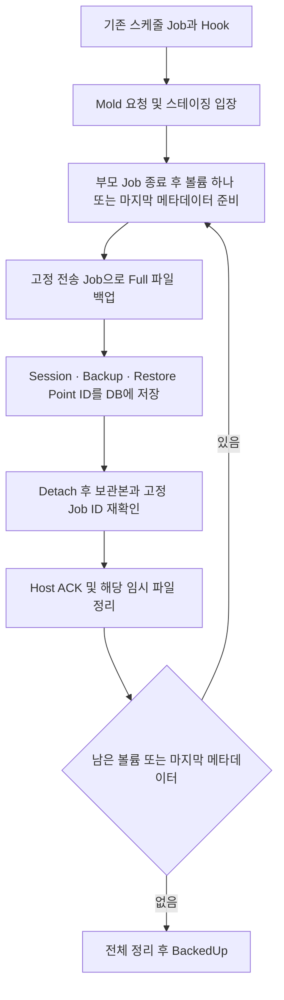

<!--
Licensed to the Apache Software Foundation (ASF) under one
or more contributor license agreements. See the NOTICE file
distributed with this work for additional information
regarding copyright ownership. The ASF licenses this file
to you under the Apache License, Version 2.0 (the
"License"); you may not use this file except in compliance
with the License. You may obtain a copy of the License at

  http://www.apache.org/licenses/LICENSE-2.0

Unless required by applicable law or agreed to in writing,
software distributed under the License is distributed on an
"AS IS" BASIS, WITHOUT WARRANTIES OR CONDITIONS OF ANY
KIND, either express or implied. See the License for the
specific language governing permissions and limitations
under the License.
-->

# ABLESTACK 백업 및 복원 운영 안내

이 문서는 인프라 관리자가 ABLESTACK 백업 환경을 구성하고 백업·복원을 운영하기 위한 안내다.
솔루션별 구성, 사용 절차와 동작 흐름을 이 파일에서 함께 관리한다.

## 목차

- [운영자용 백업 구성 요약](#운영자용-백업-구성-요약)
- [공유 볼륨 백업 제한](#공유-볼륨-백업-제한)
- [GFS2 RAW 정지 상태 FULL 백업](#gfs2-raw-정지-상태-full-백업)
- [배포 정책을 보존하는 백업·복원](#배포-정책을-보존하는-백업복원)
- [스테이징 파일시스템별 외부 솔루션 설정](#스테이징-파일시스템별-외부-솔루션-설정)
- [공통 스테이징 경로 변경](#공통-스테이징-경로-변경)
- [백업 솔루션별 준비와 실행 순서](#백업-솔루션별-준비와-실행-순서)
- [NetBackup VM별 스케줄 구성 시나리오](#netbackup-vm별-스케줄-구성-시나리오)
- [NetBackup 백업 파일 만료 시 참고사항](#netbackup-백업-파일-만료-시-참고사항)
- [Veeam 보존기간과 백업 삭제](#veeam-보존기간과-백업-삭제)
- [Veeam 고정 Host 전송 Job의 정의와 검증](#veeam-고정-host-전송-job의-정의와-검증)
- [Veeam 13.0 VM별 스케줄 검증 시나리오](#veeam-130-vm별-스케줄-검증-시나리오)
- [Veeam Job 이름과 길이 제한](#veeam-job-이름과-길이-제한)
- [NetBackup·Veeam 사전 구성 파라미터 비교](#netbackupveeam-사전-구성-파라미터-비교)
- [Full 및 증분 백업 운영](#full-및-증분-백업-운영)
- [작업 상태와 제어](#작업-상태와-제어)
- [복원 절차](#복원-절차)
- [임시 파일 정리와 실패한 백업 삭제](#임시-파일-정리와-실패한-백업-삭제)
- [NetBackup 및 Veeam 서비스 운영](#netbackup-및-veeam-서비스-운영)
- [NetBackup 및 Veeam 인증정보 관리](#netbackup-및-veeam-인증정보-관리)
- [Veeam Host 구성과 배포](#veeam-host-구성과-배포)

## 공유 볼륨 백업 제한

컴퓨트 오퍼링 또는 연결된 볼륨의 디스크 오퍼링에 `shareable=true`가 설정되어 있으면 VM 백업을 지원하지 않는다.
컴퓨트 오퍼링의 공유 옵션은 연결된 OS 디스크용 디스크 오퍼링에서 확인하고, 실제 OS·데이터 볼륨의 오퍼링도 각각 검사한다.
한 개의 공유 볼륨만 포함되어도 전체 VM의 백업과 스케줄 등록·실행을
`BACKUP_SHARED_VOLUME_UNSUPPORTED`로 차단한다. 백업 오퍼링 할당에도 같은 검사를 적용한다.
VM 정지 여부, 실제 연결 VM 수, RAW/QCOW2 형식, GFS2/RBD/NFS 저장소에 관계없이 적용한다.
삭제된 오퍼링도 정의를 조회해 검사하며, 참조한 오퍼링을 확인할 수 없으면 `BACKUP_SOURCE_UNKNOWN`으로 중단한다.
공유 저장소를 사용하는 일반 볼륨은 이 제한에 해당하지 않는다.

## GFS2 RAW 정지 상태 FULL 백업

대상은 GFS2 파일시스템 내부의 RAW 이미지 파일을 VM에 연결하는 구성이다.
파일명은 볼륨 UUID일 수 있으므로 확장자로 RAW 여부를 판단하지 않는다.
LV·SAN LUN을 VM에 직접 연결하는 구성은 이 지원 범위에 포함하지 않는다.
Mold NAS(`ablestack-nas`), Commvault, NetBackup, Veeam에 공통으로 적용한다.
아래 경로는 공유 옵션이 비활성화된 볼륨에 적용하며, 공유 옵션이 활성화된 VM은 위의 공통 검사에서 먼저 차단한다.

**GFS2 RAW가 하나라도 포함된 VM은 모든 연결 VM이 정지한 경우에만 독립 FULL 백업을 생성한다.**
`kvm.incremental.backup=true`, 체인 길이 8이어도 RAW 포함 VM은 매번 부모 없는 FULL로 처리한다.
RAW 증분 요청은 `GFS2_RAW_INCREMENTAL_UNSUPPORTED`로 거절한다.
QCOW2 파일로 변환하더라도 원본 RAW에 대한 변경 추적이 생기는 것은 아니므로 checkpoint·bitmap 증분을 사용하지 않는다.

처리 순서:

1. 디스크 오퍼링의 공유 설정과 `(poolId, path)`가 같은 볼륨 연결을 모두 확인한다.
   공유 설정이 false여도 실제 연결은 확인한다. VM·볼륨·Host 상태를 확인할 수 없으면 시작하지 않는다.
2. 동일한 GFS2 클러스터의 모든 Host Agent에서 실행·일시정지된 VM의 실제 디스크 사용 여부와 형식·크기를 확인한다.
   현재 오프라인 경로에서는 해당 VM의 모든 디스크가 같은 클러스터의 GFS2 파일이어야 한다. RBD/NFS와 혼합된 VM은 차단한다.
3. 관리 서버에 디스크 소유 정보를 기록하고 공유 파일시스템에 보호 마커를 생성한다.
   GFS2의 클러스터 POSIX 잠금을 사용하므로 `localflocks` 마운트는 허용하지 않는다.
   보호 기간에는 관련 VM 시작, 디스크 연결·해제와 디스크 경로 변경을 차단한다.
4. 원본을 변경하지 않고 `qemu-img convert`로 독립 파일을 만든 뒤 종료 코드·형식·가상 크기·독립 이미지 여부와 쓰기 반영을 확인한다.
   백업마다 원본·대상 전체 내용을 다시 읽는 `qemu-img compare`는 실행하지 않는다.
   **원본 RAW는 RAW로, 원본 QCOW2는 독립 QCOW2로 보관한다.** RAW를 QCOW2로 강제 변환하지 않는다.
   RAW 예시는 다음과 같다. `-S 4k`는 0인 영역을 sparse로 저장하는 옵션이며 증분을 의미하지 않는다.

   ```bash
   qemu-img convert -p -f raw -O raw -S 4k <원본 RAW> <스테이징 RAW>
   ```

5. 외부 솔루션은 기존처럼 볼륨별 파일을 전송하고, 마지막으로 매니페스트·VM 구성·완료 마커를 저장한다.
   NAS는 저장소에 독립 파일과 완료 마커를 저장한다.
   정지 후 libvirt 정의가 제거된 VM은 Mold에 저장된 구성과 UUID를 사용한 식별용 `domain-config.xml`을 남긴다.
   이 파일에는 `bootable=false`인 오프라인 구성임을 표시한다. 실제 VM 구성 재생성과 복원은 Mold가 저장된 백업 상세로 처리한다.
   NAS의 단계는 `PREPARING` → `RAW_COPY`(QCOW2 디스크는 `QCOW2_COPY`) → `FINALIZING` → `COMPLETED`로 표시한다.
   복사 진행률은 `qemu-img convert -p` 결과를 각 볼륨의 가상 크기로 가중하여 전체 5~95%에 반영하고 볼륨 번호도 표시한다.
   완료 후처리는 99%, 작업 성공 확인 후 100%로 표시한다. 실행 Host의 Agent와 `ablestack_shared_raw.py`를 함께 갱신해야 한다.
   RAW 복사 중에는 취소할 수 있고 시작 시 지정된 대역폭 제한을 적용한다. 실행 중 대역폭 변경 메뉴는 제공하지 않는다.
   `FINALIZING` 또는 Host 작업 완료 후에는 취소·대역폭 변경 메뉴를 숨기고 서버에서도 거절한다.
6. 백업 성공 또는 실패 정리가 확인된 뒤 보호를 해제한다.
   실행 프로세스·고아 reader가 남았거나 정리가 확인되지 않으면 보호를 유지하고 재시도한다.
   관리 서버를 재시작해도 소유 정보는 유지한다. 보호 파일을 임의로 지우지 않는다.

공유 파일 보호의 전체 계획은 `backup_details`에 보관하고, 255자로 제한된 `storage_pool_details`에는 작업 식별자와 계획 해시만 저장한다.
기존 전체 JSON이 정확히 255자로 잘린 기록은 백업·작업·Host·작업 종류와 원문의 접두부가 일치하고 Host 해제도 확인된 경우에만 정리한다.
전체 JSON 원문이 남아 있는 구형 기록도 지원하며, 다른 작업의 소유정보는 해제하지 않는다.

RAW 파일은 sparse여도 논리적 크기가 원본 가상 용량과 같을 수 있다.
외부 솔루션의 sparse 처리에 따라 실제 전송량이 달라지므로 대용량 VM은 전송량·백업 시간·복원 시간을 함께 측정한다.
복원 시에는 RAW 입력을 처리하고, 기존 공유 RAW 디스크에 덮어쓸 때도 모든 연결 VM이 정지했는지 다시 확인한다.
임시 대상 생성·할당 정책 적용·데이터 검증·원본 교체 작업은 RAW 보관 여부와 관계없이 필요하다.

### RAW FULL 스케줄 유지 개수

스케줄의 **유지 항목 수(`maxbackups`)** 는 RAW의 독립 FULL 개수에 적용한다.
전역 증분 설정이 true여도 RAW 백업은 서로 부모·자식 의존성이 없으므로 FULL 하나가 유지 항목 하나다.

- 유지 개수 2: 세 번째 FULL이 **성공한 뒤** 가장 오래된 FULL을 삭제하고 최근 두 개를 유지한다.
- 세 번째 백업이 대기·진행 중이거나 실패했다면 기존 정상 FULL 두 개를 유지한다.
- NetBackup·Commvault·Veeam에서는 해당 FULL에 속한 볼륨 보관본과 마지막 metadata 보관본을 모두 삭제 대상으로 처리한다.
  NAS는 해당 백업 디렉터리를 삭제한다.
- 외부 만료가 지연되거나 삭제 확인에 실패하면 정리를 보류하고 백그라운드에서 재시도한다. 관리 서버 재시작 후에도 재시도한다.
- 유지 개수 0은 스케줄 개수에 따른 자동 삭제를 사용하지 않는다는 뜻이다.
  외부 솔루션 자체의 보존 기간·만료 설정은 별도로 적용된다.

검증 시 `kvm.incremental.backup=true`, 체인 길이 8, 스케줄 유지 개수 2로 설정하고 FULL을 세 번 성공시킨다.
각 백업이 FULL이며 부모가 없는지, 세 번째 성공 전에는 기존 정상 백업이 남아 있는지,
성공 후 최초 FULL의 모든 외부 보관본이 정리되고 최근 두 백업은 복원 가능한지 확인한다.
추가로 공유 VM 하나가 실행 중인 경우, 복사 중 VM 시작·디스크 연결 시도, 취소·재시작 후 정리 재시도를 검증한다.

GFS2 클러스터에 필요한 디스크 검사를 지원하지 않거나 검사할 수 없는 Host가 있으면 백업을 시작하지 않는다.
기존 GFS2 QCOW2·RBD RAW의 온라인 FULL·증분 백업은 해당 경로를 유지한다.

## 배포 정책을 보존하는 백업·복원

GFS2 RAW는 위의 정지 상태 FULL 조건을 적용하고, 할당 정책은 다음 조합을 지원한다.

- GFS2 RAW: `off`, `falloc`, `full`
- GFS2 QCOW2: `metadata`, `falloc`, `full`
- RBD RAW: `off`, `full`

백업에는 원본 볼륨의 실제 형식과 볼륨에 고정된 할당 정책을 함께 기록한다.
스테이징 파일은 전송용 데이터이므로 원본의 선할당 상태를 그대로 복제할 필요는 없다.
`Full / INCREMENTAL` 백업 유형은 `full` 할당 정책과 별개다.

복원 시 기존 볼륨은 해당 볼륨에 고정된 정책을 사용한다.
새 볼륨을 복원하는 경로는 선택한 디스크 오퍼링의 정책을 요청 시점에 고정한다.
관리 서버가 정책을 Host에 전달하기 전에 새 프로토콜과 정확한 복사 방식의 지원 여부를 확인한다.
호환되지 않는 Agent에는 신규 정책 복원을 요청하지 않는다.

복원은 다음 순서로 처리한다.

1. Full·증분 체인을 임시 볼륨에 모두 적용한다. 기존 볼륨은 유지한다.
2. 복원된 데이터를 지정한 정책으로 생성한 별도 볼륨에 복사한다.
   GFS2는 형식에 따라 RAW `off / falloc / full`, QCOW2 `metadata / falloc / full`을 구분하고,
   RBD `full`은 thick 할당 후 할당 상태를 유지하는 복사를 수행한다.
3. 디스크 형식·가상 크기·데이터 일치 여부와 실제 할당 결과를 검증한다.
4. 모든 대상 볼륨이 검증된 뒤 원본과 교체한다. 실패하면 원본을 복구하고 해당 작업 소유의 임시 볼륨을 정리한다.
5. 교체 완료가 기록된 작업의 검증 결과만 Mold 볼륨 상세에 저장한다.
   과거 생성 시점의 검증 결과를 새 복원 결과로 재사용하지 않는다.

신규 정책을 적용할 볼륨은 체인 복원용 임시 볼륨과 정책 적용용 볼륨의 공간을 함께 예약한다.
두 볼륨의 크기가 같으면 **대상 크기의 두 배와 여유 공간**이 필요하다. 기존 정책의 볼륨은 기존 공간 계산을 유지한다.
외부 백업의 스테이징은 기존처럼 볼륨 파일 하나씩 처리한다.
기본스토리지와 스테이징이 같은 파일시스템이면 두 예약을 합산한다.

기존 `thin / sparse / fat` 볼륨과 정책 정보가 없는 구형 백업은 기존 경로를 유지한다.
신규 `falloc`과 `full`은 호환용 `fat` 컬럼만으로 판단하지 않으며 별도 계약 값을 전달한다.
실제 GFS2·Ceph 환경에서는 각 조합별 복원과 실제 할당량을 추가 확인한다. GFS2 RAW는 FULL만 시험한다.

## 운영자용 백업 구성 요약

이 절은 백업 기능을 사용하는 인프라 관리자를 위한 안내다.
Provider는 Mold가 사용할 백업 연동 종류이며, 아래의 `ablestack-*` 이름을 설정한다.
백업 오퍼링은 VM에 연결하는 백업 정책이다. 스테이징은 외부 백업 솔루션으로 보내기 전에
백업 파일을 잠시 두는 저장 공간이며, 장기 보관용 백업 저장소와 역할이 다르다.

### VM 스토리지와 스테이징 스토리지 구분

| 구분 | 종류 | 운영자가 확인할 내용 |
| --- | --- | --- |
| VM 기본스토리지 | RBD | VM 디스크가 Glue RBD 이미지로 저장된다. 백업할 시점의 데이터를 읽어 파일로 내보낸다. 원본 VM 디스크를 Host에 별도 마운트할 필요는 없다. |
| VM 기본스토리지 | QCOW2, GFS2 환경 등 | VM 디스크가 QCOW2 파일로 저장된다. 해당 시점의 디스크 데이터를 백업 파일로 복사한다. |
| 공통 스테이징 | GFS2 | Host에서 사용하는 GFS2 경로를 지정한다. 기본스토리지 경로인 `/mnt/glue-gfs`도 사용할 수 있다. |
| 공통 스테이징 | NFS | NFS 서버의 공유 경로와 Host의 마운트 경로를 지정한다. |
| 공통 스테이징 | LOCAL | Host에 연결한 별도 디스크의 마운트 경로를 지정한다. 백업을 수행할 각 Host에 경로와 용량을 준비한다. |

RBD VM도 NFS 또는 GFS2 스테이징을 사용할 수 있다.
스테이징 종류를 VM 기본스토리지의 종류와 동일하게 맞출 필요는 없다.
현재 공통 스테이징은 파일시스템 경로를 사용하며, 스테이징용 RBD 이미지를 생성·map하는 방식은 사용하지 않는다.

### 솔루션과 VM 스토리지별 백업 방식

| 백업 솔루션 | VM 스토리지 | Full 백업 | 증분 백업 | 최종 보관 위치 |
| --- | --- | --- | --- | --- |
| `ablestack-nas` | RBD | 백업 시점의 전체 디스크를 NAS에 직접 내보낸다. | 이전 백업 시점 이후 변경된 데이터를 NAS에 직접 내보낸다. | Mold에 등록한 NAS 백업 저장소 |
| `ablestack-nas` | QCOW2 | 전체 디스크 백업 파일을 NAS에 직접 생성한다. | 변경된 디스크 데이터로 증분 파일을 NAS에 생성한다. | Mold에 등록한 NAS 백업 저장소 |
| `ablestack-commvault` | RBD | 볼륨 하나의 전체 데이터를 스테이징에 내보낸 후 Commvault로 전송한다. | 볼륨 하나의 변경분을 스테이징에 내보낸 후 Commvault로 전송한다. | Commvault의 백업 저장소 |
| `ablestack-commvault` | QCOW2 | 볼륨 하나의 전체 데이터를 스테이징에 복사한 후 Commvault로 전송한다. | 볼륨 하나의 변경분을 스테이징에 복사한 후 Commvault로 전송한다. | Commvault의 백업 저장소 |
| `ablestack-netbackup` | RBD | 볼륨 하나의 전체 데이터를 스테이징에 내보낸 후 NetBackup 작업으로 저장한다. | 볼륨 하나의 변경분을 스테이징에 내보낸 후 NetBackup 작업으로 저장한다. | NetBackup 정책의 백업 저장소 |
| `ablestack-netbackup` | QCOW2 | 볼륨 하나의 전체 데이터를 스테이징에 복사한 후 NetBackup 작업으로 저장한다. | 볼륨 하나의 변경분을 스테이징에 복사한 후 NetBackup 작업으로 저장한다. | NetBackup 정책의 백업 저장소 |
| `ablestack-veeam` | RBD | 볼륨 하나의 전체 데이터를 스테이징에 내보낸 후 Veeam 작업으로 저장한다. | 볼륨 하나의 변경분을 스테이징에 내보낸 후 Veeam 작업으로 저장한다. | Veeam Job의 백업 저장소 |
| `ablestack-veeam` | QCOW2 | 볼륨 하나의 전체 데이터를 스테이징에 복사한 후 Veeam 작업으로 저장한다. | 볼륨 하나의 변경분을 스테이징에 복사한 후 Veeam 작업으로 저장한다. | Veeam Job의 백업 저장소 |

Commvault·NetBackup·Veeam은 `볼륨 1 생성 → 외부 저장 완료 → 해당 임시 파일 정리 → 볼륨 2 처리` 순서로 진행한다.
모든 볼륨을 처리한 뒤 VM 구성과 디스크 순서, 백업 연결 관계를 담은 메타데이터도 마지막으로 저장한다.
Mold에서는 이 전체 묶음이 VM 백업 하나로 표시되지만, 외부 솔루션에는 여러 작업이 보일 수 있다.
NAS는 NAS 자체가 최종 저장소이므로 공통 스테이징 설정을 사용하지 않는다.

### Commvault·NetBackup·Veeam 공통 준비

1. 백업에 사용할 Host에 해당 솔루션의 백업 에이전트 또는 클라이언트를 설치하고 외부 서버와 통신을 확인한다.
   VM 이동이나 정지 VM 백업에 대비하여 백업을 수행할 수 있는 Host 모두에 준비한다.
2. Mold의 Zone 설정에서 `backup.framework.enabled=true`와 사용할 `backup.framework.provider.plugin`을 설정한다.
3. 글로벌 설정에서 공통 스테이징 종류와 경로를 입력한다.

   | 글로벌 설정 | 입력 내용 |
   | --- | --- |
   | `backup.thirdparty.staging.storage.type` | `GFS2`, `NFS`, `LOCAL` 중 실제 스테이징 구성 |
   | `backup.thirdparty.staging.mount.path` | Host에서 스테이징 스토리지를 마운트하는 절대 경로 |
   | `backup.thirdparty.staging.root.path` | 임시 백업·복원 디렉터리를 만들 경로. 마운트 경로와 같거나 그 하위여야 한다. |
   | `backup.thirdparty.staging.nfs.source` | NFS 사용 시 `서버주소:/공유경로` |
   | `backup.thirdparty.staging.capacity.buffer.percent` | 최대 볼륨 크기에 추가할 여유 공간 비율. 기본 `20` |
4. `backup.thirdparty.staging.enable=true`로 활성화한다.
   Mold가 대상 Host의 마운트, 쓰기 가능 여부와 여유 공간을 확인한다.
   실패하면 활성화되지 않으므로 표시된 Host·경로·용량 문제를 해결하고 다시 활성화한다.
5. 백업 오퍼링을 가져오거나 구성 스크립트로 등록하고 대상 VM에 연결한다.
   외부 서버 연결과 스테이징 검증을 완료한 뒤 첫 백업을 실행한다.

GFS2 기본스토리지를 사용한다면 `mount.path=/mnt/glue-gfs`, `root.path=/mnt/glue-gfs`로 모두 입력할 수 있다.
실제 임시 파일은 `ablestack-commvault`, `ablestack-netbackup`, `ablestack-veeam` 하위에 생성된다.
백업 후 정리는 개별 작업의 임시 파일을 대상으로 하며 기본스토리지 경로 자체를 삭제하지 않는다.

스테이징 준비 용량은 현재 VM들 중 **가장 큰 단일 볼륨의 할당 크기 + 설정한 여유 비율**을 기준으로 한다.
예를 들어 최대 볼륨이 1 TiB이고 여유 비율이 20%이면 활성화 검사 기준은 1.2 TiB이다.
동시 작업은 각각 용량을 사용하며, QCOW2 백업은 원래 기본스토리지에도 별도 임시 작업 공간이 필요하다.
QCOW2 기본스토리지의 임시 공간은 백업 대상 볼륨의 할당 크기 합에
그 합의 20% 또는 10 GiB 중 큰 여유 공간을 더하여 확인한다.
기본스토리지와 스테이징이 같은 파일시스템이면 두 용량 예약을 합산한다.
스테이징 활성화가 성공해도 실제 작업 시작 시 공간·동시 작업 수를 다시 검사한다. 부족하면 `WAITING`으로 대기한다.

실행 중인 VM의 백업은 해당 VM을 실행하는 Host에서 처리한다.
정지 VM도 백업할 수 있으며, RBD는 원본 디스크와 스테이징에 접근할 수 있는 Host를 Mold가 선택한다.
QCOW2 정지 VM은 게스트 OS를 실행하지 않는 임시 백업 환경을 사용한다.
공통 스테이징은 작업 후에도 마운트를 유지하며, 외부 UI에서 복원 파일을 쓰는 시점에도 접근 가능해야 한다.
마운트가 빠져 있으면 NFS는 글로벌 설정의 공유 주소로 연결한다.
GFS2·LOCAL은 Host의 `/etc/fstab`에 마운트 정보가 있어야 자동으로 다시 연결할 수 있으므로
각 Host에서 파일시스템과 마운트 설정을 먼저 준비한다.

## 스테이징 파일시스템별 외부 솔루션 설정

사전구성 시 각 KVM Host의 실제 마운트 타입과 외부 솔루션의 파일 백업 설정을 함께 확인한다.
Mold의 스테이징 활성화 검사와 별도로, 외부 솔루션이 해당 경로의 파일을 백업하도록 설정해야 한다.

```bash
# 각 KVM Host에서 실제 스테이징 경로로 바꿔 실행
findmnt -T '<스테이징 root.path>' -o SOURCE,TARGET,FSTYPE
```

판단 기준은 **백업을 실행하는 KVM Host에서 보이는 파일시스템 타입**이다.
NFS 서버 내부의 저장소가 GFS2여도 KVM Host가 `nfs` 또는 `nfs4`로 마운트했다면 NFS 기준으로 설정한다.

**NetBackup: 정책의 Follow NFS 확인**

| KVM Host의 `FSTYPE` | 기준 정책의 `Follow NFS` |
| --- | --- |
| `gfs2` | 활성화할 필요 없음 |
| `nfs`, `nfs4` | 활성화 필요 |

NFS 스테이징을 사용하는 모든 Host의 기준 정책에서 `Follow NFS`를 활성화한다.
이 속성은 bootstrap을 저장하는 `Full Backup`과 실제 파일을 전송하는 `mold-transfer` / `User Backup`에 함께 적용된다.
`netbackup-host-config.py`는 이 정책 속성을 자동 변경하지 않으므로 정책 생성 및 GFS2 → NFS 전환 시 관리자가 확인한다.

Linux NetBackup **Primary 서버**에서 다음과 같이 설정·확인할 수 있다. 정책명은 실제 값으로 바꾼다.

```bash
/usr/openv/netbackup/bin/admincmd/bpplinfo '<정책명>' -modify -follownfs 1
/usr/openv/netbackup/bin/admincmd/nbpemreq -updatepolicies
/usr/openv/netbackup/bin/admincmd/bppllist '<정책명>' -L
```

출력의 `Follow NFS Mnts: yes`와 Backup Selections의 현재 bootstrap 경로를 확인한다.
공식 기준은 [Follow NFS 정책 속성](https://docs.cohesity.com/docs/netbackup/11.1/150157642-170198590-0/v42408770-170198590)과
[bpplinfo의 -follownfs 옵션](https://docs.cohesity.com/docs/netbackup/11.0/15263389-167321334-0/v14664839-167321334)을 참고한다.

**Commvault: Subclient Content에 NFS 작업 경로 명시**

Linux File System Agent는 기본적으로 NFS 파일시스템을 자동 포함하지 않으므로 Subclient Content에 백업할 경로를 명시해야 한다.
현재 연동은 볼륨·메타데이터 전송 전에 선택한 Host의 Subclient Content를 해당 작업의 정확한 경로로 갱신하고,
`followMountPointsMode=FOLLOW_MOUNT_POINTS_ON`을 설정한다.
따라서 현재 연동에는 NFS 경로를 명시하는 처리가 포함되어 있다.
실제 Commvault Client의 경로 읽기 권한과 적용 중인 글로벌 제외 필터도 확인하고,
Job의 백업 파일 목록에 해당 볼륨·메타데이터가 포함됐는지 검증한다.
공식 기준은 [Linux File System의 NFS 백업 구성](https://docs.commvault.com/2023e/commcell-console/advanced_configuration_linux_file_system.html)의
`Configuring Backups for NFS-Mounted File Systems`를 참고한다.

**Veeam: NFS·GFS2 모두 snapshot-less 파일 백업 사용**

KVM Host의 NFS·GFS2 경로는 Linux Agent의 **snapshot-less file-level backup**으로 백업한다.
사전구성 전에 VBR의 기준 Linux Agent Job을 이 모드로 준비하고,
SelectedFiles는 사전구성이 출력하는 해당 Host·Job의 bootstrap 디렉터리로 지정한다.
`veeam-host-config.py`는 기준 Job의 백업 모드를 자동 변경하지 않는다.
현재 연동은 실제 볼륨·메타데이터 전송용 Job을 구성할 때 `SelectedFiles`와
`UseSnapshotlessFileLevelBackup`을 명시하며, 해당 PowerShell 옵션이 없는 VBR에서는 준비 검사를 실패 처리한다.
공식 기준은 [NFS·GFS2를 지원하는 snapshot-less 파일 백업](https://helpcenter.veeam.com/docs/agentforlinux/userguide/file_backup_snapshotless.html)과
[Set-VBRComputerBackupJob](https://helpcenter.veeam.com/docs/vbr/powershell/set-vbrcomputerbackupjob.html)을 참고한다.

공통 스테이징 마운트 검사나 기준 정책·Job의 성공만으로 실제 VM 백업 완료를 판단하지 않는다.
각 볼륨·메타데이터의 파일 목록과 전송 결과, Mold의 최종 `BackedUp` 상태를 확인하고 테스트 복원까지 검증한다.

## 공통 스테이징 경로 변경

Commvault·NetBackup·Veeam의 `backup.thirdparty.staging.*`는 공통 글로벌 설정이다.
한 솔루션만 테스트하더라도 변경 범위에 포함된 모든 솔루션과 백업 Host를 함께 확인한다.
NAS 백업 저장소의 경로 변경은 이 절의 대상이 아니다.

현재 글로벌 설정을 변경하면 이후 작업은 새 스테이징 설정을 읽는다.
외부 정책/Job의 선택 경로와 Host에 저장한 구성까지 자동 변경하는 기능은 없으므로 아래 수동 절차가 필요하다.

| 항목 | 현재 동작과 필요한 작업 |
| --- | --- |
| Mold의 새 볼륨별 작업 | 현재 글로벌 설정으로 스테이징과 복원 목적지를 결정한다. |
| 진행 중이거나 정리 대기 중인 작업 | 기존 설정에서 종료·정리를 완료한다. 대기·실행·삭제·정리 중인 기록이 있으면 위치 설정 변경을 거부한다. |
| NetBackup Host 구성 | `restore-watcher.conf` 등에 스테이징 경로가 저장된다. 변경 후 사전구성 도구로 갱신한다. |
| NetBackup 기준 정책 | Backup Selections는 사전구성이 출력하는 `<root>/ablestack-netbackup/bootstrap/<policy>`만 선택한다. root 변경 후 Host 재구성과 외부 정책 수정이 필요하다. |
| Veeam Host 구성 | 기본 마커 경로는 `<root>/ablestack-veeam/bootstrap/<host>/<job>`로 계산한다. Job별 conf는 재구성으로 갱신하며 `--agent-payload-path`는 명시적 경로가 필요할 때만 지정한다. |
| Veeam 부모 Job | SelectedFiles를 사전구성이 출력한 마커 디렉터리와 맞춘다. 외부 Job의 선택 경로는 자동 변경하지 않는다. |

두 솔루션은 부모 작업의 작은 마커 사본과 원본 볼륨 스테이징을 분리한다.
부모 작업에는 `<backup UUID>.json`만 저장하며 사본은 Post Hook에서 소유권을 확인하고 제거한다.
원본 `.volume-bootstrap`과 볼륨 데이터는 Mold의 작업별 정리가 관리한다.
공통 root 또는 provider 디렉터리 전체를 부모 정책/Job의 대상으로 선택하지 않는다.
구성 파일의 기본 마커 경로가 현재 root와 다르면 Pre Hook은 백업 요청 전에 재구성과 외부 선택 경로 수정을 요구한다.

### 변경 유형과 기존 백업 보존 조건

Mold는 새 백업의 `backup_details`에 `thirdparty.staging.configuration`을 저장하고,
새 복원 계획에도 해당 작업의 스테이징 구성을 저장한다.
여기에는 종류·root·마운트·NFS 공유·마운트 옵션이 포함되며, 원본 카탈로그 경로와 외부 작업 ID는 변경하지 않는다.
기존 백업은 스테이징 비활성화·위치 설정 변경·활성화 시 현재 구성과 원래 provider 경로가 일치하면 구성을 자동 보완한다.
업그레이드 후 처음 경로를 바꾸기 전에 기존 구성이 올바른 상태에서 비활성화한다.

| 변경 유형 | 진행 조건 |
| --- | --- |
| 절대 경로 유지, 스토리지 또는 마운트 구성 변경 | 모든 작업·정리를 완료하고 새 스토리지를 준비한다. 이전 구성이 필요한 정리는 해당 마운트에 접근할 수 있어야 한다. |
| `root.path` 변경, 기존 백업 없음 | 이전 작업의 대기·실행·정리와 외부 복원 세션도 종료한 뒤 아래 절차를 따른다. |
| `root.path` 변경, 기존 백업 보존 | 원본 백업 선택은 유지하고 새 복원 작업은 현재 스테이징을 사용한다. 기존 백업의 삭제 정리는 기록된 이전 구성을 사용하므로 필요한 기존 마운트 접근은 유지한다. |

기존 백업 삭제 시 글로벌 설정을 구경로로 되돌릴 필요는 없다.
저장한 구성을 사용해 이전 마운트를 검증한 뒤 해당 백업의 체크포인트·작업 파일을 정리한다.
이전 마운트가 없거나 NFS 공유가 기록과 달라 마운트 검증에 실패하면 삭제 정리는 대기한다.
기록이 없고 현재 구성과도 다른 구형 경로는 마운트 정보를 추정하지 않는다.
이 경우 원래 설정을 복구하고 활성화하여 구성을 기록한 뒤 변경 절차를 다시 수행한다.

외부 UI에서 이전 백업의 메타데이터를 복원할 때 원본 선택과 수신 위치를 구분한다.

| API 응답 필드 | 의미 |
| --- | --- |
| `metadatapath` | 외부 백업에 저장된 원래 메타데이터 선택 경로 |
| `metadatarestorepath` | 현재 root 기준 수신 경로: `<root>/<provider>/<VM 내부 이름>/<백업 timestamp>` |

`resolveBackupArtifact`는 정확한 메타데이터 카탈로그 ID 또는 Restore Point ID로 두 경로를 반환한다.
외부 UI에서는 원래 메타데이터 백업을 선택하되, 최종 파일 수신 디렉터리가 `metadatarestorepath`가 되도록 지정한다.
NetBackup 부분 성공과 Veeam Warning은 새 위치의 파일이 이번 복원에서 생성됐는지 확인하고,
manifest의 원본 경로·백업 UUID·VM·시점·완료 마커를 함께 대조한 뒤 Mold 복원에 연결한다.
이전 위치와 새 위치에 모두 이번 작업 시점의 메타데이터가 남아 있으면 모호한 결과로 보류한다.
manifest·카탈로그의 원본 경로나 외부 작업 ID를 DB에서 일괄 치환하지 않는다.

### 수동 변경 순서

**1. 기존 값을 기록하고 새 작업 유입을 중단한다.**

Mold의 storage type, mount path, root path, NFS source, mount options, 여유율을 기록한다.
각 Host의 구성·암호화 키와 외부 기준 정책/Job의 선택 경로·Hook·스케줄도 복구할 수 있게 보관한다.
NetBackup·Veeam 재구성에 사용할 정책/Job 이름, `VM_SCHEDULE_BACKUP`, include/exclude와
현재 Cluster의 `kvm.incremental.backup` 유효값도 확인한다.

외부 솔루션의 기준 정책/Job 스케줄을 일시 중지하고 수동 요청도 받지 않는다.
Mold 백업 스케줄에는 별도 일시 중지 플래그가 없으므로 변경 중 실행될 스케줄은
주기·시각·시간대·보관 개수를 기록한 뒤 해당 스케줄만 삭제하고, 검증 완료 후 같은 값으로 다시 등록한다.
기존 설정에서 대기 중인 작업을 완료하거나 지원되는 취소 절차로 정리한다.
실행 중인 백업·복원, 외부 파일 복원 세션과 `WAITING`·`RUNNING` 정리 작업이 남지 않았는지 확인한다.
`backup.thirdparty.staging.enable=false`는 실행 중인 작업을 종료하거나 예약을 해제하는 명령이 아니다.
대기·실행·삭제·정리 중인 작업이 있으면 위치 설정 변경이 거부되므로 기존 설정에서 해당 작업부터 정리한다.

**2. 외부 UI 복원 감시를 잠시 중지한다.**

설치된 솔루션에 해당하는 명령만 각 Host에서 실행하고 기존 활성 상태를 기록한다.
timer를 중지해도 현재 조회는 계속되므로 service가 `inactive` 또는 `failed`가 된 뒤 다음 단계로 진행한다.

```bash
# NetBackup: 새 주기 실행을 막고 현재 조회가 끝났는지 확인
systemctl stop netbackup-host-restore-watcher.timer
systemctl is-active netbackup-host-restore-watcher.service

# Veeam: 새 주기 실행을 막고 현재 조회가 끝났는지 확인
systemctl stop mold-veeam-restore-agent.timer
systemctl is-active mold-veeam-restore-agent.service
```

timer가 없는 구형 NetBackup 상시 서비스 구성은 실행 중인 복원 요청이 없음을 확인한 뒤
`systemctl stop netbackup-host-restore-watcher.service`로 중지한다.

**3. 공통 스테이징을 비활성화하고 새 마운트·경로를 준비한다.**

Mold에서 `backup.thirdparty.staging.enable=false`로 변경한 뒤
storage type, mount path, root path와 필요한 NFS source·mount options를 수정한다.
활성화 상태에서는 경로·스토리지 설정의 변경을 허용하지 않는다.
새 root는 새 mount와 같거나 그 하위의 절대 경로여야 한다.

모든 대상 Host에 실제 파일시스템과 마운트 구성을 준비한다.
GFS2·LOCAL은 `/etc/fstab`도 맞추고, NFS는 지정한 서버·공유 경로가 실제 마운트와 일치하도록 한다.
각 Host에서 아래 명령으로 확인한다. 디렉터리만 존재하는 상태를 마운트 완료로 판단하지 않는다.

```bash
findmnt -rn --mountpoint '<새 mount.path>' -o SOURCE,TARGET,FSTYPE
df -B1 '<새 mount.path>'
```

`/mnt/glue-gfs`처럼 VM 기본스토리지와 공유하는 마운트는 스테이징 변경을 이유로 해제하거나 삭제하지 않는다.
root의 하위 디렉터리만 바꾸는 경우에는 기존 마운트를 유지한다.

**4. Mold에서 새 설정을 활성화·검증한다.**

`backup.thirdparty.staging.enable=true`로 변경한다.
Mold가 대상 KVM Host의 마운트, 쓰기와 용량을 검증한 후 값을 저장한다.
실패하면 표시된 Host·스토리지 문제를 해결하고 다시 활성화한다.
이 검사는 외부 기준 정책/Job의 선택 경로를 수정하지 않는다.

**5. 각 Host 구성과 외부 기준 정책/Job을 맞춘다.**

NetBackup은 [netbackup-host-config.py](netbackup-host-config.py),
Veeam은 [veeam-host-config.py](veeam-host-config.py)를 기존 정책/Job과 인증정보로 다시 실행한다.
명령 형식은 [사전 구성 파라미터 비교](#netbackupveeam-사전-구성-파라미터-비교)를 따른다.
두 도구는 스테이징이 활성화되어 있어야 실행할 수 있으므로 4번을 먼저 완료한다.

- `--vm-schedule-backup`과, `false`일 때의 include/exclude를 기존 운영 값으로 명시한다.
- `--incremental-backup`도 현재 적용할 값으로 명시한다. 생략하면 기본 `true`가 Global·해당 Cluster에 반영될 수 있다.
- 체인 길이를 변경하지 않으면 `--backup-chain-size`는 생략하여 기존 `kvm.backup.chain.size`를 유지한다.
- Veeam 기본 구성을 사용하면 `--agent-payload-path`를 생략하고 출력된 새 마커 디렉터리로 부모 Job의 SelectedFiles를 변경한다.
  명시적 경로를 유지할 경우에는 해당 옵션을 같은 값으로 지정한다.
- NetBackup 기준 정책의 Backup Selections는 출력된 새 bootstrap 디렉터리 하나로 변경한다.
  NFS로 전환한 경우 각 기준 정책의 `Follow NFS`도 활성화한다.
  기존 백업 이미지나 복원 시점에 저장된 원본 파일 경로는 변경하지 않는다.

구성 도구가 비동적 설정 변경으로 Mold 재기동을 요구하면 안내에 따라 재기동하고 같은 명령을 재실행한다.
`backup.framework.enabled`와 `kvm.incremental.backup`의 대상 범위 값이 모두 요청값과 같으면
업데이트를 건너뛰고 관리 서버 재기동 안내 없이 오퍼링·Host 구성을 계속한다.
전역값이 같더라도 대상 Zone·Cluster 값이 달라 실제로 변경하면 재기동 안내가 나올 수 있다.
NetBackup은 `bp.conf`를 갱신하면서 Client를 재시작할 수 있고,
Veeam은 Agent 설정이 바뀌면 Agent 서비스를 재시작할 수 있다.
두 도구 모두 복원 감시를 다시 활성화하므로 모든 Host 구성이 끝나기 전에는 외부 UI 복원을 새로 시작하지 않는다.
기존에 별도 조정한 감시 옵션은 생성된 `.bak`와 비교하여 필요한 값을 유지한다.

**6. 감시와 백업·복원을 검증한 뒤 스케줄을 재개한다.**

외부 UI 복원을 사용할 Host에서 감시가 실행 중인지 확인한다.
서비스가 첫 조회를 완료한 것을 로그에서 확인한 뒤 새 외부 복원 세션을 생성한다.
시작 전부터 존재하던 외부 복원 작업은 중복 방지를 위해 제외될 수 있다.

```bash
# NetBackup
systemctl start netbackup-host-restore-watcher.timer
systemctl status netbackup-host-restore-watcher.timer --no-pager

# Veeam
systemctl start mold-veeam-restore-agent.timer
systemctl status mold-veeam-restore-agent.timer --no-pager
```

테스트 VM으로 Full 백업, 증분 활성 환경에서는 후속 증분, Mold 복원과 완료 후 정리를 확인한다.
외부 UI 복원을 운영한다면 최종 메타데이터 작업을 선택한 복원도 확인한다.
기존 백업을 보존한 경우에는 이전 Full·증분 복원도 검증하고,
삭제 가능한 테스트 백업으로 삭제 후 정리가 완료되는지 확인한다.
새 임시 파일의 경로가 설정과 일치하고 Mold의 최종 상태와 정리 상태가 완료된 뒤 스케줄을 재개한다.
이전에 감시를 사용하지 않던 Host는 구성 도구의 자동 활성화 결과를 확인하여 기존 운영 정책에 맞춘다.

### 변경 실패 시 되돌리기

새 경로에서 작업을 시작하지 않았다면 스케줄·감시를 중지한 상태로 공통 스테이징을 비활성화하고,
기록해 둔 글로벌 설정과 마운트, 외부 기준 정책/Job의 선택 경로를 복구한다.
기존 스토리지 접근을 확인한 뒤 다시 활성화하고 Host 구성을 기존 운영 값으로 재실행하여 검증한다.
암호화 키와 작업 이력은 유지한다.

새 경로에서 이미 작업을 시작했다면 먼저 **새 설정을 유지한 채 해당 작업의 종료·정리를 완료**한다.
종료·정리가 확인되지 않은 상태에서는 위치 설정을 바꿀 수 없다.
새 경로에 백업까지 저장한 경우에는 그 백업도 위의 기존 백업 보존 조건에 포함한다.
공통 root나 `/var/lib/ablestack/backup` 전체 삭제로 변경을 마무리하지 않는다.
작업별 정리와 기록 처리는 [임시 파일 정리 안내](#임시-파일-정리와-실패한-백업-삭제)를 따른다.

## 백업 솔루션별 준비와 실행 순서

### NetBackup·Veeam 호스트 정책의 VM 대상 선택

두 솔루션의 ABLESTACK 호스트 백업은 구성 파일의 `VM_SCHEDULE_BACKUP` 값으로 실행 방식을 결정한다.
Mold의 별도 글로벌 설정이 아니라 **호스트의 정책/작업별 구성**이며, 대상 조회와 백업 실행 요청에 이 값을 전달한다.
NetBackup은 `/etc/ablestack/netbackup/netbackup-host-<policy>.conf`,
Veeam은 `/etc/ablestack/veeam/<job>.conf`에 저장한다.
Veeam의 VM 대상 설정도 Job별 conf에 저장하며 공통 env에 중복 저장하지 않는다.

사전 구성의 입력 순서는 다음과 같다.

1. `VM_SCHEDULE_BACKUP` 사용 여부를 먼저 선택한다. 최초 기본값은 `false`다.
2. `true`이면 include/exclude 입력을 생략하고 `VM_INCLUDE="*"`, `VM_EXCLUDE="*"`를 자동 저장한다.
   호스트 사전 구성과 외부 호스트 정책/작업 등록을 마친 후,
   **Mold에서 대상 VM에 백업 오퍼링을 연결하고 VM별 백업 스케줄을 추가**한다.
3. `false`이면 `VM_INCLUDE`와 `VM_EXCLUDE`를 차례로 입력받는다.
   기본값은 `*`와 빈 값이며, 기존 방식대로 호스트의 실행 중인 대상 VM을 백업한다.

터미널에서 생략한 항목은 위 순서로 질문한다.
자동화 실행에서는 `--vm-schedule-backup true|false`를 명시할 수 있으며,
`false`일 때만 `--vm-include`·`--vm-exclude`를 지정한다.
터미널 입력을 사용할 수 없는 실행에서 선택 항목을 모두 생략하면 `false`, `*`, 빈 값을 사용한다.
Veeam의 재구성은 해당 작업에 저장된 값을 기본값으로 표시하며, 명시한 CLI 값이 우선한다.
VM 스케줄 사용 여부와 `--incremental-backup`의 Full/증분 선택은 서로 독립적인 설정이다.

운영 중 각 설정의 기준은 다음과 같다.

| 판단 항목 | 운영 중 기준 | 사전 구성의 역할 |
| --- | --- | --- |
| VM별 스케줄 사용 여부 | 호스트 정책/작업 구성 파일의 `VM_SCHEDULE_BACKUP` | 선택한 값을 구성 파일에 저장 |
| Full/증분 선택 | Mold의 `kvm.incremental.backup` 유효값 | `--incremental-backup`으로 Mold 전역값과 대상 Cluster 값을 설정 |
| 증분 체인 길이 상한 | Mold의 `kvm.backup.chain.size` | 증분 사용 시 명시한 값으로 Mold 설정 갱신 |

백업 실행 시 호스트 구성 파일의 증분 모드·체인 값으로 Mold 설정을 다시 덮어쓰지 않는다.
운영 중 Full/증분을 변경하려면 Mold 설정을 변경하고, VM별 스케줄 방식은 호스트 구성 파일에서 변경한다.

VM별 스케줄 방식의 구성 예시:

```bash
VM_SCHEDULE_BACKUP="true"
VM_INCLUDE="*"
VM_EXCLUDE="*"
```

이 경우 include/exclude 필터를 실행하지 않고 Mold 스케줄에서 선택한 VM만 백업한다.
`exclude="*"`는 설정 파일 방식의 대상을 모두 제외하는 보조 값이며, 스케줄 대상 VM을 제외하지 않는다.
Mold 스케줄이 아직 없거나 지금 실행할 VM이 없으면 **백업하지 않는다**. 전체 VM 백업으로 전환하지 않는다.

기존 호스트 필터 방식의 구성 예시:

```bash
VM_SCHEDULE_BACKUP="false"
VM_INCLUDE="i-2-218-VM,i-2-285-VM"
VM_EXCLUDE="i-2-285-VM"
```

이 경우 Mold VM 스케줄을 사용하지 않고 위 필터에 따라 `i-2-218-VM`만 백업한다.
두 솔루션 모두 exclude를 include보다 우선 적용하므로, `include="*"`, `exclude="*"`이면 호스트 필터 대상은 0개다.
스케줄 방식에서 `false`로 재구성할 때 자동 저장했던 `exclude="*"`를 그대로 물려받지 않으며,
호스트 필터를 다시 입력하거나 CLI로 지정한다.

VM별 스케줄 방식에서 외부 호스트 정책은 실행 계기이며, 실제 VM별 일정은 Mold가 판단한다.
예를 들어 VM 일정이 01:30이고 호스트 정책이 02:00에 실행되면 백업은 02:00에 시작하므로,
호스트 정책 주기는 필요한 VM 일정 정밀도에 맞춰 설정한다.

| 구성 및 조회 결과 | 백업 대상 | 오퍼링 처리 |
| --- | --- | --- |
| `VM_SCHEDULE_BACKUP=true`, 실행할 Mold 스케줄 있음 | 실행 시점이 된 스케줄의 실행 중인 VM만 | 기존 연결 유지, 자동 할당하지 않음 |
| `VM_SCHEDULE_BACKUP=true`, 스케줄 없음 또는 실행 대상 없음 | 백업하지 않음 | 설정 파일 방식으로 전환하지 않음 |
| `VM_SCHEDULE_BACKUP=false` | 구성 파일의 포함·제외 조건과 일치하는 실행 중인 VM | 미할당이면 기본 오퍼링 자동 할당 후 백업 |
| 조회 실패·잘못된 응답 | 작업 중단 | 설정 파일 방식으로 전환하지 않음 |

스케줄 방식은 설정 파일의 `VM_INCLUDE`·`VM_EXCLUDE`를 적용하지 않는다.
정지한 스케줄 대상 VM이 있다는 이유로 다른 설정 파일 대상 VM을 대신 백업하지 않는다.
다른 백업 솔루션의 오퍼링이 연결된 VM은 제외하며, 같은 솔루션의 기존 오퍼링도 덮어쓰지 않는다.
사전 구성으로 생성한 `externalid=netbackup` 또는 `veeam` 오퍼링은 공용 기본 오퍼링이다.
별도 오퍼링을 특정 정책/작업에 연결하려면 오퍼링의 외부 ID 또는 이름을 해당 정책/작업 이름과 일치시킨다.

호스트는 `listExternalBackupCandidates`로 선택 방식과 대상을 한 번에 조회한다.
조회 자체는 스케줄을 소비하지 않으며, Mold는 백업 시작 직전에 호스트·상태·오퍼링·스케줄을 다시 확인한다.
대상이 이동했거나 오퍼링이 변경/제거되었거나 스케줄이 삭제/소비되었으면 실행하지 않는다.
`false` 방식은 Mold VM 스케줄을 조회하거나 소비하지 않는다.
백업 시작이 수락된 뒤에만 다음 스케줄 시각을 갱신하고 VM별 중복 요청은 백업 잠금으로 직렬화한다.
설정 파일 방식에서 백업을 중단하려면 VM 목록에서도 제외해야 한다. 오퍼링만 해제하면 다음 실행에 다시 자동 할당된다.
Mold 관리 서버와 호스트 스크립트를 함께 갱신해야 하며, 새 API가 없는 서버에서는 조회 실패로 중단한다.

기존 구성 파일에 `VM_SCHEDULE_BACKUP` 항목이 없으면 호환을 위해 이전 자동 판별을 유지한다.
해당 호스트·공급자·정책에 Mold 스케줄이 있으면 스케줄 방식, 없으면 기존 파일 필터 방식이다.
새 사전 구성 또는 재구성부터는 true/false를 저장하며, 운영자는 이 값을 기준으로 방식을 확인한다.

NetBackup의 무인 구성 예시는 기존 명령에 다음 중 하나를 추가한다.

```bash
# VM별 Mold 스케줄만 사용
--vm-schedule-backup true

# 기존 호스트 필터 사용
--vm-schedule-backup false --vm-include 'i-2-218-VM,i-2-285-VM' --vm-exclude 'i-2-285-VM'
```

Veeam의 `veeam-host-config.py`도 같은 VM 대상 선택 옵션을 받는다.

### NAS: `ablestack-nas`

**사전 준비**

1. NAS 공유와 백업 Host의 접근 권한을 준비하고 Mold에 백업 저장소를 등록한다.
2. Zone의 백업 프레임워크와 `ablestack-nas`를 설정한다.
3. NAS 백업 오퍼링을 등록하여 VM에 연결한다. 주기 백업을 사용할 때는 Mold에 백업 스케줄을 설정한다.

백업 저장소의 추가 여유율은 글로벌 설정 `backup.nas.repository.capacity.buffer.percent`로 지정한다.
기본값은 `20`이며 정수 `0`~`100`을 받는다. 예상 필요량에 설정한 비율과 최소 `10 GiB` 중 큰 값을 더해 가용 공간을 검사한다.
예를 들어 Full 백업 대상이 `300 GiB`라면 기본 20%에서는 `360 GiB`, 15%에서는 `345 GiB` 이상의 가용 공간이 필요하다.
`0`으로 설정해도 최소 `10 GiB`의 추가 여유 공간은 유지한다.
Full의 예상 필요량은 Ready 상태인 대상 볼륨의 논리 용량 합계이며, 증분은 현재 그 합계의 10%로 추정한다.
따라서 실제 게스트 사용량이나 실제 증분 파일 크기를 사전에 측정한 값은 아니다.
설정값 변경은 이후 백업 공간 검사부터 적용한다.
이 설정은 NAS 백업 저장소용이며, RBD를 포함한 복원 대상 기본스토리지의
`backup.restore.primary.storage.capacity.buffer.percent`와는 독립적이다.

구형 백업 설정과 현재 사용하는 설정의 대응은 다음과 같다.

| 정리하는 구형 설정 | 현재 기준 |
| --- | --- |
| `backup.command.timeout`, `backup.restore.timeout`, `nas.backup.restore.timeout`, `netbackup.restore.timeout` | `backup.data.operation.timeout`으로 통합 |
| `backup.plugin.commvault.stage.root.path`, `backup.plugin.netbackup.stage.root.path`, `backup.plugin.ablestack-veeam.stage.root.path` | 공통 `backup.thirdparty.staging.*` 설정 사용. 기존 스테이징 마이그레이션에서 정리 |
| `backup.plugin.ablestack-veeam.sync.delete.missing.catalog`, `backup.plugin.ablestack-veeam.sync.delete.rbd.diff` | 현재 카탈로그 검증·만료 동기화 흐름 사용 |

이미 `backup.data.operation.timeout`이 있으면 값을 유지한다.
이전 정리 단계가 이미 완료된 설치에서도 후속 마이그레이션으로 남은 `netbackup.restore.timeout`을 정리한다.
새 설정이 없는 설치에서는 구형 timeout 값 중 기존 기본값과 다른 유효한 양의 정수 설정을 이관하며, 여러 값이면 가장 큰 값을 사용한다.
이관할 값이 없으면 새 기본값 `43200`초를 사용한다. 구형 설정은 새 값 보존이 성공한 뒤 삭제하며, 실패한 마이그레이션은 다음 시작 시 재시도한다.
`backup.chain.size`는 KBOSS에서 사용하므로 유지한다. `kvm.backup.chain.size`와 자동으로 합치거나 삭제하지 않는다.

**백업 순서**

1. Mold에서 백업을 실행하거나 설정한 스케줄을 기다린다.
2. NAS 저장소의 여유 공간을 확인한 후 Host에서 작업에 사용할 공유를 연결한다.
3. RBD VM은 백업 시점의 전체 데이터 또는 변경분을 NAS에 내보낸다.
   QCOW2 VM은 전체 또는 증분 디스크 파일을 NAS에 직접 생성한다.
4. 복원에 필요한 VM 구성 정보와 디스크 정보를 함께 저장한다.
5. Mold의 백업 결과를 확인한다. 작업용 NAS 연결과 임시 작업 자료는 후처리에서 정리한다.

NAS에서는 스테이징에서 외부 솔루션으로 다시 전송하는 단계가 없다.
백업 파일과 필요한 이전 Full·증분 파일은 NAS 백업 저장소에 남아 있어야 한다.

### Commvault: `ablestack-commvault`

**사전 준비**

1. Commvault 서버의 백업 저장소와 Plan을 준비한다.
2. Mold에 Commvault 서버 접속 정보를 설정하고 백업 Host의 에이전트 설치·등록을 확인한다.
3. 공통 스테이징을 활성화한 후 Commvault 백업 오퍼링을 가져와 VM에 연결한다.
4. NFS 스테이징은 [파일시스템별 외부 솔루션 설정](#스테이징-파일시스템별-외부-솔루션-설정)에 따라
   작업 경로의 Subclient Content 반영, 읽기 권한과 제외 필터를 확인한다.

**백업 순서**

1. Mold의 VM 백업 기능 또는 Mold 백업 스케줄에서 백업을 시작한다.
2. 실행 Host와 여유 공간을 확인한 뒤 VM의 백업 시점을 준비한다.
3. RBD는 볼륨의 전체 데이터 또는 변경분을 내보내고, QCOW2는 해당 데이터를 스테이징 파일로 복사한다.
4. Commvault로 해당 볼륨 파일을 보내고 저장 완료를 확인한 뒤 임시 파일을 정리한다.
5. 다음 볼륨에 같은 절차를 반복하고 마지막에 메타데이터를 저장한다.
6. Mold에서 VM 백업이 `BackedUp`으로 표시되는지 확인한다.

`COMMVAULT_TRANSFER`는 Host에서 만든 파일을 Commvault로 보내는 단계다.
Host 측 디스크 복사가 끝났더라도 이 전송과 마지막 메타데이터 저장이 끝나야 전체 백업이 완료된다.

**마이그레이션과 스테이징 호스트**

실행 중인 VM은 현재 실행 호스트에서 스테이징하고, 해당 호스트의 Commvault Client 아래에서 VM 내부 이름의 BackupSet을 생성하거나 재사용한다.
마이그레이션 후에는 새 호스트의 BackupSet을 사용하며, 이전 호스트의 BackupSet은 기존 백업을 위해 유지한다.
NFS·LOCAL·GFS2 모두 이 선택 절차를 따른다. NFS·GFS2의 같은 경로가 여러 호스트에서 보여도 전송은 선택한 작업 호스트에서 수행한다.
각 볼륨·메타데이터 전송 전에 해당 BackupSet의 콘텐츠 경로를 현재 작업의 파일 경로로 지정한다.
중지된 QCOW2 VM은 마지막 실행 호스트를 사용하며, 중지된 Glue RBD VM은 기본스토리지 접근성과 스테이징 공간을 확인해 작업 호스트를 선택한다.
QCOW2는 이전 백업 체인의 스테이징 호스트와 달라지면 새 Full 체인을 시작한다. Glue RBD는 호스트가 바뀌어도 스냅샷과 체인이 정상이고 증분 조건을 충족하면 이어갈 수 있다.
복원은 현재 VM 위치가 아니라 각 백업에 저장된 원본 호스트·외부 작업 정보를 사용한다.

### NetBackup: `ablestack-netbackup`

Mold에서 VM별 백업 스케줄을 사용하는 경우에는 아래의
[NetBackup VM별 스케줄 구성 시나리오](#netbackup-vm별-스케줄-구성-시나리오)를 순서대로 따른다.
공통 사전구성과 호스트 필터 방식의 옵션은 다음 사전 구성 흐름을 참고한다.

**사전 구성 흐름**

1. NetBackup Primary Server와 백업 저장소를 준비하고 백업 Host에 NetBackup Client를 설치한다.
   서버에서 각 Host를 Client로 인식하며 이름 또는 IP로 연결할 수 있는지 확인한다.
2. NetBackup에 Host별 기준 정책 하나를 준비한다. 정책 종류는 **`Standard`**이며,
   VM 요청용 **`Full Backup`** 스케줄과 실제 전송용 **`mold-transfer` / `User Backup`** 스케줄을 함께 만든다.
   실제 백업 Host가 정책의 Client에 등록되어 있어야 한다.
   정책 이름은 Host 이름과 독립적으로 지정한다. 사전구성의 `--policy-name`에는 NetBackup UI의 실제 기준 정책 이름을 입력한다.
   Mold Host는 현재 로컬 호스트명으로 정확히 조회하며, 필요하면 `--kvm-hostname` 또는 `--kvm-ip`로 별도 지정한다.
   Host의 실제 스테이징이 NFS이면 기준 정책의 `Follow NFS`를 활성화한다. GFS2 마운트에는 이 옵션이 필요 없다.
   확인 명령과 설정 방법은 [파일시스템별 외부 솔루션 설정](#스테이징-파일시스템별-외부-솔루션-설정)을 따른다.
3. NetBackup REST API 주소와 API key, 대상 Mold 서버의 관리자 API key·secret key를 준비한다.
   NetBackup API 계정에는 정책·Job·카탈로그 조회 및 복원·이미지 만료에 필요한 권한을 부여한다.
   신규 백업은 Host의 `bpbackup`으로 실행하며 별도 정책을 생성하지 않는다.
4. 위의 공통 준비 절차에 따라 Mold의 Zone 설정과 스테이징을 활성화한다.
5. 해당 Host에서 [netbackup-host-config.py](netbackup-host-config.py)를 실행한다.

   ```bash
   python3 /usr/share/cloudstack-common/scripts/vm/hypervisor/kvm/netbackup-host-config.py \
     --policy-name "<NetBackup 기준 정책 이름>" \
     --kvm-hostname "<Mold에 등록된 Host 이름>" \
     --vm-schedule-backup false \
     --vm-include "<대상 VM의 i-계열 인스턴스 이름>" \
     --mold-url "<Mold API 주소>" \
     --admin-apikey "<Mold 관리자 API key>" \
     --admin-secretkey "<Mold 관리자 secret key>" \
     --netbackup-url "<NetBackup REST API 주소>" \
     --netbackup-apikey "<NetBackup API key>" \
     --incremental-backup true \
     --backup-chain-size 8
   ```

   `--vm-include`는 여러 VM을 쉼표로 지정할 수 있으며, 미지정 시 `*`를 사용한다.
   `--incremental-backup`은 `true` 또는 `false`를 받으며 기본값은 `true`다.
   `true`이면 최초 Full 이후 정상 부모와 체인 길이 조건을 충족할 때 증분으로 이어간다.
   `--backup-chain-size`는 이때만 지정할 수 있으며, 생략하면 기존 전역값을 유지한다. 제품 기본값은 `8`이다.
   매번 독립 Full 백업을 생성하려면 `--incremental-backup false`를 사용하고 `--backup-chain-size`는 제외한다.
   Full 모드는 이전 백업 체인·부모 체크포인트를 사용하지 않으며, 기존 백업의 복원 체인은 유지한다.
   VM의 표시 이름과 Host에서 사용하는 `i-...-VM` 인스턴스 이름을 구분하여 입력한다.
   실제 키를 명령행에 입력할 때는 Shell history와 명령행 접근 권한을 관리한다.
6. 스크립트는 Mold의 Zone·Cluster 설정을 확인하고 NetBackup 오퍼링을 등록한다.
   `kvm.incremental.backup`의 전역 기본값과 해당 Cluster 값을 선택한 값으로 설정한다.
   다른 Cluster의 개별 설정은 유지되며, 개별 설정이 없는 Cluster는 전역 기본값을 따른다.
   `kvm.backup.chain.size`는 여러 백업 공급자가 공유하는 전역값이다.
   관리 서버 재기동 안내와 함께 중단되면 Mold를 재기동하고 같은 명령을 다시 실행한다.
7. 사전·사후 백업 스크립트, 암호화된 Mold 인증정보와 복원 감시 서비스를 Host에 구성한다.
   **NetBackup 기준 정책의 Backup Selections는 구성 결과에 출력된 bootstrap 디렉터리 하나로 설정한다.**
   볼륨 스테이징 전체 경로를 선택하지 않는다. 기존 Host도 업그레이드 후 재구성과 이 선택 경로 변경을 한 번 수행한다.
   신규 Host 키는 자동 준비하지만 Mold API key 자체를 발급하는 기능은 아니므로 3번의 키는 필요하다.
8. NetBackup 연결 설정과 서비스 상태를 확인한다. VM별 일정을 사용할 때는 등록된 오퍼링을 VM에 연결하고 Mold 백업 스케줄을 추가한다.
   `VM_SCHEDULE_BACKUP=false` 방식은 설정 파일 대상의 미할당 VM에 기본 오퍼링을 자동 연결한다.
   이 구성은 각 백업 Host에서 수행한다. VM이 이동할 수 있다면 이동 대상 Host도 준비한다.

구성 스크립트는 `/usr/openv/netbackup/bp.conf`가 있으면 기존 파일을 백업하고
사전·사후 작업 및 Client 읽기 timeout을 24시간으로 설정한 후 NetBackup 서비스를 재시작한다.
진행 중인 NetBackup 작업이 없는 시간에 구성한다. NetBackup Client 자체를 설치하는 스크립트는 아니다.

**백업 순서**

1. NetBackup UI 또는 정책 스케줄에서 기준 정책을 실행한다.
2. Host의 사전 백업 스크립트가 대상 VM을 찾아 Mold에 백업을 요청한다.
3. 기준 정책의 작업이 종료된 뒤 Mold가 실제 볼륨별 백업과 외부 저장을 진행한다.
4. RBD는 전체 데이터 또는 변경분을 내보내고, QCOW2는 해당 데이터를 스테이징에 복사한다.
5. Mold가 Host Agent에 준비된 파일의 정확한 경로를 전달한다.
   Agent는 같은 Host 정책의 `mold-transfer` 스케줄에 `bpbackup -f <파일 목록>`으로 전송을 요청한다.
   저장 완료를 확인한 뒤 임시 파일을 정리하고 다음 볼륨을 처리한다.
6. 마지막으로 메타데이터를 저장하고 Mold의 VM 백업 결과를 확정한다.

기준 정책과 Backup Selections는 유지되며, 볼륨별 작업의 대상 파일은 실행 요청의 파일 목록으로 지정한다.
`mold-transfer`의 Hook은 VM 백업 요청이나 부모 Job의 정리를 다시 실행하지 않는다.
Mold의 Full·Incremental은 원본 볼륨에서 전체 데이터 또는 변경분을 생성하는 구분이다.
생성한 파일 자체는 두 경우 모두 NetBackup `User Backup`으로 전송하며 NetBackup 증분 스케줄을 사용하지 않는다.
기준 정책 하나의 성공만으로 VM 백업 완료를 판단하지 않고, Mold에서 `BackedUp`을 확인한다.
구성 스크립트가 등록하는 NetBackup 오퍼링은 사용자 수동 백업을 허용하지 않으므로,
기본 운영 시작점은 NetBackup 정책과 사전 백업 스크립트이다.

#### NetBackup VM별 스케줄 구성 시나리오

**Mold에서 가상머신마다 백업 스케줄을 설정하는 경우**의 예시다.
Host 사전구성은 `--vm-schedule-backup true`로 실행하고, VM에 NetBackup 오퍼링과 백업 스케줄을 연결한다.
호스트 필터 방식은 [NetBackup·Veeam 호스트 정책의 VM 대상 선택](#netbackupveeam-호스트-정책의-vm-대상-선택)을 참고한다.

예시 환경은 다음과 같다. 서버 주소·정책명·백업 시각은 실제 환경에 맞춰 바꾼다.

| 항목 | 예시 |
| --- | --- |
| KVM Host / NetBackup 기준 정책 | `ablecube1`, `ablecube2`, `ablecube3`, `ablecube4` |
| 공통 스테이징 | GFS2, mount와 root 모두 `/mnt/glue-gfs` |
| 대상 VM | `ablecube4`에서 실행 중인 RBD VM 1개와 QCOW2 VM 1개 |
| Mold VM 백업 스케줄 | 두 VM 모두 매시 `50`분, 시간대 `Asia/Seoul` |
| Full/증분 | 증분 사용, 체인 길이 `8`; 최초 백업은 Full |
| 기준 정책 실행 계획 | 해당 Host의 VM 스케줄과 허용 지연에 맞춰 결정; 5분 주기는 필수가 아님 |

전체 구성 순서는 다음과 같다.

```text
서버·Client·GFS2 준비 → Mold 스테이징 활성화
  → Host별 기준 정책 준비(자동 실행 보류) → 각 Host 사전구성 및 오퍼링 등록
  → VM에 오퍼링·스케줄 연결 → 기준 정책의 실행 시간 설정·활성화
  → 기준 Job 확인 → 볼륨·메타데이터 Job 확인 → Mold BackedUp 확인
```

**1. NetBackup 연결과 Mold 공통 스테이징을 준비한다.**

NetBackup Primary Server와 저장소를 준비하고 네 Host 모두에 NetBackup Client를 설치한다.
관리 서버와 Host에서 NetBackup API 주소에 연결할 수 있어야 하며,
NetBackup에서 각 Host의 Client 이름을 확인하고 해당 Host와 통신할 수 있어야 한다.
Mold 관리자 API key·secret key와 NetBackup API key를 준비한다.
NetBackup API 계정에는 정책·Job·카탈로그 조회 및 운영할 복원·이미지 만료 작업의 권한이 필요하다.

Mold 공통 준비 절차에 따라 다음 값을 설정한다. provider 목록에는 기존 값과 함께 `ablestack-netbackup`을 포함한다.
아래 경로는 네 Host 모두에서 실제 GFS2 마운트여야 한다.

| 설정 | 값 |
| --- | --- |
| Zone의 `backup.framework.enabled` | `true` |
| Zone의 `backup.framework.provider.plugin` | 기존 목록에 `ablestack-netbackup` 포함 |
| 글로벌 `backup.thirdparty.staging.storage.type` | `GFS2` |
| 글로벌 `backup.thirdparty.staging.mount.path` | `/mnt/glue-gfs` |
| 글로벌 `backup.thirdparty.staging.root.path` | `/mnt/glue-gfs` |
| 글로벌 `backup.thirdparty.staging.enable` | 경로 입력 후 `true`로 활성화 |

각 Host에서 마운트와 여유 공간을 확인하고 Mold의 활성화 검사를 통과한다.
스테이징 공간 산정은 [공통 준비](#commvaultnetbackupveeam-공통-준비)의 기준을 따른다.

```bash
findmnt -rn --mountpoint /mnt/glue-gfs -o SOURCE,TARGET,FSTYPE
df -h /mnt/glue-gfs
```

**2. NetBackup WebUI에서 Host별 기준 정책을 준비한다.**

정책 관리 화면에서 다음 네 정책을 생성한다. 초기 구성 중에는 자동 실행을 보류한다.
각 정책은 `Standard`, 실제 백업 저장소와 아래 두 스케줄을 사용한다.
Client는 해당 Host 하나로 지정하고 `Allow multiple data streams`는 해제한다.

| Schedule name | Backup type | 역할 / 실행 시간 |
| --- | --- | --- |
| `schedule` (이름 변경 가능) | `Full Backup` | bootstrap 백업과 Hook으로 VM 백업을 요청한다. 해당 Host의 VM 예약 시각에 맞춰 자동 실행한다. |
| `mold-transfer` (고정 이름) | `User Backup` | 준비된 볼륨·메타데이터 파일을 요청받아 저장한다. Start window는 매일 `00:00–24:00`으로 열어 둔다. 시간 창 자체로 자동 반복 실행되지 않는다. |

`mold-transfer`의 저장소와 Retention은 실제 VM 백업을 보관할 기준으로 설정한다.
bootstrap용 `schedule`은 별도 Retention을 지정할 수 있다. 증분 복원에 필요한 볼륨과 부모 이미지가
메타데이터보다 먼저 만료되지 않도록 실제 데이터의 보존기간을 설정한다.

**정책·Client·저장소의 동시 실행 제한도 함께 확인한다.**
이 흐름에서 bootstrap 작업과 `mold-transfer`는 같은 정책의 서로 다른 백업 Job이다.
여기서 말하는 bootstrap은 Mold 요청을 시작하는 일반 Standard 백업이며,
NetBackup 멀티스트림 기능의 자원을 소비하지 않는 제어용 parent job과 구분한다.

| 위치 / 옵션 | 확인·조정 기준 |
| --- | --- |
| Policy Attributes / `Limit jobs per policy` | `1`도 순차 처리가 가능하므로 필수 변경은 아니다. 볼륨 전송 중 다음 bootstrap 작업도 지연 없이 실행하려면 Host당 동시 전송 수 `C`에 여유 `1`을 둔 `C+1`을 시작값으로 검토한다. 기본 Mold Host 제한 `C=1`에서는 `2`를 검토할 수 있다. |
| Primary Host properties / Global attributes / `Maximum jobs per client` | 같은 Client의 여러 정책·스케줄이 공유하는 제한이다. 해당 Host의 의도한 병렬 수를 수용하는지 확인한다. 정책 제한만 높여도 이 값이 낮으면 계속 대기할 수 있다. |
| Primary Host properties / Client attributes / `Maximum data streams` | Client별 override가 있으면 `Maximum jobs per client` 대신 이 값이 적용된다. 정책의 `Allow multiple data streams` 체크박스와는 다른 옵션이다. |
| Storage unit / `Maximum concurrent jobs` | 같은 저장소를 사용하는 모든 Host·정책이 공유한다. `1`이면 Host 4대도 저장소에서는 순차 처리된다. 네 Host의 전송을 동시에 처리하려면 저장소 성능을 확인하고 `4` 이상의 필요한 슬롯과 bootstrap용 여유를 검토한다. |
| Policy Attributes / `Allow multiple data streams` | 해제한다. 전송 한 건의 정확한 파일 목록과 Job·Backup ID를 연결하며 여러 스트림으로 나뉜 모호한 결과는 완료로 처리하지 않는다. |
| Mold / `backup.thirdparty.staging.concurrent.jobs.per.host` | 기본 `1`이다. NetBackup 제한을 올려도 이 값이 `1`이면 Host 내 VM 스테이징은 하나씩 진행한다. 여러 볼륨을 가진 VM 한 개의 볼륨은 계속 순차 처리된다. |
| Mold / `backup.thirdparty.staging.concurrent.jobs.per.cluster`, `.total` | 기본값은 각각 `4`, `4`이며 백업·복원과 다른 third-party 공급자도 함께 사용하는 제한이다. Host 제한·스테이징 여유 공간과 함께 조정한다. |
| Mold / `backup.thirdparty.staging.queue.timeout`, `backup.data.operation.timeout` | 각각 스테이징 입장 대기와 실제 처리 대기·전송 시간을 고려한다. NetBackup 자원 대기로 전송이 길어지면 활성 VM이 Host 슬롯을 계속 보유하고 다음 VM은 스테이징 큐 만료로 실패할 수 있다. |

한 Host에서 순차 검증할 때는 정책·Client·저장소의 제한을 모두 `1`로 유지해도 된다.
병렬 검증은 저장소 처리량과 Mold 제한을 확인한 뒤 조정하며, 모든 제한을 무조건 최댓값으로 올리지 않는다.
`Queued`이면 Job 상세의 대기 자원이 정책인지, Client인지, storage unit인지 먼저 확인한다.
공식 기준은 [정책 동시 Job 제한](https://www.veritas.com/support/en_US/doc/18716246-163344127-0/v41274481-163344127)과
[Client 동시 실행 제한·override](https://origin-www.veritas.com/content/support/en_US/doc/150157642-165999184-0/v44169007-165999184)를 참고한다.
사전구성 도구는 정책·Client·User Backup 스케줄을 조회하고 정책 Job 제한과 Mold Host 제한을 출력한다.
Primary의 전역·Client override와 storage unit 제한은 관리 UI에서 별도로 확인하며 자동 변경하지 않는다.

| Policy name | Clients에 등록할 Host | Backup Selections에 입력할 경로 |
| --- | --- | --- |
| `ablecube1` | `ablecube1` | `/mnt/glue-gfs/ablestack-netbackup/bootstrap/ablecube1` |
| `ablecube2` | `ablecube2` | `/mnt/glue-gfs/ablestack-netbackup/bootstrap/ablecube2` |
| `ablecube3` | `ablecube3` | `/mnt/glue-gfs/ablestack-netbackup/bootstrap/ablecube3` |
| `ablecube4` | `ablecube4` | `/mnt/glue-gfs/ablestack-netbackup/bootstrap/ablecube4` |

Backup Selections는 해당 정책의 **Client Host에 있는 경로**를 가리킨다.
GFS2 경로를 공유하더라도 각 정책에는 대응하는 Client와 bootstrap 디렉터리를 지정한다.
위 표는 정책명과 Host명을 같게 한 예시이며 필수 규칙은 아니다.
예를 들어 `ablecube1` Host의 정책을 `kvm-prod-1`로 만들면
`--policy-name kvm-prod-1 --kvm-hostname ablecube1`로 사전구성하고
Backup Selections는 `/mnt/glue-gfs/ablestack-netbackup/bootstrap/kvm-prod-1`로 지정한다.
정책의 Client는 실제 백업 Host인 `ablecube1`로 유지한다.
Mold는 `/mnt/glue-gfs` 아래에 `ablestack-netbackup`을 붙이므로 root 설정에 이 하위 이름을 다시 붙이지 않는다.

기준 정책의 `Full Backup` 스케줄은 작은 bootstrap 마커를 저장한다.
실제 이미지 파일은 같은 정책의 `mold-transfer` User Backup 요청에 포함된 파일 목록으로 백업한다.
따라서 기준 정책의 Backup Selections에는 위 bootstrap 경로 하나를 입력한다.
볼륨이나 VM 백업본이 늘어나도 정책을 추가하거나 Backup Selections를 변경하지 않는다.

**3. 각 Host에서 VM별 스케줄 모드로 사전구성한다.**

아래는 `ablecube1`에서 실행하는 예시다. 나머지 Host에서는 `--policy-name`을 각 Host의 정책명으로 바꿔 순서대로 실행한다.
`--vm-schedule-backup true`일 때는 `--vm-include`·`--vm-exclude`를 지정하지 않는다.

```bash
python3 /usr/share/cloudstack-common/scripts/vm/hypervisor/kvm/netbackup-host-config.py \
  --policy-name 'ablecube1' \
  --mold-url 'http://<Mold>:8080/client/api' \
  --admin-apikey '<Mold 관리자 API key>' \
  --admin-secretkey '<Mold 관리자 secret key>' \
  --netbackup-url 'https://<NetBackup>:1556/netbackup' \
  --netbackup-apikey '<NetBackup API key>' \
  --vm-schedule-backup true \
  --incremental-backup true \
  --backup-chain-size 8
```

스크립트는 Mold 연결 설정과 증분 설정을 확인하고 해당 Zone의 NetBackup 오퍼링을 등록하거나 기존 오퍼링을 사용한다.
체인 길이 `8`은 전역 설정이므로 기존 환경에서는 현재 운영 값을 확인하여 지정한다.
비동적 설정 변경으로 중단되면 **Mold 관리 서버에서** 다음 명령으로 재시작하고,
Host에서 같은 사전구성 명령을 다시 실행한다.

```bash
systemctl restart mold.service
```

최종적으로 `[ OK ] Completed NetBackup host configuration`과 출력된 `Parent policy Backup Selections`를 확인한다.
스크립트가 해당 Host의 bootstrap 디렉터리를 생성하므로 이 단계까지 완료한 뒤 정책을 실행한다.
예를 들어 `ablecube4`에서는 다음 항목을 확인한다.

```bash
ls -ld /mnt/glue-gfs/ablestack-netbackup/bootstrap/ablecube4
test -x /usr/openv/netbackup/bin/bpstart_notify.ablecube4
test -x /usr/openv/netbackup/bin/bpend_notify.ablecube4
systemctl is-active netbackup-host-restore-watcher.timer
```

bootstrap 디렉터리에 JSON 파일이 없는 시점도 정상이다. 마커는 대상 VM의 백업 요청 때 생성되고 이후 정리된다.
디렉터리 자체는 유지하며, 경로가 없다면 마운트와 사전구성 완료 여부를 확인한다.

**4. Mold에서 각 VM에 오퍼링과 매시 50분 스케줄을 연결한다.**

사전구성에서 등록한 NetBackup 오퍼링을 두 VM에 각각 할당한다.
각 VM의 백업 스케줄 설정에서 다음 값을 저장한다.

| 항목 | 입력 값 |
| --- | --- |
| 간격 유형 | `HOURLY` / 매시간 |
| 시간(매시 몇 분) | `50` |
| 시간대 | `Asia/Seoul` |
| 보관 개수 | 운영 보관 정책에 맞는 값; 증분 의존성에 따라 추가 보존될 수 있음 |

이 예시는 두 VM이 `ablecube4`에서 실행 중인 경우다. 예약 시각이 되면 `ablecube4`의 기준 정책이 대상 VM을 조회한다.
VM이 이동할 수 있다면 이동 대상 Host도 사전구성하고 기준 정책을 운영한다.
VM별 스케줄 모드의 자동 대상은 실행 중인 VM이므로 첫 검증 시 두 VM의 실행 상태도 확인한다.
스케줄을 매시 50분이 지난 뒤 새로 등록했다면 최초 예약은 다음 시간의 50분이 될 수 있다.

**5. VM 스케줄에 맞춰 기준 정책의 Start window와 실행 주기를 설정한다.**

Mold VM 스케줄은 VM별 백업 대상 시각을 정하고, NetBackup Host 기준 정책은 그 대상을 조회·요청하는 실행 계기가 된다.
**Host 정책을 반드시 5분마다 실행할 필요는 없다.** 해당 Host에 있는 VM들의 백업 시각과 허용 지연을 보고 결정한다.

| 해당 Host의 VM 스케줄 | 기준 정책 실행 계획 |
| --- | --- |
| 모든 VM이 매시 50분 | 매시 50분 이후 한 번씩 실행되도록 계획한다. 예를 들어 매시 55분을 목표로 시간 창과 주기를 맞추고 실제 실행 시각을 확인한다. |
| VM마다 매시 10분·30분·50분 등으로 다름 | 필요한 각 시각 이후 실행 기회를 두거나, 허용 지연에 맞춰 짧은 주기로 실행한다. |
| VM별 시각이 다양하고 빠른 처리가 필요함 | 예를 들어 5분 주기로 대상을 확인한다. 대상이 없는 실행에서는 VM 백업을 요청하지 않는다. |

대상이 없어도 bootstrap 디렉터리 백업은 Catalog에 별도 Backup ID를 만들 수 있다.
호스트 4대가 5분마다 이미지 하나씩을 만들면 하루 `1,152개`, 30일에 `34,560개`이며 실제 VM 전송 이미지는 별도다.
VM들이 모두 매시 50분 대상이면 매시 55분 등으로 실행 기회를 줄이고 bootstrap 보존기간도 운영 기준에 맞춰 조정한다.
**정책 하나가 Catalog 이미지 하나를 의미하지 않는다.** 볼륨별 스테이징에서는 VM 백업 한 번에
볼륨 수만큼의 이미지와 마지막 메타데이터 이미지가 생긴다.

이미 쌓인 bootstrap 이미지는 `Catalog`에서 정책명·기간으로 조회하고,
연결된 Job의 스케줄과 파일 목록이 bootstrap 경로만 선택했는지 확인한 뒤 `Expire`로 만료 처리한다.
스테이징이 현재 비어 있다는 이유로 이미지를 선택하지 않는다. 정상 볼륨도 전송 완료 후 임시 파일이 삭제된다.
실제 VM 볼륨·메타데이터는 Mold에서 백업본을 삭제하여 의존성과 정확한 Backup ID를 함께 정리한다.
bootstrap 스케줄의 Retention을 바꾸는 것과 기존 이미지의 만료 처리는 별도 작업이다.
절차는 [Catalog 이미지 만료 안내](https://www.veritas.com/support/en_US/doc/150157642-163367294-0/v41088127-163367294)를 참고한다.

NetBackup WebUI에서 기준 정책의 스케줄을 편집하고 다음 항목을 구분하여 저장한다.

| 화면 / 항목 | 설정 기준 |
| --- | --- |
| Attributes / Backup type | `Full Backup` |
| Attributes / Frequency | VM 스케줄과 허용 지연에 맞춰 선택한다. 모두 매시 50분인 경우에는 1시간 단위를 검토할 수 있고, 짧은 확인 주기가 필요하면 예를 들어 `5 minutes`로 지정한다. |
| Start window | 정책의 자동 시작을 허용할 시간대다. VM 예약 시각 이후 실행 기회를 포함한다. 상시 확인 방식이라면 일~토 각 요일의 `00:00`~`24:00` 전체를 열 수 있다. |
| Start window / Resolution | 시간 창을 편집하는 눈금 간격이다. `5 minutes`를 선택해도 정책 실행 주기가 5분이 되지는 않는다. |
| Exclude dates | 실행해야 할 날짜가 제외되어 있지 않은지 확인한다. |

`Frequency = 1 hour`는 매시 55분 같은 고정 분 실행을 보장하는 설정이 아니다.
Start window도 그 안에서 시작할 수 있다는 뜻이므로, 목표 시각에 맞춘 창과 빈도를 구성한 뒤 여러 회차의 실제 시작 시각을 확인한다.
예를 들어 기준 정책이 매시 45분에만 실행되면 50분에 도래한 VM 백업은 다음 시간 45분까지 기다릴 수 있다.
자원 대기·작업 소요 시간도 영향을 주므로 VM 스케줄 이후 허용 지연 안에 기준 Hook이 실행되는지 검증한다.

기준 정책을 저장하고 활성화한다. 네 Host의 정책 주기는 각 Host의 VM 스케줄에 맞춰 정한다.
Start window와 Frequency의 의미는 공식 [Start Window 안내](https://www.veritas.com/content/support/en_US/doc/18716246-165970620-0/v42545421-165970620)와
[Frequency 안내](https://www.veritas.com/content/support/en_US/doc/18716246-165970620-0/v41780165-165970620)를 참고한다.

**6. 예약 시각 이후 기준 정책과 실제 VM 백업이 이어지는지 확인한다.**

다음은 09:50 예약을 아직 접수하지 않았고 `ablecube4` 기준 정책의 Hook이 09:55에 실행되는 예시다.
시간은 모두 `Asia/Seoul`이며, 09:55는 설명을 위한 실제 실행 시각이다.

| 시점 | 동작 |
| --- | --- |
| 09:50 | 두 VM의 Mold 스케줄이 실행 대상 시각에 도달한다. |
| 09:55 기준 정책 Hook 실행 | 예약 시각이 현재 이하인 두 VM을 조회하고 Mold에 백업을 요청한다. |
| 요청 접수 | VM별 백업 작업과 bootstrap 마커를 준비한다. 접수 이후 다음 예약을 10:50으로 갱신한다. |
| 기준 Job 종료 | bootstrap 파일 저장을 마친 뒤 실제 볼륨 파일 생성·전송 단계가 진행된다. |
| 볼륨 파일 준비 완료 | Mold가 Host Agent에 정확한 파일 목록을 전달하고, 같은 `ablecube4` 정책의 `mold-transfer` User Backup을 요청한다. |
| 각 볼륨 저장 후 | 해당 Job과 Backup ID를 확인한 뒤 임시 파일을 삭제하고 다음 볼륨을 처리한다. 마지막에는 메타데이터 디렉터리를 같은 스케줄로 전송한다. |
| 전체 완료 | Mold에서 `BackedUp`을 확인한다. |

Mold는 Host Agent를 통해 `bpbackup -p <Host 정책> -s mold-transfer -f <파일 목록>`을 실행한다.
REST API는 Job의 정책·스케줄·Client·정확한 파일 목록을 확인하고 해당 Job의 Backup ID를 카탈로그에서 검증하는 데 사용한다.
명령 종료 코드 `0`만으로 완료 처리하지 않으며, 요청 기록을 호스트에 저장하여 재시작 후 같은 전송을 중복 요청하지 않는다.
요청 직전의 Job ID 경계도 함께 저장하여 오래된 전체 Job 이력을 매번 다시 읽지 않고 해당 요청 이후의 후보만 조회한다.
VM 하나에 여러 볼륨이 있으면 여러 볼륨 Job과 마지막 메타데이터 Job이 생기므로 VM 수와 Job 수가 같을 필요는 없다.
09:50 요청이 이미 접수된 VM은 09:55 실행에서 같은 예약으로 다시 요청하지 않는다.
접수 후 실제 백업이 실패한 경우에도 다음 예약이 갱신되어 있으므로, 짧은 정책 주기가 같은 예약의 자동 재시도를 보장하지는 않는다.

**7. NetBackup과 Mold에서 결과를 함께 확인한다.**

NetBackup WebUI의 `Activity monitor → Jobs`에서 전체 Job을 볼 수 있는 목록과 시간 범위를 선택한다.
정책 이름을 `ablecube4`로 조회하고, `schedule`과 `mold-transfer` 스케줄의 Job을 구분한다.
두 VM이 Host 4에서 실행 중이라면 다른 Host의 기준 Job에서 VM 백업 요청이 없는 것은 정상이다.

| 확인 대상 | 확인할 내용 |
| --- | --- |
| 기준 정책 `ablecube4` | Hook 실행과 Job 종료 상태·코드를 확인한다. 기준 Job 성공은 VM 백업 전체의 완료를 의미하지 않는다. |
| `ablecube4` / `mold-transfer` 볼륨 Job | 파일 목록이 준비된 볼륨 파일 하나를 선택하며 정상 완료되는지 확인한다. |
| `ablecube4` / `mold-transfer` 메타데이터 Job | 파일 목록이 해당 VM·백업 시각의 디렉터리를 선택하며 마지막에 정상 완료되는지 확인한다. |
| Mold VM 백업 | 최종 상태 `BackedUp`, 카탈로그 확인과 정리 결과를 확인한다. 정리 `COMPLETED`만으로 백업 성공을 판단하지 않는다. |

Job 상세의 `Overview`에서 파일 목록·상태 코드를, `Details`에서 실행 로그를 확인한다.
정상 성공 코드 `0`을 확인하고, `1` 등 비정상·부분 성공은 상세 사유를 확인한다.
화면 확인 방법은 공식 [Job 조회 안내](https://www.veritas.com/support/en_US/doc/150157642-165935937-0/v152286338-165935937)를 참고한다.

| 증상 | 먼저 확인할 항목 |
| --- | --- |
| Job이 `Queued`, storage unit의 최대 Job 수 메시지 | 저장소·Client·정책의 동시 실행 제한과 자원 할당 상태를 확인한다. |
| 기준 Job만 있고 VM 백업 요청도 없음 | 해당 Host의 실행 중인 VM, 오퍼링 연결, `VM_SCHEDULE_BACKUP`, 예약 도래 여부와 Hook 로그를 확인한다. |
| Mold는 `Failed`, `mold-transfer` Job은 없음 | 해당 정책의 User Backup 스케줄·Start window, Host의 `bpbackup` 설치와 요청 기록, Mold 실패 상세와 관리 서버 로그를 확인한다. |
| `NetBackup artifact query failed with status 401` | API key·계정 권한과 관리 서버의 API 인증 코드 반영 여부를 확인한다. 기준 Job의 성공만으로 REST API 연결을 판단하지 않는다. |
| 볼륨 Job은 성공했지만 `NETBACKUP_TRANSFER`에서 HTTP `400`, `Limit must be less than 100.` | `/catalog/images`의 페이지 크기를 확인한다. 카탈로그는 `99`, Job 목록은 `1000`으로 조회한다. 아래 카탈로그 조회 오류 확인 절차를 따른다. |
| bootstrap 경로 없음 | 해당 Host의 스테이징 마운트와 사전구성 완료 여부, 정책에 입력한 경로를 확인한다. |

실제 백업을 실행한 Host에서 Hook 로그와 해당 백업 UUID의 작업 로그를 확인한다.
GFS2를 공유해도 아래 로그는 Host 로컬 파일이다.

```bash
tail -n 100 /var/log/netbackup-mold-hook.log
tail -n 100 '/var/lib/ablestack/backup/jobs/<백업 UUID>/job.log'
```

같은 Host의 두 VM 중 하나가 `PREPARING / ADMITTED`, 다른 하나가
`WAITING / HOST_CONCURRENCY_LIMIT`이면 Host 스테이징 슬롯을 순차 사용하는 상태다.
큐 대기 제한은 `backup.thirdparty.staging.queue.timeout`이며 기본 `3600`초다.
VM 하나의 볼륨·메타데이터 처리가 끝나야 다음 VM이 슬롯을 얻는다. UI의 대기 만료 시각도 함께 확인한다.
작은 `.volume-bootstrap` 마커는 슬롯 대기 전에 생성하므로, 부모 Hook이 대기 VM의 마커를 기다리면서
먼저 허용된 VM의 진행을 막지 않는다. 실제 볼륨 파일 생성은 입장 허용과 부모 Job 종료 확인 이후에 시작한다.

`PREPARING`이 계속되면 Mold 상태 툴팁의 상세 사유에서 기다리는 부모 Job ID·상태를 확인한다.
조회가 실패하면 오류를 표시하고 파일 생성을 보류한다. Host에서는 다음을 확인한다.

```bash
cat '/var/lib/ablestack/backup/jobs/<백업 UUID>/volume-request.json'
systemctl status 'ablestack-backup-<백업 UUID>' --no-pager -l
tail -n 100 '/var/lib/ablestack/backup/jobs/<백업 UUID>/job.log'
```

`volume-request.json`의 `gate: true`는 부모 작업 종료를 기다리는 단계다.
NetBackup의 `Failed / Done` 작업은 종료됐으며 source 준비를 막지 않는다.
`Waiting for retry`도 실행 중인 Hook이 없으므로 source 준비를 막지 않지만,
부모의 `Active`·`Queued` 또는 확인되지 않은 상태는 계속 기다린다. 외부 전송 자체의 성공 판정과는 별개다.
상태 코드 `74`와 `Client timed out waiting for bpstart_notify to complete`는 부모 Pre Hook 시간 초과다.
대기 중 재시도 Job이 있으면 해당 부모 Job을 확인하고 취소한 뒤 새 기준 백업을 실행한다.
실제 볼륨 전송 Job이나 진행 중인 Mold 작업을 일괄 취소하거나 `volume-start` 파일을 수동 생성하지 않는다.

이전 Pre Hook이 비정상 종료해 context가 남았으면 context 잠금을 확보한 뒤
기록된 부팅 ID·PID·프로세스 시작 시각과 NetBackup Backup ID를 확인한다.
이전 프로세스가 종료된 다른 백업의 context만 보관 디렉터리로 옮기며, 실행 중이거나 확인할 수 없으면 중단한다.
소유 프로세스 정보가 없는 구형 `.inprogress`는 자동 정리하지 않는다.
이때는 NetBackup·Mold의 활성 작업과 잠금 소유자가 없는지 먼저 확인하고 해당 context의
`.inprogress`와 `.env`만 별도 보관한다. 볼륨 파일·DB 행·작업 디렉터리는 삭제하지 않는다.
Post Hook은 Pre 실패 `73`·시간 초과 `74` 또는 다른 Job의 context로 오래된 Mold 백업을 갱신하지 않는다.

첫 Full과 후속 증분이 완료된 뒤 테스트 복원까지 확인한다.
10.5와 11.1의 실서버 검증 범위는 [API 호환성 확인](#netbackup-105111-api-호환성-확인)을 참고한다.

**실패 후 자동 재시도와 Frequency를 함께 구성한다.**

`Frequency`만 설정해도 실패한 기준 정책이 같은 간격으로 계속 실행되는 것은 아니다.
성공한 백업 이후의 실행 주기는 정책의 Frequency로 계산하지만, 실패 후에는 Primary 서버의
`Host properties → Global attributes`에 있는 공통 설정을 함께 적용한다.

| 설정 | 적용 내용 | 1시간 간격 재시도 예시 |
| --- | --- | --- |
| 기준 `Full Backup` / Frequency | 성공한 기준 백업 이후 다음 실행 주기 | `1 hour` |
| Primary / Job retry delay | 실패한 Job의 재시도 간격. 기본 `10 minutes` | `60 minutes` |
| Primary / Schedule backup attempts | 과거 지정 시간 동안 허용할 시도 횟수. 기본 `2 tries in 12 hours` | `4 tries in 1 hour` |

이 예시는 시간당 실행에서 기본 횟수 제한 때문에 장시간 대기하는 상황을 피하기 위한 값이다.
시도 제한을 해제하는 값은 아니며, 다른 수동 실행 등으로 한도를 소진하면 다시 대기할 수 있다.
진행 중인 작업, 실행 창, Job 동시 실행 제한과 저장소 자원 때문에 실제 시작은 늦어질 수 있다.
`mold-transfer`는 User Backup이므로 이 자동 스케줄 시도 제한의 적용 대상이 아니지만,
기준 Full Job이 실행되지 않으면 새 VM 백업 요청 자체가 시작되지 않는다.

Primary 서버에서 현재 값을 확인한 뒤 필요한 공통 값을 변경한다. KVM Host에서 실행하지 않는다.

```bash
# 현재 Primary 공통 설정 확인
/usr/openv/netbackup/bin/admincmd/bpconfig -U

# 실패 후 약 1시간 간격 재시도: 최근 1시간 동안 최대 4회 허용
/usr/openv/netbackup/bin/admincmd/bpconfig -wi 60 -tries 4 -period 1

# 변경된 정책을 스케줄러가 다시 읽도록 요청
/usr/openv/netbackup/bin/admincmd/nbpemreq -updatepolicies

# 저장된 정책과 실제 다음 실행 계산을 확인
/usr/openv/netbackup/bin/admincmd/bppllist ablecube4 -L
/usr/openv/netbackup/bin/admincmd/nbpemreq -policies screen ablecube4
```

재시도 간격과 시도 제한은 **Primary 서버 전체 정책에 적용**된다.
예를 들어 `ablecube1`의 Frequency가 5시간이고 `ablecube4`가 5분이면, 성공 후에는 각 주기를 따르지만
둘 다 실패한 경우 위 설정의 공통 재시도 간격은 60분이다.
정책별 Frequency와 실패 재시도 간격을 각각 동일하게 만드는 설정으로 해석하지 않는다.
원래 설정으로 되돌릴 때는 처음 확인한 `bpconfig -U` 값을 사용한다.
일반 제품 기본값은 `-wi 10 -tries 2 -period 12`이며 기존 운영 값과 같다고 가정하지 않는다.

정책 변경 확인 간격은 기본 10분이다. `nbpemreq -updatepolicies`는 정책 재읽기 요청이며,
실패 이력 삭제나 강제 백업 실행 명령이 아니다.
`nbpemreq -policies screen`에서 `Earliest time based on failure history`, `triesPerPeriod`,
`timePeriod`, `jobRetryDelay`, `Next schedule to run`의 `Start`를 확인한다.
예를 들어 `triesPerPeriod 2 timePeriod 43200`과 수 시간 뒤의 `Start`가 표시되면,
정책이 활성화되고 창이 열려 있어도 실패 시도 제한으로 자동 실행이 미뤄질 수 있다.
반대로 현재 `Last backup`과 `Due`가 5시간 차이면 스케줄러는 5시간 주기를 반영한 상태다.
과거 Job 목록의 간격만으로 현재 Frequency 적용 여부를 판단하지 않는다.

사전구성 도구는 이 공통 재시도 설정의 확인 필요성을 출력하며, 값을 조회하거나 자동 변경하지 않는다.
실패한 Hook이나 API 인증 문제는 별도로 해결해야 한다. 재시도 주기 변경 자체가 실패 원인을 고치지는 않는다.
공식 기준은 [10.5 Global attributes](https://origin-www.veritas.com/content/support/en_US/doc/18716246-165970620-0/v40147083-165970620),
[bpconfig](https://origin-www.veritas.com/support/en_US/doc/15263389-165221817-0/v14660491-165221817),
[nbpemreq](https://origin-www.veritas.com/support/en_US/doc/15263389-165221817-0/v14670858-165221817)를 따른다.

**8. 백업 삭제와 테스트 초기화를 확인한다.**

Mold에서 볼륨 스테이징 백업본을 삭제하면 **선택한 복원 지점이 소유한 볼륨·메타데이터 Backup ID를 모두 만료**하고,
외부 이미지 부재를 확인한 다음 기록된 RBD 스냅샷 또는 QCOW2 체크포인트·스테이징·작업 기록을 정리한다.
볼륨 두 개의 백업본이면 볼륨 이미지 두 개와 메타데이터 이미지 한 개가 대상이다.
다른 VM의 이미지, bootstrap 이미지, 다른 복원 지점과 공유하는 부모 이미지를 정책명으로 일괄 만료하지 않는다.
후속 증분이 참조하는 백업본은 삭제 대기하며, 강제 삭제는 미리 확인한 의존 백업 범위를 따른다.

NetBackup에서 먼저 이미지를 만료한 경우에는 다음 동기화에서 저장된 정확한 Backup ID를 조회한다.
일부 볼륨 또는 메타데이터만 없으면 `PARTIAL`로 표시하고 남은 이미지와 원본 스냅샷을 보존한다.
해당 복원 지점이 소유한 이미지가 모두 없으면 `EXPIRED`로 표시하고,
최초 부재 확인 후 최소 10분 뒤에도 부재가 확인되며 의존 백업·실행 중 작업이 없을 때 로컬 정리를 진행한다.
백업 생성 후 첫 10분의 동기화 유예와 실제 조회 주기도 있으므로 NetBackup에서 지운 즉시 Mold에서 사라지는 방식은 아니다.
API 조회 오류는 이미지 삭제로 판단하지 않는다. Host 연결·마운트·스냅샷 삭제가 확인되지 않으면 정리 `WAITING`으로 남겨 재시도한다.
RBD는 기록된 원본 디스크의 해당 백업 체크포인트 이름만 삭제하며 VM의 다른 스냅샷을 전부 삭제하지 않는다.

기존 테스트 백업본을 지우고 다시 검증할 때는 다음 순서로 진행한다.

1. Host 정책의 자동 실행을 중지하고 Mold·NetBackup의 진행 중 작업을 완료한다.
2. Mold에서 기존 VM 백업본을 삭제하고 삭제 대기·정리 오류가 없는지 확인한다.
3. NetBackup Catalog에서 남은 테스트 이미지를 조회하고 파일 목록이 bootstrap만 포함하는지 확인한 뒤 만료 처리한다.
4. 전체 테스트 기간으로 조회해 남은 Catalog 이미지를 확인한다. Host 기준 정책은 유지한다.
5. Host 구성과 정책 설정을 확인한 뒤 원하는 테스트 시점에 기준 정책을 재개한다.
   `VM_SCHEDULE_BACKUP=true`이면 테스트 VM의 예약 시각도 확인한다.
   bootstrap 이미지까지 만료한 경우 재개 직후 실행될 수 있으므로 아래 참고사항을 확인한다.

Catalog를 비우기 위해 NetBackup 내부 DB나 이미지 파일을 파일 시스템에서 직접 삭제하지 않는다.

#### NetBackup 백업 파일 만료 시 참고사항

**활성 Host 정책의 bootstrap 이미지까지 전체 만료하면, 12시간 Frequency를 설정했어도 기준 정책이 다시 실행될 수 있다.**
NetBackup의 정책 실행 관리자(`NBPEM`)는 정책 설정과 기존 백업 이미지를 기준으로 실행 시점을 판단하고,
이미지 만료 시 실행 대상을 다시 계산한다.
최근 성공한 기준 백업 이미지가 모두 없어지면 이전 백업이 없는 것으로 판단할 수 있으며,
정책이 활성화되고 실행 창이 열려 있으면 새 기준 백업을 시작할 수 있다.
이 동작의 기준은 [NetBackup nbpem 명령 설명](https://www.veritas.com/support/en_US/doc/15263389-162556708-0/v14670814-162556708)을 참고한다.

이때의 실행 흐름은 `전체 이미지 만료 → NetBackup 기준 정책 재실행 → Host PRE Hook → Mold createNetBackup API → VM 백업 생성`이다.
`VM_SCHEDULE_BACKUP=false`는 구성 파일의 포함·제외 조건으로 VM을 선택하는 설정이므로,
기준 정책이 실행될 때마다 조건에 맞는 VM의 백업을 요청한다.
Mold의 카탈로그 만료 동기화 자체는 새 VM 백업을 요청하지 않는다.

만료 목적에 따라 다음 대상을 구분한다.

| 목적 | 만료 대상과 실행 조건 |
| --- | --- |
| VM 백업의 만료·정리 동작만 검증 | 해당 복원 지점의 정확한 볼륨·메타데이터 Backup ID를 확인해 만료한다. 일반 구성에서는 `mold-transfer` / `User Backup` 이미지이며, 기준 `schedule` / `Full Backup`의 bootstrap 이미지는 유지한다. |
| 전체 테스트 환경 초기화 | 위 초기화 순서대로 Host 정책의 자동 실행을 중지하고 진행 중 작업이 끝난 뒤 bootstrap을 포함한 테스트 이미지를 만료한다. Mold의 만료 동기화·정리 결과를 확인한 뒤 정책을 재개하며, 재개 직후 새 백업이 실행될 수 있다. |

bootstrap과 여러 VM의 이미지는 같은 Host 정책·Client 아래에 존재하므로 정책명이나 Client만으로 일괄 선택하지 않는다.
스케줄 이름, 파일 목록과 Backup ID로 대상을 확인하며, 남겨 둘 복원 지점이 참조하는 Full·증분 이미지는 보존한다.
bootstrap 파일 경로는 기본 스테이징 경로 기준 `/mnt/backup-staging/ablestack-netbackup/bootstrap/<Host>`이다.

만료 후 예상보다 빨리 백업이 생성되면 Primary 서버에서 다음을 조회한다. `ablecube3`은 대상 Host 정책명으로 바꾼다.

```bash
/usr/openv/netbackup/bin/admincmd/bppllist ablecube3 -L
/usr/openv/netbackup/bin/admincmd/nbpemreq -policies screen ablecube3
/usr/openv/netbackup/bin/admincmd/bpconfig -U
```

`Frequency`, `Last backup`, 다음 실행의 `Due`·`Start`, 실패 이력과 실제 Job의 실행 사유·결과를 함께 확인한다.
2026-10-28 테스트에서는 Frequency가 `43200 seconds`인 상태에서 재실행 당시 계산에 `Last backup: 0:00:00 (0)`이 기록되어 있었고,
자동 예약 Job 성공 후에는 다음 `Due`가 `11:40 → 23:40`, `11:41 → 23:41`로 계산됐다.
이는 전체 만료 후 기준 백업 이력이 없는 것으로 계산되어 재실행된 상황과 일치한다.
조회에 과거 계산 결과인 `(stale)` 항목이 함께 있으면 현재 계산 결과와 시점을 구분한다.
실패 후 재시도는 별도 공통 설정인 `Job retry delay`와 `Schedule backup attempts`를 따르므로,
만료 후 재실행과 구분해 위의 실패 재시도 설정 설명을 확인한다.

#### NetBackup 10.5·11.1 API 호환성 확인

두 버전의 연동을 확인할 때에는 제품 버전과 요청하는 API 버전을 구분한다.
현재 클라이언트와 복원 감시기는 `application/vnd.netbackup+json;version=12.0`을 요청한다.
각 버전의 실제 서버에서 아래 API의 응답과 백업·복원 결과를 확인해야 하며,
모의 API 응답을 사용하는 단위 테스트만으로 실서버 호환성을 확정하지 않는다.

NetBackup API key는 `Authorization: <API key>`로 전달한다. API key에 `Bearer `를 붙이지 않는다.
관리 서버의 Java 클라이언트와 Host의 복원 감시기에 같은 형식을 적용한다.
인증 형식은 [NetBackup API key 사용 안내](https://www.veritas.com/support/en_US/doc/150157642-170198590-0/v136631063-170198590)를 따른다.
기준 정책 실행은 NetBackup Client를 통해 이루어지므로, 기준 정책이 성공하더라도 Mold의 REST API 인증이 통과했다는 의미는 아니다.

| 확인 항목 | 요청 또는 실행 | 통과 기준 |
| --- | --- | --- |
| API 인증·Job 조회 | `GET /admin/jobs/` | API v12 요청이 HTTP `200`을 반환한다. `401`은 인증 실패이며 백업 시작으로 처리하지 않는다. |
| 기준 정책 조회 | `GET /config/policies/<Host 정책명>` | 활성 `Standard`, 해당 Host Client 하나와 `mold-transfer` / `User Backup` 스케줄을 확인한다. |
| 준비된 파일 전송 | Host의 `netbackup-volume-backup.py` → `bpbackup -p <정책> -s mold-transfer -f <목록>` | 정책·Backup Selections 변경 없이 정확한 파일만 전송된다. 요청 기록을 남기며 재시작·응답 유실 후 중복 실행하지 않는다. |
| 저장 완료·카탈로그 | `GET /admin/jobs/`, `GET /admin/jobs/<Job ID>/file-lists`, `GET /admin/jobs/<Job ID>`, `GET /catalog/images/<Backup ID>` | 정확한 정책·스케줄·Client·파일 목록, 명시적인 성공 코드 `0`과 그 Job의 이미지 ID를 확인한다. 공유 정책의 다른 이미지를 선택하지 않는다. |
| 볼륨별 복원 | 관리 서버의 Primary REST `POST /recovery/workloads/physical/scenarios/granular-files-folders/recover`, `GET /admin/jobs/<Job ID>` | 정확한 원본 Client·백업 시점·파일을 지정하고 `destinationClient`와 `renameFile`로 기록된 Worker의 작업 전용 경로에 받는다. Full·증분을 각각 복원한다. |
| 외부 UI 복원 | 메타데이터 복원 후 Host 감시기 실행 | 성공 코드 `0` 또는 검증된 부분 성공만 Mold 복원으로 연결한다. |
| 이미지 삭제 | `POST /catalog/expire-images` | HTTP `202` 승인 대기는 삭제 완료로 처리하지 않는다. 외부 이미지 부재 확인 후 정리한다. |

10.5와 11.1에서 각각 RBD·QCOW2 테스트 VM의 첫 Full, 후속 증분, 복원, 삭제를 확인하고
실제 제품 버전·API 요청 버전·외부 Job ID·Mold 백업 UUID를 기록한다.
API 정의의 기준은 각 Primary Server의 `https://<Primary Server>/api-docs/index.html`이다.
User Backup 전송의 `bpbackup -p`, `-s`, `-S`, `-t 0`, `-f`, `-k`, `-L` 옵션은
[10.5 명령 참조](https://www.veritas.com/support/en_US/doc/15263389-165221817-0/v14659534-165221817)와
[11.1 명령 참조](https://www.veritas.com/content/support/en_US/doc/15263389-170177412-0/v14659534-170177412)에 정의되어 있다.
`-i`는 파일 목록을 받는 User Backup과 함께 사용하지 않는다.
실제 10.5·11.1 서버에서 요청 파일 목록의 응답 형식, Client 식별, User Backup 창과 보존기간을 검증한다.
복원 요청은 기존에 두 제품 버전에서 사용하던 API 미디어 버전 `12.0`을 유지한다.
제품 버전 `10.5`·`11.1`과 API 미디어 버전은 별개이며, 10.5 WebUI에서 관찰한 `5.0`으로 변경하지 않는다.
[10.5 Recovery API 정의](https://sort.veritas.com/public/documents/nbu/10.5/windowsandunix/productguides/html/recovery/recovery.yaml)의
최신 미디어 버전은 `12.0`, [11.1 Recovery API 정의](https://sort.veritas.com/public/documents/nbu/11.1/windowsandunix/productguides/html/recovery/recovery.yaml)는 `14.0`이다.
**향후 11.1 설치 후 테스트 메모:** 현재 요청은 `12.0`으로 유지한다. 미디어 버전 관련 오류가 발생하면
`Accept`, 외부 multipart `Content-Type`, 각 part의 `Content-Type`을 함께 확인하고 `14.0` 적용 여부를 검토한다.
단순히 제품이 11.1이라는 이유로 자동 변경하거나, 응답이 불명확한 복원 요청을 다른 버전으로 재제출하지 않는다.
두 정의 모두 `physicalFilesFoldersRecoveryRequest`, 파일별 `path`·`backupTime`, `renameFile`의 `from`·`to` 구조를 제공한다.
이 비교는 요청 구조 확인이며, 새 볼륨별 경로 변경 동작까지 두 실서버에서 재검증했다는 의미는 아니다.

**볼륨별 복원의 Primary REST 전환**

기존 VM 단위 복원은 관리 서버가 Primary REST로 요청했으나, 볼륨별 스테이징 초기 구현은 KVM에서
`bprestore`를 실행했다. 서로 다른 Client 사이의 복원에서는 요청 주체와 권한 확인 방식이 달라
Client 상태 코드 `135`가 발생할 수 있었다. 새 요청은 기존 VM 단위 복원과 같은 Primary REST 경로를 사용한다.
관리 서버에 설정된 API key의 원본 Client `RESTORE`와 대상 Client `RESTORE_DESTINATION` 권한을 확인한다.
WebUI에서 관리자 계정으로 성공한 것만으로 Mold API key의 복원 권한이 확인된 것은 아니다.

- 원본 Client·시점은 각 매니페스트 artifact의 `sourceHost`·`backupTime`으로 지정한다.
- 대상 Client는 저장된 복원 계획의 Worker Host이며, 파일 수신과 VM 볼륨 적용·정리를 같은 Host에서 수행한다.
- `renameFile`은 선택한 파일/디렉터리의 부모 경로를 작업 전용 `restore/<작업 ID>/metadata/` 또는 `payload/`로 바꾼다.
- GFS2·NFS는 해당 Worker에서 설정된 공유 파일 시스템의 마운트를 확인한다. 같은 경로 문자열만으로 같은 저장소라고 간주하지 않는다.
- LOCAL은 원본 백업 Host의 로컬 디렉터리를 읽지 않는다. NetBackup 저장소의 파일을 선택한 Worker의 로컬 스테이징으로 받는다.
  대상 Worker는 모든 복원 대상 기본 스토리지와 스테이징에 접근할 수 있어야 하며, 기본 스토리지도 로컬이면 그 접근성에 따라 후보가 제한된다.
- REST 응답의 정확한 Job ID를 저장한 뒤 비동기로 조회하고, 명시적인 성공 코드 `0`을 확인한 후 Host에 다음 단계 진행을 알린다.
- 요청 전에 전송 방식과 제출 의도를 저장한다. 응답 유실로 Job ID를 확인할 수 없으면 재제출하거나 KVM 명령으로 전환하지 않는다.
  이 경우 Mold는 확인 대기와 스테이징 보존을 유지하므로 Primary의 실제 복원 작업을 확인해야 한다.
- 업데이트 전에 접수된 KVM 복원은 기존 Job ID를 조회하거나 Host의 기존 제출 기록만 조회한다. 새 복원은 REST로 요청한다.

기존 백업은 다시 생성하지 않고 사용할 수 있지만, 상태 코드 `135`로 이미 실패한 복원은 rollback·정리가 끝난 뒤 새로 요청한다.
Client 상호 복원 허용 파일을 추가하는 작업은 새 REST 흐름의 필수 설정이 아니다.

두 제품 버전에서 원본 Client와 같은 Host 및 다른 Host로 복원하고, LOCAL·공유 스테이징의 실제 파일 수신 Host와 경로를 확인한다.
검증 항목에는 기존 VM 복원, 단일 볼륨 복원, 백업에서 새 인스턴스 생성, Full·증분 체인 적용과 정리 완료를 포함한다.
테스트 중 외부 UI 메타데이터 복원으로 감시기를 중지했다면, 원래 경로에 남은 테스트 메타데이터와 처리 기록을 먼저 확인한 뒤 감시를 재개한다.

사전 구성 후 `NetBackup artifact query failed with status 401`이 발생하면,
키의 유효성과 함께 **관리 서버에 반영된 Java 클라이언트의 Authorization 헤더**를 확인한다.
`Volume pipeline was cancelled`만 남은 Host 로그보다 DB의 `thirdparty.volume.failure`와 관리 서버 로그를 먼저 확인한다.

**카탈로그 조회 페이지 크기 오류와 기존 작업 확인**

NetBackup 10.5 실서버에서 `GET /catalog/images?page[limit]=1000`은 HTTP `400`, 오류 코드 `8961`,
`Limit must be less than 100.`을 반환한다. 이 목록은 `page[limit]=99`로 조회하며,
기존 이미지별 정책의 백업 완료 확인과 삭제 전 확인에 같은 제한을 적용한다.
새 User Backup은 Job에 기록된 정확한 이미지 ID를 개별 조회한다.
Job 목록의 `page[limit]=1000`은 유지하며 공유 Host 정책은 cursor로 후속 페이지까지 조회한다.
응답에 다음 페이지가 있거나 한 페이지를 가득 채우면 조회가 불완전한 것으로 처리하고,
해당 응답만으로 백업 완료나 이미지 부재를 확정하지 않는다.
이 변경도 11.1의 실제 서버에서 위 호환성 항목에 따라 확인한다.

볼륨 Job이 성공해도 카탈로그 참조를 저장하지 못하면 Mold는 `NETBACKUP_TRANSFER`와 정리 `WAITING`을 유지할 수 있다.
같은 Host의 후속 작업은 실행 슬롯을 기다리다가 `Staging queue timeout expired`로 실패할 수 있다.
기존 스테이징 파일과 외부 볼륨 Job을 보존하고 `RUNNING` 작업의 저장된 외부 Job 참조를 확인한다.
조회가 정상화되면 다음 볼륨과 metadata까지 완료되는지 확인한다.
이미 대기 시간 만료로 `Failed`가 된 작업은 자동 재개 대상이 아니므로 별도 백업을 다시 요청한다.

### Veeam: `ablestack-veeam`

**사전 준비**

1. Veeam 백업 저장소와 Linux Agent를 준비하고 백업 Host가 Veeam에서 발견·등록되는지 확인한다.
2. 파일 단위 백업을 사용하는 기준 Linux Agent Job을 Host마다 준비한다. Job 이름은 Host 이름과 독립적으로 지정한다.
   예를 들어 `ablecube1` Host의 기준 Job 이름을 `veeam-ablecube1`로 정할 수 있다.
   새 전송은 기준 Job에서 최초 한 번 생성한 고정 전송 Job을 재사용한다. 기존에 접수된 임시 Job 방식은 그대로 조회·정리한다.
3. Mold에 Veeam 접속 정보를 설정하고 서버 측 작업 명령을 실행할 수 있는 연결을 확인한다.
   공통 볼륨별 백업은 Veeam 서버의 PowerShell 작업을 SSH로 실행하는 경로를 사용한다.
4. 공통 스테이징을 활성화하고 Host에 Veeam 연동 스크립트를 설치한다.
   Host의 Mold 인증정보를 구성하고 Veeam 오퍼링을 등록하여 VM에 연결한다.
5. 기준 Job의 Pre/Post에 설치된 Veeam 연동 스크립트를 지정한다.
   실행 파일과 구성 도구는 아래의 [Veeam Host 구성과 배포](#veeam-host-구성과-배포)를 참고한다.

**Veeam PowerShell 실행 환경**

볼륨별 백업의 기준 Job 준비 확인과 전송 Job 처리는 관리 서버의 Java SSH 클라이언트가 실행한다.
Veeam 13.0 연동은 PowerShell 7을 필수로 사용한다. 관리 서버의 두 Java 클라이언트와 Host Hook은
`C:\Program Files\PowerShell\7\pwsh.exe`, PATH의 `pwsh.exe`, `pwsh` 순서로 읽기 전용 검사를 수행한다.
PowerShell 7 버전 확인과 Veeam 모듈 로딩에 성공한 실행 파일에서 실제 작업을 한 번만 실행한다.
Windows PowerShell 5.1로 재시도하지 않으며, 실제 작업 실패 후 다른 실행 파일로 재제출하지 않는다.

Java SSH 클라이언트는 인코딩된 실행 명령이 6,000자를 넘으면 스크립트를 짧은 명령 여러 개로
VBR SSH 계정의 임시 디렉터리에 전송한다. 각 조각의 저장 확인과 전체 길이·SHA-256 검증을 마친 뒤
임시 파일을 지우고 스크립트를 한 번만 실행한다. 전송 확인 실패 시 실제 작업을 실행하지 않으며,
실행 응답 유실 시에도 재제출하지 않는다. 이 경로는 별도 SCP 지원 없이 Windows 명령줄 길이 제한을 피한다.

Windows VBR에서 다음 읽기 전용 명령으로 모듈과 필요한 명령을 확인한다.

```powershell
& 'C:\Program Files\PowerShell\7\pwsh.exe' -NoProfile -NonInteractive -Command '$PSVersionTable.PSVersion; Import-Module Veeam.Backup.PowerShell -ErrorAction Stop; Get-Command Copy-VBRComputerBackupJob'
```

표준 설치 경로를 사용하지 않는 경우 VBR의 SSH 접속 계정에서도 `pwsh.exe` 또는 `pwsh`를 실행할 수 있도록 PATH를 확인한다.
관리 서버 JVM의 `veeam.powershell.bin` 옵션은 사용하지 않는다. PowerShell 7 실행 파일이나 Veeam 모듈이 없으면
버전·모듈 오류를 반환하고 실제 작업 명령을 실행하지 않는다. 모듈 로딩 오류는 다른 명령 실행 전에 중단한다.
Java 변경은 모든 관리 서버에 Veeam 플러그인을 배포한 뒤 관리 서비스를 재시작하고,
Hook 변경은 각 KVM Host의 설치된 `mold-backup.lib.sh`에 반영한다.

Veeam URL·사용자·비밀번호와 공통 스테이징 경로는 Mold 등록값을 사용한다.
Host Job conf에는 접속 비밀번호나 이 설정들의 사본을 저장하지 않는다.
Job 설정을 읽을 때 Root Admin 전용 `getVeeamRuntimeConfig` API로 해당 Host Zone의 현재 접속 정보를 조회한다.
이 API는 `BackupManagerImpl.getCommands()`의 실행 등록 목록에 포함되며, `backup.framework.enabled=true`로 관리 서버를 시작해야 제공된다.
Pre/Post Hook에서 HTTP 401이 발생하면 같은 Root Admin 계정의 `listApis name=getVeeamRuntimeConfig` 조회와 관리 서버 배포 버전을 먼저 확인한다.
API 클래스·문서가 존재해도 실행 등록 목록에 없으면 조회·호출할 수 없다. 관리 서버 패키지를 적용하고 모든 관리 서비스를 재시작한 뒤 재확인한다.
등록 후에도 실패하면 API key의 개별 명령 허용 규칙과 API secret의 일치 여부를 확인한다.
`publickey`는 Base64 X.509 RSA 공개키를 받으므로 API 기본 문자열 길이인 255자가 아닌 8,192자까지 허용한다.
실제 키는 RSA 2048~4096비트만 허용한다. HTTP 431과 `max allowed length 255 ... publicKey`가 함께 나오면
관리 서버의 API 파라미터 수정본을 적용하고 모든 관리 서비스를 재시작한다. 이 수정에는 Agent 교체가 필요하지 않다.
응답은 요청마다 메모리에서 생성한 RSA 공개키로 보호한 AES-256-GCM 암호문이며, 복호화 키와 비밀번호는 파일에 쓰지 않는다.
작업·프로세스가 다시 시작되면 Mold를 재조회한다. 조회 실패 시 이전 Job의 값이나 기존 conf 비밀번호를 사용하지 않는다.
백업 ID·외부 Job/세션 ID·진행 상태는 기존 DB와 작업 기록으로 유지하므로 인증정보 재조회가 새 백업 제출을 의미하지 않는다.

기존 Host 설정은 관리 서버 API와 Host 런타임을 먼저 업데이트한 뒤 다음 명령으로 전환한다.
Veeam 암호를 다시 입력하거나 VM 선택 조건을 다시 지정할 필요가 없다.

```bash
python3 /usr/share/cloudstack-common/scripts/vm/hypervisor/kvm/veeam-host-config.py --refresh-runtime-settings
```

명령은 Mold 조회에 성공한 Job만 전환하며 기존 Job 이름·VM 선택·스케줄 모드를 유지한다.
Veeam 비밀번호가 포함된 기존 conf 백업은 `secrets/<conf>.bak.*.enc`에 공통 Host 키로 암호화해 보관한다.
`VM_SCHEDULE_BACKUP=false`일 때만 `VEEAM_BACKUP_INTERVAL_TYPE=EXTERNAL`을 기록하며, `true`에서는 해당 항목을 제거한다.
조회 권한을 얻기 위한 Mold API URL·API key와 암호화한 API secret의 참조는 Host에 필요하다.

`BackingUp`은 작업이 성공했다는 뜻이 아니다. 준비 확인이나 외부 세션 조회가 실패하면
중복 전송을 막기 위해 확인 대기로 유지하며, `VEEAM_TRANSFER` 진입만으로 Veeam 저장 완료를 판정하지 않는다.
세션 이력이 없는 새 Job도 조회할 수 있도록 세션은 열거 후 해당 Job의 `JobId`로 일치시킨다.
실제 조회 오류는 빈 결과로 처리하지 않는다. 이미 제출 여부가 불명확한 작업은 세션이 없다는 이유만으로 재제출하지 않는다.

**백업 순서 — 고정 전송 Job 전환 구현, Veeam 13.0 실서버 검증 대기**

1. Veeam UI 또는 Job 스케줄에서 기준 Job을 실행한다.
2. Pre 스크립트가 Mold에 대상 VM의 백업을 요청한다.
3. 기준 Job이 종료된 뒤 Mold가 RBD 또는 QCOW2 데이터를 볼륨별 스테이징 파일로 생성한다.
4. 최초 전송에서 기준 Linux Agent Job을 복제해 고정 Host 전송 Job을 한 번 생성한다.
   전송 Job의 자동 스케줄과 Pre/Post Hook을 해제하고 이번 볼륨 파일만 선택하여 snapshot-less Full 파일 백업을 실행한다.
5. 정확한 실행 Session·Backup·Restore Point ID를 Mold DB에 저장한 뒤 해당 보관본을 `Detach-VBRBackup`으로 분리한다.
   같은 Backup·Restore Point가 보존되고 Job 연결이 해제됐으며 고정 Job ID가 유지되는지 재조회한다.
   분리가 확인된 뒤에만 스테이징 파일을 정리하고, 같은 전송 Job의 선택 경로를 다음 볼륨으로 바꾼다.
6. 같은 전송 Job으로 마지막 메타데이터 디렉터리도 저장·분리한다. Host 스테이징과 기록 정리가 끝나면 Mold에서 `BackedUp`을 확인한다.

기존 스케줄 Job과 고정 전송 Job을 모두 유지한다. 볼륨마다 새 Job을 만들거나 고정 Job을 삭제하지 않는다.
전송 Job을 재사용해도 실행 세션과 보관본은 볼륨·메타데이터마다 별개다.
전송 Job에 별도 Backup Copy 등 종속 작업을 연결하지 않는다. 공식 Detach 전제에는 원본 Job과 종속 작업의 비활성화가 포함된다.
복원은 `Backups`의 정확한 Backup·Restore Point로 선택하며, 같은 표시 이름만으로 구별하지 않는다.
분리된 백업은 `Orphaned`로 분류될 수 있다.
Job 수가 줄어도 볼륨·메타데이터 백업 수와 저장소 사용량은 별도로 남는다.
외부 UI 복원에서 선택해야 하는 마지막 메타데이터 백업과 실제 VM 복원 절차는
아래의 [외부 UI 복원 안내](#netbackupveeam-외부-ui의-rbdqcow2-복원)를 따른다.

Detach는 소유권·성공 세션·단일 Backup·Restore Point가 정확히 확인된 경우에만 수행한다.
확인 오류는 정리 `WAITING`으로 남겨 재조회하며, 해당 Job을 다음 전송에 넘기지 않는다.
전환 전에 접수된 볼륨별 임시 Job은 기존 프로토콜로 조회한다. 완료된 기존 임시 Job은 카탈로그 동기화에서 소유권을 검증한 뒤 정리한다.
수동으로 만든 동명 Job이나 미완료·모호한 작업을 이름만 보고 일괄 삭제하지 않는다.
기준 Job의 보존 설정은 자동 변경하지 않는다. 설정과 만료·삭제 절차는 아래의
[Veeam 보존기간과 백업 삭제](#veeam-보존기간과-백업-삭제)를 따른다.
공식 명령은 [Detach-VBRBackup](https://helpcenter.veeam.com/docs/vbr/powershell/detach-vbrbackup.html),
보관 기준은 [분리된 Agent 백업](https://helpcenter.veeam.com/docs/vbr/userguide/agent_backup_detach.html)을 참고한다.

#### Veeam 고정 Host 전송 Job의 정의와 검증

**검증 상태:** 아래는 현재 브랜치의 전환 구현과 합격 조건이다. Veeam cmdlet을 모의한 PowerShell 7 테스트와
실제 Veeam 13.0 서버의 검증을 구분한다. 실서버에서 A·B 분리, A 삭제 후 B 복원, 고정 Job ID 유지까지 확인한 뒤
실제 빌드·식별자·결과를 이 절에 기록하고 운영 구조를 확정한다. 현재 실서버 결과는 미확인이다.

2026-10-29 로컬 검증: Veeam 모듈 JUnit 77개(고정 전송 Job 10개 포함), 공통 전송·DB 저장 JUnit 27개,
Hook 테스트 12개가 통과했다. PowerShell 7.4.15에서 실제 스크립트를 실행했으며 Veeam cmdlet은 모의 구현을 사용했다.
관련 40개 모듈의 reactor compile과 변경 대상 Checkstyle도 통과했다.
이 결과는 실제 VBR 백업 데이터 생성·복원·만료 검증을 의미하지 않는다.

| 용어 | 역할과 수명 |
| --- | --- |
| 기존 스케줄 Job / 기준 Job | Host별로 구성한 기존 Linux Agent Job. 스케줄과 Mold Pre/Post Hook, bootstrap 선택 경로를 유지한다. VM 백업 요청과 준비를 시작한다. |
| 고정 Host 전송 Job | 동일 Host·기준 Job 조합에 하나인 `ABLESTACK-H-<32자리 식별자>`. 최초 한 번 복제하고 계속 재사용한다. 자체 스케줄과 Hook 없이 Mold가 선택 경로를 바꾸어 수동 실행한다. Host별 기준 Job은 하나로 구성한다. |
| 실행 세션 | 전송 Job을 한 번 실행한 기록. 같은 Job ID 아래에도 매번 다른 Session ID를 사용한다. |
| 보관본 / Backup | 해당 볼륨 파일 또는 메타데이터 디렉터리를 담은 Veeam 백업 컨테이너. 성공 후 Job에서 분리하여 독립 보관·삭제한다. |
| 복원 지점 / Restore Point | 보관본 안의 정확한 복원 시점. 이 프로토콜은 보관본마다 단일 Full Restore Point를 요구한다. |
| Mold 논리 백업 | VM 한 시점의 볼륨 보관본들과 마지막 메타데이터 보관본. Mold 증분 파일도 Veeam에는 독립 Full 파일 백업으로 저장한다. |



**식별자와 재시작 복구**

| 매니페스트 필드 | 정의 |
| --- | --- |
| `transferProtocol` | 새 전송은 `VEEAM_HOST_JOB_V1`. 값이 없는 기존 보관본은 임시 Job 방식으로 처리하며 재제출·일괄 전환하지 않는다. |
| `externalJobName` / `externalJobId` | 고정 전송 Job의 이름 / 지속되는 구성 GUID. |
| `jobId` | 이번 실행의 Session GUID. 고정 Job GUID와 다르다. |
| `externalBackupId` | 분리할 정확한 Veeam Backup GUID. 동일 이름의 다른 보관본 삭제를 방지한다. |
| `externalId` | 정확한 Restore Point GUID. |

프로토콜과 라우팅은 외부 제출 의도와 함께 먼저 저장하고, 성공한 세 ID를 저장한 다음 Detach한다.
VBR의 `C:\ProgramData\ABLESTACK\Mold\host-job-transfer\`에는 artifact별 receipt와 Job별 `*.owner.json`, `*.lock`을 저장한다.
소유권은 제출부터 Detach 확인까지 유지하며 SSH 호출이 끝나도 다음 artifact가 Job을 재사용하지 못하게 한다.
Start 응답이 유실되면 같은 Job·요청 시각·기존 세션 경계로 정확한 세션만 복구한다.
후보가 없거나 여러 개면 확인 대기를 유지하며 다시 Start하지 않는다.
Detach 응답 유실은 같은 Backup ID의 분리 상태를 재확인하고, 확정된 보관본이 사라지거나 Job 연결이 남으면 대기한다.
receipt나 owner 파일을 지워 대기를 해제하지 않는다. 실패한 전송도 세션 종료와 해당 보관본의 분리를 확인한 뒤 소유권을 해제한다.

`Artifact is saved; external transfer finalization is pending`에
`PowerShell is in NonInteractive mode. Read and Prompt functionality is not available.`가 함께 표시되면,
저장된 보관본의 Detach에서 확인 입력을 요구한 경우를 확인한다. `Detach-VBRBackup`은 공통 확인뿐 아니라
Veeam 경고 질문도 억제하도록 성공·실패 후처리 모두 `-Force -Confirm:$false`로 호출한다.
소유권·세션 종료·단일 보관본과 복원 지점 검증을 통과한 대상에만 적용하며, 분리 결과는 다시 조회한다.
기존 호출의 옵션 누락으로 대기 중이면 수정된 스크립트가 포함된 Veeam 플러그인을 모든 관리 서버에 반영하고
관리 서비스를 재시작한다. 저장된 전송 완료 참조와 receipt를 유지하면 다음 조회에서 Detach 후처리를 재시도한다.
작업 상태 다시 확인으로 후처리 재시도 경과를 확인한다. 이 경우 새 백업을 요청하거나 Job·보관본·영수증을 초기화하지 않는다.
2026-10-29 추가 로컬 검증에서는 경고 질문과 공통 확인 질문을 모의 cmdlet에서 실제로 발생시켜 옵션 누락 오류를 재현했다.
수정 후 PowerShell 7 비대화형 실행 테스트 11개가 통과했으며, 저장된 `DETACHING` 상태에서 추가 백업 실행 없이
분리 재시도·보관본 보존·고정 Job ID 유지도 확인했다. 실제 VBR에서의 분리 및 이후 볼륨 진행은 별도로 확인한다.

**동시 실행과 대기 조건**

| 제한 | 의미 |
| --- | --- |
| Mold `backup.thirdparty.staging.concurrent.jobs.per.host` 기본 `1` | 선택된 Worker Host의 백업·복원을 합산하는 공통 입장 제한. 클러스터·전체 제한과 용량 조건도 적용한다. |
| Veeam 고정 전송 Job | Host의 백업 전송을 하나씩 처리한다. Mold Host 제한을 `2`로 높여도 같은 Job의 백업 전송 둘을 동시에 실행하지 않는다. 이미 입장한 작업은 이전 artifact의 Detach를 기다릴 수 있다. |
| Veeam 복원 | 백업 전송 Job을 실행하지 않는다. 공통 입장 제한과 Agent·FLR 등 Veeam의 실제 자원 제약을 함께 받으며 병렬 가능 수는 실서버에서 확인한다. |
| NetBackup `mold-transfer` | 요청마다 별도 User Backup을 제출한다. Mold 제한을 높이면 정책·Client·저장소의 동시 실행 한도와 용량이 허용하는 범위에서 병렬 처리할 수 있다. |

예를 들어 같은 시각에 Host 1의 VM 네 대와 Host 2·3의 VM 각 한 대가 요청되면,
Host 제한 `1`에서 Host 1은 한 대가 입장하고 세 대가 공통 대기열에서 기다린다.
스케줄 시각은 요청 시각이며 실제 시작·완료 시각을 보장하지 않는다. 공통 입장 대기 시간 초과와
이미 입장한 전송의 Detach 확인 대기는 별개 상태로 확인한다.
VM 30대라도 Job 구성 수는 Host 수를 기준으로 늘고, 세션·보관본 수는 실제 볼륨·백업 회차 수에 따라 늘어난다.

**Veeam 13.0 실서버 합격 조건**

1. 기존 기준 Job의 스케줄·Hook·bootstrap 경로가 유지되고 고정 전송 Job은 자동 실행·Hook 없이 동작한다.
2. 작은 테스트 자료 A를 고정 Job으로 Full 백업하고, Session·Backup·Restore Point GUID를 기록한 뒤 Detach한다.
   분리 후 동일 Backup·Restore Point가 존재하고 고정 Job GUID가 그대로인지 확인한다.
3. 같은 Job에서 B를 백업·분리한다. A·B의 Backup·Session·Restore Point GUID가 서로 다르며 각 보관본에 Restore Point가 하나인지 확인한다.
4. A만 명시적으로 삭제하고 B의 Backup·Restore Point와 고정 Job이 유지되는지 확인한다.
   B를 원본 KVM Host를 이용한 파일 복원으로 받아 원본 내용·체크섬과 대조한다.
5. Mold VM의 볼륨 여러 개와 마지막 메타데이터, Full·증분, Mold UI·Veeam UI 복원을 검증한다.
   같은 표시 이름으로 여러 보관본이 남아도 정확한 ID로 대상이 구분되는지 확인한다.
6. Start·Detach 응답 유실 및 Detach 실패에서 중복 제출·다른 보관본 삭제가 없고 대기·재조회로 복구되는지 확인한다.
7. Days 보존의 실제 만료와 Mold 카탈로그 반영을 확인한다. 기간 경과 전 삭제 테스트가 자동 만료 검증을 대신하지 않는다.

결과에는 VBR 정확한 빌드, Agent 버전, 기준·전송 Job GUID, A·B의 세 ID, 분리 전후 Job 연결 값,
A 삭제 후 B 복원 내용·체크섬, Full·증분 및 정리 결과를 기록한다. cmdlet 옵션이나 분리 후 객체 속성이
설치된 13.0에서 다르면 확인되지 않은 분리를 성공으로 처리하지 않고 해당 차이를 먼저 수정·재검증한다.

전환 배포에는 관리 서버의 API·Server·Veeam 플러그인을 함께 반영한다. KVM Agent도 새 매니페스트 필드를
보존하는 동일 버전의 API 패키지로 맞춘다. Host의 `veeam/mold-backup.lib.sh`에는 고정 전송 Job의 Hook 재진입 방지 규칙을 반영한다.
진행 중인 기존 작업은 저장된 프로토콜과 ID로 계속 조회하며, 수동으로 기존 Job을 새 고정 Job에 병합하지 않는다.

#### Veeam 보존기간과 백업 삭제

새 전송은 고정 Host 전송 Job에서 볼륨·메타데이터를 각각 백업하고 성공한 보관본을 Detach한다.
이전 프로토콜의 보관본은 임시 Job 설정 제거 방식으로 유지한다. 두 방식 모두 보관 백업은 Veeam 저장소에 남는다.
고정 전송 Job의 실서버 검증 상태와 합격 조건은 앞 절을 따른다.

**연동 전 보존 설정**

1. Veeam 콘솔의 `Home > Jobs > Backup`에서 Host별 기준 Linux Agent Job을 편집한다.
2. `Storage` 단계의 `Keep backups for`를 운영 정책에 맞는 **일수(Days)**로 설정한다.
   Mold에 별도의 VM별 보존기간을 설정하는 방식이 아니며, 사전 구성 명령도 이 값을 자동 지정하지 않는다.
3. 고정 전송 Job은 최초 생성 시 기준 Job의 보존 설정을 상속한다. PowerShell의 `RetentionType`은 `RestoreDays`여야 하며
   다른 값이면 새 전송을 시작하지 않는다. 기준 Job 변경을 이미 생성된 전송 Job에 자동 복제하지 않으므로
   전송 Job의 보존 설정도 함께 확인·변경한다. 이미 분리된 백업은 생성 당시의 보존 설정을 기준으로 확인한다.
   기준 Job 변경만으로 기존 Orphaned 백업의 보존기간까지 일괄 변경되었다고 판단하지 않는다.

현재 사용하는 백업 서버 관리형 Linux Agent Job의 공식 구성 안내는 일수 기반이다.
다른 Job 종류·버전 또는 기존 Job에서 Restore Point 개수 기반 설정이 제공되더라도
이를 Mold VM 백업의 보관 개수로 해석하지 않는다. `Set-VBRComputerBackupJob`의 `RetentionType` 인자 존재만으로
해당 빌드·Job의 UI에서 모든 보존 방식이 지원된다고 판단하지 않는다.
Veeam 13 문서는 이후 13.x 빌드로 갱신될 수 있으므로 실제 설치 빌드와 Job 종류를 함께 확인한다.
설정 위치는 공식 [Linux Agent Job 저장소 설정](https://helpcenter.veeam.com/docs/vbr/userguide/agent_job_target_set_linux.html)을 참고한다.

| 항목 | Mold 연동에서의 의미 |
| --- | --- |
| 기준 Job의 Days | 새 볼륨·메타데이터 백업에 상속할 외부 보존기간 |
| Job에서 분리된 일수 기반 백업 | Veeam 백그라운드 보존 처리로 만료·삭제하는 대상 |
| Job에서 분리된 개수 기반 백업 | 개수 초과만으로 자동 만료되지 않으므로 별도 삭제가 필요함 |
| Mold의 `backup-chain-size` | Full 전환을 위한 증분 체인 길이이며 보존일수나 VM 백업 보관 개수가 아님 |
| Mold에서 선택한 백업 삭제 | 해당 논리 백업의 외부 볼륨·메타데이터 보관본을 대상으로 하는 명시적 삭제 |

예를 들어 디스크 2개인 VM의 한 백업 시점은 볼륨 2개와 마지막 메타데이터의 독립 백업으로 구성된다.
Veeam Restore Point 수와 Mold의 VM 백업 시점 수는 일치하지 않는다.
Days 기반 분리 백업과 개수 기반 분리 백업의 차이는 공식
[Agent 백업 분리와 보존](https://helpcenter.veeam.com/docs/vbr/userguide/agent_backup_detach.html)에 따른다.

**만료와 수동 삭제**

- 일수 경과 시각과 실제 저장소 삭제 시각은 같지 않다. Veeam의 백그라운드 보존 처리가 실행되어야 하며,
  불변성 기간 또는 사용 중인 파일의 잠금 때문에 정리가 늦어질 수 있다.
  정상 Job 체인의 최소 Restore Point 유지 규칙을 Orphaned 백업에도 그대로 적용하지 않는다.
  일수 기반 Orphaned 백업은 만료 후 전체가 제거될 수 있다.
  세부 조건은 공식 [Background Retention](https://helpcenter.veeam.com/docs/vbr/userguide/background_retention_job.html)을 참고한다.
- Veeam에서 외부 자료가 만료되면 Mold의 카탈로그 동기화가 실제 존재 여부를 다시 확인한다.
  일부 볼륨·부모 자료·메타데이터만 남은 상태를 복원 가능한 정상 백업으로 판단하지 않는다.
- VM 백업 한 건을 명시적으로 삭제할 때는 Mold의 백업 삭제를 사용한다.
  다른 복원 지점이 참조하는 Full·증분 자료는 의존성에 따라 삭제 대기로 남을 수 있다.
  기준 Host Job이나 공유 저장소 디렉터리를 직접 지워서 VM 백업 삭제를 대신하지 않는다.
- Veeam의 보존 처리는 Mold 증분 체인의 부모 참조를 해석하지 않는다.
  Veeam에 저장된 파일 백업이 Full이어도 그 파일의 내용은 Mold 증분 데이터일 수 있다.
  필요한 부모 Full·증분 자료가 먼저 만료되면 후속 메타데이터가 남아 있어도 복원할 수 없으므로,
  Full 전환 주기와 보존일수를 함께 정하고 복원에 필요한 전체 체인의 카탈로그 상태를 확인한다.

#### Veeam 13.0 VM별 스케줄 검증 시나리오

third-party 스테이징이 이미 구성된 환경에서 연동부터 백업·복원까지 검증하는 순서다.
대상은 Veeam **13.0**이다.
공식 `ver=13` 문서는 이후 13.x 빌드로 갱신될 수 있으므로 실제 13.0 빌드 번호와 PowerShell 지원 옵션을 기록한다.

| 항목 | 테스트 환경 |
| --- | --- |
| Mold API | `http://192.168.1.30:8080/client/api` |
| 실행 Host | 두 VM 모두 `ablecube1` |
| RBD VM | `veeam-rbd` / `i-2-319-VM` / `9d3f75e4-da49-4a00-b9c6-c21e5233a16c` |
| GFS2 QCOW2 VM | `veeam-gfs` / `i-2-320-VM` / `0b1deab2-d7dd-4f9d-929d-f2d58f695dd4` |
| 공통 staging mount·root | 둘 다 `/mnt/glue-gfs`; 기존 third-party 설정 유지 |
| Veeam 기준 Job | 예: `veeam-ablecube1`; Host명과 다르게 지정 가능 |
| 기준 Job SelectedFiles | `/mnt/glue-gfs/ablestack-veeam/bootstrap/ablecube1/veeam-ablecube1` |
| 실제 볼륨·metadata staging | `/mnt/glue-gfs/ablestack-veeam/<VM 내부 이름>/<백업 timestamp>`; Mold가 관리 |
| VM 선택 / 체인 | `--vm-schedule-backup true --incremental-backup true --backup-chain-size 8` |

1. `ablecube1`의 공통 스테이징 마운트와 Veeam Agent 준비 상태를 확인한다.
   VM을 다른 Host로 이동할 테스트까지 수행하려면 이동 대상 Host도 같은 방식으로 구성한다.
2. VBR에서 저장소와 `ablecube1` Linux Agent 연결을 확인하고, Host별 기준 파일 백업 Job을 준비한다.
   NFS·GFS2에서는 snapshot-less 파일 백업을 사용한다. Job 자동 실행은 구성이 끝날 때까지 보류한다.
   [파일시스템별 외부 솔루션 설정](#스테이징-파일시스템별-외부-솔루션-설정)의 기준 Job 모드와 경로 조건을 확인한다.
   관리 서버의 VBR SSH·PowerShell 연결과 Host의 Mold API·VBR 연결도 확인한다.
3. `ablecube1`에서 다음 사전구성을 실행한다. 인증정보는 실제 환경 값으로 입력한다.

   ```bash
   python3 /usr/share/cloudstack-common/scripts/vm/hypervisor/kvm/veeam-host-config.py \
     --job-name 'veeam-ablecube1' \
     --kvm-hostname 'ablecube1' \
     --mold-url 'http://192.168.1.30:8080/client/api' \
     --admin-apikey '<Mold 관리자 API key>' \
     --admin-secretkey '<Mold 관리자 secret key>' \
     --veeam-host '<VBR 주소>' \
     --veeam-user '<VBR 사용자>' \
     --veeam-password '<VBR 암호>' \
     --veeam-script-dir 'C:/ablestack/veeam/veeam-ablecube1' \
     --vm-schedule-backup true \
     --incremental-backup true \
     --backup-chain-size 8
   ```

   위 전송 경로는 Windows VBR 예시다. Linux VBR은 `/var/lib/veeam/scripts/ablestack/veeam-ablecube1`을 지정한다.
   디렉터리는 SSH로 자동 생성한다. [자동 복사 안내](#veeam-서버로-prepost-파일-자동-복사)의 접속 조건도 확인한다.
   비동적 설정 변경으로 재시작 안내가 나오면 관리 서버에서 `mold.service`를 재시작하고 같은 명령을 다시 실행한다.
4. 출력된 경로를 기준 Job의 SelectedFiles에 입력한다. staging 전체 디렉터리를 선택하지 않는다.
   자동 복사가 완료되면 출력된 VBR의 Pre/Post 파일 경로를
   **Guest Processing → Scripts의 Pre-job/Post-job**으로 등록한다.
   `--veeam-script-dir`를 생략했으면 생성된 두 파일을 VBR에 수동 복사한 후 등록한다.
   실행 위치·설치 경로는 [Veeam 신규 구성 안내](#활성-상태와-로그-확인)를 따른다.
5. 두 VM에 `VeeamBackup` 오퍼링을 연결하고 각각 매시 `50`분, `Asia/Seoul` 등 원하는 Mold 스케줄을 지정한다.
   기준 Job은 해당 시각 이후 허용 지연 안에 실행되도록 VBR 스케줄을 구성한다.
   Mold 스케줄 도래만으로 VBR Job이 자동 시작되지는 않는다. 실제 실행 시각과 VBR 서버 시간대도 확인한다.
6. ROOT·DATA 볼륨에 첫 검증 파일을 만든 뒤 예약 시각 이후 기준 Job을 실행한다.
   두 VM 요청이 접수되고, Host 제한 기본 `1`이면 한 VM이 입장하고 다른 VM은 `HOST_CONCURRENCY_LIMIT`으로 대기한다.
   두 VM 모두 bootstrap 마커를 준비하므로 대기 VM 때문에 부모 Pre Hook이 멈추면 안 된다.
   부모 종료 후 볼륨별 전송과 최종 metadata까지 완료되어 두 VM이 `BackedUp`인지 확인한다.
7. VBR에서 기준 Job과 고정 전송 Job이 유지되고, 각 볼륨·metadata 보관본이 분리되어 Restore Point가 보존되는지 확인한다.
   첫 백업은 Mold `FULL`이다. ROOT·DATA 내용을 변경한 뒤 다음 회차를 실행하여 조건을 충족하면 `INCREMENTAL`인지 확인한다.
   준비된 변경분 파일도 Veeam에는 독립 Full로 전송한다. Veeam 전송 타입만으로 Mold 증분 여부를 판단하지 않는다.
8. Mold UI에서 VM을 정지하고 첫 Full과 후속 증분을 각각 복원한다. 시작 후 ROOT·DATA의 검증 파일이 해당 시점과 맞는지 확인한다.
   이어 Veeam UI의 `Backups`에서 해당 논리 백업의 메타데이터 Backup·Restore Point ID를 대조해 선택하고
   `resolveBackupArtifact`의 `metadatarestorepath`에 복원하고 감시기가 Mold VM 복원을 요청하는지 확인한다.
   기준 bootstrap이나 개별 볼륨 파일만 복원하지 않는다. 최종 VM 복원 성공은 Mold에서 확인한다.
9. 마지막으로 테스트 백업을 Mold에서 삭제하여 정확한 외부 보관본이 정리되는지 확인한다.
   증분이 참조하는 부모는 의존성에 따라 삭제 대기하는지 확인한다. 다른 보관본과 고정 Job이 그대로 유지돼야 한다.

결과에는 실제 VBR 빌드, VM·Mold 백업 UUID, Restore Point·Session GUID,
Full/증분, Detach 전후의 Backup GUID·Job 연결과 보관본 존재 여부, Mold UI·Veeam UI 복원 결과를 함께 기록한다.
Host 로그는 `/var/log/mold/veeam-hook.log`와 `/var/lib/ablestack/backup/jobs/<백업 UUID>/job.log`,
외부 UI 복원은 `journalctl -u mold-veeam-restore-agent.service`와 `/var/lib/ablestack/veeam/events/restore.log`에서 확인한다.

#### Veeam Job 이름과 길이 제한

Veeam Linux Agent Job 이름은 최대 50자다. 새 고정 전송 Job은 기준 Job 이름과 원본 Host 이름으로 계산한
`ABLESTACK-H-<32자리 식별자>`로 43자를 사용한다. 설명은 `Mold fixed Host transfer <Job 이름>`이며,
논리 백업마다 설명을 덮어쓰지 않는다. 정확한 구성·Session·Backup·Restore Point ID는 각 artifact에 저장한다.

이전 프로토콜의 볼륨 Job은 `ABLESTACK-V-<32자리 식별자>`, 메타데이터 Job은 `ABLESTACK-M-<32자리 식별자>`였다.
다음 규칙은 기존 보관본의 조회·복원·삭제 및 임시 Job 정리에만 유지한다.
백업 UUID와 볼륨 경로 전체로 고정 식별자를 계산하며, 원본 백업 UUID는 Job 설명의 `Mold logical backup <UUID>`에 유지한다.
메타데이터는 백업 UUID와 메타데이터 구분자로 식별한다.
기존 보관본의 재조회·삭제·임시 Job 정리에 같은 규칙을 사용하며, 이전의 긴 이름도 기존 작업 조회에만 사용한다.
기존 Job을 찾았을 때는 새 이름으로 중복 생성하지 않는다.
새 이름으로 만든 백업은 이름에 원본 UUID가 그대로 포함되지 않으므로 설명과 정확한 Session·Restore Point ID로 대조한다.

관리 서버의 SSH 명령은 전체 인코딩 길이 6000자 이내로 보내며, 긴 스크립트는 나누어 전송한 뒤 검증하여 한 번 실행한다.
Host Hook도 실제 인코딩 길이에 따라 파일로 전송하며, 파일 전송 실패 후 긴 명령을 그대로 다시 보내지 않는다.
사전구성의 `--job-name`은 50자를 초과하면 설정을 변경하기 전에 거절한다. 기존 부모 Job 이름을 임의로 바꾸지는 않는다.
반영 대상은 모든 관리 서버의 Veeam 플러그인과 Veeam 연동 Host의 `veeam/mold-backup.lib.sh`, `veeam-host-config.py`다.
Host의 실제 실행 파일은 `/usr/share/cloudstack-common/scripts/vm/hypervisor/kvm/veeam/mold-backup.lib.sh`다.
Veeam Client 재설치는 필요하지 않다.

## NetBackup·Veeam 사전 구성 파라미터 비교

두 솔루션 모두 각 KVM Host에서 Python 구성 도구를 한 번 실행한다.
Veeam의 기존 환경 생성·설치·설정용 셸 스크립트는 `veeam-host-config.py`로 통합했다.
실제 백업 시 호출되는 Pre/Post Hook과 복원 감시 스크립트는 별도 런타임 파일로 유지한다.

| 공통 옵션 | 의미와 기본 동작 |
| --- | --- |
| `--admin-apikey`, `--admin-secretkey` | Mold Admin API 인증정보. Veeam은 `--api-key`, `--api-secret` 별칭도 지원 |
| `--mold-url URL` | Mold API 주소. NetBackup 필수, Veeam 생략 시 Agent의 `agent.properties`에서 조회 |
| `--vm-schedule-backup true\|false` | VM별 Mold 스케줄 사용 여부. 기본 `false`, `VM_SCHEDULE_BACKUP`으로 저장 |
| `--vm-include LIST`, `--vm-exclude LIST` | `false`일 때 대상/제외 필터. 기본 `*`/빈 값. 터미널에서 생략 시 입력받음 |
| `--incremental-backup true\|false` | 최초 구성할 Full/증분 정책. 기본 `true`. Mold Global 및 해당 Cluster에 반영 |
| `--backup-chain-size N` | 증분일 때만 지정. 생략하면 기존 `kvm.backup.chain.size` 유지, 제품 기본값 `8` |

`--vm-schedule-backup true`는 필터를 묻지 않고 `VM_INCLUDE=*`, `VM_EXCLUDE=*`를 저장한다.
Mold에서 오퍼링을 연결하고 VM별 스케줄을 설정한다. 스케줄 조회 실패 시 백업을 중단하며 호스트 필터로 대체하지 않는다.
`false`는 호스트 필터를 사용하고, 다른 공급자 오퍼링이 연결된 VM은 제외한다.
호환되는 오퍼링이 없는 대상 VM에는 해당 공급자 오퍼링을 자동 할당한 뒤 백업한다.
Full/증분 정책과 VM 선택 방식은 별개이다.

| 항목 | NetBackup `netbackup-host-config.py` | Veeam `veeam-host-config.py` |
| --- | --- | --- |
| 외부 정책/Job 이름 | `--policy-name` 필수. NetBackup UI의 실제 기준 정책 이름이며 Host명과 독립 | `--job-name`, 기본 현재 호스트 이름. Veeam UI의 실제 기준 Job 이름이며 Host명과 독립 |
| 솔루션 서버 인증 | `--netbackup-url`, `--netbackup-apikey` | `--veeam-host`, `--veeam-password`, `--veeam-user`(기본 `administrator`) |
| Host 자동 식별 | 현재 호스트 이름으로 정확히 조회. 필요할 때만 `--kvm-hostname` 또는 `--kvm-ip` 지정 | 동일. 외부 정책/Job 이름을 Host 조회 키로 사용하지 않음 |
| Zone | 조회한 Host의 Zone | 조회한 Host의 Zone, `--zone-id` 지정 시 일치 검증 |
| 복원 감시 접속 | NetBackup API | KVM → VBR SSH. `--veeam-ssh-user` 기본 Veeam 사용자, `--veeam-ssh-key` 선택 |
| 서버에 Hook 전송 | 해당 없음 | `--veeam-script-dir` 지정 시 VBR 디렉터리를 생성하고 Pre/Post 래퍼만 전송·검증. 생략 시 수동 복사 |
| 오퍼링 | 기본 `NetBackup` 자동 생성·재사용 | 기본 `VeeamBackup` 자동 생성·재사용. `--offering-name`은 신규 생성 이름에만 사용 |
| 백업 데이터 스테이징 | Mold `backup.thirdparty.staging.*` | 동일. 로컬 datadisk/NAS 저장소 생성 옵션 제거 |
| 부모 작업의 bootstrap 경로 | `<root>/ablestack-netbackup/bootstrap/<policy>` | 기본 `<root>/ablestack-veeam/bootstrap/<host>/<job>`. 명시적 경로가 필요할 때만 `--agent-payload-path` 사용 |
| 설치·감시 | Hook, restore service/timer, `bp.conf` 구성 | Hook, Job conf, Agent timeout, restore service/timer 구성 |

Veeam의 VM 스케줄 선택은 부모 Job별 `/etc/ablestack/veeam/<JOB>.conf`의 `VM_SCHEDULE_BACKUP`을 따른다.
`ablecube1`과 `veeam-ablecube1`은 서로 다른 Job 설정이다. 한 파일을 `true`로 바꿔도 다른 Job에는 적용되지 않는다.
스케줄 없이 실행된 VM을 조사할 때는 실제 실행 Job의 구성과 `/var/log/mold/veeam-hook.log`의
`pre-notify mode=SCHEDULE` 또는 `mode=CONFIG`를 함께 확인한다. 구성의 `LOG_FILE`을 바꿨다면 해당 경로를 사용한다.
`true`이고 실행할 VM 스케줄이 없으면 대상은 0개다. 이미 시작한 백업은 이 설정 변경만으로 취소되지 않는다.

NetBackup 정책 conf의 `MOLD_SECRET_FILE`과 `SECRET_KEY_FILE`은 암호화한 Mold API secret 및 Host 키의 참조다.
사용자 지정 키 경로도 복호화 helper에 전달한다. NetBackup과 Veeam 모두 Mold 접속 인증과
Host/정책/Job별 VM 선택 조건은 로컬에 필요하지만, Mold가 관리하는 공통 스테이징 root를 중복 저장할 필요는 없다.
부모 정책/Job에 실제 등록한 bootstrap 경로는 root 변경 후의 불일치를 검사하므로 유지한다.

Veeam은 Linux Agent 설치와 VBR의 SSH 접속 구성을 먼저 완료한다.
두 사전구성 도구는 공통 스테이징의 활성화·경로·현재 Host의 마운트를 먼저 검사한다.
검사에 실패하면 Mold 설정 변경·오퍼링 생성·인증정보 및 Hook 파일 생성 전에 중단한다.
호스트마다 같은 Mold/Zone 설정을 변경하므로 사전구성 명령은 순서대로 실행한다.
두 솔루션 모두 증분 여부는 매 백업 시 Mold 유효값을 따르며, Host 구성 파일로 런타임 값을 덮어쓰지 않는다.

```bash
# NetBackup: VM별 스케줄 사용
python3 netbackup-host-config.py \
  --policy-name '<NetBackup 기준 정책 이름>' \
  --mold-url 'http://<Mold>:8080/client/api' \
  --admin-apikey '<Mold API key>' --admin-secretkey '<Mold API secret>' \
  --netbackup-url 'https://<NetBackup>/netbackup' --netbackup-apikey '<NetBackup API key>' \
  --vm-schedule-backup true --incremental-backup true --backup-chain-size 8

# Veeam: VM별 스케줄 사용
python3 veeam-host-config.py \
  --job-name '<Veeam 기준 Job 이름>' \
  --mold-url 'http://<Mold>:8080/client/api' \
  --admin-apikey '<Mold API key>' --admin-secretkey '<Mold API secret>' \
  --veeam-host '<Veeam 서버>' --veeam-password '<Veeam 암호>' \
  --vm-schedule-backup true --incremental-backup true --backup-chain-size 8
```

호스트 필터 방식은 `--vm-schedule-backup false --vm-include '*' --vm-exclude ''`로 지정한다.
재실행할 때 운영 중 변경한 증분 정책을 유지하려면 `--incremental-backup`에 현재 원하는 값을 명시한다.

## Full 및 증분 백업 운영

### 설정과 백업 선택

- **Full**: 해당 백업 시점의 볼륨 전체 데이터를 보관한다. 최초 백업은 Full로 시작한다.
- **증분**: 이전 정상 백업 이후 변경된 데이터만 보관한다. 복원 시 기준 Full과 필요한 이전 증분 백업도 사용한다.
- `kvm.incremental.backup`: VM이 속한 Cluster의 증분 백업 사용 여부이다.
- `kvm.backup.chain.size`: Full과 후속 증분이 연결된 백업 체인의 길이 상한이다. 기본값은 `8`이다.

NetBackup·Veeam은 실행 시 VM의 ROOT 볼륨에서 확인한 Cluster의 `kvm.incremental.backup` 유효값을 따른다.
Cluster별 값이 있으면 전역값보다 우선하며, Cluster별 값이 없으면 전역값을 사용한다.
따라서 전역값만 `false`로 바꾸더라도 Cluster에 `true`가 지정되어 있으면 증분이 계속 활성화된다.
운영 중 증분을 끄려면 대상 Cluster의 유효값도 `false`인지 확인한다.
현재 이 설정은 비동적으로 선언되어 있으므로, 특히 전역값 변경은 Mold 관리 서버 재기동 절차를 따른다.
변경값이 반영된 이후 새 백업은 독립 Full로 생성하며, 기존 Full·증분 백업은 기존 보관 정책에 따라 유지한다.
이미 시작된 백업의 처리 방식을 중간에 바꾸는 용도로 사용하지 않는다.
사전 구성 도구를 다시 실행하면 지정한 `--incremental-backup` 값으로 Mold 설정을 다시 갱신하므로,
운영 중 변경한 값을 유지하려면 같은 값을 명시한다. 이 옵션의 기본값은 `true`다.

Mold가 이전 성공 백업과 설정을 확인하여 Full 또는 증분을 선택한다.
증분 기능을 켰다고 모든 요청이 증분이 되는 것은 아니며,
첫 백업, 체인 길이 상한 도달, 이전 연결 정보 누락·사용 불가, 볼륨 구성 변경 등에서는 새 Full이 필요하다.
기존 VM 단위 백업에서 새 볼륨별 방식으로 전환하는 첫 백업도 Full로 시작한다.
호스트 이동 후 이전 정보를 이어 쓸 수 없는 경우에도 Full로 바뀔 수 있다.

RBD 증분은 이전 RBD 백업 시점과 현재 시점의 변경분을 파일로 내보낸다.
QCOW2 증분은 디스크의 변경 기록을 이용해 변경된 부분만 파일로 만든다.
이전 기록이 유효하지 않아 증분이 실패하면, 기존 작업과 임시 자료의 정리가 확인된 경우 Full로 재시도한다.
외부 작업이나 정리가 미확정이면 즉시 재시도하지 않고 대기하므로 실패 사유와 정리 상태를 확인한다.

### 외부 솔루션의 Full 표시와 보관 정책

Commvault·NetBackup·Veeam에 보내는 파일은 Mold가 먼저 전체 또는 변경분으로 생성한다.
**Mold의 VM 백업은 증분이어도 외부 솔루션의 파일 저장 작업은 Full로 표시될 수 있다.**
이는 VM 전체를 다시 내보냈다는 의미가 아니라, 이번에 생성한 파일을 외부 솔루션이 보관했다는 의미이다.
Mold의 백업 유형과 외부 작업의 유형을 각각 확인한다.

현재 볼륨별 스테이징에서 Commvault·NetBackup의 요청은 다음과 같다. 볼륨 파일과 마지막 메타데이터에 같은 기준을 적용한다.

| Mold VM 백업 유형 | 스테이징에 생성하는 데이터 | Commvault 요청 | NetBackup 요청 |
| --- | --- | --- | --- |
| `FULL` | 볼륨 전체 데이터 | `backupLevel=FULL`, `runIncrementalBackup=false`, `forceFullBackup=true` | `Full Backup` 스케줄로 실행 |
| `INCREMENTAL` | RBD 변경분 또는 QCOW2 변경 블록으로 만든 증분 파일 | `backupLevel=FULL`, `runIncrementalBackup=false`, `forceFullBackup=true` | `Full Backup` 스케줄로 실행 |

Mold가 부모 백업 관계와 복원 체인을 관리하고, 외부 솔루션은 이번에 생성된 파일 전체를 보관한다.
현재 방식의 비동기 작업은 관리 서버 재시작 후에도 저장된 볼륨 계획과 외부 Job 참조로 이어서 처리한다.
구형 디렉터리 스테이징에서 외부 Job ID 없이 남은 작업에 백업 요청을 새로 보내는 경로는 사용하지 않는다.
기존에 저장이 끝난 백업의 조회·복원과 외부 Job 상태 확인은 유지한다.

Commvault·NetBackup·Veeam의 보관·만료는 외부 솔루션 정책을 따른다.
Mold는 만료 결과를 동기화하며, 필요한 Full이나 증분 파일이 사라진 복원 시점은 복원 불가로 표시한다.
외부 솔루션에서 볼륨별 작업이나 마지막 메타데이터를 임의로 삭제하면 전체 VM 복원에 영향을 줄 수 있다.
NAS는 NAS에 남은 기준 Full·증분 파일과 Mold 백업 목록을 함께 관리한다.
NetBackup에서 전체 이미지를 만료할 때는 [백업 파일 만료 시 참고사항](#netbackup-백업-파일-만료-시-참고사항)의
bootstrap 이미지 구분과 기준 정책 재실행 조건을 함께 확인한다.

### 백업 후 확인할 항목

1. Mold에서 해당 VM 백업의 최종 상태가 `BackedUp`인지 확인한다.
2. 외부 솔루션에서 볼륨별 작업과 마지막 메타데이터 작업이 완료됐는지 확인한다. NAS는 저장소의 백업 결과를 확인한다.
3. `WAITING`이면 여유 공간과 동시 작업 제한을, 전송 중이면 해당 외부 솔루션의 작업 상태를 확인한다.
4. 실패했다면 화면의 실패 사유와 정리 상태를 확인한다. 임시 파일이 남았다는 이유로 기본스토리지나 스테이징 상위 경로를 직접 삭제하지 않는다.
5. 첫 Full과 후속 증분을 각각 실행하여 백업 유형을 확인하고, 운영 전 별도 VM으로 복원 결과를 확인한다.

### 원본 VM 삭제와 보관된 백업 사용

ABLESTACK 백업 오퍼링을 제거하면 VM의 오퍼링 연결과 Mold 백업 예약을 해제하고, 기존 백업은 보존한다.
진행 중인 백업·복원과 관련 정리를 먼저 완료한다. 백업 삭제는 백업 목록에서 별도로 실행한다.

| ABLESTACK 솔루션 | 오퍼링 제거 시 외부 백업 | Mold 백업 이력 |
| --- | --- | --- |
| NAS | NAS의 Full·증분 파일과 메타데이터를 보존한다. | 보존한다. |
| NetBackup | 외부 백업을 보존한다. 외부 보관·만료 정책은 계속 적용된다. | 보존하고 카탈로그 결과를 동기화한다. |
| Veeam | 외부 백업을 보존한다. 외부 보관·만료 정책은 계속 적용된다. | 보존하고 카탈로그 결과를 동기화한다. |
| Commvault | 호스트별 BackupSet과 외부 백업을 보존한다. 외부 보관·만료 정책은 계속 적용된다. | 보존하고 카탈로그 결과를 동기화한다. |

NAS·Commvault·NetBackup·Veeam은 원본 VM을 영구 삭제한 뒤에도 보관된 백업을 사용할 수 있다.
원본 VM을 삭제하기 전에 백업·복원 작업과 관련 정리를 완료하고, VM의 백업 오퍼링 연결과 예약을 해제한다.
VM 삭제 시 DATA 볼륨을 함께 삭제할지 선택하고, 기본스토리지 공간은 볼륨의 물리 정리 후 반환되는지 확인한다.
보존된 Full·증분 파일과 백업 메타데이터는 VM 삭제와 별도로 관리한다.
Commvault·NetBackup·Veeam은 오퍼링 연결 해제나 VM 영구 삭제 후에도 보관 백업에 저장된 오퍼링·원본 정보를 기준으로 카탈로그와 외부 만료 결과를 정기적으로 확인한다.

Commvault 오퍼링을 다시 할당하면 대상 호스트의 VM BackupSet을 확인한다.
오퍼링에 연결된 Plan과 일치하는 기존 BackupSet을 재사용하며, 백업 경로와 기존 백업을 유지한다.
BackupSet 목록에 Plan 정보가 없으면 해당 BackupSet ID의 상세 정보를 조회하여 확인한다. 생성 후 확인과 오퍼링 삭제 전 검사에도 같은 절차를 적용한다.
BackupSet이 없으면 선택한 Plan으로 생성한다. 호스트가 바뀐 후 백업할 때도 동일하게 확인한다.
조회가 실패하거나 응답·생성 결과를 확인하지 못하거나 Plan이 일치하지 않으면 할당 또는 백업을 성공 처리하지 않는다.
기존 백업은 저장된 호스트·외부 작업 정보로 조회하고 복원하므로, 해당 Commvault Client와 BackupSet을 유지한다.
백업 이력이 남아 있는 동안 BackupSet은 오퍼링 연결과 별도로 관리하며, 개별 백업 삭제가 BackupSet 전체 삭제를 의미하지 않는다.

Commvault 백업 오퍼링은 Zone마다 하나를 등록하고 외부 Plan과 연결한다.
VM의 오퍼링 연결 해제와 백업 오퍼링 자체 삭제는 별개의 작업이다.
오퍼링 자체는 연결된 백업이 있거나 할당된 VM이 있으면 삭제할 수 없다.
보관된 백업을 Mold에서 조회·복원하려면 해당 오퍼링 정의를 유지한다.
연결된 백업과 할당된 VM이 모두 없으면 해당 Zone의 호스트·VM 내부 이름·Plan으로 확인한 관리 대상 BackupSet을 정리한 뒤 오퍼링 정의를 삭제한다.
생성·재사용한 BackupSet 정보를 오퍼링에 기록하여 VM·호스트 DB 이력이 정리된 뒤에도 삭제 대상을 확인한다.
외부 삭제나 삭제 완료 확인에 실패하면 오퍼링 정의를 유지하며, 같은 삭제 작업을 재시도할 수 있다.
Commvault의 Plan 자체는 유지한다.

| 기능 | 원본 VM 영구 삭제 후 사용 |
| --- | --- |
| 가상머신 백업 복원 | 영구 삭제된 원본 VM으로는 복원할 수 없다. 일반 삭제 상태인 VM은 영구 삭제와 구분한다. |
| 볼륨 복원·연결 | 백업에 저장된 볼륨 정보를 이용해 복원하고, 같은 Zone의 다른 사용 가능한 VM에 연결한다. |
| 백업에서 새 인스턴스 생성 | 백업 당시 구성과 디스크 데이터를 이용해 새 VM과 볼륨을 생성한다. 필요한 템플릿·오퍼링·네트워크와 기본스토리지 공간을 준비한다. |
| 백업 삭제 | 보관된 백업의 삭제 정책과 증분 의존 관계에 따라 별도로 삭제한다. |

볼륨 복원·연결과 새 인스턴스 생성에는 원본 VM의 실행 상태나 원본 디스크 파일이 필요하지 않다.
필요한 Full·증분 백업과 메타데이터는 유지해야 하며, Mold가 참조하는 삭제 VM의 DB 이력을 수동으로 제거하지 않는다.
백업 이력이 있는 VM의 일반 볼륨 연결·분리 제한은 VM 삭제와 별도로 적용한다.

ABLESTACK 백업에서 새 인스턴스 생성 중 복원이 실패하면 생성한 대상 VM과 ROOT·DATA 볼륨을 모두 삭제한다.
볼륨 ID와 UUID는 VM 정리 전에 DB에 기록하여 DATA 볼륨이 분리되거나 VM이 먼저 삭제된 뒤에도 같은 대상을 정리한다.
VM 제거 요청만으로 정리 완료를 표시하지 않으며, 모든 대상의 삭제를 확인한 뒤 `CLEANUP_COMPLETED`로 표시한다.
삭제 표시된 볼륨이 `Allocated` 또는 `Destroy` 상태이고 기본스토리지 풀·파일 경로·보조스토리지 연결이 모두 없으면 정리할 스토리지 자원이 없는 것으로 처리한다.
호스트·스토리지 연결 오류 등으로 삭제가 끝나지 않으면 `CLEANUP_REQUIRED` 상태와 사유를 보관하고 주기적으로 재시도한다.
Management Server 재시작 뒤에도 재시도하며, 정리가 끝나기 전에는 해당 백업으로 새 복원을 시작하거나 백업을 삭제할 수 없다.
이 정리는 실패한 생성 작업의 대상에만 적용하며 원본 VM과 백업본은 유지한다.
복원 대상 VM이 삭제되었거나 영구 삭제 중이면 자동 재조회에서 복원 후처리와 VM 시작을 진행하지 않는다.
외부 볼륨 복원은 새 전송 요청을 중단하고 호스트 복원 취소를 요청하며, 이미 요청한 외부 전송의 종료와 자원 정리를 확인한다.
원본 VM이 삭제되었어도 별도로 생성한 복원 대상 VM이 유효하면 새 인스턴스 복원을 계속할 수 있다.

## 작업 상태와 제어

### 상태와 단계 읽기

Mold의 백업 상태는 VM 백업 전체의 결과다. 단계는 현재 처리 중인 작업을 나타낸다.
볼륨 파일이 생성되었더라도 외부 전송과 마지막 메타데이터 저장이 끝나야 `BackedUp`이 된다.
목록에서는 복원을 `복원 중`으로 표시하고, 단계·볼륨 번호·상세 내용은 상태에 마우스를 올려 확인한다.
백업 단계도 마우스오버에서 확인하며, 백업 진행률을 제공하는 경로에서는 진행 막대를 함께 표시한다.
백업·복원 단계는 화면 언어와 관계없이 `QCOW2_BACKUP`, `RESTORE_CONVERT` 같은 영문 코드로 표시한다.

| 표시 | 의미 |
| --- | --- |
| `BackingUp` | VM 백업을 진행 중이다. 단계를 확인하고, 볼륨 정보를 제공하는 경로에서는 현재 볼륨도 확인한다. |
| `BackedUp` | 필요한 볼륨과 메타데이터 저장을 완료했다. |
| `Restoring` | 복원 파일을 가져오거나 실제 VM 볼륨을 복원 중이다. |
| `Failed` | 작업이 실패했다. 실패 사유와 임시 파일 정리 상태를 함께 확인한다. |

복원 결과는 백업본의 상태와 별도로 관리한다. 복원 후 목록이 `BackedUp`으로 돌아와도
이번 복원의 성공 여부는 **가상머신 복원 결과**와 복원 실패 사유로 확인한다.
카탈로그 `AVAILABLE`은 필요한 백업 파일을 외부 카탈로그에서 확인했다는 의미이며,
VM 복원 완료나 게스트 OS 부팅 성공을 의미하지 않는다.

### 백업 단계

다음은 NAS와 Commvault·NetBackup·Veeam에서 사용하는 주요 단계다.
백업 엔진과 연동 방식에 따라 일부 단계만 표시되며, 단계가 짧으면 상태 조회 사이에 지나갈 수 있다.

| 단계 | 수행하는 작업 |
| --- | --- |
| `WAITING` | 공통 스테이징과 기본스토리지 용량, 동시 실행 수의 허용을 기다린다. |
| `PREPARING` | 외부 기준 작업의 준비 완료를 기다리고 원본 디스크 읽기 작업을 준비한다. 볼륨별 외부 백업 경로에서 사용한다. |
| `QCOW2_BACKUP` | QCOW2 데이터를 백업 파일로 복사 중이다. NAS는 VM 단위 백업 작업을, 외부 솔루션의 볼륨별 경로는 현재 볼륨의 파일 생성을 표시한다. |
| `RBD_EXPORT` / `RBD_EXPORT_DIFF` | RBD 볼륨의 전체 데이터 또는 변경분을 내보내는 중이다. |
| `COMMVAULT_TRANSFER` / `NETBACKUP_TRANSFER` / `VEEAM_TRANSFER` | 생성한 볼륨 파일을 해당 솔루션의 저장소로 전송 중이다. |
| `METADATA_TRANSFER` | 모든 볼륨을 연결하는 VM 정보와 복원용 메타데이터를 저장 중이다. |
| `FINALIZING` | 전체 백업 결과를 확정하고 후처리를 진행 중이다. |

외부 솔루션의 볼륨별 백업은 다음 순서로 진행한다.

```text
WAITING → PREPARING
  → 볼륨 1 생성 → 외부 전송 확인 → 해당 볼륨 임시 파일 정리
  → 볼륨 2 생성 → 외부 전송 확인 → 해당 볼륨 임시 파일 정리
  → METADATA_TRANSFER → FINALIZING → BackedUp
```

NAS는 볼륨 파일을 NAS에 직접 저장하므로 외부 전송 단계가 없다.

#### 솔루션·백업 엔진별 진행 표시

단계 코드가 같더라도 작업을 실행하고 진행률을 제공하는 단위는 백업 경로에 따라 다르다.

| 백업 경로 | 단계와 볼륨 표시 | 진행률 기준 |
| --- | --- | --- |
| NAS / QCOW2 | `QCOW2_BACKUP`을 표시하며 현재 볼륨 `1/2`, `2/2`는 제공하지 않는다. 여러 디스크를 하나의 libvirt VM 백업 작업으로 실행한다. | `virsh domjobinfo`의 VM 백업 작업 전체 처리량을 백업 진행 구간으로 환산한다. 특정 볼륨 하나의 진행률이 아니다. |
| NAS / Glue RBD | `RBD_EXPORT` 또는 `RBD_EXPORT_DIFF`와 현재 볼륨 번호를 제공한다. 볼륨별로 내보내고 NAS에 저장한다. | 현재 볼륨 처리량과 볼륨 순서로 계산한다. 증분 내보내기처럼 총 처리량을 알 수 없는 경우 진행률을 표시하지 않을 수 있다. |
| Commvault·NetBackup·Veeam / 볼륨별 백업 | 현재 볼륨 번호와 파일 생성·`*_TRANSFER` 단계를 제공한다. 볼륨별 생성·전송을 반복한 뒤 `METADATA_TRANSFER`로 진행한다. | 각 볼륨의 생성·전송 구간과 마지막 메타데이터 저장 구간에 배분한 비율로 계산한다. |

화면은 작업 상태 API가 볼륨 번호와 전체 볼륨 수를 함께 제공할 때만 `볼륨: 1/2`처럼 표시한다.
예를 들어 NAS QCOW2에서 `BackingUp / RUNNING / QCOW2_BACKUP / 11%`만 표시되는 것은 정상이며, ROOT·DATA 중 어느 볼륨을 처리 중인지 나타내는 값은 아니다.
이 진행률들은 전체 백업의 모든 처리 시간을 측정한 값이나 모든 디스크의 단순 바이트 복사 비율과는 다르다. `BackedUp`이 되어야 전체 백업이 완료된다.

#### NAS 증분 실패와 Full 재시도

증분 시도가 실패하고 실패 작업의 정리가 확인되면 Full 백업으로 재시도할 수 있다.
데이터를 추가했다는 이유만으로 Full이 되는 것은 아니며, 이전 백업의 체크포인트·비트맵과
체인 상태가 다음 증분 백업에 사용할 수 있어야 한다.
실패한 증분 시도의 부모 체인은 이후 증분의 기준으로 사용하지 않도록 닫고,
재시도한 Full이 성공하면 그 백업을 새 기준으로 사용한다. 기존 백업본을 삭제한다는 뜻은 아니다.

QCOW2 증분 시작 전 부모 체크포인트를 libvirt에 재등록해야 할 수 있다.
재등록이 실패하면 실제 백업을 시작하지 않고 정리 후 실패를 반환한다.
실패 사유의 `Failed to redefine checkpoint ...`와 뒤에 붙은 libvirt 오류를 확인한다.

실행 Host의 `/var/lib/ablestack/backup/jobs/<백업 UUID>/job.log`로 실패한 시도를 확인한다.
Full 재시도의 새 작업 UUID와 혼동하지 않는다. 실패 작업 정리가 끝나면 이 파일은 이미 없어질 수 있다.
체크포인트 재등록 오류는 작업 로그와 Agent 로그에 함께 기록한다.

ABLESTACK NAS·Commvault·NetBackup·Veeam의 THIN·SPARSE 파일 볼륨 복원은 `qemu-img convert -S 4k`를 사용한다.
독립 Full도 복사 대신 변환하며, 연속된 4 KiB 이상의 0 영역은 sparse로 저장한다.
NAS 증분 체인은 선택한 시점의 데이터를 변환하고, 볼륨별 복원은 Full을 변환한 뒤 후속 증분을 순서대로 적용한다.
NAS QCOW2는 선택한 마지막 증분을 `qemu-img convert`의 입력으로 사용하고, backing chain을 읽어 부모 파일에 의존하지 않는 새 이미지를 생성한다.
변환에 앞서 전체 대상 볼륨의 필수 Full·중간 증분·선택한 마지막 증분 파일을 확인한다.
필수 파일이 없거나 일반 파일이 아니면 복원을 중단하며, 이전 백업 시점으로 대체하지 않는다.
RBD 백업을 파일 볼륨으로 복원하는 경우에도 같은 변환을 사용한다.
별도 시험 설정 없이 적용되며, 변환 결과를 준비한 뒤 기존 볼륨과 교체한다.
복원 명령에는 백업 원본이 아닌 **복원 대상 볼륨**의 provisioning type을 실제 대상 경로와 함께 전달한다.
원본 VM 복원은 기존 대상 볼륨의 정책을, 새 VM·개별 볼륨 복원은 생성된 대상 볼륨의 정책을 사용한다.
원본 파일을 보관한 뒤 새 파일로 교체하는 과정과 전체 볼륨 트랜잭션의 임시 파일에도 같은 정책을 적용한다.

| 파일 형식 | 대상 오퍼링 | 변환 옵션 |
| --- | --- | --- |
| QCOW2 | THIN | `-S 4k -o preallocation=off` |
| QCOW2 | SPARSE | `-S 4k -o preallocation=metadata` |
| QCOW2·RAW | FAT | `-S 0 -o preallocation=full` |
| RAW | THIN·SPARSE | `-S 4k -o preallocation=off` — RAW에는 QCOW2 메타데이터 선할당 모드가 없다. |

볼륨별 복원에서 기존 대상의 더 큰 용량으로 확장할 때도 같은 `--preallocation` 정책을 적용한다.
정책을 전달하는 새 명령에서 파일 대상의 정책이 누락되면 임의로 THIN으로 처리하지 않고 복원을 실패시킨다.
이 필드가 없던 구버전 명령 파일은 기존 `-S 4k` 변환 동작을 유지한다. Native RBD 대상의 import·import-diff 경로는 변경하지 않는다.
화면의 왼쪽 항목명은 한글, 오른쪽 상태·상세는 영어로 표시한다.
변환 중 상세는 `ROOT · Restoring volume data` 또는 `DATA · Restoring volume data`로 표시한다.
파일 변환 상세에는 파일 형식과 `-S`·`preallocation` 옵션을 노출하지 않으며,
진단용 변환 로그의 `sourceFormat`, `targetFormat`, `sparseSize`, `provisioningType`, `preallocation`에서 확인한다.

### 백업 완료 처리와 완료 후 카탈로그 확인

Commvault·NetBackup·Veeam의 볼륨별 백업은 데이터 전송, 완료 후 정리, 외부 카탈로그 확인을 각각 관리한다.
백업 완료 전후에는 다음 순서로 처리한다.

| 순서 | 처리 내용 | 확인할 표시 |
| --- | --- | --- |
| 1 | 각 볼륨의 외부 저장 완료를 확인하고 해당 볼륨의 스테이징 파일을 정리한다. | `BackingUp`, 해당 솔루션의 `*_TRANSFER` |
| 2 | 모든 볼륨의 연결 관계와 VM 구성, 체크포인트 등 복원 메타데이터를 마지막으로 저장한다. | `BackingUp` / `METADATA_TRANSFER` |
| 3 | Host 작업 종료를 확인하고, 다음 증분에 필요한 체크포인트 정보를 보관한다. 원본의 임시 작업 파일과 백업 스테이징 디렉터리를 정리하고 용량·실행 슬롯 예약을 해제한다. | `BackingUp` / `FINALIZING` |
| 4 | 전체 백업의 크기·결과와 사용량을 확정한다. 별도의 카탈로그 확인 전에는 `PENDING`으로 표시한다. | `BackedUp`, 정리 상태 `COMPLETED`, 스테이징 `RELEASED`, 카탈로그 `PENDING` |
| 5 | Management Server의 백그라운드 동기화가 외부 카탈로그에서 선택한 시점에 필요한 메타데이터와 Full·증분 파일의 존재 여부를 조회한다. | `PENDING` 또는 직전 카탈로그 확인 결과 |
| 6 | 필요한 파일이 모두 있음을 확인하면 카탈로그 상태와 확인 시각을 저장한다. | 카탈로그 `AVAILABLE`, 카탈로그 확인 시간 |
| 7 | 이후에도 같은 주기로 확인하여 외부 저장소의 파일 만료·누락 또는 조회 실패를 반영한다. | 확인 결과에 따른 카탈로그 상태·사유와 확인 시각 |

백업 완료 결과와 다음 증분에 필요한 체크포인트 정보를 DB에 보관한 뒤, 스테이징 디렉터리 삭제와 예약 해제를 확인한다.
직전 parent 정리가 필요한 증분은 해당 정리까지 끝낸 후 Host의 `jobs/<백업 UUID>/`와 `<백업 UUID>.properties`를 자동 제거한다.
작업 기록 정리는 카탈로그 확인과 별도로 진행하며, 정리 응답을 받지 못하면 같은 기록 정리만 재시도한다.
Management Server를 다시 시작하면 완료된 백업의 남은 작업 기록과 정리 대기를 확인하여 이어서 처리한다.
스테이징 관리에서는 보관된 완료 결과를 표시하고, **작업 상태 다시 확인** 시 외부 백업 파일의 카탈로그 조회는 계속 수행한다.
Host의 종료 기록은 `job-history.sqlite` 공통 색인에 모아 보관한다. 색인 반영을 확정한 뒤 개별 백업 시작 JSON·잠금 파일과
실행 허용 종료 파일을 제거하므로, 완료 백업이 늘어도 백업별 제어 파일이 계속 쌓이지 않는다.

카탈로그 동기화 주기는 `backup.framework.sync.interval`이며 기본 `300`초다.
백업 완료 후 다음 동기화에서 확인하므로 완료 직후 `BackedUp / PENDING / 정리 COMPLETED`가 함께 표시될 수 있다.
갱신에는 다음 동기화까지의 대기 시간과 외부 API 조회 시간이 필요하며, 여러 VM·백업을 순서대로 조회하면 더 걸릴 수 있다.
진행 중 작업을 확인하는 `backup.framework.active.job.sync.interval`(기본 `10`초)과는 별도 주기다.

**카탈로그 확인 시간**은 백업 완료 시간이 아니라 마지막으로 성공한 외부 카탈로그 조회의 시각이다.
백업 목록을 새로고침하면 저장된 최신 확인 결과를 볼 수 있다.
외부 API 조회가 실패하면 `UNKNOWN`과 사유를 표시하며, 이전에 성공한 확인 시각은 남을 수 있다.
Commvault의 파일별 카탈로그 조회는 저장된 백업 완료 시각을 기준으로 한다. 시각이 없거나 유효하지 않으면
참조된 백업 Job의 상세를 다시 조회하고, 완료 상태·백업 작업 유형·Job ID·원본 호스트·VM 및 하위 클라이언트를 확인한 뒤
그 백업 Job의 `detailInfo.endTime`을 사용한다. 작업이나 시각을 확인할 수 없으면 조회 실패로 보존한다.
정리 상태 `COMPLETED`는 임시 파일 정리 결과이고, 카탈로그 `AVAILABLE`은 외부 백업 파일 확인 결과다.
이전 증분 기준의 추가 정리가 필요한 작업은 **이전 RBD 스냅샷 정리 상태** 또는 **이전 QCOW2 비트맵 정리 상태**로 별도 확인한다.

### 이전 증분 기준의 정리

Commvault·NetBackup·Veeam의 볼륨별 증분 백업은 전체 볼륨과 메타데이터의 외부 저장을 완료한 뒤
원본 스토리지의 **직전 parent 기준**을 정리한다. 이 정리는 다음 백업의 변경 추적을 위한 원본 자원 정리다.
외부 저장소에 보관한 Full·증분 백업 파일이나 복원 연결 관계는 유지한다.

| 원본 스토리지 | 상태 항목 | 정리 대상 | 보존 대상 |
| --- | --- | --- | --- |
| Glue RBD | 이전 RBD 스냅샷 정리 상태 | 이번 증분이 사용한 직전 parent 스냅샷 | 현재 백업 시점의 스냅샷과 외부 백업 파일 |
| QCOW2 | 이전 QCOW2 비트맵 정리 상태 | 이번 증분이 사용한 직전 parent 체크포인트에 연결된 비트맵 | 현재 비트맵, 체크포인트 등록 정보와 보관한 XML, 외부 백업 파일 |

1. **완료 확인:** 모든 볼륨과 메타데이터 전송, Host의 백업 종료·완료 처리를 확인한다.
2. **대상 등록:** 백업 계획에 기록한 직전 parent가 있으면 원본 정리 상태를 `WAITING`으로 저장한다.
   parent가 없는 새 Full 백업에서는 이 절차로 과거 기준을 일괄 삭제하지 않는다.
3. **소유·사용 여부 확인:** 이번 백업에 기록한 원본 이미지·파일, parent 이름과 현재 기준을 확인한다.
   QCOW2는 모든 대상 디스크의 현재 비트맵이 유효하고 다른 작업과 충돌하지 않는지 확인한다.
4. **직전 parent 정리:** RBD는 해당 이미지의 기록된 parent 스냅샷만 제거한다.
   QCOW2는 실행 중 VM의 QMP 또는 정지 VM 디스크의 정상 잠금을 이용해 parent 비트맵만 제거한다.
   현재 비트맵을 초기화하거나 체크포인트와 하위 항목을 일괄 삭제하지 않는다.
5. **결과 확인:** 제거 결과를 확인하고 해당 작업의 정리 완료 기록을 남긴 뒤 `COMPLETED`로 반영한다.
   QCOW2의 `COMPLETED`는 이전 비트맵 정리 결과이며, 체크포인트 XML 삭제를 뜻하지 않는다.
6. **정리 재시도:** Host 연결 실패, 이미지 잠금·사용 중 또는 조회·제거 결과 미확정이면 `WAITING`과 사유를 유지한다.
   백그라운드 정리 작업이 30초 간격으로 다시 확인하며, Management Server 재시작 후에도 저장된 대기 작업을 이어서 처리한다.

일부 디스크만 정리된 상태에서 실패해도 재시도는 같은 parent만 대상으로 한다.
이미 제거된 비트맵·스냅샷은 다시 생성하지 않으며, 다른 백업 기준을 추가로 삭제하지 않는다.
QCOW2의 parent 비트맵이 공유될 수 있는 backing 계층에도 남아 있으면 하위 파일을 임의 변경하지 않는다.
원본 파일의 소유·사용 관계와 안전한 정리 범위를 확인하지 못한 경우에는 사유를 남기고 정리를 대기한다.
백업은 `BackedUp`을 유지하면서 원본 정리만 `WAITING`일 수 있다.
카탈로그 확인과 스테이징 정리도 각각 별도 상태이므로 함께 확인한다.

다음 증분은 **이번 백업이 남긴 현재 기준**에서 시작한다.
QCOW2 디스크에 비트맵이 남아 있고 libvirt 등록 정보만 사라졌다면 보관한 XML로 필요한 직전 기준을 재등록한다.
재등록 시 현재 증분 기준을 검증하고, 정리된 과거 비트맵을 새로 만들거나 초기화하지 않는다.
XML은 체크포인트 메타데이터이므로 실제 비트맵이 유실된 경우의 변경 추적 데이터를 복구할 수는 없다.
백업본에서 디스크를 복원할 때에는 외부 저장소의 Full·증분 파일을 사용한다.

NAS의 QCOW2 증분도 저장 완료 후 이전 parent 비트맵을 정리하고 새 비트맵을 보존한다.
NAS의 작업 내 정리 결과는 Host 작업 로그에서 확인한다.
위의 별도 원본 정리 상태와 백그라운드 재시도는 공통 스테이징을 사용하는 세 솔루션에 적용한다.

### 공유 스테이징의 동시 사용과 예약 절차

Commvault·NetBackup·Veeam의 백업과 복원은 공통 스테이징을 함께 사용한다.
작업마다 provider·VM·백업 시점 또는 복원 작업 ID로 디렉터리를 구분하고,
각 작업의 용량과 실행 슬롯을 확보한 뒤 실행한다. 한 VM의 여러 볼륨을 순서대로 처리하는 작업은 실행 슬롯 하나를 사용한다.

| 글로벌 설정 | 기본값 | 적용 범위 |
| --- | --- | --- |
| `backup.thirdparty.staging.concurrent.jobs.per.host` | `1` | Host 하나에서 동시에 실행하는 백업·복원의 합 |
| `backup.thirdparty.staging.concurrent.jobs.per.cluster` | `4` | Cluster 하나에서 동시에 실행하는 백업·복원의 합 |
| `backup.thirdparty.staging.concurrent.jobs.total` | `4` | 세 솔루션과 모든 Host를 합친 동시 백업·복원 수 |
| `backup.thirdparty.staging.queue.timeout` | `3600`초 | 새 작업이 실행 허용을 기다릴 수 있는 시간 |

기본 설정에서는 같은 Host의 작업은 하나씩 실행하고, 여러 Host에서는 Cluster·전체 제한과 용량 범위 안에서 병렬로 실행한다.
같은 Host에서 둘 이상 실행하려면 Host 제한을 조정하고 Cluster·전체 제한 및 각 작업의 필요 공간도 함께 확보한다.
GFS2·NFS를 공유하는 Host들은 같은 파일시스템의 예약분을 함께 계산한다.
`LOCAL`은 Host별 공간을 검사하되 Host·Cluster·전체 동시 실행 수 제한은 공통으로 적용한다.

1. **대기 등록:** 작업을 `WAITING`으로 등록하고 실행 Host, 스테이징과 기본스토리지의 요구량을 확인한다.
2. **공간·슬롯 확인:** 현재 가용 공간에서 다른 활성 작업의 예약분을 제외하여 판단하고,
   Host·Cluster·전체 제한도 모두 확인한다. 같은 자원을 사용하며 실행 조건을 갖춘 앞선 대기 작업을 우선한다.
3. **예약 확정:** 예약할 용량과 허용 요청을 저장하고 Host의 예약 완료를 확인하여 `ADMITTED`로 전환한다.
   Host 응답을 확인 중인 `ADMITTING`도 용량과 슬롯을 점유한다.
4. **작업 실행:** 볼륨별 생성·전송·임시 파일 정리를 반복한다. 볼륨 하나의 임시 파일 정리만으로 전체 작업의 예약을 해제하지 않는다.
5. **종료와 정리 확인:** 실제 백업·복원 및 외부 작업의 종료와 필요한 임시 작업 공간 정리를 확인한 뒤 예약을 `RELEASED`로 바꾼다.
   해제된 공간과 슬롯을 기준으로 다음 대기 작업의 실행 여부를 다시 판단한다.

예약은 Mold 작업 사이의 용량 사용을 조정하는 기록이다. 예약 크기만큼 빈 파일을 미리 생성하는 방식은 아니므로,
파일시스템의 실제 사용량과 예약량은 다를 수 있다. 기본스토리지와 스테이징이 같은 파일시스템이면
두 요구량과 다른 작업의 예약분을 합산한다. 공간 여유율은 [솔루션별 복원 공간 여유율](#솔루션별-복원-공간-여유율)을 참고한다.

대기 제한 시간이 지나면 대기 작업을 취소하는 절차를 수행한다. 실행 중인 작업의 예약은 경과 시간만으로 만료하지 않는다.
실패·취소 요청 후에도 프로세스 종료, 외부 전송 종료 또는 정리를 확인하지 못하면 예약을 유지한다.
취소 처리가 대기 중인 `CANCEL_PENDING`도 공간과 슬롯을 점유한다.
이 경우 스테이징 관리에서 대기 사유를 확인하고 **작업 상태 다시 확인 → 필요한 임시 파일 정리 재시도 → 예약 해제 확인** 순서로 처리한다.

### 스테이징 대기와 정리 대기 구분

스테이징의 `WAITING`은 실행 허용을 기다리는 상태다. 사유를 함께 확인한다.

| 스테이징 상태 또는 대기 사유 | 의미 |
| --- | --- |
| `WAITING` / `PREPARING_ADMISSION` | 작업의 실행 허용 요청을 준비 중이다. 이 문구만으로 공간 부족이라고 판단하지 않는다. |
| `WAITING` / `STAGING_CAPACITY` | 스테이징의 예약 가능한 공간이 부족하다. |
| `WAITING` / `PRIMARY_STORAGE_CAPACITY` | 원본을 유지하면서 임시 볼륨을 준비할 기본스토리지 공간이 부족하다. |
| `WAITING` / `HOST_CONCURRENCY_LIMIT`, `CLUSTER_CONCURRENCY_LIMIT`, `STAGING_CONCURRENCY_LIMIT` | Host·Cluster·전체 동시 실행 수 제한 때문에 기다린다. |
| `WAITING` / `EARLIER_WAITING_JOB` | 같은 자원을 사용하는 먼저 대기한 작업의 실행을 기다린다. |
| `ADMITTING` | Host의 실행 허용 응답을 확인 중이며, 용량과 실행 슬롯을 확보한 상태다. |
| `ADMITTED` | 용량과 실행 슬롯을 확보하여 작업 실행이 허용됐다. 작업 완료를 뜻하지 않는다. |
| `CANCEL_PENDING` | 취소 요청 후 종료·정리 확인을 기다리며 예약을 유지한다. |
| `RELEASED` | 작업의 자원 예약이 해제됐다. 복원 성공 여부는 별도 결과로 확인한다. |

**복원 정리 상태**는 실행 허용과 별개로 복원용 스테이징 파일의 정리 상태를 표시한다.
외부 UI 복원에서는 Mold 작업 경로인 `<root>/<provider>/restore/<복원 작업 ID>`와
외부 UI가 메타데이터를 복원한 `<root>/<provider>/<VM 이름>/<백업 시점>`을 각각 정리한다.
Mold 작업 경로 정리가 끝나도 원래 메타데이터 정리가 남으면 `WAITING`과 외부 Job·세션의 정리 사유를 표시한다.
이때 실제 VM 복원의 `COMMITTED / COMPLETED` 결과는 유지한다.
복원 중 `WAITING`과 `Restore job has not finished`가 함께 나오는 것은
복원에 필요한 파일을 아직 정리하지 않고 있다는 정상 표시다. 이때 정리 재시도를 할 필요는 없다.
작업 종료 후에도 정리가 `WAITING`으로 남으면 정리 사유와 외부 작업 종료 여부를 확인한다.
`Restore staging directory ownership is unconfirmed; existing data is protected`는
디렉터리가 해당 작업 소유인지 확인하지 못해 기존 파일을 보존한다는 의미다.

복원 정리가 `COMPLETED`이고 예약이 `RELEASED`인 작업은 저장된 복원 이력으로 상태를 표시한다.
정상 정리 과정에서 Host의 작업·예약 요청 파일도 제거할 수 있으므로, 완료 후 그 파일을 다시
조회해서 `UNKNOWN` 또는 `Staging admission request is not ready`가 표시되면 조회 처리 문제를 확인한다.
이 문구만으로 이미 확정된 `COMMITTED / COMPLETED` 결과가 취소되거나 복원이 다시 실패한 것은 아니다.

ABLESTACK KVM 복원 후에는 VM에 이미 연결된 볼륨의 디스크 번호를 유지한다. NetBackup·Veeam·Commvault의
볼륨별 스테이징 복원과 ABLESTACK NAS에 적용하며, 기존 CloudStack 공급자의 복원 경로는 유지한다.
이전 코드에서는 연결된 DATA 볼륨을 다시 연결하면서 자기 번호를 사용 중으로 계산해 다음 빈 번호로 바꿀 수 있었다.
예를 들어 백업의 DATA `deviceId=1`이 복원 후 DB에서 `2`가 되면, 다음 복원은
`VM volume device or capacity differs from the selected backup`으로 차단된다.
이미 바뀐 디스크 번호는 자동으로 정정하지 않는다. VM을 Mold에서 정지하고, 원본 매니페스트와 현재 볼륨의
UUID·용량이 일치하며 원래 번호가 비어 있는지 확인한 뒤 해당 DATA 볼륨의 `volumes.device_id`만 원래 값으로 정정한다.
Windows에서 디스크를 Online으로 전환하는 동작은
이 DB 번호 변경의 원인이 아니며, 게스트 디스크가 오프라인인 이유는 별도로 확인한다.

### 대역폭 조정과 백업 취소

Commvault·NetBackup·Veeam의 QCOW2 백업은 실행 중인 VM과 정지 VM 모두
`backup.qos.bandwidth.limit.mbps`를 초기 제한값으로 사용한다. `0`은 `제한 없음`을 뜻한다.
`QCOW2_BACKUP` 단계에서는 Mold에서 대역폭을 변경할 수 있으며 변경값은 다음 볼륨에도 적용된다.
이 제한은 원본 디스크에서 스테이징 파일로 복사하는 작업에 적용한다.
외부 솔루션 전송 단계와 메타데이터 전송·최종 완료 처리에는 적용하지 않는다.
RBD export/export-diff의 실시간 대역폭 조정은 제공하지 않으며, RBD 백업의 상태 툴팁에는 대역폭과 적용 상태를 표시하지 않는다.

용량 대기 중인 작업과 `PREPARING`, `QCOW2_BACKUP`, `RBD_EXPORT`, `RBD_EXPORT_DIFF` 단계에서는
백업 취소를 제공한다. 외부 작업이 실행 중이거나 종료 여부를 확인하지 못한 경우에는 취소할 수 없다.
`COMMVAULT_TRANSFER`, `NETBACKUP_TRANSFER`, `VEEAM_TRANSFER`, `METADATA_TRANSFER`, `FINALIZING` 단계에서는 취소를 제공하지 않는다.
이미 일부 볼륨 전송을 완료했더라도 다음 볼륨 생성 중 외부 전송이 없는 상태라면 취소할 수 있다.
취소 요청 후 실제 작업 종료와 임시 파일 정리가 확인되어야 공간 예약이 해제된다.
예를 들어 볼륨 1의 전송을 완료하고 볼륨 2를 `QCOW2_BACKUP` 또는 `RBD_EXPORT` 단계에서 생성 중이면
취소 후 원본 체크포인트·스테이징 파일·공간 예약·Host 작업 기록 정리를 진행한다.
외부 작업의 종료 여부를 확인하지 못하면 정리를 `WAITING`으로 유지하고 재확인한다.
이미 외부 저장소에 전송한 볼륨 1의 파일은 취소 백업 기록과 함께 보존한다.
해당 외부 파일까지 제거하려면 정리 완료 후 취소 백업에서 일반 **백업 삭제**를 실행한다.
삭제는 해당 취소 백업이 소유한 파일을 대상으로 하며, 외부에 전송하지 않은 볼륨은 건너뛴다.
외부 파일 삭제와 정리를 완료하면 Mold 백업 행을 제거한다. 외부 승인 또는 삭제 확인이 대기 중이면 행과 삭제 진행 기록을 유지한다.

## 복원 절차

### Mold UI에서 복원

NAS·Commvault·NetBackup·Veeam의 복원은 대상 백업 시점과 VM을 선택하여 진행한다.
기존 VM에 복원할 때에는 VM을 정지한 뒤 실행한다.

**NAS**는 백업 저장소를 연결하여 선택한 시점의 파일을 읽는다.
**Commvault·NetBackup·Veeam**은 Mold가 복원 Host와 공통 스테이징 경로를 준비한 뒤
외부 솔루션에서 필요한 파일을 가져온다. 백업 당시 Host나 임시 경로가 남아 있을 필요는 없다.

1. Mold에서 원하는 VM 백업 시점을 선택하고 복원을 요청한다.
2. 실행 Host, 스테이징 및 기본스토리지의 공간을 확인한다.
3. 필요한 Full·증분 파일을 볼륨별로 가져와 새 볼륨을 준비한다.
4. 모든 볼륨의 준비가 성공한 뒤 실제 VM 볼륨을 교체한다.
5. VM 복원 결과와 후처리 완료를 확인한 뒤 VM을 시작한다.

볼륨 준비 중 실패하면 기존 VM 볼륨을 교체하지 않는다.
교체 도중 실패하면 기존 볼륨으로 되돌리는 절차를 수행하며, 복구가 완료되지 않은 경우에는 관리자 확인이 필요하다.
원본을 보호하면서 새 볼륨을 준비하므로 기본스토리지에 추가 공간이 필요하다.
QCOW2 백업도 원본 기본스토리지에 별도 임시 작업 공간을 사용하므로 스테이징 여유 공간만 확인해서는 안 된다.

### 솔루션별 복원 공간 여유율

여유율은 전체 스토리지의 일정 비율을 비워 두라는 뜻이 아니라, **복원에 필요한 것으로 계산한 용량에 추가하는 비율**이다.
스테이징과 기본스토리지는 각각 검사한다. Disk Offering의 thin/sparse 설정이나 게스트의 실제 데이터량,
작은 증분 백업 파일 크기만으로 복원 공간 요구량이 줄어들지는 않는다.

| 백업 솔루션 | 검사 대상 | 설정 | 기본값 및 범위 |
| --- | --- | --- | --- |
| NAS·Commvault·NetBackup·Veeam | 복원 대상 기본스토리지: QCOW2 파일·Glue RBD | `backup.restore.primary.storage.capacity.buffer.percent` | 기본 `20`, 정수 `0`~`100`. 검사별 최소 여유 공간 `10 GiB` |
| Commvault | 공통 스테이징: QCOW2·RBD 백업 파일 | `backup.thirdparty.staging.capacity.buffer.percent` | 기본 `20`, 정수 `0`~`100` |
| NetBackup | 공통 스테이징: QCOW2·RBD 백업 파일 | `backup.thirdparty.staging.capacity.buffer.percent` | 기본 `20`, 정수 `0`~`100` |
| Veeam | 공통 스테이징: QCOW2·RBD 백업 파일 | `backup.thirdparty.staging.capacity.buffer.percent` | 기본 `20`, 정수 `0`~`100` |

**기본스토리지:** ABLESTACK의 네 백업 솔루션이 글로벌 설정
`backup.restore.primary.storage.capacity.buffer.percent`를 함께 사용한다.
`15`로 지정하면 새 복원의 QCOW2 파일 공간 검사와 Glue RBD 풀 공간 검사에 모두 15%를 적용한다.
필요 용량이 1000 GiB인 검사라면 최소 1150 GiB의 가용 공간이 필요하다.
`0`으로 설정해도 최소 10 GiB의 여유 공간은 필요하다.
이 설정은 Full·증분, 기존 VM 복원·새 인스턴스 생성·개별 볼륨 복원에 적용한다.

NAS·Commvault·NetBackup·Veeam의 VM 복원은 기존 볼륨을 모두 유지하면서 복원 볼륨 전체를 준비한다.
따라서 같은 파일시스템 또는 Glue RBD 풀에 준비할 볼륨들의 용량을 합산하고 여유율을 더해 검사한다.
현재 원본이 이미 차지한 공간은 가용 공간에서 제외되어 있으므로 그 크기를 다시 요구량에 더하지 않는다.
NAS의 QCOW2 체인은 선택한 복원 시점을 직접 변환하므로 별도의 증분 overlay 복사 공간은 더하지 않는다.
Commvault·NetBackup·Veeam의 파일 복원처럼 증분 파일을 기본스토리지에 복사하여 병합하는 경로는
한 번에 사용하는 증분 overlay 공간도 반영한다. 개별 볼륨 복원은 그 볼륨의 공간 요구량을 검사한다.
세 솔루션의 외부 전송 전 기본스토리지 예약, 스테이징과 겹치는 공간 계산, 실제 볼륨 준비 검사에도
같은 복원 계획에 저장한 기본스토리지 여유율을 사용한다.

예를 들어 NAS에서 100 GiB ROOT + 1,000 GiB DATA를 같은 기본스토리지로 VM 복원하면,
기본 20%에서 `1,100 + 220 = 1,320 GiB` 이상의 가용 공간이 필요하다.
Full·증분 백업 파일의 표시 크기나 게스트 데이터량을 이 계산의 기준으로 사용하지 않는다.
가용 공간이 1,274 GiB라면 20% 기준에서는 복원을 시작하지 않는다.
15%로 설정한 새 작업의 검사 기준은 1,265 GiB지만, 동시 작업이나 다른 파일의 증가로 실제 가용 공간이 줄면 실패할 수 있다.

글로벌 설정값을 바꿀 때에는 서비스 재시작이 필요 없다.
변경값은 새로 요청한 복원부터 적용하며, 진행 중인 복원은 시작할 때의 값을 유지한다.
Host 로그의 `PRIMARY_CAPACITY_POLICY`, `PRIMARY_SPACE_PLAN_CHECK`, `PRIMARY_SPACE_CHECK`, `RBD_SPACE_CHECK`,
`VM_RESTORE_PRIMARY_CAPACITY`와 용량 예약 정보에서 적용값과 요구·가용 바이트를 확인한다.

**스테이징:** Commvault·NetBackup·Veeam은 공통 스테이징 설정 하나를 함께 사용한다.
RBD 원본도 `.raw`·`.rbdiff` 파일로 스테이징하므로 QCOW2와 같은 스테이징 여유율을 사용한다.
활성화 검사는 가장 큰 VM 볼륨 크기에 비율을 더하고, 실제 복원은 선택한 복원 계획의 스테이징 요구량에 적용한다.
이 비율에는 기본스토리지 복원의 최소 10 GiB 규칙을 적용하지 않는다. 복원 계획 생성 시 비율을 저장하므로 변경값은 새 작업에서 사용한다.
스테이징과 기본스토리지가 같은 파일시스템이면 두 공간 요구량과 다른 작업의 예약분을 함께 반영한다.
스테이징 비율과 기본스토리지 비율은 독립적이다. 예를 들어 스테이징만 15%로 바꾸고 기본스토리지는 20%로 유지하거나,
기본스토리지 설정도 15%로 변경할 수 있다. 백업 시 원본 기본스토리지의 작업 공간 예약은 별도 기준을 사용한다.

**예약과 실제 디스크 사용량:** Commvault·NetBackup·Veeam의 용량 예약은 작업 허용을 위한 논리적 계산이다.
Mold의 작업 예약 정보와 스테이징의 `.volume-reservations/<jobId>.json`에 요구 바이트를 기록하며,
그 크기의 파일을 만들거나 `fallocate`로 블록을 미리 할당하지 않는다.
작업은 공간과 실행 슬롯을 확보한 뒤 시작하며, 스테이징과 기본스토리지가 같으면 두 요구량을 합산한다.
예약 기록의 생성·해제 자체는 작은 관리 파일과 메타데이터를 제외하면 `df`·`du` 사용량을 바꾸지 않는다.
백업 파일 가져오기, 기본스토리지의 복원 임시 볼륨 생성, 원본 보호용 볼륨 유지 및 이 파일들의 삭제가 실제 사용량을 바꾼다.
실패·취소 시에는 외부 쓰기 작업의 종료와 정리를 확인한 뒤 예약을 해제하며, 종료가 불확실하면 예약을 유지한다.
따라서 정리 작업으로 `df` 사용량이 크게 줄었어도 예약 수치만 해제되어 공간이 반환된 것으로 해석해서는 안 된다.

### Commvault·NetBackup·Veeam 복원 Worker 선택과 대기

볼륨별 복원을 사용하는 세 Provider는 새 인스턴스 생성·단일 볼륨 복원에서도 공통 Worker 선택을 사용한다.
관리 서버가 기본스토리지의 첫 Host를 먼저 지정하지 않고, 접근 가능한 KVM Host 중 실행 슬롯이 허용되는 Host를 우선한다.
그다음 실행·대기 작업 수를 비교한다. Host·Cluster·전체 동시 실행 제한을 함께 반영한다.
정리되지 않은 실행 슬롯과 대기 요청도 부하에 반영하며, 동률이면 대상 VM의 이전 Host와 Host ID 순서를 참고한다.
동시에 요청해도 앞 요청의 배정을 반영하여 다음 Worker를 선택한다.

- 모든 복원 대상 기본스토리지에 연결된 같은 Zone의 활성 KVM Host만 후보가 된다.
- 실행 중 VM의 볼륨 복원은 해당 VM의 Host에서 수행한다. 명시적으로 지정한 Host도 다른 Host로 자동 변경하지 않는다.
- GFS2·NFS도 후보 Host에서 설정된 파일 시스템의 마운트와 여유 공간을 확인한다.
- LOCAL은 선택된 Worker의 로컬 스테이징에 파일을 받는다. 로컬 기본스토리지는 접근 가능한 Host로 후보가 제한된다.
- Commvault는 대상 Host 이름에 대응하는 등록 Client와 Linux File System application `29`, 준비 완료 상태를 확인한다.
  원본 백업 Client·Subclient·백업 Job 참조는 매니페스트대로 유지하고, 선택된 대상 Client의 작업 전용 경로로 복원한다.
  등록되지 않았거나 준비되지 않은 Host는 분산 후보에서 제외하며, 확인 오류를 준비 완료로 취급하지 않는다.
- 모든 적격 Host가 작업 중이거나 공간·Cluster·전체 동시 실행 수가 부족하면 대기할 수 있다.
  Commvault의 적격 Client가 한 대뿐이거나 로컬 기본스토리지가 한 Host에만 연결된 경우에도 그 Host에서 대기한다.

이미 계획과 대기열이 등록된 복원은 기록된 Worker를 유지한다. `HOST_CONCURRENCY_LIMIT`이라는 이유로
진행 중이거나 접수 여부가 불확실한 외부 복원을 다른 Host에 다시 제출하지 않는다.
Worker는 새 복원 요청을 접수할 때 선택하며, 이미 등록된 대기 작업은 기록된 Host에서 실행을 기다린다.

### Commvault·NetBackup·Veeam 볼륨별 복원 단계

| 단계 | 수행하는 작업 |
| --- | --- |
| `WAITING` | 스테이징·기본스토리지 공간과 실행 슬롯의 허용을 기다린다. |
| `COMMVAULT_RESTORE` / `NETBACKUP_RESTORE` / `VEEAM_RESTORE` | 해당 솔루션에서 메타데이터 또는 볼륨 백업 파일을 스테이징으로 가져온다. 상세 문구로 어느 파일인지 확인한다. |
| `PREPARE_VOLUME` | 가져온 파일을 기본스토리지의 복원용 임시 볼륨에 적용한다. 첫 Full 파일은 변환·복사하고, 후속 증분은 순서대로 병합·적용한다. |
| `SWITCH_VOLUMES` | 모든 볼륨의 준비를 마친 뒤 실제 VM 볼륨으로 교체하는 구간이다. 교체의 확정 여부는 VM 복원 결과로 확인한다. |
| `CLEANUP_SOURCE` | 볼륨 교체 확정 후 복원에 사용한 임시 파일의 후처리 구간이다. 정리 완료 여부는 정리 상태로 확인한다. |
| `FINALIZING` | Host 작업 종료 후 Mold가 최종 결과를 반영 중일 때 UI에서 표시할 수 있다. |

Veeam 파일 복원은 `Start-VBRLinuxFileRestore -MountToOriginalHost`로 해당 Restore Point의 원본 KVM Agent Host를 사용한다.
별도 Linux 마운트 서버 등록이나 `Get-VBRServer` 조회를 요구하지 않는다. 백업 내용을 여는 원본 Host와 파일을 받는
복원 Worker는 다를 수 있으며, 파일은 선택된 Worker의 작업 전용 스테이징으로 가져온다. Veeam 서버에서 원본 Host의
이름 해석과 인증·접속이 가능해야 한다. 원본 Host 접속 실패는 실제 오류를 포함한 복원 실패로 반영한다.
이전 `File.Replace` 오류로 초기 요청만 남은 경우, 동일 요청의 `.json.tmp`에 확인된 제출 전 실패가 있으면
그 실패 결과를 복구한다. 새 파일 복원을 중복 제출하지 않으며, 기존 요청의 실패·정리 완료를 확인한 뒤 새 복원을 요청한다.

파일 가져오기와 적용은 같은 볼륨에서도 반복된다.

**백업 볼륨 복원 후 VM 연결**은 요청 접수 후 백그라운드에서 진행한다.
요청 접수 이벤트에는 `submitting a background volume restore and attach request`와
`accepted; restoration is still in progress`를 표시한다. 이 이벤트의 시각은 접수 처리 시각이다.
`NETBACKUP_RESTORE` 등의 단계에서 `Fetching volume 1`이 표시되면 실제 볼륨 파일을 가져오는 중이며,
데이터 적용과 `ATTACH_VOLUME` 처리가 끝나야 대상 VM에 볼륨이 연결된다.
연결 완료 후에는 같은 **백업 볼륨 가상머신복원** 유형으로
`Successfully restored Volume ... and attached it to Instance ...` 완료 이벤트를 별도로 남긴다.
이 이벤트의 생성 시각으로 실제 완료가 확인된 시각을 확인한다. 실패 시에는 실패 사유를 포함한 `ERROR` 이벤트를 남긴다.
볼륨·백업·대상 VM을 함께 기록하며, 반복 상태 확인만으로 같은 결과 이벤트를 다시 생성하지 않는다.
최종 복원 상태가 `COMPLETED`인지, 대상 VM의 볼륨 목록에 연결된 볼륨이 있는지 함께 확인한다.
진행 중에는 같은 복원 요청을 중복 실행하지 않는다.

외부 솔루션에서 볼륨 파일을 가져올 때 Veeam은 `Success`, Commvault는 `Completed`만 정상 성공으로 인정한다.
경고·부분 성공·실패·취소는 VM 볼륨에 적용하지 않으며, 확인한 상세 오류를 복원 실패 사유에 포함한다.
Commvault는 상태명의 대소문자와 `w/`·`With` 표기 차이를 정규화하고, `Completed`여도 실패·누락 파일 수가
보고되면 차단한다. 실행 중인 작업은 종료로 간주하지 않으며, 알 수 없는 결과도 성공으로 진행하지 않는다.

```text
WAITING → 메타데이터 가져오기·검증
  → 볼륨 1: Full 가져오기 → PREPARE_VOLUME → 증분 가져오기·적용 반복
  → 볼륨 2: Full 가져오기 → PREPARE_VOLUME → 증분 가져오기·적용 반복
  → SWITCH_VOLUMES → CLEANUP_SOURCE → 복원 결과·정리 완료 확인
```

`Applying volume 1/2, artifact 1`은 **전체 2개 볼륨 중 첫 번째 볼륨의 첫 번째 백업 파일**을
임시 볼륨에 적용 중이라는 뜻이다. `artifact`는 디스크 파티션이 아니라 Full·증분 백업 파일의 순번이다.
첫 파일이 Full이고, 증분이 있으면 같은 볼륨의 `artifact 2`, `artifact 3` 순서로 이어진다.
볼륨의 처리 순서는 복원 계획을 따르므로 `1/2`만으로 ROOT 또는 DATA라고 단정하지 않는다.
메타데이터를 가져오는 동안 표시되는 볼륨 번호는 볼륨 데이터 적용 완료를 뜻하지 않는다.

`PREPARE_VOLUME`은 대용량 변환·병합 명령이 끝날 때까지 같은 상세 문구를 유지할 수 있다.
단계나 파일 번호가 한동안 같다는 이유만으로 중단됐다고 판단하지 않는다.
작업 Host의 `job.log`와 실제 실행 중인 변환·병합 작업을 함께 확인한다.
이 과정에서는 기존 VM 볼륨을 유지하고, 모든 볼륨의 준비가 성공한 뒤 교체한다.

Glue RBD 대상의 RAW Full 파일은 NAS와 같은 공통 `rbd import` 함수로 임시 이미지에 적용하고,
후속 RBD 증분 파일은 `rbd import-diff`로 적용한다. QCOW2 파일을 RBD로 복원하거나 RBD의 RAW 파일을
GFS 파일 볼륨으로 복원할 때는 `qemu-img convert`로 대상 형식에 맞춘다.
RBD 이미지 변환·정보 조회에는 `<pool>/<이미지>` 경로를 사용하며, 이미지 존재 확인·스냅샷 처리·이름 변경·정리 명령도
복원 대상으로 선택한 기본스토리지의 pool을 명시한다.

### 스냅샷 강제 삭제 후 RBD 원본 복원

NAS·Commvault·NetBackup·Veeam은 기존 RBD 볼륨에 VM 백업을 복원하기 전에 일반 볼륨 스냅샷과
강제 삭제의 잔여 정리 정보를 함께 확인한다. 스냅샷이 DB에서 `Destroyed`이거나 삭제 이력으로 남아 있어도,
Primary 정리 대기(`snapshot.force-delete.pending.*`) 또는 대상 매핑 불명(`snapshot.force-delete.unmapped`)이
남으면 `SNAPSHOT_CLEANUP_PENDING`으로 복원을 차단한다. 정리 기록이 손상되어 Primary 여부를 확인할 수 없어도 차단한다.

스냅샷의 물리 정리·잔여 복구를 완료한 뒤 복원을 다시 요청한다. 성공한 정리로 대기 기록이 제거되면 같은 볼륨의 복원이 허용된다.
정상적인 Secondary 사본의 정리만 남은 경우에는 원본 RBD 복원을 차단하지 않는다.
새 VM이나 새 볼륨으로 복원할 때는 실제 복원 대상 볼륨의 이력을 검사하므로 원본 볼륨의 잔여 정리 상태를 상속하지 않는다.

### NAS 복원 단계

NAS는 백업 저장소의 Full·증분 체인을 읽어 복원한다.
아래 단계는 파일 형식·대상 스토리지·단일 볼륨 또는 VM 복원 방식에 따라 일부만 나타난다.

NAS도 Commvault·NetBackup·Veeam과 같은 공통 복원 트랜잭션으로 VM 전체 볼륨을 교체한다.
원본 VM 복원과 새 VM 대상 복원 모두 다음 순서를 사용한다.

1. 전체 임시 볼륨을 준비한다. 이때 기존 ROOT·DATA는 대상 경로에 그대로 남아 있다.
2. 모든 볼륨의 준비와 대상 상태를 확인한 뒤 원본을 보관하고 임시 볼륨을 순서대로 교체한다.
3. 전체 교체 성공을 `COMMITTED`로 저장한 뒤 보관한 원본들을 정리한다.

두 번째 볼륨 준비에 실패하면 첫 번째 원본도 바뀌지 않는다.
교체 도중 실패하면 이미 교체한 볼륨도 포함하여 전체 원본으로 롤백한다.
롤백에 실패하거나 작업이 중단되면 트랜잭션 기록과 남은 원본을 보존한다.
실패 작업 조회·재시도 시 기록으로 복구하며, 미확정 교체 기록이 남은 VM은 시작을 차단한다.
`COMMITTED` 이후 원본 삭제에 실패하면 새 복원본을 유지하고 원본 정리를 재시도할 기록을 남긴다.
완료 확정 이후의 정리 오류를 복원 전 원본으로 되돌리는 사유로 처리하지 않는다.

파일 대상은 `<볼륨 경로>-csrestore-prepared-<트랜잭션 UUID>`에 복원 데이터를 준비하고,
교체 시 원본을 `<볼륨 경로>-csrestore-original-<트랜잭션 UUID>`로 보관한다.
RBD 대상도 같은 이름 규칙의 별도 이미지로 준비·보관한다.
복구 기록은 Host의 `/var/lib/ablestack/backup/jobs/restore-transactions/<VM 내부 이름>/`에 남긴다.
이 파일·이미지를 수동 삭제하면 원복 또는 정리 재시도에 필요한 정보가 사라질 수 있다.
개별 볼륨 복원은 해당 볼륨만 교체하며, 파일 대상의 `.csrestore.<시각>.bak`은 해당 볼륨의 원복 용도다.

GFS2에서 VM 볼륨 교체의 atomic rename이 `ESTALE`(`Stale file handle`)을 반환하면 최대 3회 재시도한다.
각 재시도 전 원본이 같은 파일 식별자·크기·수정 시각을 가진 일반 파일인지와 이동 대상이 없는지를 다시 확인한다.
대기 시간은 250·500·1,000ms이며, 파일이 바뀌거나 대상이 생겼으면 덮어쓰지 않고 기존 트랜잭션 롤백으로 연결한다.
rename이 이미 반영됐을 가능성이 있는 불명확한 결과도 성공으로 추정하지 않고 기록에 따라 롤백한다.
GFS2 이외의 파일시스템, 다른 I/O 오류와 권한 오류는 이 재시도의 대상이 아니다.
파일 상태 조회 오류도 `없음`으로 간주하지 않으며, 롤백을 확인할 수 없으면 기록을 보존하고 VM 시작을 차단한다.
이 보완은 Agent의 공통 VM 복원 트랜잭션에 적용한다. 관리 서버 패키지 갱신과 별도로 KVM Host의 Agent 갱신이 필요하다.
실제 GFS2·장치 오류를 해결하는 커널/스토리지 조치를 대체하지 않는다.
새 인스턴스 생성이 실패하면 그 시도에서 할당한 VM·볼륨은 별도 정리 대상이므로, 대상 파일이 없다는 사실로 NAS 백업본 손상을 판단하지 않는다.

| 단계 | 수행하는 작업 |
| --- | --- |
| `VALIDATE_CHAIN` | 선택한 시점의 Full·증분 체인과 복원 계획을 검증한다. |
| `PREPARE_SOURCE` | NAS 백업 저장소를 연결하고 복원 파일에 접근할 준비를 한다. |
| `RESTORE_DATA` | 현재 볼륨의 데이터 복원을 시작한다. 하위 단계로 바뀔 수 있다. |
| `RESTORE_PREPARE_TARGET` | 대상 파일 형식과 임시 볼륨, 기본스토리지의 작업 공간을 준비한다. |
| `RESTORE_CONVERT` | Full 백업 파일 또는 증분 체인을 대상 디스크 형식과 할당 정책에 맞춰 변환한다. 상세는 `ROOT · Restoring volume data` 또는 `DATA · Restoring volume data`다. 실제 변환 옵션은 로그에서 확인한다. |
| `RESTORE_RBD_IMPORT` / `RESTORE_RBD_DIFF` | Full 데이터를 RBD로 가져오거나 후속 RBD 증분을 적용한다. |
| `RESTORE_PROMOTE` | 준비한 볼륨을 다음 대상 경로 또는 이미지로 반영한다. RBD 준비 중 임시 이미지 반영에도 나타날 수 있으므로 이 단계만으로 VM 전체 교체 완료를 판단하지 않는다. |
| `ATTACH_VOLUME` | 복원 방식에 따라 생성한 볼륨의 연결을 처리한다. |
| `CLEANUP_SOURCE` | 복원에 사용한 NAS 연결과 임시 자원을 정리한다. |
| `FINALIZING` | Host 작업 종료 후 Mold가 최종 결과를 반영 중일 때 UI에서 표시할 수 있다. |

#### NAS 복원 확인

볼륨 할당 정책은 Management Server가 전달하고 실제 변환·교체는 Agent가 수행한다.
테스트할 VM은 Mold에서 정지한 뒤 같은 백업 시점을 선택한다.

복원 전과 완료 후 같은 기본스토리지 마운트에서 `df -B1 <마운트 경로>`와
`du -x -s -B1 <마운트 경로>`를 함께 기록한다. 볼륨별 실제 점유량은
`du -B1 -- <ROOT 볼륨 경로> <DATA 볼륨 경로>`로 비교한다.
`ls -l`의 파일 길이와 VM에 제공하는 가상 용량을 실제 할당 블록 사용량으로 해석하지 않는다.

DATA 준비 중에도 ROOT 원본은 기존 볼륨 경로에 남아 있어야 한다.
이 시점의 ROOT 원본이 반드시 `.bak`이나 `-csrestore-original-` 이름이어야 하는 것은 아니다.
원본을 별도 이름으로 옮기는 시점은 전체 볼륨 준비가 끝난 뒤의 교체 단계다.
완료 후에는 새 데이터가 기존 대상 경로에 반영되고 해당 트랜잭션의 prepared·original 파일 또는 이미지가 정리되어야 한다.
남아 있으면 삭제부터 하지 않고 복원 로그와 트랜잭션 기록의 단계·오류를 확인한다.

Agent 로그의 `CONVERT`에서 볼륨별 `provisioningType`·`preallocation`을,
`VM_VOLUMES_PREPARED`·`VOLUME_SWITCHED`·`VM_VOLUMES_COMMITTED`에서 전체 준비·교체·확정을 확인한다.
Mold에서 복원 완료를 확인한 뒤 VM을 시작하고, 백업 시점의 파일 내용과 게스트 파일시스템 사용량을 확인한다.
호스트의 `du` 값만으로 게스트 데이터 정합성이나 정상 부팅을 판정하지 않는다.

### 가상머신 복원 결과와 기본스토리지 정리 상태

가상머신 복원 결과를 제공하는 경로에서는 UI가 **`결과(outcome) / 단계(phase)`** 순서로 표시한다.
스테이징 관리 화면에서는 두 값을 `·`로 구분한다.
결과는 볼륨 교체가 확정됐는지, 단계는 그 결과에 이르기까지 어디까지 처리했는지를 나타낸다.

| 결과 / 단계 예 | 의미 |
| --- | --- |
| `NOT_STARTED / WAITING` | 볼륨 준비 트랜잭션을 시작하기 전이다. |
| `RUNNING / PREPARING` | 메타데이터 검증과 볼륨별 파일 가져오기·적용을 진행 중이다. 기존 볼륨은 아직 교체하지 않는다. |
| `RUNNING / PREPARED` | 전체 임시 볼륨의 준비를 완료했다. 교체를 확정하기 전이다. |
| `RUNNING / SWITCHING` | 준비한 볼륨으로 교체 중이다. |
| `COMMITTED / COMMITTED` | 볼륨 교체를 확정했다. 기본스토리지의 기존 볼륨 정리가 남아 있을 수 있다. |
| `COMMITTED / COMPLETED` | 볼륨 교체를 확정하고 기본스토리지의 기존 볼륨 정리까지 완료했다. |
| `RUNNING / ROLLING_BACK` | 준비 또는 교체 실패 후 기존 볼륨으로 되돌리는 중이다. |
| `ROLLED_BACK / ROLLED_BACK` | 기존 볼륨으로 되돌렸다. 요청한 백업 시점으로의 복원 성공은 아니다. |
| `FAILED / FAILED` 또는 `FAILED / START_FAILED` | 볼륨 준비 트랜잭션 시작 전에 실패했다. 실패 사유를 확인한다. |
| `RECOVERY_REQUIRED` 또는 `UNKNOWN / COMMIT_UNCONFIRMED` | 되돌리기·정리 또는 교체 확정 기록을 확인해야 한다. 복원 완료로 판단하지 않는다. |

예를 들어 `COMMITTED / COMPLETED`의 두 값은 중복 결과가 아니라
**교체 확정 결과 / 후처리까지 끝난 단계**를 함께 보여 준다.
이 결과는 디스크 복원 결과이며, Windows 부팅·로그인과 데이터 검증 결과는 별도로 확인한다.

**기본 스토리지 볼륨 정리 상태**는 공통 스테이징 파일 정리와 별개다.

| 기본스토리지 정리 상태 | 의미 |
| --- | --- |
| `NOT_REQUIRED` | 볼륨 준비 시작 전 등으로 정리할 기본스토리지 자원이 아직 없다. |
| `NOT_STARTED` | 볼륨 준비·교체 중이며 성공 후 기존 볼륨 정리 또는 실패 후 임시 볼륨 정리를 아직 시작하지 않았다. |
| `RUNNING` | 교체 후 기존 볼륨을 정리하거나 롤백하며 임시 볼륨을 정리 중이다. |
| `WAITING` | 정리를 완료하지 못했으며, 사유와 복구 기록을 확인해야 한다. |
| `COMPLETED` | 해당 결과에 필요한 기본스토리지 볼륨 정리를 완료했다. |

따라서 복원 중 `RUNNING / PREPARING`, 스테이징 `ADMITTED`,
복원 정리 `WAITING (Scheduled after restoration finishes)`, 기본스토리지 정리 `NOT_STARTED`가
함께 표시되는 것은 정상 흐름이다. 각 항목은 서로 다른 대상과 처리 시점을 나타낸다.
복원 진행 툴팁에는 카탈로그 상태·확인 시간, 과거 백업 정리 상태, 이전 RBD 스냅샷·QCOW2 비트맵 정리 상태를 표시하지 않는다.
항목명은 선택한 언어로 표시하고 오른쪽 상태·단계·상세 값은 영어로 표시한다. 메타데이터 복원 중에는 볼륨 진행 번호를 표시하지 않는다.
복원 완료 후 기본 상태는 백업본의 보관 상태인 `BackedUp`을 유지하고 툴팁의 **최근 복원 결과**에 `COMPLETED`를 표시한다.
완료된 작업의 볼륨 번호와 실행 단계는 표시하지 않는다. 최근 복원 결과를 표시하는 동안에는 과거 백업의 카탈로그·증분 기준 정리 항목을 함께 표시하지 않는다.

### NetBackup/Veeam 외부 UI의 RBD·QCOW2 복원

NetBackup·Veeam은 **RBD와 QCOW2 모두 외부 UI에서 복원을 시작할 수 있다.**
볼륨별 백업에서는 해당 시점의 **메타데이터 백업 작업**을 선택한다.
Commvault는 Mold UI에서 복원을 시작한다.

1. Mold에서 대상 VM을 **Stopped**로 둔다.
2. 원하는 Mold 백업 시점에 연결된 메타데이터 작업을 확인한다.
   새 Veeam 고정 전송 방식은 **메타데이터의 Backup GUID·Restore Point GUID와 선택 경로**를 확인한다.
   이름이 같은 보관본이 여러 개일 수 있다. 기존 임시 Job 방식은 `ABLESTACK-M-<32자리 식별자>`를 함께 대조한다.
   기존 Veeam 백업과 기존 NetBackup 이미지별 정책 방식은 **`ABLESTACK-<Mold 백업 UUID>-metadata`**를 확인한다.
   새 NetBackup 방식은 **Host 정책 / `mold-transfer`**에서 해당 Mold 백업의 메타데이터 Backup ID·시점을 선택한다.
   파일 목록이 `<root>/ablestack-netbackup/<VM 내부 이름>/<백업 timestamp>`인 메타데이터 작업인지 확인하며 볼륨 파일 Job은 선택하지 않는다.
3. NetBackup/Veeam UI에서 해당 작업의 복원 시점을 선택한다.
4. 원본 메타데이터 선택은 유지하고 `resolveBackupArtifact`가 안내하는 현재 `metadatarestorepath`로 복원한다.
   최종 수신 디렉터리는 `<현재 root>/<provider>/<VM 내부 이름>/<백업 timestamp>`이며 외부 복원 전에 마운트를 확인한다.
5. NetBackup 사후 스크립트·복원 감시 서비스 또는 Veeam 복원 에이전트가 완료된 작업을 확인하여
   해당 Mold 백업 시점의 VM 복원을 요청한다.
6. Mold가 복원 Host와 용량을 준비하고 필요한 볼륨을 순서대로 가져와 VM을 복원한다.
7. Mold에서 실제 VM 복원 완료를 확인한 뒤 VM을 시작한다.

볼륨별 파일 작업을 외부 UI에서 직접 복원해도 VM 복원은 시작되지 않는다.
메타데이터 작업의 정확한 백업 시점을 선택해야 하며, 여러 볼륨의 파일과 메타데이터를 서로 다른 시점에서 섞지 않는다.
외부 UI의 파일 복원 완료와 Mold의 VM 복원 완료는 별도 단계다.
외부 복원 완료 알림이 반복되어도 같은 작업으로 새 VM 복원을 반복 요청하지 않는다.

실행 중인 VM의 복원 차단을 테스트할 때는 외부 파일 복원 Job과 Mold VM 복원을 구분한다.
NetBackup·Veeam의 메타데이터 파일 복원은 성공해도, Mold는 `resolveBackupArtifact`에서
`matched=true`, `restoreallowed=false`와 VM 정지 필요 사유를 반환하여 실제 VM 복원을 시작하지 않는다.
NetBackup 감시 로그의 `SKIPPED restoreBackupArtifact` 또는 Veeam 이벤트의
`mold.restore.skipped.volume-pipeline`과 해당 Job·세션 ID를 확인한다.
원본 백업은 `BackedUp`을 유지하며, VM 정지 후 정상 복원을 테스트하려면 새 외부 복원 작업을 실행한다.
Veeam은 같은 Backup Browser에서도 metadata 파일 복사를 다시 실행해 새 Task를 만들 수 있다.

감시기는 정확한 메타데이터 Backup ID·Restore Point, 외부 Job·세션 ID와 종료 증거를
`rejectBackupArtifactRestore`로 전달한다. Mold는 VM 복원 작업을 생성하지 않고 사전 차단 이력을 저장한다.
Mold 백업 목록의 실패 안내 아이콘에서 **최근 복원 실패 사유, 외부 Job·세션 ID, 기록 시각, 수신 Host와 정리 상태**를 확인한다.
동일 외부 요청을 다시 감지해도 VM 복원을 시작하지 않는다. 이후 새로 시작한 실제 VM 복원 결과가 최신 결과가 된다.
외부 요청의 실패 기록은 실제 VM 볼륨 복원 계획과 구분하여 조회한다.
잔여 메타데이터 정리가 대기 중이면 백업 삭제를 보류하고, 정리가 완료되면 해당 실패 이력 때문에 삭제를 차단하지 않는다.

사전 검사에서 허용된 요청도 `restoreBackupArtifact`에 외부 파일 복원의 수신 Host와 시작·종료 시각(`proof`)을 전달한다.
Mold 비동기 작업에서 VM 복원을 시작하지 못하면 해당 Job·세션의 실제 실패 사유를 최근 복원 실패로 기록하고,
동일한 소유권 검사로 복원된 메타데이터를 정리한다. 따라서 이전에 차단된 Job의 사유만 계속 표시되지 않는다.
종료 증거를 보내지 않는 이전 알림 스크립트의 요청은 호환되지만, 실패 시 메타데이터 자동 정리는 허용하지 않는다.

성공한 외부 UI 복원의 원래 메타데이터 경로도 정리한다. Mold는 VM 복원을 시작하기 전에 외부 Job·세션의
종료 증거와 수신 Host를 기록하고, 실제 VM 작업 종료·스테이징 정리·자원 반환을 확인한 뒤 메타데이터를 정리한다.
실패·사전 차단뿐 아니라 성공 후에도 같은 소유권 검사를 적용한다. 수신 Host와 실제 VM 복원 Worker가 다르면
원래 수신 Host에서 메타데이터를 정리한다. 관리 서버를 재시작해도 미완료 정리 기록부터 재개한다.

잔여 메타데이터는 백업 UUID·VM UUID·시점·매니페스트·완료 마커와
외부 작업의 실제 기록 시각이 일치하는 작은 메타데이터 파일 및 checkpoint XML·RBD checkpoint `.meta`만 대상이다.
RBD `.meta`는 해당 백업 매니페스트의 `RBD_DIFF` 엔진 볼륨·checkpoint 이름과 연결되고(`RBD` 표기도 호환), 파일 내부의 VM 이름·백업 유형·
현재/부모 checkpoint가 일치해야 정리한다. 이 정리는 복원된 메타데이터 파일만 제거하며 원본 RBD 스냅샷을 삭제하지 않는다.
볼륨 이미지나 알 수 없는 파일이 있거나 다른 백업·복원 작업이 사용 중이면 `WAITING`과 사유를 남기고
관리 서버가 30초 주기로 다시 확인한다. Host 단절, 종료 미확인, 소유권 불일치도 정리를 보류한다.
실행 중인 VM 복원이 차단되어 `FAILED`인 상태에서 `Unknown checkpoint content`가 함께 표시되면,
복원 차단 사유와 잔여 메타데이터 정리 보류 사유를 구분한다.
기존 정리 대기 건은 다음 주기부터 재시도하므로 새 파일 복원이나 백업 재생성 없이 정리 결과를 확인한다.
정리 완료 후 `COMPLETED`를 표시하며, NetBackup/Veeam 보관 백업과 카탈로그·Restore Point는 이 정리로 삭제하지 않는다.
Host의 `/var/lib/ablestack/backup/external-restore-cleanup/`에 작업별 정리 영수증을 남겨
재시도나 재시작 후 같은 경로에 새로 복원된 파일을 이전 요청으로 삭제하지 않는다.
백업 시점 디렉터리가 제거된 뒤에도 빈 VM 상위 디렉터리와 `restore`·`bootstrap` 상위 디렉터리는 남을 수 있다.

API 실패로 아직 처리 완료되지 않은 외부 Job은 감시기의 다음 조회에서 재시도하므로 상태 파일을 삭제하지 않는다.
이미 남아 있는 파일의 소유권이나 종료 증거를 확인할 수 없으면 자동 삭제하지 않고 로그와 정리 대기 사유를 먼저 확인한다.
이미 `SUBMITTED`로 처리된 요청의 Mold 비동기 작업이 실패했다면 실패 사유와 정리 결과를 확인한 뒤 새 외부 복원 Job·세션으로 요청한다.
기존 보관 백업을 다시 생성할 필요는 없으며 감시 상태 파일을 삭제해 이전 요청을 강제로 재실행하지 않는다.

**성공한** 외부 복원이 남긴 메타데이터는 기존 `SUBMITTED` 영수증을 확인하여 정리만 등록할 수 있다.
`restoreBackupArtifact`의 `cleanupmetadataonly=true`는 provider·외부 Backup ID·Job ID가 기존 제출 기록과 정확히
일치하고 완료 증거가 있을 때만 허용하며, 해당 기록이 없으면 VM 복원을 새로 시작하지 않고 거부한다.
NetBackup에서는 다음처럼 메타데이터 정리만 요청한다.
예시의 `364`와 Backup ID는 실제 **최초 외부 UI 복원 Job** 값으로 지정하며, Mold가 이어서 실행한 볼륨 복원 Job을 사용하지 않는다.

```bash
python3 - <<'PY'
import runpy

watcher = runpy.run_path('/usr/local/sbin/netbackup-host-restore-watcher')
job_id = '364'
external_id = 'ablecube4_1792958584'
job = watcher['fetch_restore_job'](job_id)
result = watcher['invoke_restore_notify'](external_id, job_id, job, operation='cleanup')
if result != 'submitted':
    raise SystemExit('Metadata cleanup registration failed; inspect the restore watcher log')
print('Metadata cleanup requested; check the Mold async job result')
PY
```

위 명령의 성공 메시지는 비동기 요청 접수를 뜻한다. 감시 로그의 `SUBMITTED metadata cleanup jobid=...`에 기록된
Mold 작업 ID를 `queryAsyncJobResult` 또는 `async_job`에서 조회하여 등록 결과도 확인한다.
`job_status=1`이면 등록 성공, `2`이면 `job_result`의 오류로 등록 실패이며 파일이 남을 수 있다.
실제 등록 후 관리 서버가 30초 주기로 정리한다. 파일 소유권·종료 시각 불일치나 다른 작업이 있으면 `WAITING`으로 남긴다.
이미 `SKIPPED`로 차단됐거나 Mold 제출 영수증이 없는 옛 요청은 이 방법으로 복원·정리를 강제하지 않는다.
Veeam도 기존 제출된 외부 세션과 검증된 완료 증거로 같은 API를 사용할 수 있다.

`matched=false`나 백업 ID 조회 오류는 VM 상태 차단이 아니므로 별도로 확인한다.
Commvault의 Mold UI 전체 VM 복원도 실행 중인 VM은 공통 사전 검사에서 거부한다.

Veeam 외부 UI의 `Warning` 결과는 정상 성공과 구분한다. 정확한 세션을 다시 조회하여 종료 시각과 상세 로그를 확인하고,
권한·소유자·시간 속성 설정 경고만 남은 경우에 한해 메타데이터를 검증한다. 선택한 백업의 원래 경로 또는 현재 수신 경로에서
`backup-manifest.json`, `domain-config.xml`, `.staging.complete`가 해당 복원 작업 이후 기록된 정상 파일인지 확인하고,
백업 UUID·시점·VM 이름·VM UUID·볼륨 참조가 Mold 정보와 일치할 때만 VM 복원을 연결한다.
내용 읽기·쓰기 오류, 로그 조회 불가, 필수 파일 누락·불일치, 다른 경로로 복원하여 파일을 확인할 수 없는 경우에는
자동 연결을 보류하고 감시 로그에 사유를 남긴다. 보류한 세션은 다음 감시에서 다시 확인한다.
로컬 파일 변경만으로 만든 `local-flr-*` 식별자는 성공 증거로 사용하지 않는다.
이 예외는 외부 UI의 메타데이터 복원에만 적용하며, Mold가 가져오는 실제 볼륨 파일의 `Warning`은 실패 처리한다.

외부 UI에서 메타데이터를 쓰는 시점에는 Mold의 사전 용량 예약이 실행되지 않는다.
따라서 해당 경로의 마운트와 접근 권한을 운영 환경에서 유지해야 한다.
대용량 볼륨 파일은 이후 Mold가 용량을 예약한 스테이징 경로에서 처리한다.
RBD는 기준 Full 파일과 필요한 증분 파일을 순서대로 적용하여 새 RBD 볼륨을 준비한다.
QCOW2도 동일한 백업 시점의 Full·증분 파일을 사용한다.
두 방식 모두 모든 볼륨 준비가 성공한 뒤 실제 VM 볼륨을 교체한다.

## 임시 파일 정리와 실패한 백업 삭제

### 임시 경로와 보존 범위

#### 백업·복원 데이터 파일

아래의 `<root>`는 `backup.thirdparty.staging.root.path`이며,
`<provider>`는 `ablestack-commvault`, `ablestack-netbackup`, `ablestack-veeam` 중 해당 솔루션이다.
`<VM>`은 `i-2-220-VM`과 같은 VM 인스턴스 이름이고, `<시점>`은 `yyyy.MM.dd.HH.mm.ss.SSS` 형식이다.
GFS2 기본스토리지의 `/mnt/glue-gfs`를 마운트 경로와 `<root>`로 함께 사용할 수 있다.

| 구분 | 생성·접근 경로 | 파일과 용도 |
| --- | --- | --- |
| NAS 백업본 | `<NAS 공유 루트>/<VM>/<시점>/` | QCOW2 또는 RBD 백업 파일, VM 구성과 체크포인트 정보. NAS가 최종 보관 위치다. |
| NAS 작업 중 마운트 | Host 임시 디렉터리의 `csbackup*` 아래 `<VM>/<시점>/` | NAS의 같은 백업 파일을 마운트하여 읽고 쓴다. 백업 스크립트의 기본 예는 `/tmp/csbackup.XXXXX/<VM>/<시점>/`이며, 복원은 JVM 임시 디렉터리를 사용한다. |
| NetBackup·Veeam 부모 작업의 마커 사본 | `<root>/ablestack-netbackup/bootstrap/<policy>/`, `<root>/ablestack-veeam/bootstrap/<host>/<job>/` | `<백업 UUID>.json`에 원본 마커 위치와 백업 ID를 기록한다. Post Hook은 소유권을 확인하고 이 사본만 제거한다. |
| 세 솔루션의 백업 스테이징 | `<root>/<provider>/<VM>/<시점>/` | 외부 전송 전 볼륨 파일과 `domain-config.xml`, `backup-manifest.json`, 체크포인트 정보 등을 생성한다. |
| 세 솔루션의 복원 메타데이터 | `<root>/<provider>/restore/<복원 작업 ID>/metadata/` | 외부 저장소에서 가져온 VM 구성, `backup-manifest.json` 등 해당 백업 시점의 메타데이터를 둔다. |
| 세 솔루션의 복원 볼륨 파일 | `<root>/<provider>/restore/<복원 작업 ID>/payload/` | 필요한 Full·증분 파일을 가져와 기본스토리지의 새 볼륨을 준비하는 데 사용한다. |
| 세 솔루션의 최종 백업본 | 각 외부 솔루션의 백업 저장소 | Mold의 스테이징 경로와 별도로 보관하며 외부 카탈로그의 작업·파일 정보로 조회한다. |

볼륨 백업 파일의 기본 이름은 `root.<볼륨 UUID>` 또는 `datadisk.<볼륨 UUID>`에 확장자를 붙인다.
QCOW2는 `.qcow2`, RBD Full은 `.raw`, RBD 증분은 `.rbdiff`이다.
복원의 `metadata`와 `payload`에는 외부 복원 작업이 원래 백업 디렉터리 구조를 포함하여 파일을 생성할 수 있다.
작업별 정확한 경로는 스테이징 관리의 **임시 파일 저장 경로**와 해당 작업 계획에서 확인한다.

`root.path=/mnt/glue-gfs`인 Commvault의 경로 예는 다음과 같다.

```text
/mnt/glue-gfs/
├── ablestack-commvault/
│   ├── i-2-220-VM/2026.10.15.10.00.00.000/  # 백업 스테이징
│   └── restore/<복원 작업 ID>/
│       ├── metadata/                         # 복원 메타데이터
│       └── payload/                          # 복원 볼륨 파일
└── .volume-reservations/                     # 공유 스테이징 용량 예약 기록
```

여러 Host가 같은 GFS2 또는 NFS 공유를 마운트하면 같은 작업 경로와 파일이 모든 Host에서 보인다.
Host마다 별도의 복원 파일을 한 벌씩 만든다는 의미가 아니다. 실제 복원은 선택한 작업 Host에서 실행한다.
파일이 보이는 Host 수가 아니라 스테이징 관리의 **작업 호스트**로 실행 위치를 확인한다.
`LOCAL` 스테이징은 Host별 파일시스템이므로 같은 경로명이라도 파일을 공유하지 않는다.

#### 실행 Host의 작업·예약·복원 기록

Host의 백업·복원 관리 기록은 `/var/lib/ablestack/backup/` 아래에 보관하며, 작업별 상태와 실행 파일의 루트는 `jobs/`이다.
아래의 `<작업 ID>`는 백업에서는 백업 UUID, 복원에서는 별도로 발급한 복원 작업 ID다.
각 파일은 해당 실행 방식과 진행 단계에서 필요할 때 생성되며, 모든 작업에 항상 존재하는 것은 아니다.

| 구분 | 경로 | 주요 내용 |
| --- | --- | --- |
| 작업 상태 | `/var/lib/ablestack/backup/jobs/<작업 ID>.properties` | 상태·단계·실행 Host 작업 정보와 로그 경로 |
| 작업 로그·실행 기록 | `/var/lib/ablestack/backup/jobs/<작업 ID>/` | `job.log`, `events.jsonl`, `run.sh`, `exit-code` |
| 최근 실패·취소 작업 로그 | `/var/lib/ablestack/backup/failed-jobs/<작업 ID>.zip` | 후처리 완료 후 보관하는 상태 파일·이벤트·진단 로그. 백업 데이터와 실행 계획은 포함하지 않는다. |
| 백업 계획과 진행 기록 | 위 백업 작업 디렉터리 | `backup-command.json`, `volume-plan.json`, `volume-progress.properties`, 외부 전송 요청·확인 및 정리 기록 |
| 이전 증분 기준 정리 기록 | `/var/lib/ablestack/backup/jobs/<백업 UUID>/source-cleanup.json` | 이번 백업이 사용한 parent와 현재 기준, RBD 스냅샷 또는 QCOW2 비트맵의 정리 결과·대기 사유 |
| 복원 계획과 진행 기록 | 위 복원 작업 디렉터리 | `restore-command.json`, `volume-restore-plan.json`, `restore-capacity-plan.json`, 외부 복원 요청·확인 및 정리 기록 |
| 백업 시작 기록 | `/var/lib/ablestack/backup/backup-start/<백업 UUID>.json`, 같은 이름의 `.lock` | 실행·정리 대기 중인 백업의 시작 준비·요청 전달·실제 시작 여부를 기록한다. 정리 후 공통 종료 색인으로 옮긴다. |
| 공통 종료 색인 | `/var/lib/ablestack/backup/job-history.sqlite` | 정리된 작업의 시작 확인과 예약 종료 기록을 작업 ID로 조회한다. 중복 시작·뒤늦은 공간 예약 차단에 사용하며 Host별 로컬 파일 하나로 보관한다. 쓰기 중 SQLite 저널 파일이 일시 생성될 수 있다. |
| 실행 허용 요청·확인 | 해당 작업 디렉터리 | `staging-admission-plan.json`, `staging-admission-request.json`, `staging-admission-granted` 등 |
| 공유 스테이징 예약 | `<root>/.volume-reservations/` | `<작업 ID>.json` 예약량, `filesystem.id` 파일시스템 식별값, `capacity.lock` 동시 예약 제어 |
| 실행 허용 종료 기록 | `/var/lib/ablestack/backup/staging-admission-closed/<작업 ID>.closed` | 실행 허용 종료와 작업 기록 제거 조건 확인을 기록한다. 실행 작업 파일을 정리한 뒤 공통 종료 색인에 옮기고 개별 파일을 제거한다. |
| 복원 시작 기록 | `/var/lib/ablestack/backup/restore-start/<복원 작업 ID>.json`, 같은 이름의 `.lock` | 볼륨별 복원의 시작 준비·초기화 결과를 기록한다. 잠금과 시작 기록으로 중복 시작이나 시작이 차단된 요청의 뒤늦은 실행을 방지한다. |
| 복원 볼륨 교체 기록 | `/var/lib/ablestack/backup/jobs/restore-transactions/<대상 VM>/<트랜잭션 ID>.properties` | 볼륨 준비·교체·원상 복구와 정리 진행 기록 |
| VM별 복원 잠금 | `/var/lib/ablestack/backup/jobs/restore-transactions/<대상 VM>/transaction.lock` | 같은 VM의 볼륨 교체·복구가 동시에 실행되지 않도록 제어한다. 트랜잭션 정리 후에도 VM 디렉터리와 잠금 파일은 남을 수 있다. |
| VM 복원 결과 | `/var/lib/ablestack/backup/restore-outcomes/<복원 작업 ID>.json`, 같은 이름의 `.lock` | 볼륨별 복원의 결과와 기본스토리지 정리 상태. 작업 디렉터리와 별도로 보관한다. |

**UUID로 VM과 백업 작업 확인**

`backup-start/<UUID>.json`의 UUID는 Mold 백업 UUID이며 VM UUID나 Commvault 외부 Job ID가 아니다.
같은 UUID의 `.json`과 `.lock`은 한 백업 시작 기록의 한 쌍이다.
JSON의 `plan.manifest.vmName`은 원본 VM의 내부 이름, `provider`는 공급자, `timestamp`는 백업 시점이다.
`plan.hostId`는 실행 Host의 Mold DB ID다. 아래 조회는 실행 Host의 시작 기록만 읽고 파일을 변경하지 않는다.

```bash
python3 - <<'PY'
import json
import socket
from pathlib import Path

print('HOST\tBACKUP_UUID\tVM\tPROVIDER\tBACKUP_TIME\tSTART_STATE\tHOST_ID')
for file in sorted(Path('/var/lib/ablestack/backup/backup-start').glob('*.json')):
    try:
        receipt = json.loads(file.read_text())
        plan = receipt.get('plan') or {}
        manifest = plan.get('manifest') or {}
        print('\t'.join(str(value) for value in (
            socket.gethostname(), file.stem, manifest.get('vmName', ''),
            manifest.get('provider', ''), manifest.get('timestamp', ''),
            receipt.get('state', ''), plan.get('hostId', ''))))
    except (OSError, ValueError, TypeError, AttributeError) as error:
        print(f'{file.name}\tREAD_ERROR\t{error}')
PY
```

시작 기록의 `STARTED`는 과거의 시작 확인 값이며 현재 백업이 실행 중이라는 뜻은 아니다.
현재 실행·정리 여부는 Mold의 작업 상태와 정리 상태로 확인한다. `.lock` 파일의 존재도 실행 여부의 증거가 아니다.
출력한 UUID는 `cloud.backups.uuid`와 대조하여 백업 ID와 `vm_id`를 확인한다.
각 Host의 로컬 기록이므로 작업이 분산되었다면 해당 실행 Host마다 조회해야 한다.

**중앙 DB와 Host 기록의 관계**

현재 백업·복원은 Host 파일만으로 관리하지 않는다. Mold DB의 `backup_details`에도 다음 제어 정보를 JSON 등으로 저장한다.

| 중앙 DB 키 | 저장 내용 |
| --- | --- |
| `thirdparty.staging.configuration` | 백업 당시 종류·root·마운트·NFS 공유·옵션. 경로 변경 후에도 해당 백업 정리에 사용 |
| `thirdparty.volume.manifest` | 볼륨 식별자, Full·증분 파일 경로와 체인, 외부 백업 Job 참조 |
| `thirdparty.volume.restore.plan` | 복원 작업 ID, 실행 Host, 대상 VM, 스테이징 경로와 선택한 볼륨 |
| `thirdparty.volume.restore.history.*` | 복원 시도별 상태, 외부 전송 요청·결과, Host에서 확인한 VM 복원 결과 |
| `thirdparty.staging.admission.backup` / `thirdparty.staging.admission.restore` | 대기열, 실행 Host, 스테이징·기본스토리지 요구량과 예약 상태 |
| `ablestack.restore.instance.resources` / `ablestack.restore.instance.cleanup.pending` | 실패한 새 인스턴스 복원의 대상 VM·볼륨 소유 정보와 정리 대기 |

일반 비동기 작업의 `async_job`·`vm_work_job`·`sync_queue_item`, VM 스냅샷의 `vm_snapshots`,
볼륨·스냅샷 저장소 참조의 `volume_store_ref`·`snapshot_store_ref`도 작업 상태나 경로·연결 정보를 중앙 DB에서 관리하는 기존 사례다.
Management Server 사이의 배타 제어에는 `GlobalLock`의 MySQL 명명 잠금을 사용한다.
ABLESTACK 볼륨 복원의 준비·실행·외부 메타데이터 요청 잠금은 `bkr-p-`, `bkr-j-`, `bkr-e-` 접두사와
전체 식별자의 32자리 해시로 구성해 항상 38자로 제한한다. 외부 요청은 provider와 Job·세션 ID를 함께 해시한다.
긴 DB 이력 키나 VM·볼륨 이름을 잠금 이름에 붙이지 않으며, DB 이력 키는 이전 백업과 호환되도록 유지한다.
MySQL `GET_LOCK`의 64자 제한 초과로 `External restore callback is being claimed; retry shortly`가 발생하던 경로를 수정한다.
실제 다른 요청이 같은 잠금을 점유한 경우에는 중복 복원을 차단하고 그 요청이 사용하는 파일을 정리하지 않는다.
Host의 `job-history.sqlite`는 중앙 DB와 별개인 로컬 종료 색인이며, DB라는 이름만으로 Mold의 MySQL 기록과 혼동하지 않는다.

Host 파일은 실제 프로세스 실행·종료 확인, 뒤늦은 재실행 차단, 볼륨 이름 교체 중 장애 복구에도 사용한다.
중앙 DB의 상태만 변경하거나 DB 잠금이 풀렸다는 사실만으로 Host의 외부 전송·변환 프로세스가 종료된 것으로 판단하지 않는다.
작업·자원·경로의 중앙 조회와 삭제 연동은 DB 중심으로 개선할 수 있지만, Host가 독립적으로 복구하는 데 필요한 최소 기록과 실행 잠금은 함께 설계해야 한다.
이 설명은 현재 저장 구조와 개선 방향이며, 별도 작업 테이블로 이전하거나 Host 실행 제어 전체를 중앙 MySQL로 옮긴 구현은 아니다.

이 기록들은 실행 Host에 생성한다. 공유 스테이징이 다른 Host에서도 보이는 것과 별개이므로
`job.log`는 스테이징 관리에 표시된 작업 Host에서 확인한다.
필요한 실행 경로와 진행 단계에서 디렉터리를 생성하므로 Host마다 디렉터리 구성이 다를 수 있다. 같은 경로명이어도 각 Host의 기록은 별개다.
백업 시작·실행 허용 종료 정보는 작업 파일 정리 후 공통 종료 색인에 보존한다. 복원 시작 기록과 VM 복원 결과도
중복 실행 제어와 결과 확인에 사용하므로 실행 작업 디렉터리와 별도로 보관한다.
Commvault·NetBackup·Veeam의 볼륨별 백업은 성공 결과의 DB 저장, 스테이징 삭제, 예약 해제와 필요한 이전 증분 기준 정리를
모두 확인한 뒤 UUID별 작업 디렉터리와 상태 파일을 자동 제거한다. NAS 백업도 완료 결과를 저장한 뒤 실행 작업 파일을 정리한다.
다음 증분과 복원에 필요한 백업 메타데이터 및 현재 원본 체크포인트·비트맵은 보존한다.
실패·취소·정리 대기 작업은 외부 작업 종료와 물리 정리가 확인될 때까지 실행 계획과 작업 파일을 보관한다.
후처리를 마친 실패·취소 작업은 최근 진단 로그를 `failed-jobs/<작업 ID>.zip` 하나로 압축해 보관한 뒤 실행 작업 파일을 정리한다.
이 압축 기록은 7일간 보관하며, 기간이 지난 기록은 다음 작업 파일 정리 시 제거한다. 정리 응답 유실로 재시도해도 기존 압축 기록을 유지한다.
공통 종료 색인은 Python 표준 라이브러리의 `sqlite3`로 읽고 쓰며 기본스토리지나 공유 스테이징 경로에 두지 않는다.
색인 저장을 확정하기 전에는 개별 제어 파일을 제거하지 않고, 저장 실패·조회 실패는 정리 대기로 유지한다.
이미 실행 디렉터리가 정리된 종료 기록도 다음 작업 정리 때 제한된 개수씩 색인으로 옮긴다.
예를 들어 완료 백업 140개의 시작 JSON·잠금·예약 종료 파일 420개는 Host의 공통 색인 파일에 합쳐 관리한다.
백업별 실행 폴더와 제어 파일은 실행 중이거나 정리가 확인되지 않은 작업에만 남는다.
복원 볼륨 교체 기록의 `.properties`는 기본스토리지 정리를 마치면 삭제한다.
별도 VM 복원 결과를 제공하는 볼륨별 복원 경로는 그 결과의 보관도 확인한 뒤 기록을 삭제한다.
`.lock` 파일은 잠금 해제 후에도 0바이트 파일로 남을 수 있으며, 파일의 존재만으로 작업 실행 중 여부를 판단하지 않는다.
중복 실행 방지용 최소 기록과 정리 대기는 구분하며, 실행 작업 파일이 남아 있으면 작업 종료 확인,
스테이징 예약 해제와 이전 증분 기준 정리 등 후속 정리 상태를 확인한다.
작업 디렉터리의 로그·계획 파일이 남아 있다는 사실만으로 데이터 파일이나 용량 예약이 남았다고 판단하지 않는다.

현재 백업 삭제는 해당 백업의 자원·실행 기록을 정리하며 이 공통 경로 전체를 비우지 않는다.
세 외부 솔루션의 볼륨별 백업을 삭제할 때는 `backup_details`의 현재 복원 계획과 이전 복원 시도 이력을 모두 확인한다.
각 시도의 원래 실행 Host에 `RESTORE_RETIRE`를 보내 `restore-start/`·`restore-outcomes/`의 JSON·잠금 파일과 남은 실행 기록을 정리한다.
복원·롤백·기본스토리지·외부 전송·예약·실패 인스턴스 정리가 끝나지 않았거나 Host가 응답하지 않으면 백업 삭제를 대기시키고 DB의 소유 정보를 보존한다.
Host 응답의 작업 ID·백업 UUID·대상 VM을 확인한 뒤 각 시도의 `hostRecordsRetiredAt`을 DB에 저장하므로,
여러 Host 중 일부만 정리했거나 응답이 유실되어도 확인된 단계부터 안전하게 재시도한다.
Host에서는 실제 실행 기록·볼륨 교체 저널·스테이징·예약이 남아 있지 않은지 다시 검사한다.
파일을 제거하기 전에 로컬 SQLite에 작업 ID·백업 UUID·대상 VM·Host와 종료 이유만 보존하며 복원 계획·볼륨별 결과 전체는 남기지 않는다.
이 최소 종료 기록은 지연된 시작·결과 재생성과 공간 재예약을 차단한다. 모든 Host 정리 확인 후 기존 백업 삭제 흐름에서 중앙 DB 상세·복원 이력을 제거한다.
정리 확인 전의 복원 기록은 날짜만으로 만료시키지 않는다. 변경 적용 전에 이미 중앙 DB 이력까지 삭제되어 소유자를 대조할 수 없는 Host 기록도 일괄 삭제하지 않는다.
이 동작은 공통 볼륨별 복원 경로를 사용하는 Commvault·NetBackup·Veeam에 적용한다. NAS의 기존 복원 실행 기록 정리는 유지한다.

#### NetBackup Host 연동 기록

NetBackup Host 연동 스크립트의 기본 상태 경로는 `/var/lib/ablestack/netbackup/`이며, `STATE_ROOT`로 지정할 수 있다.
이 스크립트나 복원 감시기를 사용할 때 필요한 디렉터리와 파일을 생성한다. 공통 작업 기록인 `/var/lib/ablestack/backup/`과 함께 관리한다.

| 디렉터리·파일 | 용도 |
| --- | --- |
| `contexts/` | 백업 시작·종료 알림 사이에 이어받을 작업 정보와 진행 표시를 저장한다. |
| `locks/` | 같은 작업에 대한 연동 스크립트의 동시 실행을 제어한다. |
| `hook-control/` | context·PRE/POST별 고정 이름으로 실행 시도, 호출 프로세스 식별자와 종료 요청을 저장한다. 인증정보는 저장하지 않는다. |
| `sessions/` | 해당 연동 작업에서 조회한 Mold VM 목록 등 API 응답을 보관한다. |
| `runtime/` | 정책별 실행 환경과 작업 기록을 저장한다. |
| `restore-watcher-state.json` | 복원 감시기의 처리 상태를 저장한다. 기본 파일 경로이며 감시기 설정에 따라 지정할 수 있다. |
| `restore-watcher.lock` | 복원 감시기의 중복 실행을 제어한다. 기본 파일 경로이며 감시기 설정에 따라 지정할 수 있다. |

사전·사후 Hook은 `netbackup_hook_runner.py`가 별도 프로세스 그룹으로 실행하고 호출 프로세스의 생존을 확인한다.
호출자 종료, TERM/INT/HUP, 실행 제한(기본 86,400초), 동일 작업의 실패·시간 초과·취소 Post 알림이 확인되면
해당 Hook 그룹을 TERM으로 종료한 뒤 남은 프로세스를 KILL로 종료하여 자식에게 상속된 context 잠금도 해제한다.
Mold가 접수한 VM 백업 작업, 스테이징 파일과 외부 백업본은 이 처리로 취소하거나 삭제하지 않는다.
실행 중인 VM 백업의 중복 제출은 Mold의 기존 실행 중 검사로 차단한다.

Post의 종료 요청은 context·Backup ID·확인 가능한 Job ID와 `bpbkar`의 PID·부팅 ID·시작 시각이 일치해야 한다.
종료 요청에는 이번 시도의 임의 토큰을 기록하므로 이전 시도의 늦은 Post가 새 시도를 종료하지 않는다.
완료·실패 Post의 후처리도 같은 호출자 검사를 거치므로 이전 Post가 새 context를 확정하거나 정리하지 않는다.
대기 중 취소되어 PRE가 시작되지 않은 작업은 실행 중인 다른 PRE를 건드리지 않는다.
중복 PRE 실패(73)나 PRE 시간 초과(74)의 Post도 기존 context를 성공·실패로 덮어쓰거나 스테이징을 정리하지 않는다.
동일한 Job·Backup ID·호출 프로세스를 모두 재사용한 알림은 새 시도와 구분할 수 없어 거절한다.

감시 프로세스가 강제 종료되었어도 다음 호출은 이전 프로세스 식별자와 호출자 종료 또는 일치하는 종료 요청을 확인한 뒤
남은 Hook 그룹을 정리한다. 실제 context 잠금이 해제된 경우에만 계속 진행한다.
Backup ID를 재사용한 새 호출자는 감시기가 이전 PRE 소유자의 PID·시작 시각과 종료를 확인한 경우에만
이전 context를 보관 디렉터리로 옮기고 재시작한다. 정상 완료 후 Post를 기다리는 PRE는 이 증명으로 취급하지 않는다.
종료 여부를 확인할 수 없으면 `hook-control/`에 `RECOVERY_REQUIRED`를 남기고 기존 작업을 보존한다.
잠금 파일 자체를 삭제해서 우회하지 않는다. 이 변경 전에 시작된 구형 Hook 프로세스에는 새 감시가 소급 적용되지 않는다.

업데이트할 Host 파일은 `netbackup-host-common.sh`, `netbackup-host-bpstart-notify.sh`,
`netbackup-host-bpend-notify.sh`, `netbackup_hook_runner.py`이다. 기존 notify 래퍼가 이 경로들을 호출하면 래퍼 재생성은 필요 없다.
Mold API 연결은 15초, 요청 전체는 300초로 제한하고 백업 생성 POST를 자동 재전송하지 않는다.
대용량 백업의 `BPSTART_TIMEOUT`은 NetBackup Primary 서버에서도 확인하고, `CLIENT_READ_TIMEOUT`과 함께 실행 시간에 맞춘다.
Host 구성 도구가 Client의 `bp.conf`를 수정한 것만으로 Primary 서버의 제한이 변경되지는 않는다.

#### 기본스토리지의 백업·복원 작업 파일

백업 스테이징 파일 외에 원본 또는 복원 대상 기본스토리지에도 임시 작업 공간을 사용할 수 있다.

| 구분 | 생성 위치와 이름 | 용도 |
| --- | --- | --- |
| 세 솔루션의 QCOW2 백업 작업 파일 | 원본 볼륨 파일과 같은 디렉터리의 `.backup-<백업 UUID>-<디스크 이름>.qcow2` | 백업 도중 원본 디스크의 데이터를 안정적으로 읽기 위한 임시 작업 파일 |
| QCOW2 복원 준비·원본 보존 파일 | 대상 볼륨과 같은 디렉터리의 `<대상 볼륨>-csrestore-prepared-<ID>`, `<대상 볼륨>-csrestore-original-<ID>` 등 | 새 볼륨을 준비하고 교체 동안 기존 볼륨을 보존한다. 증분 적용 중에는 `csrestore-overlay-*.qcow2` 등의 작업 파일도 사용할 수 있다. |
| RBD 복원 준비·원본 보존 이미지 | 대상 Glue pool의 `<대상 이미지>-csrestore-prepared-<ID>`, `<대상 이미지>-csrestore-original-<ID>`, `<대상 이미지>-csrestore-<ID>` 등 | 파일시스템 디렉터리 대신 Glue RBD 이미지로 새 볼륨 준비와 기존 볼륨 보존을 수행한다. |
| 최종 복원 볼륨 | Mold에 등록된 대상 기본스토리지의 볼륨 경로 또는 Glue RBD 이미지 | 모든 준비와 교체가 성공한 뒤 VM이 사용하는 실제 디스크 |

예를 들어 파일 기본스토리지의 최종 볼륨은 `/mnt/glue-gfs/<볼륨 경로>`일 수 있다.
실제 파일·이미지 이름은 복원 계획, 작업 로그와 볼륨 교체 기록에서 확인한다.

#### 보존과 정리 범위

볼륨 백업 파일은 외부 저장 완료를 확인한 뒤 정리한다.
복원 파일은 VM 복원 과정에서 필요한 처리가 끝난 뒤 정리한다.
정리 대상은 해당 작업의 임시 파일이며, 기본스토리지 마운트 경로·스테이징 root·provider 상위 경로를 삭제하지 않는다.
작업 종료나 파일 정리를 확인하지 못하면 용량 예약을 유지한다.

### 백업 삭제 정책

다음 정책은 `ablestack-nas`, `ablestack-commvault`, `ablestack-netbackup`, `ablestack-veeam`에 적용한다.
CloudStack 기본 `nas`와 `kboss`의 기존 삭제 정책은 변경하지 않는다.
삭제 범위는 현재 `kvm.incremental.backup` 값이 아니라, 같은 공급자·원본 VM에 남아 있는 실제 복원 지점의 참조 관계로 결정한다.

| 상황 | 일반 삭제 | 강제 삭제 |
| --- | --- | --- |
| 후속 참조가 없는 Full 또는 마지막 증분 | 선택한 지점의 소유 파일과 기록을 정리한다. | 일반 삭제와 대상이 같다. |
| 후속 증분이 참조하는 Full 또는 중간 증분 | 삭제 요청을 저장하고 `WAITING_DEPENDENCIES`로 보류한다. 필요한 파일과 DB 기록을 유지한다. | 선택한 지점과 이를 참조하는 후속 지점을 마지막 증분부터 정리한다. |
| 독립된 Full 백업만 존재 | 선택한 Full만 삭제한다. | 일반 삭제와 대상이 같다. |
| 외부 백업이 생성되지 않고 Mold에만 실패 기록이 남음 | 일반 삭제를 사용한다. 미생성과 실행 종료를 확인한 뒤 스테이징·예약·작업 기록을 정리한다. | 확인 절차를 생략하는 용도로 사용하지 않는다. |
| 외부 삭제 승인·호스트 정리·실행 종료가 미확인 | 삭제 완료로 처리하지 않고 기록을 보존한다. | 동일하게 보존하며, 강제로 완료 처리하지 않는다. |

예를 들어 `Full → Inc1 → Inc2`에서 **Inc1 강제 삭제**는 `Inc2 → Inc1` 순서로 진행한다.
정상 Full, 다른 Full 체인과 선택한 지점에 종속되지 않은 분기는 보존한다. **Full 강제 삭제**는 해당 Full에 종속된 지점까지 포함한다.
일반 삭제가 보류된 부모는 후속 지점이 모두 삭제되면 함께 정리한다. 보류 중인 부모의 파일은 저장소 공간을 계속 사용한다.
현재 증분 설정을 끈 상태라도 과거 증분이 남아 있으면 이 참조 보호가 적용된다.

#### UI 확인과 삭제 요청

백업 목록과 VM의 백업 탭에서 삭제 확인창을 연다. 기본 화면에는 삭제 확인 문구와 강제 옵션만 표시한다.
강제 옵션을 켜고 함께 삭제되는 후속 종속 지점이 있을 때만 **선택한 백업과 이를 참조하는 후속 증분 백업이 함께 삭제됨**을 한 번 안내하고,
ABLESTACK 공급자는 `getBackupDeletionPlan`으로 실제 삭제 대상 이름·개수를 표시한다. 일반 삭제의 참조 보호와 보류 정책은 그대로 적용한다.
여러 지점을 일반 삭제하면 선택한 후속 증분부터 부모 순서로 요청한다. 선택하지 않은 후속 지점이 남으면 부모는 삭제 대기로 보존한다.
강제 삭제는 선택한 부모의 범위에 포함된 자식의 중복 요청을 제거한다. 여러 삭제 범위가 같은 후속 지점을 공유해도 앞선 삭제 이후 남은 범위만 처리한다.
독립된 Full만 선택한 경우에는 일반·강제 모두 선택한 Full만 각각 처리하며, 다른 Full이나 다른 VM의 백업을 포함하지 않는다.
일부 삭제가 실패하거나 결과 확인이 중단되면 나머지 일괄 요청을 중단한다. 이미 삭제한 지점은 되돌리지 않고 남은 목록에서 재시도한다.

각 요청 직전에 백업 존재 여부와 삭제 계획을 다시 조회한다. 앞선 요청이나 삭제 대기 부모의 자동 정리로 이미 사라진 지점은 건너뛴다.
확인창에서 조회한 범위보다 대상·참조가 줄어든 경우 최신 계획의 지문을 `deleteBackup`의 `deletionplan`으로 전달한다.
새 대상·참조가 추가되면 자동으로 범위를 확대하지 않고 중단하므로 목록을 새로고침하여 다시 확인한다.
최신 계획 조회와 실행 사이에 참조 관계가 다시 바뀌면 서버의 지문 검사로 거절한다. API 직접 호출에서 지문을 생략하면 실행 시점의 참조 관계를 기준으로 처리한다.
첫 비동기 요청이 접수되면 확인창을 닫고 상단 공통 메시지와 우측 작업 알림으로 진행·결과를 표시하며, 완료 시 목록을 갱신한다.
일반 삭제가 후속 참조 때문에 보류된 경우 상단에는 **삭제 요청 접수**를 표시하고 목록의 **삭제 대기** 상태를 유지한다.
백업 오퍼링 할당은 삭제 요청으로 해제되지 않는다.

#### 외부 보관본 누락과 재시도

Commvault·NetBackup·Veeam 볼륨별 카탈로그 동기화는 선택 지점 복원에 필요한 Full·모든 증분·메타데이터를 검사한다.
외부 조회 실패를 파일 부재로 간주하지 않는다. 중간 파일 부재가 확인되면 이를 필요로 하는 복원 지점도 복원 불가로 표시하며,
외부 정책이 아직 보관 중인 다른 파일을 자동으로 삭제하지 않는다. 새 백업은 정상 증분 기준을 사용할 수 없으면 Full로 시작한다.
남은 불완전 체인은 마지막 지점부터 일반 삭제하거나, 정리 시작 지점의 강제 삭제로 종속된 나머지를 함께 정리한다.

삭제 요청·대상 소유자·물리 정리 완료는 `backup_details`의 `ablestack.backup.delete.*`에 저장한다.
볼륨별 외부 삭제 진행과 NetBackup 승인 대기 티켓은 기존 `thirdparty.volume.delete.progress`에도 유지한다.
Commvault·NetBackup·Veeam 볼륨별 백업은 외부 삭제 확인과 이전 복원 시도·호스트 체크포인트·스테이징·작업 기록 정리가 끝난 지점만 DB 행과 자원 사용량을 제거한다.
NAS는 저장소 파일과 기존 호스트 정리 절차의 성공을 확인한 뒤 DB 행과 자원 사용량을 제거한다.
응답 유실이나 중간 실패 시 남은 요청은 `WAITING`과 오류 이유를 유지하며, 일반 동기화 또는 같은 삭제 요청의 재시도로 이어서 처리한다.
이미 삭제가 확인된 외부 항목을 다시 요청하거나 자원 사용량을 중복 차감하지 않는다.
여러 복원 지점의 삭제는 전체를 원복하는 트랜잭션이 아니다. 일부 지점을 삭제한 뒤 실패하면 이미 삭제한 지점은 되돌리지 않으며 남은 지점의 정리를 이어간다.

삭제 대기 지점은 목록에 **삭제 대기**로 표시하고 새로운 복원에 사용할 수 없게 한다. 강제 삭제 대기 건은 강제 옵션으로 재시도한다.
백업·복원 실행, 실패 인스턴스 정리와 종료가 확인되지 않은 작업이 있으면 일반·강제 삭제 모두 중단한다.
호스트에서만 발견되는 참조 파일이나 중앙 DB 이력까지 이미 제거된 구형 작업은 강제 옵션만으로 소유권을 추정하여 지우지 않는다.
호스트 공통 경로 전체나 `job-history.sqlite`, `transaction.lock`을 비우는 작업도 이 삭제 기능의 범위에 포함하지 않는다.

### 백업 삭제 중 Host 작업 기록 정리 대기

`Host backup job record cleanup remains pending`은 백업 삭제의 마지막 단계인 Host 작업 기록 정리를
확정하지 못했다는 뜻이다. 이 단계에서는 외부 백업 항목과 로컬 체크포인트·스테이징 삭제가 이미 완료되었을 수 있다.
카탈로그의 `AVAILABLE`과 확인 시간은 마지막 조회 결과이므로 삭제 도중의 현재 보관 상태를 보장하지 않는다.
삭제를 재시도하면 저장된 진행 상황을 이어서 처리하며, 삭제가 확인된 외부 항목은 다시 삭제하지 않는다.

삭제 후 작업 기록 정리는 작업 종료, 스테이징 디렉터리 부재, 용량 예약 해제와 실행 허용 종료를 확인한다.
보관할 백업의 완료 증빙과 이전 증분 기준 정리 증빙은 이 단계에서 요구하지 않는다.
계속 대기하면 오류 문구 뒤에 표시되는 Host의 상세 사유와 Agent 로그를 확인한다.

### 실패한 백업 삭제 순서

1. Mold에서 실패 사유와 정리 상태를 확인한다.
2. 외부 작업이 실행 중이거나 정리가 대기 중이면 먼저 해당 작업의 종료 여부와 연결 상태를 확인한다.
3. 필요한 경우 **스테이징 관리**에서 작업 상태를 다시 확인하거나 정리를 재시도한다.
4. 정리 완료 후 Mold의 일반 **백업 삭제**를 실행한다.

정리 상태가 `COMPLETED`이고 UI의 일반 삭제가 정상 완료되면 추가 수동 파일 삭제는 필요하지 않다.
카탈로그의 `PENDING` 표시만으로 Host의 디렉터리를 수동 삭제하지 않는다.
작업 종료 후에도 정리가 `WAITING`이면 사유를 확인하고 실행 Host, 스테이징 마운트와 외부 서버 연결을 확인한다.
증분 백업이 참조하는 Full·이전 증분 파일은 후속 복원 시점에 필요하므로 개별적으로 삭제하지 않는다.

**스테이징 관리**는 자동 처리만으로 작업 결과나 정리를 확정하지 못한 경우 사용하는 관리자 화면이다.
Commvault·NetBackup·Veeam의 볼륨별 백업·복원에 공통으로 제공한다.
루트 관리자 계정에서 해당 백업을 선택했을 때, 외부 작업 접수·상태가 불확실하거나 임시 파일·예약·작업 기록 등의 정리가 미완료이면 표시한다.
정상 진행 중인 작업, `HOST_CONCURRENCY_LIMIT` 등 일반적인 용량·실행 슬롯 대기, 정리가 완료된 과거 실패만으로는 표시하지 않는다.
작업 상태 다시 확인은 외부 작업과 파일을 조회하며, 새 백업을 시작하는 기능이 아니다.
정리 재시도는 종료가 확인된 작업의 남은 임시 파일과 작업 기록 정리를 시도한다.
외부 작업 번호의 수동 연결은 실제 솔루션에서 해당 VM·볼륨·시점의 작업임을 확인한 경우에만 사용한다.
확인되지 않은 작업을 완료로 간주하거나 강제로 삭제하는 기능은 아니다.

백업 하나의 실패를 정리할 때 공통 스테이징, 다른 VM의 파일이나 백업 정책을 직접 삭제하지 않는다.
Host 작업 기록도 Mold의 정리 결과를 확인하기 전에 수동으로 지우지 않는다.

## NetBackup 및 Veeam 서비스 운영

백업 솔루션의 Client·Agent는 데이터 전송을 담당한다.
아래 Mold 연동 서비스는 외부 UI에서 완료된 복원을 확인하여 해당 VM의 Mold 복원을 요청한다.
카탈로그 동기화와 실제 백업·복원 작업 상태 확인은 Management Server가 별도로 수행한다.

### 서비스별 역할과 준비

| 실행 위치 | 서비스 또는 작업 | 역할 | 기본 실행 방식 |
| --- | --- | --- | --- |
| NetBackup Client Host | `netbackup-host-restore-watcher.timer` | NetBackup 복원 감시 프로그램을 주기적으로 실행 | 기본 1분 주기 |
| NetBackup Client Host | `netbackup-host-restore-watcher.service` | NetBackup의 완료된 외부 UI 복원을 확인하고 복원 알림 스크립트로 Mold에 연결 | 타이머가 호출할 때 한 번 실행 후 종료, 조회 최대 300초 |
| Veeam Agent Host | `mold-veeam-restore-agent.timer` | Veeam 복원 감시 프로그램을 주기적으로 실행 | 기본 3분 주기 |
| Veeam Agent Host | `mold-veeam-restore-agent.service` | 완료된 Veeam 파일 복사 Task와 정확한 Restore Point를 Mold 백업과 연결 | 타이머가 호출할 때 한 번 실행 후 종료 |
| Management Server | 백업 목록·카탈로그 동기화 | 외부 백업 파일의 존재 여부와 만료 결과를 Mold에 반영 | `backup.framework.sync.interval`, 기본 300초 |
| Management Server | 진행 중인 작업 동기화 | 백업·복원 상태와 완료 후처리를 확인 | `backup.framework.active.job.sync.interval`, 기본 10초 |

외부 UI 복원을 사용할 Host마다 해당 솔루션의 감시 서비스를 준비한다.
RBD·QCOW2 모두 같은 서비스를 통해 메타데이터 복원 완료를 Mold에 연결한다.
볼륨별 파일 전송과 실제 VM 볼륨 복원은 이후 Mold가 관리하며, 감시 서비스가 직접 수행하지 않는다.

**NetBackup**

- [netbackup-host-config.py](netbackup-host-config.py)가 감시 프로그램과 service·timer 파일을 생성하고 timer를 활성화한다.
- 기본 서비스 파일은 `/etc/systemd/system/netbackup-host-restore-watcher.service`,
  타이머 파일은 `/etc/systemd/system/netbackup-host-restore-watcher.timer`이다.
  service는 `Type=oneshot`이며 timer만 부팅 시 자동 활성화한다.
- 감시 설정은 `/etc/ablestack/netbackup/restore-watcher.conf`,
  Mold 복원 요청 설정은 `/etc/ablestack/netbackup/restore.conf`이다.
- timer는 기본 1분 간격으로 실행하고, 재부팅·중지 중 놓친 실행은 재개 후 한 번 보충한다.
  실행 중에는 같은 service를 중복 실행하지 않으며 수동 실행도 기존 `restore-watcher.lock`으로 동시 실행을 막는다.
  `POLL_INTERVAL_SECONDS`는 사용하지 않으며 새 구성 파일에서도 제거한다.
- 각 실행에서 설정 파일을 다시 읽는다. 조회는 최대 300초이며 시간 초과·전체 Job 목록 조회 오류는 service 실패로 표시하고 다음 timer 주기에 재시도한다.
  이 제한은 외부 UI 복원 완료 조회와 Mold 요청에만 적용되며, Mold가 접수한 실제 VM 복원은 별도 작업으로 계속 진행한다.
- 최초 실행에서 이미 종료된 Job ID를 기준 기록으로 저장한다. 이후 실행은 이 기록을 재사용하며 새 Job을 매번 제외하지 않는다.
  최초 조회나 기록 저장에 실패하면 복원 요청을 시작하지 않는다.
  접수된 요청은 Job마다 디스크에 기록하여 이후 Job의 오류·시간 초과에도 재요청을 줄인다.
  요청 직후 기록 전 종료된 경우에는 같은 외부 Job ID로 재시도하며 Mold의 중복 요청 방지를 따른다.
  기록 파일이 손상되면 자동 초기화하지 않고 실패로 표시한다.
- NetBackup 10.5·11.1에서 사용하는 Jobs API의 실행 상태와 종료 코드를 분리해서 판단한다.
  종료된 Job의 코드 `0`만 정상 성공이며, `1`은 부분 성공, 그 외 종료 오류는 실패로 기록한다.
  실행·대기·중단 상태와 종료 코드가 확인되지 않은 응답으로는 Mold 복원을 시작하지 않는다.
- 부분 성공은 해당 Job의 상세 정보·`try-logs`·파일 선택 목록을 확인한다.
  데이터 읽기·쓰기 오류, 이미지 파일 오류, 설명할 수 없는 오류 또는 로그 조회 실패가 있으면 자동 복원을 보류한다.
  파일 권한·소유권·시각 속성 경고와 필수 항목이 아닌 진단 파일 오류만 조건부로 허용한다.
  볼륨별 백업의 필수 메타데이터인 `backup-manifest.json`, `domain-config.xml`, `.staging.complete`가
  이번 Job에서 복원된 정상 파일인지 확인하고 백업 UUID·VM·시점·볼륨 계획·완료 마커를 대조한 뒤 연결한다.
  실제 볼륨 파일은 이후 Mold가 외부 저장소에서 순서대로 복원하므로 이 단계에서 로컬에 있을 필요는 없다.
  기존 디렉터리 백업 등 필수 메타데이터를 입증할 수 없는 부분 성공은 자동 연결하지 않는다.
- 부분 성공의 상세 오류와 보류 사유는 감시 로그와 `restore-watcher-state.json`의 `restoreValidation`에 기록한다.
  조회·파일 검증이 보류된 Job은 다음 감시 주기에 다시 확인한다. 이미 처리한 Job은 중복 요청하지 않는다.
- NetBackup Client의 `netbackup` 서비스는 별도이다. 구성 스크립트는 Client를 설치하지 않으며,
  기존 `bp.conf`를 갱신한 경우 Client 서비스를 재시작한다.

**NetBackup 감시 설정 관리**

`/var/lib/ablestack/netbackup/restore-watcher-state.json`과 `restore-watcher.lock`은 지우지 않는다.
처리 기록과 최초 기준 기록을 보존하며, 잠금 파일 자체는 감시 작업이 끝나도 재사용한다.
기존 구성에서 `STATE_FILE`·`LOCK_FILE`을 다른 절대 경로로 지정했다면 그 경로도 그대로 유지한다.
이전 `restore-watcher.conf`에서 별도 조정한 옵션은 `.bak`와 비교하여 다시 반영한다.
주기를 바꾸려면 `systemctl edit netbackup-host-restore-watcher.timer`로 아래 예시처럼 drop-in을 작성한다.
서비스·timer 본문을 직접 수정하면 사전구성 재실행 시 교체될 수 있다.

```ini
[Timer]
OnCalendar=
OnCalendar=*:0/3
```

위 예시는 3분 주기이다. 변경 후에는 `systemctl daemon-reload`와
`systemctl restart netbackup-host-restore-watcher.timer`를 실행한다.
한 번만 즉시 확인하려면 `systemctl start netbackup-host-restore-watcher.service`를 사용한다.
service를 직접 `enable`하지 않는다.

**Veeam**

- [veeam-host-config.py](veeam-host-config.py)가 호스트 사전구성 완료 후 복원 감시 service·timer를 설치·활성화한다.
  RPM의 `--install-only`는 런타임만 설치하며 미구성 Host의 감시를 활성화하지 않는다.
- 기본 서비스 파일은 `/etc/systemd/system/mold-veeam-restore-agent.service`,
  타이머 파일은 `/etc/systemd/system/mold-veeam-restore-agent.timer`이다.
- Host의 `/etc/ablestack/veeam/` Job별 `.conf`에는 Mold 접속 인증의 참조와 감시 대상 Job·VM 선택 조건을 구성한다.
  Veeam 접속 정보는 실행 시 Mold에서 조회한다. `mold-backup.env`에는 Job별 인증정보를 중복 기록하지 않는다.
- Veeam Linux Agent 설치·등록은 별도로 필요하며 Mold 감시 서비스가 이를 대신하지 않는다.
- 평상시에는 **timer가 `active`**인지 확인한다.
  service는 한 번 조회한 뒤 종료하므로 조회 사이에 `inactive`로 보이는 것은 정상이다.

외부 UI에서 복원을 시작하기 전에 감시 서비스를 활성화한다.
두 솔루션 모두 평상시에는 timer가 `active`인지 확인하며 조회 사이에 service가 `inactive`인 것은 정상이다.
처음 감시를 구성했을 때 이미 존재하는 복원 작업은 중복 요청 방지를 위해 처리 대상으로 제외할 수 있다.
서비스 활성화만으로 스테이징이 마운트되는 것은 아니므로 공통 스테이징 설정을 준비하고,
외부 솔루션이 메타데이터를 쓸 경로의 마운트와 접근 권한을 유지한다.

### 활성 상태와 로그 확인

각 명령은 해당 솔루션을 구성한 Host에서 실행한다.

**NetBackup**

```bash
systemctl is-enabled netbackup-host-restore-watcher.timer
systemctl status netbackup-host-restore-watcher.timer --no-pager
systemctl list-timers --all netbackup-host-restore-watcher.timer
systemctl status netbackup-host-restore-watcher.service --no-pager
journalctl -u netbackup-host-restore-watcher.service -n 100 --no-pager
tail -n 100 /var/log/netbackup-mold-restore-watcher.log
tail -n 100 /var/log/netbackup-mold-restore.log
```

**Veeam 신규 구성과 외부 UI 복원**

각 KVM Host에 Veeam Linux Agent를 설치하고 Host별 기준 Agent Job을 하나씩 사용한다.
NFS·GFS2 스테이징은 기준 Job을 snapshot-less 파일 백업으로 준비한다.
백업 모드와 경로 조건은 [파일시스템별 외부 솔루션 설정](#스테이징-파일시스템별-외부-솔루션-설정)을 따른다.
Job 이름은 Mold Host 이름과 별도로 지정할 수 있다. 아래는 `ablecube1` Host에서 `veeam-ablecube1` Job을 사용하는 예시다.
사전구성 진입점은 `veeam-host-config.py` 하나이다. 내부 단계별 함수로
인증정보·Job conf·Hook·Agent timeout·복원 감시 서비스를 구성한다.

```bash
python3 /usr/share/cloudstack-common/scripts/vm/hypervisor/kvm/veeam-host-config.py \
  --job-name 'veeam-ablecube1' \
  --kvm-hostname 'ablecube1' \
  --mold-url 'http://<Mold>:8080/client/api' \
  --admin-apikey '<Mold Admin API key>' \
  --admin-secretkey '<Mold Admin secret key>' \
  --veeam-host '<Veeam server address>' \
  --veeam-password '<Veeam password>' \
  --veeam-script-dir 'C:/ablestack/veeam/veeam-ablecube1' \
  --vm-schedule-backup true \
  --incremental-backup true \
  --backup-chain-size 8
```

위 예시는 VM별 Mold 백업 스케줄을 사용하고 증분 체인 길이를 `8`로 명시하는 구성이다.
사전구성 완료 후 Veeam 오퍼링을 VM에 연결하고 VM별 백업 스케줄을 설정한다.
`--backup-chain-size`는 공통 `kvm.backup.chain.size`에 반영되며, 기존 값을 유지하려면 생략한다.

`--kvm-hostname`·`--kvm-ip`는 자동 조회가 맞지 않을 때만 지정한다.
오퍼링은 기본 이름 `VeeamBackup`으로 자동 생성·재사용하고 신규 오퍼링 이름을 지정할 때만 `--offering-name`을 사용한다.
NetBackup과 Veeam은 각각 `ablestack-netbackup`, `ablestack-veeam`을
`backup.framework.provider.plugin`의 Global 및 대상 Zone 값에 추가하며 기존 다른 공급자는 보존한다.
증분 체인은 `kvm.backup.chain.size`를 사용하고 제품 기본값은 8이다.
체인 값을 생략하면 기존 Mold 설정을 보존한다. 실행 시 증분 여부와 체인 길이는 Mold 설정을 따른다.

Veeam UI에 등록할 `<JOB>-pre-notify.sh`·`<JOB>-post-notify.sh`도 자동 생성한다.
`--veeam-script-dir` 지정 시 Veeam Backup Server에 디렉터리를 생성하고 두 파일을 복사·검증한다.
완료 메시지에 출력된 서버의 파일 경로를 Job의 Guest Processing → Pre-job/Post-job에 등록한다.
이 옵션을 생략하면 두 파일을 수동 복사한 후 등록한다.
Veeam은 파일을 KVM Linux Agent의 관리 경로로 업로드하여 root로 실행한다.
래퍼는 KVM의 `/etc/ablestack/veeam/hooks/pre-notify.<JOB>`·`post-notify.<JOB>`를 SSH 없이 직접 호출한다.
이 생성 Hook이 `/usr/share/cloudstack-common/scripts/vm/hypervisor/kvm/veeam/`의 실행 스크립트를 호출한다.
따라서 래퍼에 적힌 KVM Hook 경로는 사전구성에서 설치되어 있어야 한다.
Veeam 서버에서 등록하는 파일 경로와 KVM에서 실행하는 경로를 동일하게 만들 필요는 없다.
Storage → Advanced → Scripts는 Backup Server에서 실행하는 설정이므로 이 Agent Hook 등록과 구분한다.

부모 Host Job의 SelectedFiles 대상은 사전구성이 출력한 `VEEAM_AGENT_PAYLOAD_PATH`이며 작은 bootstrap 사본만 백업한다.
기본값은 `<root>/ablestack-veeam/bootstrap/<host>/<job>`이다.
예를 들어 root가 `/mnt/glue-gfs`, Host가 `ablecube1`, Job이 `veeam-ablecube1`이면
SelectedFiles는 `/mnt/glue-gfs/ablestack-veeam/bootstrap/ablecube1/veeam-ablecube1`로 지정한다.
Host와 Job 이름을 모두 `ablecube1`로 지정하면 `bootstrap/ablecube1/ablecube1`이 되며,
두 폴더는 각각 Host와 Job을 구분한다.
기본 경로를 사용할 때는 `--agent-payload-path`를 생략한다.
Veeam UI의 SelectedFiles가 사전구성에서 출력된 경로와 같은지 확인한다.
명시적 경로를 유지하려면 `--agent-payload-path`에 기존 경로를 지정한다.
완료된 볼륨·metadata 보관본과 기존 복원 지점은 경로 변경 대상이 아니다.
사전 Hook은 `createAblestackVeeamBackup`을 요청하고 Mold가 고정 전송 Job으로 볼륨들과 최종 metadata를 저장·분리한다.
사후 Hook은 부모용 마커 사본만 정리한다. 원본 마커·볼륨 staging 파일과 최종 백업 시점은 Mold가 관리한다.
Veeam의 Active Full/Start 선택만으로 Mold의 Full/증분을 결정하지 않는다.

Veeam UI 복원은 다음 순서로 진행한다.

1. Mold에서 원본 VM을 정지한다.
2. `Backups`에서 원하는 논리 백업의 메타데이터 Backup·Restore Point GUID를 대조하여 선택한다.
   새 전송 방식은 같은 고정 Job 이름의 보관본을 이름만 보고 선택하지 않는다.
   기존 `ABLESTACK-M-<32자리 식별자>`와 `ABLESTACK-<백업 UUID>-metadata`도 기존 백업 조회에서 지원한다.
   분리된 보관 백업은 `Orphaned`에 표시될 수 있다.
3. metadata 파일을 현재 스테이징 수신 경로(`resolveBackupArtifact`의 `metadatarestorepath`)에 복원한다.
   원본과 현재 root가 같으면 기존 경로와 동일하다. 부모 Host Job의 bootstrap이나 개별 볼륨 Job만 복원한 것은 VM 복원 요청으로 처리하지 않는다.
4. `mold-veeam-restore-agent.timer`가 실제 파일 복사 Task UUID와 부모 FLR Session UUID, Restore Point ID를 조회한다.
   Task의 `Status`와 실제 시작·종료 시각으로 파일 복사 완료를 확인하므로 Backup Browser를 닫을 필요가 없다.
5. `resolveBackupArtifact`가 manifest와 정확히 대조하여 백업과 VM을 식별한다. `VM_INCLUDE`의 첫 VM이나 파일 수정 시간으로 추정하지 않는다.
6. `restoreBackupArtifact`가 중복 요청을 제어하고 공통 `restoreBackup`으로 연결한다. Mold가 필요한 Full·증분을 볼륨별로 회수·적용한다.
7. 최종 성공 여부는 Mold에서 확인한다. Veeam FLR 성공은 metadata 파일 복원 완료이며 VM 볼륨 복원 완료와 구분한다.

Warning 종료는 상세 결과와 복원된 metadata를 검증한 경우에만 연결한다. 실패·진행 중 작업은 연결하지 않는다.
Browser에서 백업을 열어 보기만 한 경우에는 VM 복원을 요청하지 않는다.
같은 Browser에서 파일 복사를 다시 실행하면 별도 Task로 처리하며, 동일 Task를 다시 조회해도 중복 복원하지 않는다.
조회 범위는 부모 Browser를 연 시각이 아니라 파일 복사 Task의 종료 시각을 기준으로 적용한다.
감시는 기존 service와 timer를 사용하며 별도 상시 파일 감시 서비스를 추가하지 않는다.
로그의 `session`은 파일 복사 Task UUID이고 `parent_session`은 Browser의 FLR Session UUID이다.
수동 CLI의 `restore`·`restore-notify`는 공통 `restoreBackup`을 사용한다.
Seed import API·전용 restore API·Host export 스크립트·datadisk 별도 설치/활성화 단계는 제거했다.
`backup.plugin.ablestack-veeam.staging.path`도 등록하지 않으며 후속 업그레이드에서 Global 값과 Zone override를 삭제한다.
실제 staging은 `backup.thirdparty.staging.*` 설정을 사용한다.

**Veeam 서비스 확인**

```bash
systemctl is-enabled mold-veeam-restore-agent.timer
systemctl status mold-veeam-restore-agent.timer --no-pager
systemctl list-timers --all mold-veeam-restore-agent.timer
journalctl -u mold-veeam-restore-agent.service -n 100 --no-pager
tail -n 100 /var/lib/ablestack/veeam/events/restore.log
tail -n 100 /var/log/mold/veeam-hook.log
```

기본 경로를 변경한 구성은 해당 conf/env에 지정된 설정·로그 경로를 확인한다.
감시 로그의 요청 접수와 실제 VM 복원 완료는 별도 결과이므로 최종 완료는 Mold에서 확인한다.

### 기존 Host 갱신 시 서비스 확인

현재 구성에서는 `mold-veeam-catalog-sync.service/.timer`와
`mold-veeam-flr-watch.service`를 사용하지 않는다.
카탈로그는 Management Server에서 동기화하고 외부 UI 복원은 `restore-agent.timer`로 감시한다.

소스 파일이 없어도 이전에 Host에 설치한 서비스는 남아 있을 수 있다.
백업·복원이 진행 중이지 않은 시간에 아래 명령으로 기존 서비스를 확인한다.

```bash
systemctl list-unit-files 'mold-veeam-*'
systemctl list-units --all 'mold-veeam-*'
```

이전 `catalog-sync`·`flr-watch` 서비스가 실행 중이면 현재 감시 구성으로 전환한 뒤 사용을 중지한다.
신규 구성 도구는 구형 서비스의 사용 여부를 추정하여 자동 삭제하지 않는다.
테스트용 이전 설치가 있으면 `restore-watch`·`catalog-sync`·`flr-watch`를 별도로 확인해 중지한다.
현재 사용하는 `mold-veeam-restore-agent.service/.timer`는 유지한다.

## NetBackup 및 Veeam 인증정보 관리

Host의 사전·사후 스크립트와 복원 감시 서비스는 Mold API key와 secret key로 Mold에 요청한다.
이 API 인증정보는 대상 Mold 서버에서 발급받아야 한다.
Host의 `/root/.ssh/ablestack.key`는 API secret을 보호하는 암호화 키이며 API 계정의 secret key와 구분한다.

- 신규 구성은 Host별 임의 키를 자동 생성하고 NetBackup·Veeam이 같은 Host 키를 함께 사용한다.
- 새 API secret 저장에는 두 솔루션 모두 AES-256-GCM을 사용한다.
- 키와 암호화된 인증정보 파일은 root 전용으로 관리한다. 파일 권한은 `600`, 보호 디렉터리는 `700`이다.
- 필요한 Python 암호화 라이브러리는 `python3-cryptography`이다.
- 키와 암호화된 인증정보는 함께 보호된 위치에 보관한다.
  키만 삭제하거나 다른 Host의 암호문만 복사하면 인증정보를 읽을 수 없다.

| 기존 Host 구성 | 구성·갱신 시 동작 |
| --- | --- |
| 키와 암호화 파일 모두 없음 | 신규 키를 생성하여 인증정보를 저장한다. |
| 기존 키만 있고 암호화 파일 없음 | Veeam은 키를 보존한다. NetBackup은 미사용 키를 신규 형식으로 전환할 수 있다. |
| 기존 키와 암호화 파일 있음 | 키를 보존하며 기존 인증정보를 읽을 수 있다. |
| 암호화 파일은 있는데 키 없음 | 새 키 생성을 차단한다. 원래 키를 복구하거나 인증정보를 다시 구성해야 한다. |
| 신규 형식 키가 이미 있음 | 동일한 키를 재사용한다. |

키를 바꿀 때에는 NetBackup·Veeam의 인증정보 파일과 설정을 함께 전환한다.
암호화된 인증정보가 남아 있으면 자동 키 교체를 차단하므로 키 파일만 수동 삭제하지 않는다.
실제 백업·복원이나 복호화 과정에서는 키를 새로 생성하거나 교체하지 않는다.
구성 명령에 실제 API secret을 입력할 때는 명령행·Shell history 접근 권한을 관리한다.

## Veeam Host 구성과 배포

| 목적 | 구성 도구 |
| --- | --- |
| 최초 구성·재구성 | [veeam-host-config.py](veeam-host-config.py) |
| RPM 디렉터리·systemd 준비 | 같은 Python의 `--install-only`, RPM에서 호출. 실행 파일은 패키지 경로 유지 |
| 백업 실행 Hook | [Pre](veeam/ablestack_veeam_pre_notify.sh), [Post](veeam/ablestack_veeam_post_notify.sh) |
| 외부 UI 복원 감시 | [mold-veeam-restore-agent.sh](veeam/mold-veeam-restore-agent.sh) |

Veeam 실행 파일은 RPM이 설치한 패키지 경로에서 직접 실행한다. 신규 설치 기준이며 기존 경로의 자동 이전은 수행하지 않는다.

- 사전구성: `/usr/share/cloudstack-common/scripts/vm/hypervisor/kvm/veeam-host-config.py`
- Hook·공통 라이브러리·복원 감시기: `/usr/share/cloudstack-common/scripts/vm/hypervisor/kvm/veeam/`
- 공통 Python 모듈: `/usr/share/cloudstack-common/scripts/vm/hypervisor/kvm/`
- 생성된 Job `.conf`, `mold-backup.env`, `hooks/`, 업로드용 Pre/Post 래퍼, `secrets/`: `/etc/ablestack/veeam/`
- 실행 상태 `state/`, 이벤트 `events/`, 백업·복원 참조 `registry/`: `/var/lib/ablestack/veeam/`
- 실제 systemd service·timer: `/etc/systemd/system/`

실행 스크립트와 Python 모듈은 `/etc`로 복사하지 않는다. 생성한 Hook은 패키지 경로의 스크립트를 호출하며,
복원 감시 서비스도 같은 패키지 경로를 사용한다. 설정이나 생성 Hook을 변경할 때 사전구성을 다시 실행한다.
구성 디렉터리는 `ABLESTACK_VEEAM_ETC_DIR`, 상태 디렉터리는 `ABLESTACK_VEEAM_STATE_DIR`로 별도 지정할 수 있다.
생성 Hook과 systemd 서비스에도 해당 경로를 반영한다.
일반 사전구성에는 `--install-only`를 지정하지 않는다. Veeam UI의 Agent Job 생성과 Pre/Post 등록은 수동 단계다.
Job 이름에 공백 등이 있으면 파일 이름에서는 `_`로 치환하고, 다른 Job과 파일 이름이 충돌하면 중단한다.
Watcher는 설치된 모든 Job `.conf`를 조회하므로 사용자 지정 Job 이름도 처리한다.
Job의 `VEEAM_RESTORE_WATCH_WINDOW_MIN`은 해당 Job의 조회 범위로 적용하며,
지정하지 않으면 감시 서비스의 기본 조회 범위를 사용한다. 다른 Job의 값을 이어받지 않는다.

구성은 다음 순서로 진행한다.

1. 입력값, Agent 설치, Host/Zone/Cluster, 공통 staging 마운트를 확인한다.
2. Global/Zone의 백업 프레임워크와 공급자를 확인하고 선택한 증분 정책을 Global/Cluster에 반영한다.
3. `backup.framework.enabled` 또는 `kvm.incremental.backup`을 실제로 변경한 경우에만 관리 서버 재기동을 안내하고 중단한다.
   재기동 후 같은 명령을 다시 실행한다. 대상 범위의 값이 모두 같아 변경을 건너뛰면 안내 없이 다음 단계로 진행한다.
4. 같은 Zone·`ablestack-veeam`·`externalid=veeam` 오퍼링이 있으면 재사용한다. 없으면 생성하고 완료를 확인한다.
5. 패키지 런타임의 존재를 확인하고 systemd 파일·디렉터리를 준비한다. 암호화한 API secret, Job conf, Pre/Post Hook과 업로드용 래퍼를 생성한다.
6. Agent의 `timeoutPrePost`를 설정하고 변경 시 Agent 서비스를 재시작한다.
7. `--veeam-script-dir`가 있으면 VBR에 디렉터리를 생성하고 Pre/Post 래퍼 두 개를 전송·검증한다.
8. systemd를 갱신하고 복원 감시 timer의 활성화를 확인한다. Veeam UI에서 출력된 Pre/Post 파일 경로를 등록한다.

### Veeam 서버로 Pre/Post 파일 자동 복사

호스트 사전구성 명령에 `--veeam-script-dir`를 추가하면 KVM에서 VBR로 SSH 접속하여
지정한 최종 디렉터리를 자동 생성한다. OS의 임시 폴더가 아닌, Job에서 계속 사용할 경로를 지정한다.
디렉터리는 사전에 수동 생성할 필요가 없으며 전송 후에도 유지한다.

```bash
# Windows VBR: 기존 사전구성 옵션에 추가
--veeam-script-dir 'C:/ablestack/veeam/veeam-ablecube1'

# Linux VBR: 같은 옵션에 Linux 경로 지정
--veeam-script-dir '/var/lib/veeam/scripts/ablestack/veeam-ablecube1'

# 별도 SSH 계정·키를 사용하는 경우 함께 지정
--veeam-ssh-user '<VBR SSH 사용자>' --veeam-ssh-key '/root/.ssh/veeam_id_rsa'
```

- 경로 형식으로 실행 방식을 선택한다. Windows는 `C:/...` 또는 `C:\...`, Linux는 `/...` 형식이다.
  접속한 서버에서도 실제 OS를 확인하며, 일치하지 않거나 필요한 원격 도구를 실행할 수 없으면 파일 생성 전에 중단한다.
- KVM에는 OpenSSH 클라이언트가 필요하다. 비밀번호 인증은 `SSH_ASKPASS_REQUIRE=force`를 지원하는 OpenSSH 8.4 이상을 사용한다.
  해당 환경 변수는 [OpenSSH 8.4 릴리스](https://www.openssh.org/releasenotes.html)부터 지원된다.
  VBR은 SSH 접속이 가능해야 하고, 지정한 SSH 사용자에게 대상 디렉터리 생성·파일 교체 권한이 있어야 한다.
  Windows VBR에서는 `powershell.exe`가, Linux VBR에서는 Python 3가 실행 가능해야 한다.
- `--veeam-ssh-user`는 생략하면 `--veeam-user`를 사용한다. `--veeam-ssh-key`를 지정하면 해당 키로 인증한다.
  키는 무인 실행에 사용할 수 있어야 한다. 키를 생략하면 `--veeam-password`를 SSH 비밀번호로 사용한다.
  다른 SSH 계정을 사용한다면 해당 계정의 키 인증을 구성한다.
- 호스트 키는 기존 `known_hosts`와 비교하고 최초 접속한 서버만 자동 등록한다. 서버 키가 변경되었으면 접속을 중단한다.
- 생성된 `<JOB>-pre-notify.sh`와 `<JOB>-post-notify.sh`만 전송한다.
  `.conf`, `.env`, API secret, Host 암호화 키와 기존 공통 실행 스크립트는 VBR로 전송하지 않는다.
- 서버에서 같은 파일은 재사용한다. 내용이 변경되면 기존 파일을 `.bak.<UTC 시각>.<식별자>`로 보관하고
  임시 파일에 기록한 뒤 최종 파일을 교체한다. SHA-256을 원본과 비교한 결과가 모두 일치해야 완료로 처리한다.
- 대상 디렉터리의 잠금과 Host·Job 식별 파일로 동시 변경과 서로 다른 Host·Job의 파일 이름 충돌을 차단한다.
  이 관리 파일은 전송 디렉터리에 유지한다.
- SSH 실패·권한 오류·120초 전송 제한 초과·검증 실패 시 0이 아닌 종료 코드를 반환하고 실패 단계를 출력한다.
  완료한 로컬 설정과 서버 파일은 보존하므로 원인을 수정하고 같은 명령을 재실행한다.
  이후 재구성에도 **같은 `--veeam-script-dir`를 명시**해야 서버 사본이 갱신된다.
- 자동 복사는 Veeam Job 설정을 변경하지 않는다. 성공 시 출력된 **VBR 서버 파일 경로**를
  Guest Processing → Scripts의 Pre-job/Post-job에서 직접 선택한다.

Windows 예시에서 출력되는 경로는 다음과 같다.

```text
Pre-job : C:\ablestack\veeam\veeam-ablecube1\veeam-ablecube1-pre-notify.sh
Post-job: C:\ablestack\veeam\veeam-ablecube1\veeam-ablecube1-post-notify.sh
```

Linux VBR은 `/var/lib/veeam/scripts/` 아래에 보관한다. 서버에서 선택한 SH 스크립트는 백업 실행 시
Veeam이 KVM Linux Agent로 업로드하여 실행한다.
[Veeam 공식 문서](https://helpcenter.veeam.com/docs/vbr/userguide/agent_job_guest_scripts.html?ver=13)를 참고한다.

**실패 후 재시도와 기존 파일**

- 같은 설정·파일은 건너뛴다. API secret도 복호화 비교 후 같으면 재암호화하지 않는다.
- 내용·권한을 변경하는 기존 파일은 `<파일>.bak.<UTC 시각>.<식별자>`에 복사한 후 원자적으로 교체한다.
  API secret 백업도 보호된 secrets 디렉터리에 보관하며 Host 암호화 키는 재사용한다.
- 실패하면 실패 단계를 출력하고 0이 아닌 종료 코드를 반환한다. 이미 반영한 Mold 설정과 생성한 오퍼링은 유지한다.
  전체 구성을 자동 원복하는 방식이 아니며, 원인을 수정한 뒤 같은 명령을 재실행한다.
- 오퍼링 생성의 비동기 작업 ID는 `.offering-import.json`에 남겨 재실행 시 생성 결과를 먼저 확인한다.
- Agent 재시작 실패는 `.agent-restart-required`에 남겨 INI가 이미 갱신된 상태에서도 다시 재시작한다.
- 같은 Host에서 동시 사전구성을 실행하면 `.configure.lock`으로 차단한다.
- Mold의 Secure 설정은 암호화되어 조회되므로 기존 Veeam 암호는 평문과 비교하지 않는다.
  값이 이미 있으면 재사용하고, 서버·사용자 변경 또는 `--update-veeam-credentials` 지정 시 새 암호를 반영한다.
  이 옵션을 생략해 기존 암호를 재사용할 때는 `--veeam-password`에도 현재 Veeam 암호를 입력한다.

실제 볼륨 데이터는 Mold 공통 staging을 사용한다. 부모 Agent Job의 작은 bootstrap 경로와 구분한다.
Veeam의 Full/증분 초기 정책과 체인 길이는 Mold 설정으로 관리하며 기본 체인 길이는 8이다.
호스트 사전구성 완료 후 Veeam UI의 Job 및 Hook을 등록하고 백업과 metadata 기반 복원을 검증한다.
